# Indagium — Software Architecture & Design Document (SAAD)

> **Status:** reverse-engineered from the source tree at app version **1.8.7**.
> Every structural claim below is followed by the file (and where useful the line) that supports it.
>
> **Update (app version 1.8.9):** §26 (AI test suites) and the rows it adds to §2, §5–§7, §9, §12–§14,
> §16, §18 and §21–§25 describe the `feat/ai-test-suites` branch. The scale figures in §2.2 were
> refreshed then; other sections keep their original figures and line numbers unless they mention the
> feature.

---

## 1. About this document

### 1.1 Purpose

This document describes the architecture of Indagium **as it actually exists in the code**, not as it
was originally designed. It is written for someone who has to change the system: a maintainer adding
a feature, a reviewer judging a pull request, or a contributor deciding which package a new file
belongs in.

### 1.2 Method

The document was produced by reading `src/desktopMain`, `src/desktopTest`, `build.gradle.kts`, and
the CI configuration. It contains no aspirational architecture. Where the code carries a comment
recording *why* a decision was made, this document cites the comment's location rather than
re-arguing the point — the comment is the primary source, and it lives next to the code that would
have to change.

### 1.3 How to read the citations

A citation like `utils/Filter.kt:301` means "line 301 of
`src/desktopMain/kotlin/com/indagium/utils/Filter.kt`". Paths are relative to
`src/desktopMain/kotlin/com/indagium/` unless they begin with `src/`, `docs/`, or a repository-root
filename such as `build.gradle.kts`.

Line numbers were correct at the time of writing and will drift. Names — of classes, functions, and
constants — are the stable part of a citation; treat the line number as a hint.

### 1.4 What this document does not cover

- **UI visual design and layout details.** Which composable draws which pixel is in the code and
  changes constantly. Section 11 covers only the *structural* rules of the UI layer.
- **How to use the application.** See [USER_GUIDE.md](USER_GUIDE.md).
- **The MCP tool contract in detail.** See [mcp/AVAILABLE_METHODS.md](mcp/AVAILABLE_METHODS.md).
- **Per-function behaviour.** This is an architecture document, not an API reference.

### 1.5 Table of contents

| # | Section |
|---|---|
| 2 | [System overview](#2-system-overview) |
| 3 | [Architectural drivers and constraints](#3-architectural-drivers-and-constraints) |
| 4 | [Context and deployment](#4-context-and-deployment) |
| 5 | [High-level component architecture](#5-high-level-component-architecture) |
| 6 | [Module boundaries](#6-module-boundaries) |
| 7 | [Package dependency graph](#7-package-dependency-graph) |
| 8 | [Core domain model](#8-core-domain-model) |
| 9 | [Key packages and classes](#9-key-packages-and-classes) |
| 10 | [Data flow: the render pipeline](#10-data-flow-the-render-pipeline) |
| 11 | [State management](#11-state-management) |
| 12 | [Threading and concurrency model](#12-threading-and-concurrency-model) |
| 13 | [Persistence architecture](#13-persistence-architecture) |
| 14 | [External integrations](#14-external-integrations) |
| 15 | [Sequence diagrams](#15-sequence-diagrams) |
| 16 | [AI run lifecycle](#16-ai-run-lifecycle) |
| 17 | [Error handling and resilience](#17-error-handling-and-resilience) |
| 18 | [Security considerations](#18-security-considerations) |
| 19 | [Performance and scalability](#19-performance-and-scalability) |
| 20 | [Build, packaging and release](#20-build-packaging-and-release) |
| 21 | [Testing architecture](#21-testing-architecture) |
| 22 | [Extension points](#22-extension-points) |
| 23 | [Known architectural risks and technical debt](#23-known-architectural-risks-and-technical-debt) |
| 24 | [Glossary](#24-glossary) |
| 25 | [Traceability index](#25-traceability-index) |
| 26 | [AI test suites](#26-ai-test-suites) |

---

## 2. System overview

Indagium is a **desktop Android log analysis workspace**. It opens saved logcat captures and Android bug-report archives, and can capture live device logcat together with screen video over USB or Android wireless debugging. Engineers use filters, pattern-based folding, crash detection, synchronized playback, annotations, and an optional AI assistant to reduce evidence to the lines that explain a defect.

### 2.1 Runtime shape

Indagium is **one process**. There is no server component, no database, no user account, and no
network dependency for any core function.

| Property | Value | Evidence |
|---|---|---|
| Process model | Single JVM desktop process | `Main.kt:33` `fun main`, `Main.kt:108` `application { }` |
| UI toolkit | Compose Multiplatform for Desktop (Skia/Skiko) | `build.gradle.kts` `org.jetbrains.compose` 1.11.1 |
| Language / target | Kotlin 2.4.0, KMP with a single `jvm("desktop")` target | `build.gradle.kts` plugins block |
| Java baseline | JDK 21 toolchain | `build.gradle.kts` toolchain declaration |
| Main class | `MainKt` | `build.gradle.kts` `mainClass` |
| Persistence | Plain files in an OS-specific app-data directory | `ui/DesktopStorage.kt:8-46` |
| Network use | Optional and user-initiated only: AI providers, GitHub release check, one-time voice-model download, and the user-configured issue tracker's MCP server | `ai/`, `update/UpdateChecker.kt`, `voice/VoiceModelInstaller.kt`, `testing/tracker/SdkTrackerMcpClient.kt` |
| Inbound network | None unless the user enables the local control server, which binds loopback only | `debug/ControlServer.kt:329`, off by default `model/Model.kt` `mcpControlEnabled` |

The single source set is `desktopMain`, with tests in `desktopTest`. The multiplatform plugin is
used for its toolchain and source-set model, not to target multiple platforms — there is exactly one
target.

### 2.2 Scale of the system

| Metric | Value |
|---|---|
| Production source files | 333 Kotlin files in `src/desktopMain` |
| Production Kotlin lines | 155,102 |
| Test source files | 380 Kotlin files in `src/desktopTest` (369 `*Test.kt` files) |
| Test Kotlin lines | 101,251 |
| Packages | 17 (`model`, `utils`, `ui`, `source`, `cases`, `ai`, `debug`, `diagram3`, `video`, `voice`, `proofread`, `update`, `singleinstance`, `capture`, `testing`, `edition`, `security`) |
| MCP/automation tools exposed | 156: `MCP_TOOLS` (`debug/ControlServer.kt:767`) plus the test-suite, test-run and issue catalogues appended at `debug/ControlServer.kt:1692`; tool schemas evolve with the application |

### 2.3 Technology stack

| Concern | Choice | Version | Notes |
|---|---|---|---|
| UI | Compose Multiplatform Desktop, Material 3 | 1.11.1 | `compose.desktop.currentOs` resolves a per-OS Skiko artifact |
| Language | Kotlin Multiplatform | 2.4.0 | Bumped from 2.1.0 specifically to consume the Kotlin MCP SDK |
| MCP server | `io.modelcontextprotocol:kotlin-sdk-server` | 0.14.0 | Provides the `mcpStreamableHttp {}` Ktor helper |
| MCP client | `io.modelcontextprotocol:kotlin-sdk-client` | 0.14.0 | `testing/tracker/SdkTrackerMcpClient.kt`: the issue-tracker connection (`build.gradle.kts:313`) |
| HTTP server | Ktor CIO + CORS | 3.4.3 | `debug/ControlServer.kt` |
| HTTP client | Ktor CIO | 3.4.3 | AI providers and the update checker |
| Archives | Apache Commons Compress + XZ | 1.28.0 / 1.10 | `.zip` and `.7z` bug reports; capture archive writing |
| Zstandard | `com.github.luben:zstd-jni` (per-platform classifier jar) | 1.5.7-4 | ZIP method 93 for the Compact capture log (`utils/CaptureZstd.kt`); native selected like the bytedeco classifier |
| Video | bytedeco JavaCV + JavaCPP + FFmpeg | 1.5.13 / 8.0.1-1.5.13 | Per-OS native classifier resolved at configure time |
| Speech | App-owned JNI bridge to pinned `whisper.cpp` | 1.9.5 (CMake source archive, SHA-256 checked) | Statically links Whisper/GGML into the generated host library; macOS embeds Metal, Linux/Windows use portable CPU kernels |
| Markdown rendering | multiplatform-markdown-renderer (+ M3) | 0.41.0 | Renders streaming AI answers without a web view |
| Logging binding | slf4j-nop | 2.0.17 | The app never calls SLF4J; the binding only silences the MCP SDK and Ktor |

Dependency choices are annotated in `build.gradle.kts` with the alternatives that were rejected and
why — notably the FFmpeg-over-VLCJ decision (license), and the exclusion of the eleven unused native
libraries JavaCV declares as non-optional transitive dependencies.

---

## 3. Architectural drivers and constraints

These are the forces the code demonstrably answers to. Each one has left a visible mark on the
design; they are listed here because most of the non-obvious decisions in later sections trace back
to one of them.

### D1 — Log files are far larger than the UI can materialise

The system targets logcat captures in the multi-gigabyte / 10-million-line range. This is the single
strongest driver in the codebase and it explains, among other things:

- `EntryIdMap` (`utils/EntryIdMap.kt:9`) being an `AbstractMap` **view** rather than a real
  `HashMap` — the comment records ~700 MB saved at 10M entries.
- `java.util.BitSet` id sets inside `computeItems` instead of `HashSet<Int>` (`utils/Filter.kt:145`).
- Memoisation of the entire item list per tab (`utils/Filter.kt:177`) and a splice fast path for
  single-group expand/collapse (`utils/Filter.kt:194`).
- A hand-rolled `parseThreadtimeFast` tried ahead of the regex chain (`utils/LogParser.kt:127`).
- Parsing being **deliberately sequential** — a parallel implementation benchmarked ~1.7x slower
  (`utils/LogParser.kt:36-38`).

See [§19](#19-performance-and-scalability) for the full treatment.

### D2 — Offline and private by default

Log files routinely contain customer data. The architecture treats every outbound byte as something
the user must ask for:

- The control server is off by default and binds loopback only.
- AI API keys are held in memory for one launch and are structurally excluded from serialisation
  (`ui/AppState.kt:963-966`).
- A non-loopback AI endpoint is refused until the user acknowledges a data-disclosure notice
  (`ai/AiProviderProfileSupport.kt:13-40`).
- Voice dictation runs on-device; the model is downloaded once, only after explicit consent.
- The diagnostic log redacts secrets and absolute paths before writing (`debug/AppLogger.kt:104-116`).

### D3 — Single process, no backend

There is nowhere to offload work to. Every expensive operation competes with the UI thread for the
same machine, which is why §12's cancellation and debounce machinery exists at all, and why
`computeItems` needs a cancellation hook that works *without* a coroutine (`utils/Filter.kt:277-289`).

### D4 — Testability without a Compose harness

`AppState` takes every external dependency as a constructor parameter — parser function, storage
directories, control-server factory, directory picker, update checker, video-controller factory
(`ui/AppState.kt:892-953`). This is the seam that lets the desktop test suite exercise application logic
with no UI running, and it is why the project has no DI framework: the constructor *is* the
injection point.

### D5 — Cross-platform packaging with native components

Three OSes and two architectures share a platform-specific native dependency closure, including
FFmpeg, zstd-jni, whisper.cpp, and the Objective-C speech bridge. This drives per-OS classifier
selection (`build.gradle.kts:43-58`), build-time compilation of the macOS dylib, and dependency
locking for artifacts whose *module name* differs per platform. The exact media-native scope and
licences are maintained in `licenses/third-party/media-components.json` and
`THIRD_PARTY_NOTICES.md`.

### D6 — Source-available licensing

Indagium ships under the PolyForm Perimeter License. This is why there is a build-generated license
resource and a mandatory in-app acceptance gate (`ui/LicenseAgreementDialog.kt`, `AppState.needsLicenseAcceptance`).
The separate **Third-party licences…** viewer is read-only and does not change that acceptance gate.
Third-party terms, complete legal texts, and source references are indexed in
`licenses/third-party/media-components.json` (the native media closure) and
`licenses/application/application-components.json` (every other runtime JAR, scrcpy-server and the
AppImage runtime); the root `LICENSE` remains the application licence. `validateApplicationLicenseInventory`
resolves `desktopRuntimeClasspath` and fails resource generation when a module matches no inventory
pattern, so a new transitive dependency cannot ship without a reviewed licence entry.
The source archive is SHA-256-pinned but is not a bit-for-bit reproducible-build claim. Inventory
maintenance, replacement steps, and unresolved codec-patent questions are tracked in
[`docs/legal/media-licensing.md`](legal/media-licensing.md).

---

## 4. Context and deployment

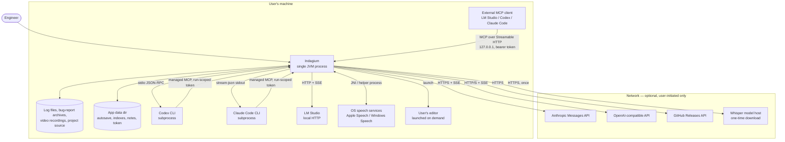

**Key.** Solid arrows are data flow; direction is who initiates. Everything inside `host` is on the
user's own machine. Every element in `net` is optional and reached only after an explicit user
action — none is contacted at startup except the GitHub release check, and only when
`autoCheckUpdates` is on in a packaged build (`Main.kt:206-208`).

Note the two inbound arrows at the bottom: when the user runs a **Codex account** or **Claude Code
account** AI profile, Indagium starts the CLI as a subprocess *and* stands up a private, run-scoped
MCP endpoint that the CLI connects back into. That loop is described in [§14.1](#141-control-server-mcp-and-rest)
and [§15.2](#152-ai-investigation-round-trip).

---

## 5. High-level component architecture

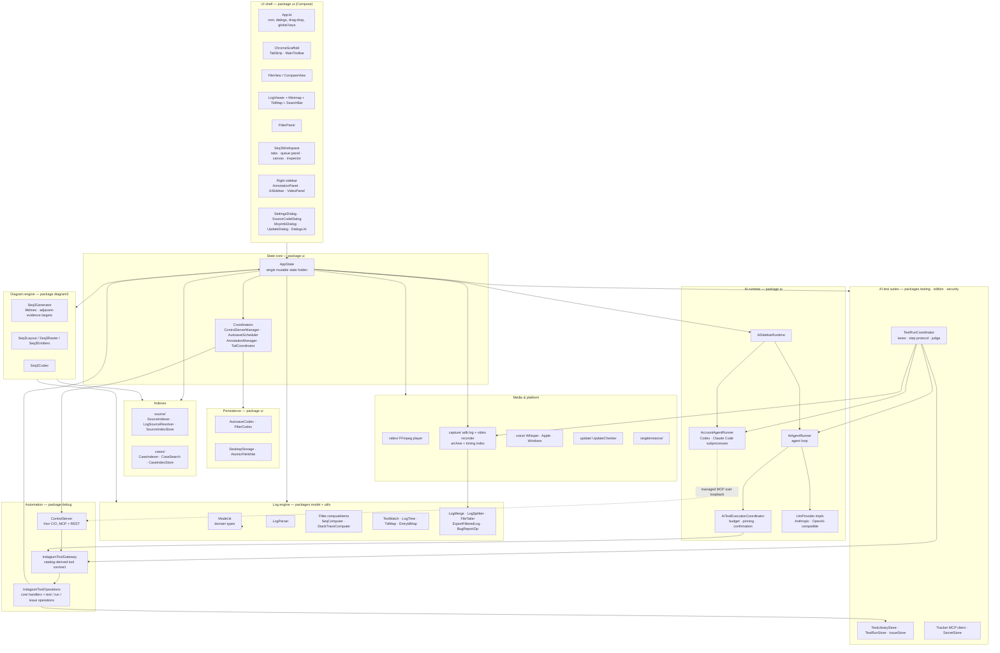

**Key.** Solid arrows are compile-time dependencies or direct calls. The single dashed arrow is a
network hop: account-based AI agents are separate OS processes, so they reach Indagium's tools over
HTTP rather than in-process.

Four things in this diagram are the load-bearing structural decisions:

1. **`AppState` is the hub.** Everything the user can change lives there, and every subsystem either
   reads it or is owned by it. There is no second source of truth.
2. **`IndagiumToolGateway` is a chokepoint.** MCP clients, REST clients, the in-app AI agent, and
   subprocess agents all reach application behaviour through the same versioned tool catalogue. See
   [§14.1](#141-control-server-mcp-and-rest).
3. **`AiToolExecutionCoordinator` sits below the model loop, not beside it.** Both the direct-API
   path and the subprocess-agent path pass through it, so the safety policy is enforced once
   (`ai/AiToolExecutionCoordinator.kt:31,37`).
4. **The AI test-suite engine owns its own scope and its own gateways.** `TestRunCoordinator` runs
   on a private IO scope and hands every lane, judge and tracker-filing agent a gateway holding only
   that agent's tools, rather than filtering the app's catalogue ([§26](#26-ai-test-suites)).

---

## 6. Module boundaries

Kotlin packages are the module boundary; there is no Gradle multi-project split. The rules below are
observed in the code and enforced by convention and review rather than by tooling.

| Package | Responsibility | May depend on | Must not depend on |
|---|---|---|---|
| `model` | All domain data types. No behaviour beyond trivial accessors and custom `equals`. | Compose `Color` only | Everything else |
| `utils` | Pure log-processing algorithms: parse, filter, fold, merge, split, export, tail, match. | `model` | `ui`, `ai`, `debug`, any Compose UI |
| `source` | Source-code indexing and log-line → call-site resolution. Pure text/regex, no compiler. | `model`, `utils` | `ui`, `ai`, `debug` |
| `diagram3` | UI-free sequence-diagram model, generator, layout, raster, text emitters, and note codec. | `model`, `utils`, `debug` (`Json.kt` only — see §7) | `ui`, `ai`, `source`, Compose UI |
| `cases` | Similarity index over previously written analysis notes. | `model`, `utils` | `ui`, `ai`, `debug` |
| `video` | FFmpeg-backed playback and frame grabbing. | `model` | `ui` |
| `capture` | Device capture adapters, session writing, versioned capture descriptors, ZIP export, and log/video timing records. | `utils` | Compose UI, viewer rendering, AI, and diagnostics UI |
| `testing` | AI test suites: library model, disk stores, edition limits, script runner, device lanes that record through real captures, run engine, judge, issue drafts, tracker client (§26). | `model`, `utils`, `capture`, `edition`, `security`, `ai` (agent launchers), `debug` (gateway type, `schema` DSL) | `ui`, Compose UI |
| `edition` | `Edition`, `EditionLimits` and the `EditionService` that holds the active edition. | — | Everything else |
| `security` | OS-keychain secret storage with a session-only fallback. | `ai` (log redaction), `testing.script` (the child-process runner) | `ui` |
| `voice` | Audio capture and the three transcription backends. | — | `ui` |
| `proofread` | UI-independent English spelling and grammar checks with UTF-16 ranges and Markdown/technical-text exclusions. | LanguageTool rules and dictionaries | `ui`, network services, app state |
| `update` | GitHub release check and asset download. | — | `ui` |
| `singleinstance` | File-lock + loopback-socket single-instance IPC. | — | Everything else |
| `debug` | Control server, tool catalogue, tool handlers, diagnostic logger. | `ui` (`AppState`), `model`, `utils`, `cases`, `diagram3`, `testing`, `edition` | Compose UI composables |
| `ai` | Provider clients, agent loop, tool-execution policy, managed MCP leases. | `debug` (gateway), `model`, `ui` (`AppState`) | Compose UI composables |
| `ui` | Compose UI, `AppState`, coordinators, persistence codecs. | Everything | — |

### 6.1 Boundary properties worth preserving

- **`model` and `utils` are UI-free.** The only Compose import is `androidx.compose.ui.graphics.Color`,
  used as a colour value type in `SequenceDef`, `Highlighter`, and friends. This is what allows the
  entire log engine to be unit-tested without a Compose harness.
- **`source` and `cases` are `AppState`-free.** `SourceIndexer` is a pure function of a file list
  (`source/SourceIndexer.kt:9-11`); `CaseIndexer` is a pure function of a directory list
  (`cases/CaseIndexer.kt:9-13`). `CaseSearch` takes its note directories as a **supplier lambda**
  rather than a value, so a settings change is picked up without reconstructing the object
  (`cases/CaseSearch.kt:38-44`).
- **`testing` is `AppState`-free.** The coordinator is built from plain lambdas (`CoordinatorDeps`,
  `testing/run/TestRunCoordinator.kt:62`) and the stores take a directory and an edition-limits
  lambda; `ui/TestRunWiring.kt` and `ui/TrackerWiring.kt` are the only places that connect it to
  `AppState`. `testing` never imports `ui`.
- **`debug/IndagiumToolOperations` is constructible without a server.** It takes an `AppState` and
  nothing else (`debug/IndagiumToolOperations.kt:63`), which is precisely why the in-app AI agent can
  reuse the identical tool contract without any HTTP involved.
- **UI leaf panels do not receive `AppState`.** `FilterPanel`, `LogViewer`, `AnnotationPanel`,
  `SearchBar`, `Minimap`, and `TidMapOverlay` take plain data plus callback lambdas. The binding is
  done by adapter composables — `BoundFilterPanel` (`ui/FileView.kt:32`) and the inline binding at
  `ui/FileView.kt:188-231`. See [§11.4](#114-the-bound-adapter-pattern) for the trade-off this makes.

### 6.2 Capture boundary and tab integration

`CaptureService` and `TabCaptureController` in `ui/CaptureCoordinator.kt` provide the UI-facing
boundary for the `capture` package. The service resolves user-supplied host `adb` and optional
`scrcpy`, discovers device states, recovers retained session directories, and exposes tool and
diagnostic status. A controller belongs to exactly one live capture tab and owns that tab's recorder
and archive-export lane. `AppState` enforces the one-live-capture invariant, publishes an empty
streaming tab before launching `adb logcat`, and uses `TailCoordinator` to append parsed rows while
the recorder writes the raw log.

The toolbar's Capture action focuses the existing live tab or creates a session-only **New capture**
launcher tab (the New tab, §6.3). The launcher lists devices, actionable tool errors, and non-recording retained
sessions. Starting a device closes the launcher and activates a normal `LogTab`; filters, selection,
folding, search, and Notes therefore operate on a live capture through the same viewer path as a
file-backed log. `LogTab.captureSessionId` marks an active stream and `isCaptureLauncher` marks the
ephemeral launcher. Both are intentionally excluded from autosave. A live tab renders a 46dp
capture strip and, when mirroring is enabled, an embedded device mirror in the right-sidebar capture
card (`ui/EmbeddedMirrorPanel.kt`, `capture/mirror/EmbeddedMirrorRuntime.kt`).

**Recording uses the embedded device transport, not host `scrcpy --record`.** When video is enabled,
`CaptureRecorder` owns `capture/mirror/EmbeddedDeviceSession.kt`, which deploys the checksum-pinned
scrcpy server over `adb forward` and parses its frame-meta stream. `ScrcpyPacketReader` preserves
presentation timestamps, configuration packets, and key-frame boundaries; `StreamingMkvWriter`
remuxes H.264 (default) or AV1 and optional Opus packets into the growing session MKV using FFmpeg. A cancellable reconnect
path maintains the video timeline across device interruptions, while resize/rotation parameter sets
are inserted before the next key frame.

When recording is active, `EmbeddedMirrorHandle.create(sharedSession=...)` attaches the mirror decoder
to that same packet stream; it does not open a second device transport. A bounded decoder feed drops
frames until the next key frame rather than blocking the recorder if rendering stalls. If video
recording is disabled, mirror-only mode opens its own embedded session. The host `scrcpy` executable
is only used for the separate external mirror window. The embedded preview uses VideoToolbox/Metal
on macOS. On Windows and Linux, the optional D3D11 or VAAPI/EGL native mirror is behind the
`hardwareMirror` preference (off by default); surface/decoder failures fall back to the Compose
renderer. These display paths do not own the recording session.

**Experimental device codec selection.** `CaptureSettings.videoCodec` is appended with a H.264
default in the JSON settings/session codec. Encoder discovery deploys an isolated, checksum-verified
bundled scrcpy server to a UUID path, runs `list_encoders=true` without opening a recording, and
cleans the host/device copies. Bounded adb calls run off the UI thread. The launcher displays
device-specific hardware/software/unknown acceleration and supports refreshing the result; capture
startup probes again before resolving an advanced request. Only an explicit hardware encoder is
accepted for AV1. H.265 is no longer offered (every Android device encodes H.264); a saved
`H265` setting decodes to H.264. Missing, software-only, or unconfirmed support falls back to H.264 with a
diagnostic. Successful discovery is a candidate check, not a guarantee that the requested dimensions
and profile can initialize. Advanced startup disables automatic downsizing and retries H.264 on
initial failure while preserving configured size, frame-rate limit, and bitrate.

The stream's actual codec selects the MKV codec ID and portable mirror decoder. HEVC streams (older
recordings) still use HEVC elementary-stream demuxing; Android AV1 frames use the low-overhead OBU demuxer, not AV1 Annex B.
AV1 configuration packets can contain an `av1C` record rather than OBUs: they configure container
extradata and must not be prepended to video frames or passed intact into the raw OBU decoder.
Decoder feeds extract any configuration OBUs after the four-byte record header; header-only
records contribute no decoder payload. H.26x configuration retains its existing in-band key-frame
concatenation behavior.
Advanced recording uses the Compose/JavaCV preview because the existing native mirror surfaces
accept H.264. Compressed packet observations carry the actual codec so authoring timeline segments
retain the same encoding. H.264 keeps its existing native display path and remains the migration,
recording, and external-tool default. Direct encoding does not lower bitrate automatically and
therefore does not promise a smaller recording at identical bitrate. macOS/emulator checks cover
software device AV1 fixtures and conservative fallback; physical hardware encoding remains to be
validated per device.

The `capture` package owns process adapters, session metadata and recovery, raw log/index writing,
screenshots, disk guards, ZIP range export, timing records, and the versioned
`capture.indagium.json` codec. It has no Compose rendering, viewer state, AI, or diagnostics UI
dependency. Capture settings are persisted as the user changes them; recorder configuration is read
when a new capture starts, while mirror display controls such as live volume remain available during
a session. The settings surface covers tool paths, adb buffer mode, video/audio options, limits,
naming, storage, and diagnostics.

**Wi-Fi pairing** (`capture/WirelessAdb.kt`, `capture/WirelessPairingFlow.kt`,
`ui/WirelessPairingDialogs.kt`) attaches an Android 11+ phone over Wireless debugging. It depends on
adb's mDNS backend (`adb mdns check`/`services`): `CaptureService.refreshDevices` piggybacks one
best-effort mDNS listing on its existing poll, and a phone on its pairing screen appears as an inline
"Ready to pair" row (never an automatic modal). mDNS failure is logged only; it never sets `error` or
clears `devices`, since networks with AP isolation block mDNS while USB capture is unaffected. Pairing
is either a typed 6-digit code (`adb pair host:port code`; the address is editable, which is the manual
fallback when mDNS is blocked) or a QR code (ZXing `core`, Android Studio's `WIFI:T:ADB;S:name;P:pw;;`
payload) whose per-dialog random name the phone advertises once it scans. After a successful pair
adb's own mDNS auto-connect normally attaches the phone, so `WirelessPairingFlow` watches the device
list first and only then falls back to `adb connect` (connecting explicitly while auto-connect also
runs creates a duplicate `ip:port` entry). Neither `adb pair` nor `adb connect` is trusted on exit
code; success is judged on their output. The pairing code and QR password travel only as argv of the
one adb process (there is no runner-level or capture-diagnostics logging of argv) and
`QrPairingCredentials.toString` redacts the password. A wireless device is recognised purely from its
serial (`CaptureDevice.wireless`), so no persisted format changed.

The descriptor is the hand-off between capture and review. Portable archive v5 extends v3's ZIP
layout: `capture.indagium.json`, `logcat.log`, optional `screen.mp4` (or MKV when needed to retain
audio), optional notes/markers and screenshots, and `captured_with_indagium.txt`. The descriptor
stores checksums, actual video coverage, and structured device-availability intervals.
`timeline/sync.json` contains half-open clock-segment row bounds, reference log timestamps,
capture-elapsed anchors, reliability, and timeline bounds. `mapping/blocks.jsonl` contains sparse
byte/row checkpoints and capture-time bounds; each block also records `settled` (appended, optional): true only when
every row was resolved through its segment's final anchor when written. A row logged before the anchor existed (startup
window, after a reconnect or clock jump), during an unconfirmed clock jump, a synthetic row or a recovered row only
contributes its arrival time, so the settled anchor can resolve it outside that block's envelope. Window queries (time-range
export and preview, the marker ordinal window) therefore always scan blocks that are not settled (and, as before, blocks
under a manual anchor), filtering per row; the preview envelope shortcut skips them too; a block with no `settled` field
(unknown) counts as not settled. Synchronization derives row time from the log
timestamp and the matching reliable segment; missing or uncertain timestamps never inherit a
neighbor's video time. New files contain no persisted per-row JSON timing map. Child exports
rebase row/byte boundaries and timing while clipping availability and notes to the selection.
Opening an archive verifies its assets and creates an ordinary log tab with linked video.
Legacy adapters preserve v1/v2 mappings, v3 single-anchor behavior, and v4 per-row timelines.
New v5 archives require the updated reader; no legacy-export mode is added.

Automatic anchors use the existing estimator on at most 256 eligible observations or two seconds.
Buffered history and synthetic availability markers do not establish device-clock anchors.
Reconnection/reboot starts a new segment. An offset change of at least one second, sustained across
five observations spanning at least one second, makes the transition uncertain until a stable
anchor is available. Manual links correct the selected segment and persist through restore/export.
Block writers close after 1,024 counted rows, 1 MiB, or one second, whichever occurs first, without
empty blocks. Block clock context permits range scans to resume without parsing the whole prefix.
Timing resolution is shared by playback, navigation, marker/range selection, and export; imported
captures must not recreate a dense per-row JSON cache. In memory, `CaptureTimingResolver` keeps
primitive columns (playhead key, elapsed, presence/reliability bitsets) and `CaptureTimelineIndex`
one search-key array, building `Point`s on demand (about 25 MiB per million rows). `AppState`
builds a tab's index on `ioScope`, keyed by the identity of its log, timeline and manual anchors,
never on the EDT or under `stateLock`: there `captureTimelineIndex` returns null and queues the
build, Follow reports `FollowMappingStatus.INDEX_PENDING`, and a `captureIndexVersion` state bump
recomposes the video panel when it publishes. Presence of a capture link is `hasCaptureTimeline`,
never a non-null index; off-EDT callers (MCP tools) build inline or join the running build.
The reproducible million-row fixture and size/navigation measurements are documented in
[`CAPTURE_METADATA_BENCHMARK.md`](CAPTURE_METADATA_BENCHMARK.md).

**Compact capture archives.** `CaptureExportRequest.format` defaults to `CaptureExportFormat.ZIP`
(`"zip"`); the opt-in `COMPACT` format (`"ind"`) writes `<name>.ind` using the same v5 ZIP
layout and reader. Compact is an Indagium format (zstd log, AV1-in-MKV video that standard tools
cannot extract or play), so it does not use a `.zip` name; GitHub issue attachments do not accept
`.ind`, so zip it first or use the ZIP export. `.ind.zip` files from an earlier build of this branch
still open because archive detection is by content; recents classify both `zip` and `ind` as archives,
and `captureArchiveTitle` strips `.ind.zip`, `.zip` and `.ind` for the tab title. Snapshot exports expose a format selector, while stopped/retained saves add Save
Compact beside Save ZIP. Compact does not require video: an archive without video is valid. AI tools
and issue attachments retain their default ZIP requests.

Two things differ from a ZIP export. (1) The log: `CaptureArchiveZipWriter` (commons-compress
`ZipArchiveOutputStream(Path)`, `Zip64Mode.AsNeeded`, deterministic entry time 0, per-entry DEFLATE
level with already-compressed media at `NO_COMPRESSION`) normally stores `logcat.log` with DEFLATE.
For Compact the exporter first compresses it with zstd level 12 (`CaptureArchiveLogCodec.ZSTD`;
workers = cpus-1 clamped to 1..4) into a temp file in the export work directory and adds it with
`addRawArchiveEntry` as ZIP method 93, carrying the uncompressed CRC and size. On a dev logcat DEFLATE
reaches about 8.7x and zstd-12 about 29x. `CaptureZstd.isAvailable` (`utils/CaptureZstd.kt`) probes
the zstd-jni native load, which fails with a `LinkageError` rather than an `Exception`; when it is
unavailable Compact falls back to DEFLATE and the result message says the log was stored with
DEFLATE. (2) The video: `chooseCompactVideo` picks it once, after the staged range export and before
notes, the `captured_with_indagium.txt` blurb, the video asset and the descriptor are produced, so
those are written a single time. Outcomes: `NO_VIDEO`; `PASSTHROUGH_AV1` (the immutable staged clip is
already AV1, so `FfmpegAv1CompactVideoTranscoder.copyAlreadyAv1` remuxes it into `screen.mkv` without
the encoder); `ENCODED_AV1` (transcode to `.compact-screen.mkv`, used only when strictly smaller than
the staged video, then published as `screen.mkv`); `KEPT_ORIGINAL_NOT_SMALLER` (the encoded file is
discarded and `screen.mp4`/`screen.mkv` ships as staged); `KEPT_ORIGINAL_ENCODER_UNAVAILABLE`
(`ensureAvailable()` threw `IOException`, original kept). Comparing only the video is sufficient
because every other entry is identical between the ZIP and Compact variants, so the earlier exact
ZIP-size comparison (`countBytes`/counting sink) and its "not smaller, so no archive" gate no longer
exist. Transcoder errors and cancellation still fail the export. Each outcome has its own result
message, and the `.mkv` audio note is added whenever the original video ships. Exact-start rendering
or availability cards can still produce H.264 staging, which then takes the encode-and-compare path.

`FfmpegAv1CompactVideoTranscoder` encodes through bundled `libsvtav1` at CRF 28, preset 10 (SVT-AV1
3.1.2 maps presets 11-13 to 10, so 10 is the ceiling; presets 9 and above disable the screen-content
tools), with millisecond presentation times and unchanged dimensions. SVT's `lp` is a level of
parallelism (0-6; larger values warn and clamp to 6), so the encoder worker count is capped at six
and a single-processor machine uses one; level 6 already keeps about nine of ten cores busy. Decoder
concurrency stays at two. A keyframe is forced at 10 s of source time or after
300 video frames since the previous keyframe, whichever comes first; the frame cap keeps JavaCV
`setTimestamp`'s 1000-grab window (audio plus video) safe, and `gop_size = min(fps x 10 s, 300)`.
The bytedeco macOS arm64 SVT-AV1 is a C-only build (its log reports "asm level selected : up to c"),
roughly five times slower than a Homebrew NEON build, so the preset is the only effective speed
lever: on synthetic emulator-style clips (mostly static UI with scroll bursts, 10 s keyframes) preset 10
ran 3.3x faster than preset 8 at 720x1600 (about 8x realtime versus 2.5x) and 2.7x faster at
1080x2400 (3.5x versus 1.3x), for 10-14% more bytes and mean SSIM 0.997-0.998 versus 0.998-0.999.
Skipping the same-format `sws_scale` copy, four decoder threads and other SVT knobs (`enable-tf`,
`enable-tpl-la`, tiles, `lookahead`, `fast-decode`, ...) made no measurable difference. A 2 s
keyframe interval, not the preset, is what once produced 52.8% of the source size. `transcode`
reports the fraction of source duration encoded (frame PTS over container duration, monotonic,
ending at exactly 1.0) through an optional callback; `chooseCompactVideo` turns it into the status
"Encoding AV1 video… NN%", emitted only when the whole percent changes and at most four times a
second. Video-only sources publish the encoded MKV directly, retaining source metadata and
aspect/frame-rate rationals; a separate packet-mux pass runs only when audio or auxiliary streams
need copying into `screen.mkv`. Working-space preflight reserves a second copy of the log (zstd temp
file included) plus the transcoded video. Cancellation and failures clean conversion/archive staging;
callers advance save checkpoints only after successful publication.

Reading. `zstd-jni` 1.5.7-4 supplies the codec to commons-compress, with the per-platform classifier
jar selected like the bytedeco natives (`zstdJniPlatform`, `build.gradle.kts`). The JDK's
`java.util.zip.ZipFile` rejects an archive when any entry uses method 93, so `ArchiveFormat.isValidZip`
tries the JDK first and falls back to commons `ZipFile`, and `BugReportZip` scan, extract and stream
use commons `ZipFile`; this keeps candidate scans, note video frames and the plain-archive fallback
working on Compact archives. `CaptureArchiveReader` maps a `LinkageError` raised while decoding a
zstd entry to a `CaptureArchiveException` ("uses zstd compression, which could not be loaded on this
system"), because `AppState` catches `Exception` only. A bare `.zst` file stays `Unsupported`.

Accepted limitations. Re-cutting an imported Compact archive that has audio can start up to about
10 s before the requested start, because the copy begins at the preceding keyframe. Video-only
exact-start cuts of an AV1 source re-encode to H.264 and then to AV1 again (generation loss).
commons-compress writes "version needed to extract" 1.0 for the method-93 entry, which mainstream
readers ignore. Standard unzip tools (macOS Archive Utility, Windows Explorer, Info-ZIP `unzip`)
cannot extract the zstd log, while 7-Zip-zstd, libarchive-based tools and Indagium can; the archive's
`captured_with_indagium.txt` says so. This path targets macOS validation; other shipped platforms
require separate native encoding/playback verification.

A new retained working session directory contains `logs/logcat.log`, `mapping/blocks.jsonl`,
`timeline/sync.json`, `video/screen.mkv`, screenshots, session metadata, and the finalized portable
descriptor. Its storage version distinguishes this layout from legacy sessions with
`mapping/capture-index.jsonl`: `session.json.storageVersion = 2`; an absent version selects the
legacy layout. Existing source sessions and archives are never automatically rewritten.
A live snapshot flushes the active block and freezes log bytes, block records, and timing metadata
under the recorder lock, then exports all history, a time range, since the last
successful save, or the contiguous interval between the first and last selected capture rows, and
leaves the recorder running. Exact byte/row save cursors advance monotonically only after successful
publication. Uncertain time-range selection includes overlapping blocks with a boundary notice;
explicit row selection remains exact, and the requested video interval does not expand. Recovery
scans an unindexed complete-log tail as uncertain rather than inventing synchronization.
Cancellation or failure leaves the capture active. Video export chooses
a readable preceding keyframe where available; the descriptor reports actual coverage instead of
implying video spans the full log interval. Screenshots are stored in the session and added to Notes
with video-frame provenance when available.
Since-last-save keeps **independent log and video coverage** on `CaptureSession`:
new sessions use exact byte/row log cursors alongside `snapshotCheckpointMs`, while
`videoCheckpointMs` advances only when an export actually produced video. The
log cursor consists of exclusive `logCheckpointByteOffset` and inclusive `logCheckpointRowOrdinal`.
Both survive session restore and imported-capture checkpoint persistence. The
video range's start is `min(logCheckpoint, videoCheckpoint)` when a video checkpoint exists, so a
snapshot whose video still lags the log (StreamingMkvWriter's Matroska muxer only flushes a cluster
when it closes — bounded to roughly a second now, see above, but still not instant) is recovered by
the next snapshot instead of silently dropped; both cursors round-trip through `session.json`
(`CaptureRecorder.sessionJson`/`sessionFromJson`), which still accepts the pre-split file shape (no
`videoCheckpointMs` key) for backward compatibility. `FfmpegCaptureVideoExporter` additionally
re-encodes (rather than remuxing from a keyframe) when the preceding keyframe is more than 500ms
before the requested start, using whichever bundled H.264 encoder is available at runtime
(`libopenh264`, `libx264`, then `h264_videotoolbox`, probed in that order; falls back to the
keyframe-aligned remux if none is available) so a since-save export starts at (or within one frame
of) what was actually requested instead of always restarting from the recording's first keyframe.
`CaptureArchiveExporter.export` also waits (bounded, `DEFAULT_VIDEO_COVERAGE_WAIT_MS` — 2s in
production now that StreamingMkvWriter keeps the file close to real time, was 8s against host
scrcpy's laggier muxer; 0/disabled by default so tests aren't affected) for a still-recording
session's video to catch up to the requested end before snapshotting it, and its preview lane uses a
cheap copy+scan probe (`CaptureVideoCoverageProbe`, cached by source file length) instead of a full
copy+remux so the snapshot popover's debounced polling stays lightweight.

Stop drains tailing and finalizes the v5 descriptor in the retained session directory; the session
index remains beside the raw log and video. The ordinary player then lets log rows and video seek one
another, while a later Save ZIP writes the separate flat portable layout. If the application exits before Stop, the recorder marks its directory interrupted; the
next launcher lists it for recovery. Live recorder/launcher markers are not restored as active
state, while a finalized descriptor link is durable and reopens as a normal capture-backed tab.

**Test-run lane captures** are the one case where a second controller records beside the user's
capture. An AI test run records each lane through the same `TabCaptureController`, start path and
archive code (§26.5.5); `LogTab.testLane` marks such a tab, `AppState.liveCaptureTabId` ignores it, so
the one-live-capture rule above stays exactly as it was for every manual flow (toolbar, launcher, the
device AI tools), and a per-device claim under `stateLock` keeps lanes and manual captures off the same
phone.

**Availability and offline review.** Device availability is independent of the recorder lifecycle:
a transport outage leaves the recorder `RECORDING`, retaining its device claim and lane ownership.
Logcat and embedded-video reconnect work runs in the background with cancellable backoff capped at
five seconds. Logcat resumes as soon as ADB is usable; completed Android boot is a separate AI-tool
condition. `CaptureAvailabilityInterval` stores monotonic start/end times and best-effort boot
identity evidence in session JSON and archive v4/v5. Recovery stays on the original ADB serial;
changed wireless endpoints are not automatically rebound because existing session metadata lacks a
verified stable hardware identity. Optional indexed log transitions and video cards
are controlled by keyed JSON settings; disabling their presentation does not remove interval data.
Stop while offline retains the trailing gap. Playback uses the session timeline, and gap-aware
video export renders unavailable cards without compressing that elapsed interval.
The raw-media player preserves a requested seek position inside sparse video PTS intervals, holding
the preceding image while the playback clock traverses the gap. Paused preview scans do not feed
audio; decoding resumes from the requested position. The same resolver serves headless frame grabs,
so raw capture playback does not depend on exporting placeholder frames first.
After a seek the playback clock stays frozen at the seek position until the decode thread has
actually reached it (the first frame at or after the target; JavaCV's cached first frame after
`setTimestamp` does not count, since the demuxer can still sit back at the previous keyframe), so
catch-up through a long GOP cannot make the first frames arrive late. A frame the drop logic picks
for display is shown even if the published position already ran ahead of it; the position never
moves backwards. Availability exports re-encode with a keyframe about every two seconds so that
catch-up stays short.
The Device events control presents those structured intervals independently of marker-row
presentation. Confirmed reboot labels come from interval evidence; optional log jumps require
matching transition rows and preserve the difference between row ordinals and parsed entry IDs.
FileView collects one per-tab event model for the capture-bar pill and the existing FilterPanel
Issues category dropdown. Device events appear only in their dedicated category; All and Android
issue categories exclude event rows and counts, without a separate section or badge. Those surfaces share incremental background marker scanning. Event navigation preserves
filters and Original-panel visibility and reports when a matching row is hidden by the filter.

`DeviceLoggingConfiguration` retains only logging buffer sizes and global/per-tag `log.tag` values
in keyed, local session metadata. Unknown reads remain distinct from known empty/default values. Buffer parsing accepts Android
consumed/readable metrics; bounded getprop parsing accepts unrelated multiline property values.
A typed, replay-one restoration event triggers one ownership-checked actual device readback.
Capture start reads the actual device state off the UI thread; successful in-session changes update
the intended values. Start rechecks application/controller ownership after those blocking reads
and before publication so shutdown cannot launch a recorder from a stale start request.
Recovery restores known values only on verified reboot/restart evidence,
preserving early buffered log rows before a potentially destructive buffer resize. Ordinary
same-boot reconnects do not overwrite device settings, and restoration never escalates to adb root
automatically. Probe/write failures are bounded and diagnostic; they do not finalize the capture.
Restoration has its own cancellable worker so setting writes cannot block the log stream's stdout
reader; Stop interrupts and joins that worker. Recovery waits up to 120 seconds for Android boot
completion, then uses a 30-second apply/readback budget requiring 10 seconds of matching samples
(at 500 ms intervals). Each write rechecks the latest saved target. Verification repairs boot-time
overwrites such as the emulator’s asynchronous `logcat -G 2M` initialization. Success requires
verified values; readback and stabilization failures remain diagnostic. Complete buffered rows are made durable before any
resize, and a truncated drain leaves buffer sizes unchanged.
Ordinary reconnects use the device-log cursor and timestamp occurrence counts. Same-identity
emulator restarts are identified by uptime or sampled UTC device-clock rollback relative to the
monotonic session clock. Exact SHA-256 row occurrence quotas suppress Quick Boot replay independently
of log-buffer ordering, preserving additional occurrences and unmatched rows. A bounded FIFO retains
recent fingerprints; on overflow, a cancellable streamed scan of the fixed pre-gap log boundary
counts only bounded drain candidates. Drain sampling uses a 32 MiB minimum and a formatting margin
for known buffer sizes, capped at 128 MiB. Limit failures are diagnostic and preserve uncovered rows.
A failed same-identity restart drain retries before resuming; an inspected empty ring clears the old
cursor. Confirmed new boots retain early-boot messages even when text matches a previous boot.

The snapshot range resolver accepts explicit elapsed start/end bounds in addition to the original
presets. Live, stopped, and imported capture tabs share preview/export behavior; imported archives
use local export metadata so their source ZIP remains immutable. Save checkpoints advance only on
successful export and never move backward for an earlier cut. The independent log/video checkpoint
rule above remains necessary for a growing recording whose media lags its log stream.
The snapshot editor checks Since-last-save eligibility against that preset's own cutoff, even
while another preset is selected. Stopped playhead changes invalidate coverage previews; live
cutoffs share a stable preview identity and refresh on a bounded timer so recorder updates cannot
starve a slow probe. Save requires actual rows, readable video, or availability evidence, with a
final exporter check before publication. While the editor is open, it owns the visible progress
and result; the stopped strip suppresses its duplicate status.
Popup visibility does not own the export job. Dismissal cancels only preview work, leaving export
ownership, completion status, and Save-and-open intent with AppState. Explicit export cancellation
has its own status and does not advance checkpoints. Imported archives expose the range editor
through the log Export menu instead of rendering a stopped-recording strip.

On macOS, Windows, and Linux (x86 or ARM), host `adb` and optional `scrcpy` are resolved from the
normal platform installation. A Linux Flatpak launch uses `flatpak-spawn --host --watch-bus` for
those host tools and requires only the `org.freedesktop.Flatpak` talk permission. Automated tests
cover process, archive, persistence, settings, selection bounds, cancellation, and mapping paths;
they do not prove Compose layout fidelity, and live device/scrcpy verification across all supported
platforms is unavailable in the current environment.

### 6.3 The New tab: a tiling launcher

The New tab (`HomeScreen`, `ui/HomeScreen.kt`; the same session-only tab that §6.2 calls the capture launcher) is a
window-manager-style host of three sections, `HomeSectionId` `OPEN` (Open a log, `HomeOpenZone`), `CAPTURE`
(`HomeCaptureSection`) and `TESTS` (`HomeTestsSection`, §26.15). `HomeScreen` only builds one `HomeSectionSlot` (icon, title,
optional header action, body) per section and hands them to `HomeTilingHost` (`ui/HomeTiling.kt`).

- **Model.** The arrangement is a split tree in `AppSettings.homeLayout` (`model/Model.kt`): `HomeLayoutLeaf(section, weight)` and
  `HomeLayoutSplit(axis, children, weight)`, axis `ROW` or `COLUMN`. The default is `COLUMN[ROW[open, capture] at 1.6, tests at 1]`
  (`DEFAULT_HOME_LAYOUT`). Hidden sections live in `homeHiddenSections` and are kept out of the tree until restored. `ui/HomeLayout.kt`
  is UI-free: normalisation (empty splits dropped, single-child splits collapsed, same-axis child splits flattened), `dropHomeSection`,
  `resizeHomeSplit` (the neighbour pair's total weight is constant; clamped to `HOME_MIN_PAIR_SHARE` and `HOME_MIN_SECTION_DP`),
  `homeGeometry` (the one source of card and gap rectangles for layout, drop overlay and preset icons),
  `homeDropTargetAt` (page-edge bands win over the card under the pointer), the five `HomeLayoutPreset`s and the `AppSettings.withHome*`
  mutators (`withHomeSectionHidden` refuses to hide the last visible section; `withHomeSectionShown` re-adds at the trailing page
  edge). The settings JSON codec is `ui/HomeLayoutSettingsJson.kt` (§13.4).
- **Moving a section is a manual pointer drag, not Compose or AWT drag-and-drop.** The card's grip uses `detectMoveDragGestures`
  (`ui/AppCursors.kt`) and an overlay draws the drop preview, label and the "Full width"/"Full height" page strips. A manual drag never
  reaches the window's file-drop target (`App.kt`), the overlay can follow the pointer live, and a UI test can drive it. A drop is one
  `updateSettings`.
- **Splitters commit once, and are never drawn.** `HDivider`/`VDivider` (with `showLine = false` in tiling surfaces) drags edit only an in-memory
  `draft` layout and write settings on release (`onDragEnd`), because `AppState.updateSettings` autosaves synchronously. A focused splitter also
  resizes by 24 dp per arrow key; a double-click resets. The splitter has no line at rest, hovered or dragged (only its hit area, the resize cursor
  and the keyboard focus ring), and tile headers show no size readout: the gap between the cards is all that separates them. The window chrome's
  `ChromeSplitter` is invisible the same way.
- **Fixed composition order.** The host's custom `Layout` receives its children flat, one `key(id)` per section in enum order, each
  measured to its rect. Moving a section changes only its rect, so its remembered state and effects (the device poll, pairing dialogs,
  filters) survive. Nested `Row`/`Column` would recompose it from scratch.
- **Hidden means not composed.** A hidden section has no rect and is not composed, so a hidden Capture section does not poll adb
  (the 3 s poll is a `LaunchedEffect` inside `HomeCaptureSection`). A "Hidden:" chip in the top bar restores it.
- **Narrow windows.** Below `HOME_STACK_BELOW_DP` (720 dp) the sections stack in one vertical scroll in tree order, each at 75% of the
  viewport height clamped to 320-560 dp; grips and splitters are off, hide and presets still work.
- **Presets and tip.** The top bar shows a mini-icon per preset (drawn from `homeGeometry`; the active one is `isActiveIn`) and a
  dismissible tip (`homeLayoutTipDismissed`); once dismissed, a "?" button shows it again.

The Capture section is condensed: a device row (status, Refresh, pairing and tools actions, a picker when several devices are
attached), a one-line summary of the recording options (`captureSettingsSummary`) with "Change…" opening `CaptureOptionsDialog`
(`CaptureStartOptions` in a 640 dp dialog, plus "All capture settings…" which calls `AppState.openCaptureSettings`), device logging,
Start capture with the reason when it is disabled (`captureStartBlockedHint`), and the full unfinished-sessions panel inline
(`UnfinishedSessionsInline`: today's `UnfinishedSessionsSection` with select all, delete selected and every row's actions; the list
scrolls inside 320 dp, and an "Open in window…" link in the panel header shows the same panel in a dialog).

The Tests section's actions that open the Tests tab pass their New tab to `AppState.openTestsTab(closeLauncherTabId)`, which closes it
once Tests is active (like a started capture or opened file). `surfaceBeforeTests` then points at the last remaining log tab, never at
the closed New tab; closing Tests with nothing else open leaves the empty state that `ensureHomeTab` refills.

### 6.4 Log view tiling

The single (non-compare) log view is a tiling surface: the filter panel's eight sections, Original, Log, Notes, the Diagram library,
AI and Video are tiles of one `TilingSurface` (`ui/TilingHost.kt`, the generic host also behind the New tab, §6.3) laid out by the
generic engine in `ui/TileLayout.kt` (`TileNode<K>` trees, `tileGeometry`, `dropTile`, `resizeProjected`, `projectTileLayout`).
The compare view runs on the same surface with four log tiles (`LOG_A`/`LOG_B`/`ORIGINAL_A`/`ORIGINAL_B`, see "Compare on tiles" below).

- **Model.** `LogViewSectionId` (`model/Model.kt`) names every tile with its tab-strip group (`LogViewTileGroup`: filters, notes, AI,
  video, or none for the log tiles) and scope. `ui/LogViewLayout.kt` is UI-free: the presets (`LogViewLayoutPreset` Classic, Review,
  Log focus, Filters on top, derived from `LogViewLegacySizes`), `effectiveLogViewLayout` (the stored tree, else Classic from the legacy
  `filterPanelWidth`/`annotationPanelWidth`/`rightSidebarSplit`), applicability and visibility (`logViewTileVisible` =
  applicable AND its group flag on AND not in `logViewHidden`), `sanitizeLogViewLayoutState` (a stored tree always holds every tile
  once; missing tiles return at default anchors) and the `AppSettings.withLogView*` mutators.
- **Host.** `LogViewTilingHost` (`ui/LogViewTiling.kt`) replaces FileView's former `Row`. It measures itself with `onSizeChanged`, never
  `BoxWithConstraints`: that is a `SubcomposeLayout`, and the Popup-based dropdowns of the AI and filter panels have thrown "layouts are
  not part of the same hierarchy" inside one (`TileStackedSurface` measures the same way). Below `LOG_VIEW_STACK_BELOW_DP` (720 dp)
  the tiles stack in one scroll (no grips or splitters). Layout edits (a drop, a splitter release, an arrow-key resize) reach
  `AppState.commitLogViewLayout` once, on release.
- **Scrolling side columns.** A COLUMN split whose visible leaves all satisfy `logViewScrollsInColumn` (the side sections, Video, and the toolbar tile; not the log tiles
  or Originals) is not made to fit the window. Both Classic sidebars can therefore scroll, including the right sidebar with Video present.
  The Video body remains `FILL` and receives its card's bounded height; scrolling the outer column does not introduce an inner player scroll.
  A lone expanded, explicitly sized tile keeps its chosen height when its neighbors are collapsed, so Video's splitter remains effective in that state.
  A Video tile dropped alone beside the main view stays a fitting tile (`logViewLoneColumn(VIDEO)` is false); maximizing it also fills the viewport.
  The toolbar tile is a `CONTENT` tile there (next bullets), so a column that holds it scrolls like any other and the toolbar may scroll out of view in it,
  which is the user's choice; excluding it used to turn that column into a fit column, where pinned sizes and minimum heights left tiles that could not be
  resized. The surface passes the predicate through `TileChromeSpec.scrolls`; `tileGeometry` then reports a `TileScrollRegion` (viewport, content height) and lays the
  column's children out by height. A tile is as tall as its content asks (next bullet); a tile that reports nothing keeps the older rule: its own
  `sizeDp` is its height (at least 80 dp, at most 2000 dp, `LOG_VIEW_PIN_MIN_DP` / `_MAX_DP`) and weighted children share what the pinned ones leave
  (`minTileDp` each at the least), so an old layout looks the same until it is resized. A collapsed tile keeps its 32 dp header. Taller content
  scrolls: wheel / trackpad over any card, splitter or the thin `TileRegionScrollbar` (`tile-scrollbar-<first tile key>`).
  **The scrollbar lives in the gap beside the column, never in it.** The cards of a column are as wide whether or not it overflows (an overflow-dependent width
  would change how their content wraps and so how tall it is, which decides the overflow: a loop and a visible jump), so the bar is drawn where there is
  room anyway, `tileScrollbarRect`: centred in the 8 dp column gap to the next column (1 dp clearance, the 6 dp bar, 1 dp), and only while the column
  overflows. A column that ends at the window's right edge uses the host padding there, which is 6 dp, so the surface is given it
  (`TileChromeSpec.scrollEdgeRoomDp` = `LOG_VIEW_HOST_PAD_DP`; `LogViewTilingFrame` pads the host on three sides and `TilingSurface` lays the tiles out
  in the width less that room, `TileScrollRegion.roomRightDp` says how much room a column has) and the bar is a 4 dp one there (the same 1 dp clearance); a
  surface with no room at all (`scrollEdgeRoomDp` 0, the tests') draws it over the column's right edge. Equal visible gaps follow: the gap left of the log
  and the gap right of it are both 8 dp with or without a bar, and the window margin is 6 dp on every side. The bar shares that strip with the column's width
  splitter, and **only its thumb takes the pointer** (`TileScrollbar.kt`: `TileRegionScrollbar`, the pure `tileScrollbarThumb` / `tileScrollbarGrab` /
  `tileScrollbarOffsetDelta`): the track is drawing only, with no hit area and no click-to-jump, so a press on the strip above or below the thumb falls through
  to the splitter (resize cursor, drag to resize, double-click to reset, written on release). The thumb plus `TILE_SCROLLBAR_GRAB_MARGIN_DP` (2 dp) above and
  below is the bar's hit area: a drag there scrolls (pixel deltas divided by the density, the thumb's travel mapped onto the content's range) and so does the
  wheel. A column that overflows only slightly has a thumb nearly as tall as the strip, and then little of the strip is left to the splitter (the arrow keys
  on the focused splitter always work). The last tile in each scrolling column has an end splitter as well. When the column reaches the host bottom,
  `LogViewTilingFrame` keeps a 6 dp gutter inside the surface but outside the scroll viewport: a full-height side card and its scrollbar end at the Log's
  bottom, while the end splitter remains hit-testable in that gutter. The gutter is excluded from `TileScrollRegion.contentHeight`, so a fitting column gains
  no artificial scroll range; the end splitter follows the column when it is scrolled and can resize its last tile at the bottom of the range.
  A detached video player keeps its window by staying composed: the host *parks* the Video tile (0 x 0) when the player reports it left the sidebar.
  A capture tab keeps its per-device video height: Video is pinned to `captureMirrorLayouts[device].videoSplit` x the host height while
  the tab is active, and resizing Video writes the per-device layout, never the global one.
- **The Diagram library is a standalone tile, never an inline Notes section.** Classic shows it collapsed at the top of the right sidebar above Notes; the Layout menu can hide or restore it.
  `DiagramLibraryTile` owns the saved-diagram list and the `+ diagram` menu (From selection / From notes / Empty diagram); its `FLEX` body makes the list scroll inside
  its viewport and lets the tile's end splitter resize that viewport. Hiding the tile removes the library without changing Notes, which retains the
  source-linked diagram-note controls. Empty diagram immediately saves a blank draft, does not scan the source log, and starts with no participants,
  messages, or log evidence. The source tab only determines library organization and a possible explicit later regeneration; the workspace identifies
  this source-free document as “Manual diagram”.
- **Toolbars at the top of a tile's body share one look** (`ui/TileToolbarStyle.kt`). The log toolbar is the Log tile's header; the Notes actions (Preview, Copy ▾, Save,
  New, Locate log…, Open ▾) are the Notes tile's header too (`ui/NotesHeaderActions.kt`, `NotesActionButtons`): one row, grip, icon, "Notes", "3 notes", the buttons, then
  the header icons, laid out by `notesHeaderLayout` (`ui/NotesHeaderLayout.kt`, pure, `NotesHeaderLayoutTest`). **The text gives way before any button does.** As the card
  narrows (card widths in dp, Notes with no Locate log… and no recent notes): the "3 notes" summary goes under 567, the "Notes" title text under 509 (the icon
  stays), the buttons then get smaller, as compact labels (6 dp padding instead of 10) under 463 and as icon buttons with tooltips (the log toolbar's narrow form;
  Copy's icon follows Copied!/failed) under 426; only under 334 does the least needed button move into the "⋯" menu (`notes-actions-overflow`), in the order
  Locate log…, Open, New, Save (a single fold saves nothing next to its own icon, so Open and New go together: 301 to 333; Open, New and Save: 268 to 300; Open
  alone is the first fold once Open has the recent-notes arrow, under 352), and under 268 Preview and Copy ▾ too (everything is in the menu, which has room for the
  title and the summary again). The default right column (350 to 360 dp, a card of about 347 to 357) shows all five buttons as icons; with Locate log… (a tab
  without a log) and recent notes Locate log… and Open fold under 385, and with recent notes alone Open folds under 352. The generic header supports that through `TileSlot.headerParts` (which parts fit),
  `TileSlot.actionsFollowTitle` (the action follows the title; the free room is after it) and `LocalTileHeaderWidthDp`. The tile owns the Copy feedback
  (`rememberCopyFeedback`) and hands it to the panel (`BoundAnnotationPanel(actionsInHeader = true, copyFeedbackState)`), which then leaves its own bar out
  (`AnnotationPanel` used on its own still draws the bar, tag `notes-toolbar`, with a hairline under it, as before). The buttons are the log toolbar's
  `AppButton`s (outlined, rounded, transparent on the card, natural height) `TILE_HEADER_GAP_DP` apart, and every click or dismissed popup (the Copy format menu,
  the recent notes list) hands the keyboard back to the panel's `FocusRequester`. The AI composer follows the same style
  but is not a toolbar: it sits on the card (tag `ai-composer`, no band or border) as the tile's fixed part below the conversation, with a text field
  (0.5 dp border, `CORNER_MD`, like the buttons; 60 dp by default), the Send button (unchanged), an outlined mic (`DictationMic(outlined = true)`) and an 11 sp hint on one row,
  `TILE_HEADER_GAP_DP` apart. There is no splitter between the conversation and the composer: the tile is resized from its own handle and the conversation
  takes the extra height. **The message box is resizable** from a handle on its top edge (`ai-prompt-resize`: an 8 dp invisible strip with the vertical-resize
  cursor, stopping short of the clear button): dragging up makes the field taller and the conversation above it shorter (the tile keeps its size), between 60 dp and
  60 % of the tile body (`composerEditorMaxDp`), a double-click resets it, and the height is session-only (not stored in the layout or the settings).
- **Toolbar tile.** `LogViewSectionId.TOOLBAR` (`ui/ToolbarTile.kt`) is the main toolbar as a slim, headerless, movable and resizable tile of the single
  view's layout, present exactly while `AppSettings.toolbarPlacement == IN_LAYOUT` (§6.6). It is the one non-log tile that is never hideable
  (`neverHidden`: the sanitizer keeps it out of the hidden list, `hideLogViewTile` refuses it, the Layout menu's Panels list skips it, no hide,
  collapse or maximize button) and not an F6 stop. `sanitizeLogViewLayoutState(..., toolbarInLayout)` is what keeps it consistent: with the flag a missing
  tile is inserted above the first tile (the top of the left column, which is the top of the filter column in every preset that has one) and pinned slim
  (`pinToolbarTile`: 80 dp in a COLUMN, 150 dp in a ROW; a size the user chose is kept); without it a stored tile is removed. `effectiveLogViewLayout`
  applies the same rule on read, so the drawn layout is right before the next commit, and the compare scope never has the tile. The tile's body is
  `MainToolbar`: a wrapping row (`ToolbarGroupFlow`) when the tile is wider than tall, a column when it is narrower (labels only from 100 dp wide); in the stacked
  narrow view it is a 72 dp card (`TileStackedSurface.heightOf`). In a scrolling column (the filter column) the tile is `CONTENT`: exactly as tall as its wrapped
  rows of buttons and its padding (always the wrapping row, since its height follows from its width), with no resize handle, and the column scrolls like any
  other; elsewhere (a ROW, or a column with the log) it keeps the pinned slim size and handle. The wrapping row has the groups of the default bar (§6.6):
  New, the panel toggles, Compare and Cases, Open with its arrow, Layout, Settings. While a tile is maximized (it covers the toolbar tile) the scaffold shows the fallback bar.
  The tile's grip hands the pointer to the window chrome (§6.6) through three optional `TilingCallbacks` hooks (`onDragPointer`, `takeDrop`, `suppressDrop`),
  and a drag of the chrome's toolbar bar over the tiles is shown by the surface through `TileExternalDrag` (the same drop maths as a tile move).
- **Maximize** is `AppState.logViewMaximized`, session-only; Esc restores it (handled on the host's preview pass because the log viewer
  consumes every Esc). F6 cycles `logViewFocusOrder` of the visible tiles (all filter tiles are one stop).
- **Layout menu.** `LayoutMenuButton` (`ui/LayoutMenu.kt`) sits before Settings in `MainToolbar` (single log views; in compare it offers the two compare presets, the shared panels, Lock and Reset instead): five preset
  thumbnails (Classic, Log focus, Filter bar, Filtering, Analysis) and the saved layouts as a second row of thumbnails, both drawn from `tileGeometry`
  (right-click a saved one for Rename / Export / Delete, a dashed "+" saves the view), one strip naming the current layout with Update / Revert
  ("Save as new…" for a preset), a Panels checklist of the applicable tiles and "Lock tiles" (hides grips). **Filter bar** is Log focus plus
  the filter bar. Every current single-view preset sets all five panel flags (sidebar, filter bar, Notes, Video, AI) from one table,
  `LogViewLayoutPreset.panels`, in `applyLogViewPreset`; `logViewPresetActive` compares them too, so a tab-strip panel toggle shows the
  preset as Modified and Revert restores it. The legacy Review / Filters on top presets (`panels == null`) leave Notes, Video and AI alone.
  The badge counts applicable tiles hidden beyond what the last-applied preset hides on purpose (Classic keeps the Diagram library
  hidden). Tab-strip Filter/Notes/AI/Video buttons keep toggling the group flags, which stay the source of truth for the strip and shortcuts; a workspace
  profile (look + defaults) never writes them, it points at a layout (`ProfileLayoutRef`: a preset or a saved layout, null = keep) that it applies through
  `applyLogViewPreset` / `applySavedLogViewLayout`; `AppState.showLogViewTile` un-hides a tile *and* switches its group on. The **Log focus** preset switches the
  Filter group off instead of listing eight hidden tiles (the badge stays meaningful and the Filter button reflects it);
  `logViewPresetActive` folds a switched-off group back into the hidden list for the highlight, and every preset that shows filters
  switches the group on again. `revealFilterTiles` (Cmd+1, the filter-input Ctrl+F path, and the filter bar's residual chip) un-hides,
  expands and un-maximizes. Plain Ctrl+F with a maximized Original or Log tile opens Find in that visible pane instead: Original uses
  Unfiltered, Log uses Filtered. The shortcut bypasses and leaves `ctrlFTarget`, `searchScopeBehavior`, `lastManualSearchMode` and
  `openUnfilteredOnCtrlF` unchanged; it does not reveal sibling tiles or unmaximize.
- **Compare on tiles.** `CompareView` (`ui/CompareView.kt`: which tabs are A and B, F6, displayed filters) puts a strip above one `TilingSurface`
  (`ui/CompareTiling.kt`): "Filters apply to" with an A | B | Both `SegmentedControl`, "B:" with the full `CompareTabPicker` (every tab as a pill, the overflow
  list and drag reorder, in the width left over; picking a pill sets `compareTabId`) and a "Link scroll" pill (`AppSettings.compareSyncScroll`). The strip is
  not a tile because tiles move. The tiles are the filter sections, A (Original over Log), B (Original over Log), Notes, Diagram library, AI and
  Video, emitted in that fixed order; Notes, AI and Video follow the left tab, as they always did. `LogViewTilingFrame` (size, Esc to restore a
  maximized tile) and `LogViewSurface` (wide `TilingSurface` or `TileStackedSurface` below 720 dp) are shared with the single view. The layout is
  app-wide: `AppSettings.compareLayout` (null = Compare grid from `compareSplit` and the legacy widths), `compareHidden`, `lastComparePreset`
  (Compare grid = originals on top, A left; Compare rows = both Originals in one row, both Logs in the next), edited by `commitCompareLayout` /
  `AppState.hideLogViewTile` (compare-aware) on release. ORIGINAL_A / ORIGINAL_B apply per tab's own `showUnfiltered` (`compareTileContext`).
  `BoundLogViewer(compare = true)` binds each side without the horizontal filter bar or Find mode chip. Ordinary compare Find uses each tab's Filtered
  slot; plain Ctrl+F on a maximized Original_A / Original_B opens Unfiltered Find in that visible side. Each log header starts with an A / B badge
  (accent while the filter panel edits that side), a kind pill (Log / Live / Capture) and the file name,
  which ellipsizes first when the tile narrows (see "Log toolbar in a tile"). The Layout menu works in compare: the two compare
  presets, the shared panels, Lock and Reset (`layoutMenuContext` picks the compare context while compare is on).
- **Log toolbar in a tile.** The log toolbar is the Log tile's header, so it degrades by the tile's width instead of clipping. The pure rule is
  `logToolbarVariant` (`ui/LogToolbarLayout.kt`, estimated button widths, the tile minus grip, maximize and, in compare, the A / B badge, kind pill
  and a 40 dp file name): wide = the legacy toolbar; then Expand all / Collapse all / Unfiltered become icon buttons with tooltips; then the "N / M
  entries" count becomes the tooltip of the empty bar space (and the first line of the menu); then Expand all, Collapse all and Unfiltered move
  into a "⋯" menu (`LogToolbarControls.kt`: a focusable `Popup` like the Export menu, focus returned to the log on dismiss or pick), then Δt and
  the filter bar toggle follow. Export, Search, the grip and maximize always stay. In single-view tile widths (no filter bar, Unfiltered closed) the
  variants start at about 630 dp (labels), 478 dp (icons + count), 360 dp (icons), 276 dp (first overflow) and below 234 dp Δt overflows too;
  compare adds 114 dp to each. Every pair of header buttons is one `TILE_HEADER_GAP_DP` (6 dp) apart, the log toolbar's `LOG_TOOLBAR_GAP_DP` included: between
  the grip and Export, between all its buttons and before the maximize button (which used to sit flush against Unfiltered). `toolbarActions` and its roving keyboard order are unchanged: an action in the menu is still reached (Enter runs it,
  the "⋯" button carries the cursor ring). The untiled toolbar is always the full variant. `LogViewerTiles.logHeaderLeading` receives the file
  name's maximum width (`logToolbarNameMaxDp`).
- **Filters apply to A | B | Both.** `AppState.compareFilterTarget` (`CompareFilterTarget`) decides what each pane shows, through the pure
  `compareDisplayedFilters(target, A's filter, B's filter)` (`ui/CompareFilters.kt`): A = A's filter on A, and on B only A's highlighters;
  B = B's own filter on B, and on A only B's highlighters (the filter panel then edits B's tab, `compareFilterEditTabId`); Both = A's filter on both
  panes. "Only the highlighters" is `highlightOnly(f)`, a `Filter` that filters nothing. `CompareView` renders `tab.copy(filter = displayed)`, and
  `AppState.effectiveSearchFilter` uses the same function for either tab, so a pane's Find bar searches exactly what the pane displays; switching the
  target (`updateCompareFilterTarget`) re-runs every active Filtered search. `compareFilterRight` is a mapped property (`true` = Both, `false` = A, or the
  single pane already chosen), so older callers and tests keep working. The compare token appends `compareFilterTarget.name` as its LAST field (index
  13); the legacy field 2 is still written as `target == BOTH`, and a token without field 13 restores Both / A from it.
- **Sync scroll.** With the link on, `CompareScrollSync` mirrors each pane's `firstVisibleItemIndex` (the `<tabId>:main` `LazyListState` in
  `logViewerScrollStateStore`) onto the other: the first visible row's time of day, `nearestEntryIndexByTime` (a binary search that steps over rows
  without a timestamp; a log that crosses midnight gets an approximate answer) over the other tab's displayed rows (`visibleItemsSummaryOf`), then
  `scrollToItem`. The index a mirror just set is remembered so the echo is not mistaken for a drive; selection is left alone.
- **Persistence and migration.** `logViewLayout` (nullable), `logViewHidden` (default `[]`), `logViewCollapsed` (default `[diagrams]`),
  `logViewTilesLocked` and `lastLogViewPreset` are JSON-only settings (`ui/LogViewLayoutSettingsJson.kt`, §13.4; the decoder reads `toolbarPlacement` from the same object to know whether a stored tree keeps the toolbar tile). A null layout means Classic
  derived from the legacy panel widths, so an old autosave restores into the previous sizes; the legacy token fields keep being
  written, but a stored layout wins. The maximized tile, the per-tile focus and the video pin are not persisted.

### 6.5 Tab strip appearance

The tab strip has ten looks (`TabStripStyle`: Current, Raised, Segmented, Typed, Compact, Source colour, Two-line, Quiet, Outline, Pill), chosen in
Settings > Appearance > Tabs (`ui/TabsAppearanceSettings.kt`: a five-column thumbnail grid, Tab size, Tab label, three detail checkboxes). The same tab appearance controls are available in the setup assistant's Look step and write directly to settings. Current
is the default and draws exactly what the shell always drew (`TabStripStyleUiTest` compares its pixels with a copy of the old shell).

- **Pure side** (`ui/TabAppearance.kt`, `TabAppearanceTest`): `tabKind` derives LOG / ZIP / IND / CAPTURE / LIVE / HOME from the
  `LogTab` fields that already say where a tab came from (live = a running capture or a live-tailed file); `tabKindBadge` (LOG, ZIP,
  IND are the Recent files list's labels), `tabSourceColor`, `tabLabelParts` (FILE_SESSION, the default "File (+ folder if same name)", is exactly `tabDisplayLabel`: the file name, plus the folder or archive only when two open tabs share it; SESSION_ONLY, "Folder", is the folder or archive the file lives in; FILE_ONLY, "File only", the bare file name; FILE_FOLDER_ALWAYS, "File — folder" (appended last: the mode is stored by name, an unknown name decodes to the default), always `file — folder`, the disambiguation winning where it is more specific so two tabs never share a label, and a tab with no source path and a unique name is just its file name. The control sits in Settings > Appearance > Tabs with a one-line hint under it that explains the default ("The folder is added when two open tabs have the same file name."); the options use 11 sp text and 8 dp padding so they fit the dialog's content column without clipping),
  `tabStripHeightDp` (Compact 28, Two-line 44, the rest 36) and the FIT-width maths.
- **Drawing** (`ui/TabStyles.kt`): `TabShell(..., appearance: TabAppearance = TabAppearance.Default)` keeps one structure for every
  style (source stripe plus a Row of live dot, badge, label, close) and varies only metrics, the chrome behind the Row and the label type.
  Diagram and Tests tabs go through the same shell with their own kinds.
- **One shape per tab** (`tabShape(style, position)`). The raised style's card is rounded on the three sides away from the content (`raisedShape`, open
  towards it), Segmented and Outline use 6 dp rounded corners, Pill uses a capsule, and the other styles are rectangular. Source-colour and active marks bend around rounded edges on every supported strip position. Everything the tab owns follows that shape on every edge: the active fill and
  outline, the hover fill of an inactive raised tab (it used to be a differently rounded pill), and the press / hover / focus highlights that
  `Modifier.clickable` draws, which are cut to the shape by a `clip` placed after the chrome and before the click (a plain rectangle gets no clip,
  so the default style adds no layer and stays pixel-identical). `TabStripStyleUiTest` hovers a tab of every style and edge and checks that the corners the
  shape cuts off keep the strip's own colour.
- **Details rule.** The badge and the source stripe are independent details any style can add (`tabShowTypeBadge`, `tabShowSourceStripe`).
  Typed always draws the badge and Source colour always the stripe (`tabBadgeShown` / `tabStripeShown`); while one of those styles is
  selected its checkbox is shown checked and locked. "Close button on every tab" off keeps the button for the active and hovered tab only
  (its room stays reserved, so the label does not reflow).
- **FIT size.** FIXED keeps the equal-share maths untouched. FIT sizes each tab from its label (`tabFitContentDp`, an estimate from the
  character count, clamped 72..240 dp), fits the last tabs that add up to the strip (`splitTabsForVisibilityFit`, same overflow button and
  `visibleTabLimit`), and shrinks them together when one over-long tab overflows. Drag reorder uses `tabIndexAtX` for the press and
  `browserTabOrderDuringDragVariable` (the dragged centre plus the same quarter-width bias against each other tab's resting centre; equal widths
  give the fixed result) with `tabOffsets` for where every tab sits during the drag.
- **Tab groups** (`ui/TabGroups.kt`, `ui/TabGroupsUi.kt`). The strip's persisted `TabRef` order is the source for both rendering and reorder commits;
  groups keep an ordered, contiguous set of log and diagram members, while Tests and capture-launcher tabs stay outside groups. A group header is a
  tinted badge ("▾ name · N", the optional icon only here) that collapses or expands its members without changing the active surface; a collapsed
  group still shows its active member beside the header and folds fully once another tab is active. The header menu offers Rename…, Colour ▸,
  Collapse/Expand, Edit group…, Ungroup (order preserved) and Close group; tab menus create a group ("Add to new group" opens the dialog as new, and
  Cancel removes it), add or move a tab through a "Add to group ▸"/"Move to group ▸" submenu with colour swatches ending in "New group…", or remove
  its membership. Group colours come from the shared highlighter palette (`HL_COLORS` plus custom colours, via `HighlighterColorPicker`); a new group
  takes the first palette colour no other group uses and its first tab's file name. Members carry a 3dp rail in the group colour on the tab's outer
  edge (inside the source stripe when it is shown), so the content-side active accent stays visible; the rail is 55% when idle and solid on the
  active member or while the group is hovered during a drag, and a hairline follows the last member. A tab drag keeps the strip's layout order and
  only offsets items; the dragged tab draws over an opaque backdrop and a 2dp accent bar marks the target gap. Grouped overflow keeps group labels and
  selecting a hidden member reveals it in the strip without changing order or membership; drag-and-drop can add a tab to a group or move a whole
  group block. Viewport projection reserves room for group headers and overflow controls, including on vertical strips, where entries retain the
  configured tab height. `tabGroups` and the canonical merged tab order are saved with autosave (`ui/TabGroupsCodec.kt`, `ui/AutosaveCodec.kt`). Each
  group persists `colorArgb` plus the nearest legacy colour name (so older builds still restore it) and its `TabGroupIcon` (NONE by default, FOLDER,
  BOOKMARK, BUG, CODE, DEVICE, FLAG, STAR or SEARCH). On restore `colorArgb` wins, then the legacy name; an old `textSize` value is ignored, and
  absent, malformed or unknown icon values restore to their defaults.
- **Persistence.** `tabStripStyle`, `tabSizeMode`, `tabLabelMode`, `tabShowTypeBadge`, `tabShowSourceStripe`, `tabCloseOnEvery` and the
  placement fields (`chromeLocked`, `tabStripPosition`, `toolbarPlacement`, `toolbarEdge`, `toolbarOuter`, `toolbarAlign`, `verticalTabBarWidthDp`, `toolbarFallbackPlacement`, used by §6.6) are JSON-only settings
  (`ui/ChromeSettingsJson.kt`, never throws, an unknown or mistyped value keeps the default).

### 6.6 Tab and toolbar placement (the window chrome)

The tab strip can sit on any window edge and the main toolbar next to it, on an edge of its own, or inside the log view's tiles. The root of
`App.kt` is `ChromeScaffold` (`ui/ChromeScaffold.kt`); the content (heap banner + the active surface) is its `content` slot. Settings >
Appearance > Tabs adds Tab position (Top / Left / Right / Bottom), Toolbar placement (With tabs · start, With tabs · end (default), Beside tabs,
Own edge, In the log view layout), the Toolbar edge for Own edge, the Toolbar alignment (Start / Center / End) and, when the toolbar's bar shares the tab
strip's edge, its order (Before tabs / After tabs), and "Lock tabs and toolbar" (`ui/ChromePlacementSettings.kt`, search entries in
`SettingsSearchIndex`). All of it is JSON-only settings (§6.5); nothing in the positional settings decoder changed. The second step added
`toolbarOuter` (the toolbar's bar is the outer one, nearest the window, when it shares an edge with the tab bar), `toolbarAlign`,
`verticalTabBarWidthDp` (140..480, default 200) and `toolbarFallbackPlacement` (the bar placement used where the toolbar cannot be a tile) and the
`IN_LAYOUT` value of `ToolbarPlacement` (stored by name, so it goes last); an old file without them decodes to the same layout as before.

- **Pure side** (`ui/ChromeLayout.kt` arrangement / metrics / frames, `ui/ChromeDock.kt` dock targets and drops, `ui/ChromePopups.kt`; `ChromeLayoutTest`).
  `ChromeArrangement(tabPosition, placement, toolbarEdge, toolbarOuter, toolbarAlign)` is what the settings ask for (`chromeArrangement(settings, toolbarHosted)`).
  `sanitized()` turns the legacy BESIDE_TABS into what it always drew: the toolbar's own bar on a vertical strip's edge, on the content side (OWN_EDGE at the strip's
  edge, inner), and with a horizontal strip the end of the strip's bar (WITH_TABS_END); the stored value is not rewritten. Where the toolbar is stored
  IN_LAYOUT but `toolbarHosted` is false (a surface without the log view's tiles) the arrangement is the bar at `toolbarFallbackPlacement`.
  `chromeFrames` turns an arrangement, the window size and the toolbar's measured length into rects: the tab bar and the toolbar's own bar (null while it
  shares the tab bar or is in the layout), the tab strip and toolbar inside them, the content, the grips and the tab bar's splitter handle. Top and bottom
  bars span the window, left and right bars fill what is between; two bars on one edge stack with the tab strip outermost unless `toolbarOuter`. A toolbar
  alone on its bar sits at its start, centre or end (`toolbarAlign`; left / centre / right on a horizontal bar, top / centre / bottom on a vertical one).
  A vertical tab bar is `verticalTabBarWidthDp` wide (card width = that + 4), a toolbar-only bar 36 dp (horizontal) or 40 dp (vertical, 96 dp while the
  button labels are on, with an ellipsis for a longer label); a toolbar sharing a vertical tab bar leaves the tabs at least 150 dp (it scrolls instead).
- **Toolbar shapes.** `MainToolbar` has three: the horizontal row (`BAR`), the vertical stack of full-width buttons (`COLUMN`, a bar of its own on a left or
  right edge) and a row that wraps onto further lines (`FLOW`, the toolbar inside a vertical tab bar, at its top or bottom, and a toolbar tile wider than
  tall). The wrapping row draws the groups of the bar (`ui/ToolbarGroupFlow.kt`): chunks of buttons that wrap whole, never inside a group: New; the panel toggles
  (Filter, Notes, AI, Video); Compare and Cases; Open with its arrow; Layout; Settings. The toggles, Compare / Cases and Open are the bar's one joined group, so
  while that group fits a line it is placed without gaps and its buttons take the group's end corners exactly as in the bar; when it does not (labels on,
  a narrow tile) it falls apart into its three chunks, each with its own end corners and a 4 dp bar gap between. The layout writes `ToolbarFlowState.joined`
  from its measure pass and the buttons read it to pick their corners. A toolbar that is as tall as its rows (the toolbar tile in a scrolling column) does not
  scroll. Labels follow "Icons only" in every shape; they shorten with an ellipsis in a column.
- **Cards.** Everything but the default joined top bar (`ChromeArrangement.cards`: tab strip on top with the toolbar in its bar) is drawn as a rounded card
  like the log view's tiles: `LOG_VIEW_CHROME_SPEC.cornerDp` radius, a 1 dp `tc.br` border, the tile background (`tc.p`), and `LOG_VIEW_HOST_PAD_DP` (6 dp) of
  gap around it; a card keeps 3 dp of padding on both axes so square tab corners clear the rounded ones, and its bar region is thicker by the margin and
  padding so the tabs keep their height. The default bar stays flat and pixel-identical (`ChromeScaffoldUiTest` compares it with `TabBar`).
- **Dock targets** (`chromeDockZones`, `applyChromeDock`). The tab strip is dropped on one of four edge strips. The toolbar is dropped on the start or end half
  of an edge strip (a bar of its own there, its buttons at that end); on the tab strip's own edge there are four such bars: "Before tabs" (over the outer half of the
  tab bar's thickness: the toolbar's bar is the outer one) and "After tabs" (the strip inside the content), each with its start and end half; the inner half of
  the tab bar is the join: With tabs · start / end. The edge strips lie inside the content along the window edges, top and bottom full width and left and
  right between them, so no zones overlap. Test tags `chrome-dock-<edge>-<start|end>`, `chrome-dock-<edge>-<before|after>-<start|end>`, `chrome-dock-tabs-<start|end>`,
  and `chrome-dock-<edge>` for the tab strip. **Dragging the tab strip moves only the tabs**: a toolbar that shared the tab bar stays where it was on screen, as
  its own bar on the old edge (WITH_TABS_END aligned to the end, WITH_TABS_START to the start); dropping the toolbar on the tab bar joins them again.
  `withChromeArrangement` writes an arrangement; while the toolbar is stored IN_LAYOUT and the arrangement is a fallback bar, only the fallback fields change,
  and `withToolbarLeavingLayout` is the explicit move of the toolbar out of the layout.
- **Scaffold.** One `Layout` that always emits the same children in the same order (the two bar backdrops, the tab strip, the toolbar, the two bar
  borders, the content, the two grips, the tab bar's splitter) and only changes their rects, so the content is never re-parented when the strip or the
  toolbar moves: what it remembers survives (`ChromeScaffoldUiTest` keeps a counter across every position). The toolbar is measured first with its cross size
  fixed because its natural length decides how much of a shared bar is left for the tabs. Borders are separate children above the tabs because `Modifier.border`
  paints after its content. Test tags: `tab-strip` (the tab bar), `main-toolbar`, `main-toolbar-bar`, `chrome-grip-tabs`, `chrome-grip-toolbar`,
  `chrome-splitter-tabs`, the dock tags above.
- **Vertical tab bar width.** `ChromeSplitter` (`ui/ChromeGrips.kt`) sits on the content-side edge of a vertical tab bar (also when the toolbar is not in it,
  also when the chrome is locked): a manual pointer drag (pixels divided by density, clamped 140..480 dp), drafted live in the scaffold and written to
  `verticalTabBarWidthDp` once on release; a double-click resets to 200.
- **Toolbar in the log view's layout** (`ui/ToolbarTile.kt`, §6.4 "Toolbar tile"). `ToolbarPlacement.IN_LAYOUT` makes the toolbar a tile. `AppState.toolbarHostedInLayout()`
  (stored IN_LAYOUT, a single log view on screen, not compare, nothing maximized) decides per frame; when it is false the scaffold draws the bar of
  `toolbarFallbackPlacement` (default top, with the tabs' end), so the toolbar is never missing. Choosing IN_LAYOUT (`withToolbarPlacement`, or a drop) stores the
  placement it replaces as the fallback. The toolbar crosses between chrome and tiles by dragging: `ToolbarDockBridge` (a `CompositionLocal` provided by the
  scaffold, session-only) carries the pointer. Dragging the chrome's toolbar grip over the tiles shows the surface's normal drop preview (`TileExternalDrag`) wherever no
  dock strip is under the pointer, and releasing there inserts the tile (`dropTile`, `withToolbarDroppedInLayout`: IN_LAYOUT, fallback = the bar it left, pinned slim, layout
  sanitized); dragging the toolbar tile's grip shows the chrome's dock strips, the tiles show no target under one, and releasing on one puts the toolbar on that edge
  (`withToolbarLeavingLayout`). Both are written once, on release.
- **Parts.** `TabStrip(orientation)` is `TabOverflowRow` (`ui/TabBar.kt`) with a vertical mode: tabs stacked one style-height each along y, the overflow button under them, and
  the FIT-width drag maths reused with equal lengths (`TabStripAxis.kt` supplies the row-or-column container). `TabAppearance.position` makes the active mark, a raised
  card's open side and the source stripe face the content side. Layout stays before Settings in `MainToolbar`. Popups from the strip (overflow list, diagram tab
  menu) open on the content side of their edge (`ChromePopupPositionProvider`), the Layout menu beside a vertical toolbar or tile (`popupsBeside`) and above a bottom one, and
  the Recent files menu next to its button (`recentMenuPlacement` / `recentMenuEdge`; under a top toolbar it keeps its old place).
- **Grips and dragging.** `ChromeGrip` is a manual pointer drag (`detectMoveDragGestures`, not Compose/AWT drag-and-drop, so App.kt's file-drop target never sees it). A part that lies
  along a vertical bar (a vertical tab strip, a vertical toolbar, the wrapping toolbar inside a vertical tab bar) has a 14 dp grip header that is always drawn; a horizontal
  part's grip is a 12 dp overlay at the part's start that takes no room and shows only under the pointer, so a horizontal bar looks exactly as it always did. While a grip is
  dragged the drop strips show (each tagged, the one under the pointer highlighted); the release is hit-tested again from the last pointer position and written once through
  `updateSettings`; a release outside every strip changes nothing. `chromeLocked` removes both grips (and the vertical headers' room). The tab strip and the toolbar are never
  hideable; every drag end reclaims root focus.

---

## 7. Package dependency graph

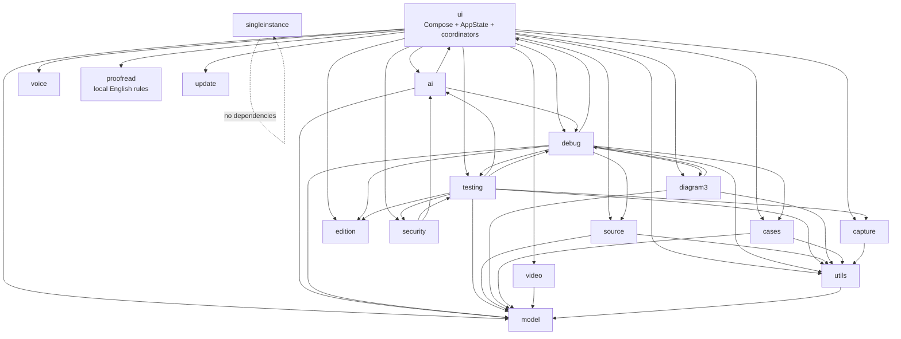

**Key.** Arrows point from dependant to dependency.

**The cycles.** `ui ↔ ai` and `ui ↔ debug` are genuine bidirectional dependencies, not diagram
artifacts. `debug/IndagiumToolOperations` holds an `AppState`, and `AppState` constructs
`IndagiumToolOperations(this).toolGateway` to hand to the AI runtime (`ui/AppState.kt:970-981`). This
is deliberate: the tools *are* "things the user can do", so they must reach the state that models
what the user can do. It is the main reason a Gradle module split has not been attempted — the cycle
would have to be broken with an interface extraction first. See
[risk R7](#23-known-architectural-risks-and-technical-debt).

`debug ↔ diagram3` is new since the v3 sequence-diagram cutover: `debug/IndagiumToolOperations`'s
`build_sequence_diagram` route calls `diagram3.generateSeq3` directly, and `diagram3/Seq3Codec.kt`
reuses `debug/Json.kt`'s hand-rolled encoder/decoder for its note header rather than adding a second
JSON implementation. Unlike the `ui` cycles this one is a plain reuse-of-a-small-utility case, not a
structural need to reach shared state — a future cleanup could break it by moving `Json.kt` (or just
the four bounded accessor functions `diagram3` actually uses) to `utils` or `model` without changing
either package's public behaviour. `diagram3` itself stays UI-free and does not depend on `source`
(unlike the deleted `diagram` package's `SeqDiagramBuilder.kt`) — see §9.7 and §13.7 for why.

`debug ↔ testing` and `security ↔ testing` are new with the AI test suites. `testing` needs the
gateway type and the `schema(...)` DSL from `debug` (every lane, judge and tracker agent is given an
`IndagiumToolGateway`) and the agent launchers from `ai`; `debug` holds the MCP catalogues and approval
dialogs for the feature and therefore imports `testing.model`/`testing.script`; `security` reuses
`testing.script`'s bounded child-process runner while `testing.tracker` reuses `security`'s secret
scrubbing. All three are reuse of small utility types, not shared mutable state, and — like the cycles
above — are broken only by an extraction. `testing` itself does not depend on `ui` (§26.2).

`model` is a leaf. `utils` depends only on `model`. `singleinstance` depends on nothing in the
application at all — it runs before `AppState` exists (`Main.kt:106`).

---

## 8. Core domain model

The model is a single file, `model/Model.kt` (925 lines), containing only data types. It is split
across two diagrams below for readability.

### 8.1 The tab aggregate

`LogTab` is the aggregate root. One tab is one opened log file, and everything the user does to that
file hangs off it.

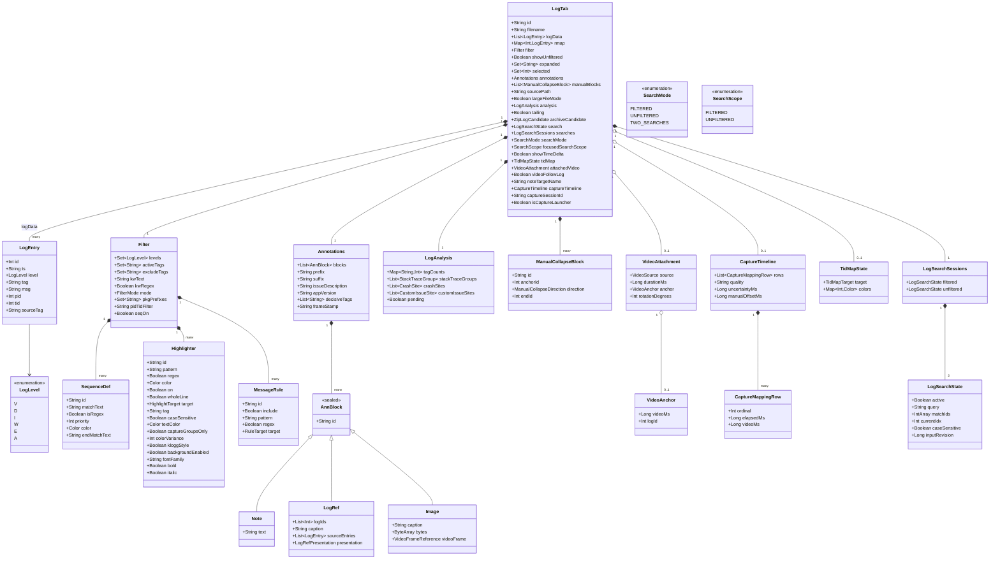

**Notes on the model that are not obvious from the shape:**

- **`rmap` is not a map.** It is an `EntryIdMap` — an `AbstractMap<Int, LogEntry>` view over
  `logData` that resolves ids by dense-index guess plus binary search (`utils/EntryIdMap.kt:9-29`).
  It is valid only because entry ids are strictly increasing in every construction path.
- **`ts` carries no date.** `LogParser` strips the `MM-DD` prefix (`utils/LogParser.kt:100`), which
  is why `LogMerge` and `LogTime` both have documented midnight-boundary caveats.
- **`sourceTag` is set only by `mergeLogs`** to badge which file a merged row came from
  (`model/Model.kt:31-35`).
- **`LogAnalysis.pending` defaults to `true`** so a freshly constructed tab reads "not analysed yet",
  never "analysed, found nothing" (`model/Model.kt:127-134`).
- **`AnnBlock.Image` overrides `equals`/`hashCode` to compare `bytes` by content**
  (`model/Model.kt:254-269`). With the default array-reference comparison, the debounced autosave in
  `ui/App.kt:102` would re-arm forever.
- **Session-only fields are deliberately excluded from persistence:** `selected`, `tailing`,
  the legacy `search` projection, both `searches` slots, `searchMode`, `focusedSearchScope`,
  `tidMap`, `videoFollowLog`, `captureTimeline`, `captureSessionId`, and
  `isCaptureLauncher`, plus the derived `logData`, `rmap`, `analysis`, and `largeFileMode`.
  A live capture cannot resume after relaunch because `adb`/`scrcpy` processes are not persisted;
  the raw capture directory is recovered as an interrupted retained session instead. See
  [§13.4](#134-what-is-persisted-and-what-is-not).

### 8.2 The view model and settings

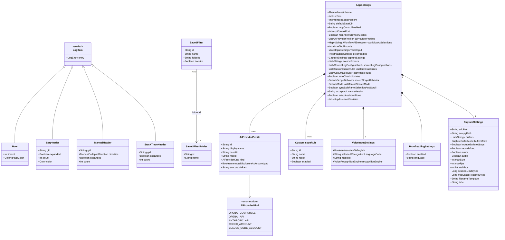

`AiProviderProfile` **has no secret field**, by design (`model/Model.kt:580`). Because `AppSettings`
is the only settings object serialised into the autosave, a pasted API key structurally cannot reach
disk. See [§18.4](#184-ai-provider-credentials).

The five-step setup assistant (Workspace, Look, Folders, Search, Capture) records `setupAssistantDone`
and `setupAssistantRevision` in keyed settings JSON only (`ui/AutosaveCodec.kt`). Revision 2 adds the
Search step: an unfinished assistant starts at Workspace, a completed assistant below revision 2
opens at Search with the current profile kept, and revision 2 or later stays closed. Finish, Skip,
Escape and window close acknowledge revision 2 while preserving any higher revision. The Search
controls write settings as they are changed, and completed older users start with Keep Current
selected. Manually running the assistant always starts at Workspace. The legacy positional settings
decoder remains frozen.

`LogItem` is the render model — the output of the filter pipeline and the input to the `LazyColumn`.
It is never persisted and never leaves the process.

---

### 8.3 Sequence-diagram workspace model (v3)

Rewritten wholesale in the "v3 cutover" (`docs/plans/use-the-claude-design-mcp-compiled-lighthouse.md`,
phase 6): the earlier `diagram`-package model (`SeqDiagramSpec`, `ManualDiagramDocument`,
`ManualDiagramInteraction`'s v1–v4 compatibility layer, rules-mode message generation, and the
override/regeneration machinery it needed) is deleted outright, not migrated. v3 never reads a
legacy document — there is exactly one on-disk version (`Seq3Codec`'s `SEQ3_VERSION = "v1"`), no
`editorVersion` discriminator anywhere in the model, and the whole domain lives in
`com.indagium.diagram3` (UI-free — see §9.7).

The core reframe: a panel row is not a log line and not a rule — it is a **message**,
`from → to : label`, backed by *n* real log occurrences.

| Type | Responsibility |
|---|---|
| `Seq3Lifeline` | One canvas column: id, display name, the raw tag ids it represents (a singleton until a user merges two lifelines), and display ordinal. |
| `Seq3Match` / `Seq3Capture` | A source-independent pattern proven across every occurrence of one message (`Seq3Tokenizer`), with named `{token}` slots for the varying runs. |
| `Seq3Occurrence` | One real log line backing a message — entry id, timestamp, pid/tid, level, text, per-token capture values. Append-only, never user-editable. |
| `Seq3Message` | The editable durable unit. `fromLifelineId` is never null (it's the tag the occurrences were scanned under); `toLifelineId` is nullable — a null value **is** the needs-target condition (`Seq3State.NEEDS_TARGET`), derived from the field rather than stored, so it can never drift out of sync. Also carries `kind` (call/return/async/self/note), `repeat` policy, `visibility` (a separate flag from authoring state — hiding never discards evidence), and `authoring` (`AUTO`/`EDITED`, which regeneration must respect). |
| `Seq3Fragment` | An explicit, user-chosen `loop`/`alt`/`opt`/`par` block over a set of message ids — unlike the old auto-detected, meaning-free `DiagramFrame`, every fragment here was deliberately created by a Group action. |
| `Seq3Note` | A canvas/text note spanning a message selection — distinct from a `Seq3Kind.NOTE` message, which is its own queue row with its own evidence. |
| `Seq3Document` | The whole generated-or-edited diagram: title, source file, range, lifelines, messages, fragments, notes, default repeat policy. No `interactions` list and no version discriminator — see this type's own doc for why there is nothing to discriminate against. |
| `Seq3GenerateOptions` | Tuning knobs for `Seq3Generator.generateSeq3`: title/source-file seed, lifeline cap, default repeat policy/threshold, and independent on/off switches for thread-handoff and correlation-token target inference. |
| `Seq3RegenReview` | Regenerate-is-a-reviewed-proposal (never a wholesale replace): new/changed/removed/edited-kept rows with per-row decisions, produced by diffing a fresh generation against the current document; `applySeq3Command`'s `ApplyRegeneration` case turns an accepted review into exactly one undo step. |

`Seq3Generator.generateSeq3` ranks lifelines from tag activity (errors, message-shape diversity,
same-thread peers, a capped raw count — the ranking itself ported unchanged from the deleted
`SeqDiagramBuilder.kt`), groups near-identical occurrences per tag into one `Seq3Message` via
`Seq3Tokenizer`, and infers each message's target only from the *immediately adjacent* entry: a
same-thread (pid+tid, bounded gap) handoff or a shared correlation token, both above a confidence
bar. Deliberately absent, by this phase's own brief: no source-index enrichment, no rules-mode
message generation, no call/site override machinery, no activation spans. v3's answer to "I don't
like what the generator inferred" is the queue's own edit affordances (`Seq3Queue`, `Seq3Commands`),
not more inference knobs in the generator.

`Seq3Layout.layoutSeq3` is the single unit-less geometry source shared by the Compose canvas
(`ui/Seq3Canvas.kt`) and the headless PNG rasterizer (`Seq3Raster.kt`, §9.7 and §13.7) — an export
can never draw something the user didn't see on screen, because both consumers draw from exactly
the same computed `Seq3Layout`, differing only in which transform (density vs. raster scale) turns
its numbers into pixels.

Manual sequence editing adds an optional `Seq3Document.rowOrder` of stable `Seq3RowRef` values
(message id and optional occurrence entry id). An empty order retains chronological rendering;
an authored order is resolved by the shared ordering helper used by layout, text emission, and
lifecycle validation. Reordering never rewrites log timestamps or occurrence evidence. The
Messages tile has two views: Templates (one row per message, for editing; never reordered by drag)
and Sequence (one row per drawn arrow, from `seq3DrawnRowRefs`, so it matches the canvas row for
row). A Sequence drag, a canvas drag, the arrow menu's Move submenu and Alt+↑/↓ all dispatch
`MoveRow` for one exact row; only a collapsed `×N` summary row moves its whole message.
`Seq3Command.ResetRowOrder` clears `rowOrder` back to chronology. After a move, fragment
membership follows the drop (`reassignSeq3FragmentMembership`): a row belongs to a fragment only
when both of its new neighbours do, a template-level member is materialised into
`occurrenceRefs` before one of its rows leaves, and a fragment's only member travels with it, so
a fragment box never stretches to follow a moved member. `normalizeSeq3FragmentSpans`
(`diagram3/Seq3FragmentSpans.kt`) keeps membership equal to the drawn box: every visible fragment holds every drawn
row from its first to its last member (children clamped to their parent, hidden rows ignored but their refs kept).
It runs after every command and when a diagram is opened, so the Artifacts "×N arrows" count, the Sequence list
rail and the canvas box always agree. Both Messages-list views drag like the Lifelines list (shared
`seq3DragLift`: the row moves in its own slot, neighbours slide). Hidden references retain their positions
and obsolete references are discarded during edits. The Templates list's default order
("Diagram order") follows the first represented row; its alternative sorts remain views rather
than mutations.

Canvas inline editors share one active target across message labels, group labels, delays,
notes, and lifeline names. Opening another editor discards the previous uncommitted draft;
group headers take pointer priority over message editors that extend into their header area.

`Seq3Lifeline.headerWidthDp` overrides automatic name-box measurement. Nullable
`Seq3ArtifactStyle` ARGB fill, border, and text overrides apply to fragments, notes, and NOTE
messages; absent fields retain the diagram theme. These fields and row order are optional additions
to the existing v1 JSON codec, so older saved diagrams need no migration. Note text wrapping and
group/delay boundary spacing belong to layout, with both renderers consuming the resulting
geometry and wrapped text instead of measuring a second time.

Diagram workspaces remain deliberately separate from `LogTab`, same shape as before the cutover:
`AppState.tabs` stays the list of open log files; `ActiveSurface` selects either a log tab
(`ActiveSurface.Log`) or an independent `Seq3WorkspaceSession` (`ActiveSurface.Diagram3` — the only
non-log variant now that the v1/v2 `ActiveSurface.Diagram` case is gone). A session carries the
source-log id (nullable — see §11.6), the generated/edited document, its own undo stack (one entry
per `applySeq3Command` call, including a whole regeneration apply), dirty/draft-saved state, and
the note block id a confirm writes into. A source tab can close without destroying an already-built
session; regeneration is disabled (`requestGenerate` is a no-op) until the session is relinked.

The workspace uses `DiagramWorkspaceTilingHost` (`ui/DiagramWorkspaceTiling.kt`) to put Messages, Lifelines, Artifacts, and Diagram preview in the
shared tile system. Its default layout stacks the three authoring tiles at the left of the preview; each tile has the common header, resize handle,
collapse, hide, and maximize controls. The Layout menu offers Standard and Canvas focus presets, visibility controls, Lock tiles, and Reset to the
last preset. Narrow windows use a scrollable preview-first stack, where controls that need split geometry (resize, collapse, maximize) are omitted.
The tree, hidden tiles, collapsed tiles, lock, and last preset are saved with the diagram's `seq3View` state; maximize remains transient. Older saved
section-open and expanded flags migrate into hidden and collapsed tiles on restore. Escape first lets a focused editor handle the key, then clears
transient workspace state before restoring a maximized tile.

PlantUML source is an independent workspace tile with the same resize, move, collapse, hide, and
maximize controls as the other diagram tiles. It starts hidden, below the preview in the default
tree, and its visibility and geometry use the existing tile-state codec. Visual editing remains
available while source is visible. A clean source buffer follows the latest document automatically;
an unapplied draft is retained and marked stale if the document's generated source changes.
Reload explicitly discards that draft; Apply is disabled until a stale draft has been reloaded.
The conservative `Seq3SourceImport` inverse of Indagium's emitted syntax retains identity/evidence
markers and presentation metadata and reports unsupported syntax with line diagnostics. Apply is
one `ReplaceDocument` undo transaction; removing evidence requires confirmation. Text-field undo
stays local to the text editor; Ctrl+Z/Cmd+Z elsewhere restores the active session's document.

---

## 9. Key packages and classes

### 9.1 `model`

| Type | File | Role |
|---|---|---|
| `LogEntry`, `LogLevel` | `model/Model.kt:10,23` | One parsed log line |
| `LogTab` | `model/Model.kt:463` | Aggregate root: one open file and all state attached to it |
| `Filter` | `model/Model.kt:154` | The complete filter specification, 18 fields |
| `Annotations`, `AnnBlock` | `model/Model.kt:276,201` | The note document attached to a tab; each new LogRef freezes its excerpt rows and presentation choices |
| `LogAnalysis`, `CrashSite`, `IssueSite` | `model/Model.kt:116,78,73` | Crash/ANR/custom-issue detection results |
| `LogItem` | `model/Model.kt:882` | Render model produced by `computeItems` |
| `AppSettings`, `ThemePreset` | `model/Model.kt:704,835` | All persisted preferences; 20 themes |

### 9.2 `utils` — the log engine

| File | Role |
|---|---|
| `LogParser.kt` | Parses four logcat formats (`threadtime`, `time`, `brief`, `bare`), per line. Fast path at `:127`, regex fallback chain, tag interning, `RAW` for unrecognised lines |
| `Filter.kt` | `passesFilter` (`:13`), `visibleEntries` (`:132`), `computeItems` (`:301`), `buildMd` (`:700`). The largest single algorithm in the app |
| `SeqComputer.kt` | `computeSeqGroups` (`:79`) — O(n·d) sequence detection with one level of nesting |
| `TagProcesses.kt` | Cancellable process-info scans for exact tags and dot-boundary package prefixes; package results emit existing numeric PID/TID rules, while exact tags retain dynamic `tag:<Tag>` restart following |
| `StackTraceComputer.kt` | Always-on stack folding (`:115`), crash sites (`:189`), custom issue sites (`:212`) |
| `TextMatch.kt` | Shared regex infrastructure: bounded LRU cache, backtracking deadline, `visibleLogLineText` as the single definition of "what the row shows" |
| `HighlightMatch.kt` | The one highlighter matcher: `highlighterMatches` (boolean), `resolveLineHighlight` (whole-line owner plus paint-ordered spans) and `countHighlighterRows` (per-highlighter row counts for the filter panel). Row rendering, the minimap and the panel counts all go through it, so "which highlighter owns this row" cannot drift between them. See [§10.1](#103-highlighters) |
| `QSettingsIni.kt` / `KloggHighlighterImport.kt` / `KloggColor.kt` / `QtColorParse.kt` | Manual import of klogg highlighter sets: Qt `QSettings` INI reader, klogg field mapping to `Highlighter`, `QColor::darker` + `minstd_rand0` colour variance, Qt/SVG colour parsing. See [§13.8](#138-klogg-highlighter-import) |
| `EntryIdMap.kt` | Memory-free id → entry lookup view |
| `LogTime.kt` | Allocation-free `HH:MM:SS.mmm` parsing, delta formatting, midnight-rollover correction |
| `TidMap.kt` | Pure core of the thread-map gutter overlay |
| `LogMerge.kt` / `LogSplitter.kt` | Time-ordered merge of multiple files; byte-exact split of one huge file |
| `FileTailer.kt` | Polling tailer with a `WatchService` hint, capped reads, rotation handling |
| `ExportFilteredLog.kt` / `AnnotationExport.kt` / `AnnotationHtml.kt` | TXT/CSV export; annotation image naming; HTML clipboard flavour |
| `BugReportZip.kt` | `.zip`/`.7z` scanning with entry-size and entry-count budgets |
| `AtomicFileWrite.kt` | `writeFileAtomically` — temp file in the destination directory, then `ATOMIC_MOVE` |
| `ImageDownscale.kt` | Hard 1280 px / 400 KB cap on annotation images |
| `Ids.kt` | Process-wide id factory: timestamp + `AtomicLong` counter |

### 9.3 `ui`

| File | Role |
|---|---|
| `AppState.kt` | 12,214 lines. The application's entire mutable state and most of its behaviour. See [§11](#11-state-management) |
| `App.kt` | Root composable: layout routing, all dialogs, drag-and-drop, global key handling, the autosave debounce |
| `FileView.kt` / `CompareView.kt` | Single-tab and two-tab layouts; the `Bound*` adapters. `CompareView` owns the tab pair, focus and displayed filters; its tiles are `CompareTiling.kt` (§6.4) |
| `LogViewer.kt` | The log list: `LazyColumn`, horizontal scroll, selection, drag-select, the Original/Filtered split |
| `FilterPanel.kt` | Left sidebar: levels, tags, message rules, sequences, collapsed ranges, saved filters |
| `TagProcessPopover.kt` | Shared process picker and PID slot for sidebar and filter-bar tag/package search; package mode identifies current-PID scope rather than advertising dynamic restart following |
| `HighlighterSection.kt` / `HighlighterCandidates.kt` | The panel's Highlighters section: rows with a Match/Line chip, badges and match counts, the inline editor, and the search-to-add field with its TEXT / TAGS / MESSAGES dropdown. `HighlighterCandidates.kt` is the pure half (query parsing incl. `tag:Name rest`, candidate ranking, row labels/badges) so tests can pin it without composing |
| `AnnotationPanel.kt` / `AnnotationManager.kt` | Notes UI and the block-model mutations behind it |
| `Dialogs.kt` / `NoteRewrite.kt` / `NoteRewriteDialog.kt` | Shared Markdown note editor and text-only rewrite preview; selection snapshots are guarded against stale drafts and Apply is one undoable editor change |
| `AiSidebar.kt` | The AI panel and the Notes edit lock (the Video / Notes / AI column is now tiles, §6.4) |
| `CaptureCoordinator.kt` | `CaptureService` tool/device discovery and recovery; one `TabCaptureController` recorder/export lane per live tab |
| `HomeScreen.kt` | The New tab: builds one `HomeSectionSlot` per section (`HomeOpenZone`, `HomeCaptureSection`, `HomeTestsSection`) and hands them to `HomeTilingHost`; also the Recent-files grid/list, its filter row and the pure helpers behind them (§6.3) |
| `HomeTiling.kt` | `HomeTilingHost`: the New tab's tiling host. One-row top bar (title, tip, hidden-section chips, preset icons), splitter hit areas inset by the 8 dp card corner, section cards with grip/hide button, manual-pointer-drag overlay, splitters with a draft layout committed on release, stacked layout below 720 dp (§6.3) |
| `TilingHost.kt` / `TileLayout.kt` / `TileScrolling.kt` | The generic tiling surface and its pure engine (§6.3, §6.4): fixed-order flat `Layout`, cards, headers, invisible splitters with a draft layout committed on release, drop overlay; trees, geometry, resize, drops, projection and scrolling columns (`TileScrollRegion`); the scroll offsets, wheel scrollables, viewport clip and scrollbar of those columns |
| `HomeLayout.kt` / `HomeLayoutSettingsJson.kt` | UI-free half of the tiling: split-tree normalise/drop/resize, `homeGeometry`, drop hit-testing, presets, `sanitizeHomeLayoutState` and the `AppSettings.withHome*` mutators; and the keyed-JSON codec for `homeLayout`, `homeHiddenSections`, `homeLayoutTipDismissed` (kept out of `AutosaveCodec.kt`, which is at detekt's per-file function limit, §13.4) |
| `LogViewTiling.kt` / `LogViewLayoutState.kt` / `TiledSectionHost.kt` | The single log view on tiles (§6.4): `LogViewTilingHost` (size via `onSizeChanged`, fixed emission order, capture video pin, parked video, maximize), the `AppState` extensions behind the Layout menu, shortcuts and tab-strip toggles (commit/hide/show/preset/reset/lock/collapse/reveal), and the `SectionHost` that turns the filter panel's sections into tiles |
| `LogToolbarLayout.kt` / `LogToolbarControls.kt` | The log toolbar's width variants (pure) and the buttons / "⋯" overflow menu that draw them (§6.4) |
| `CompareTiling.kt` / `CompareFilters.kt` / `CompareLayoutState.kt` | The compare view on tiles (§6.4): the strip with the A \| B \| Both switch and the scroll link, the host and its fixed emission order, the A / B badges, `CompareScrollSync`; the pure filter-target rules and `nearestEntryIndexByTime`; the `AppState` extensions for the tab pair, tile context, layout commit, presets and badge |
| `LogViewLayout.kt` / `LayoutMenu.kt` / `BoundLogViewer.kt` | UI-free log-view layout model (presets, legacy derivation, visibility, sanitizer, mutators); the tab-strip Layout menu (preset thumbnails, Panels, Lock, Reset, hidden badge); `LogViewer` bound to `AppState` for the tiled and the legacy view |
| `HomeTestsSection.kt` | The New tab's Run tests section: suites with their latest finished run, Run/View, + New suite, latest-run line, issue counts and the Free usage line. Reads runs through `AppState.latestTestRunSummaries` and never starts the run coordinator (§26.15) |
| `CaptureLauncher.kt` / `CaptureStrip.kt` / `CaptureSettingsUi.kt` | `HomeCaptureSection` (the condensed Capture section: device row, options summary with "Change…", Start, compact sessions; polls devices only while composed), live-tab capture chrome/snapshot/diagnostics, and Capture Settings (session recorder options are read at next start) |
| `CaptureOptionsDialog.kt` / `UnfinishedSessionsInline.kt` | The Capture section's "Recording options" dialog (hosts `CaptureStartOptions`, links to Settings → Capture via `AppState.openCaptureSettings`) and its inline unfinished-sessions panel (scrolling full list, "Open in window…" dialog) |
| `AutosaveCodec.kt` / `AutosaveScheduler.kt` / `FilterCodec.kt` / `DesktopStorage.kt` | Persistence: encoding, scheduling, the saved-filter library format, path resolution |
| `ControlServerManager.kt` | Control-server lifecycle with a generation-counter race guard |
| `TailCoordinator.kt` | Per-tab live tailing and debounced re-analysis |
| `Components.kt` / `Theme.kt` / `Shortcuts.kt` | Shared widgets, 20 theme palettes, the keyboard-shortcut catalogue |
| `Tests*.kt` / `TestRun*.kt` / `Issue*.kt` / `Testing*.kt` / `TrackerWiring.kt` / `ReorderableColumn.kt` | The AI test-suites surface: Tests workspace (`ActiveSurface.Tests`, `TabRef.Tests`), run dialog, live view and report, issue dialog, Settings sections, and the wiring that connects `testing/` to `AppState` (§26.2) |
| `TestsSuiteHealth.kt` | The suite screen's Health tab: summary cards, the cases-by-last-12-runs grid, and the latest-failure card (§26.15) |

### 9.4 `debug` — automation

| File | Role |
|---|---|
| `ControlServer.kt` | Ktor CIO server; `MCP_TOOLS` and `REST_ROUTES` catalogues; auth, CORS, device-tool approval, session reaping |
| `IndagiumToolGateway.kt` | Joins catalogue to handlers, enforces parity, defines the confirmation policy, derives OpenAI function definitions |
| `IndagiumToolOperations.kt` | Tool handler map — the actual behaviour behind each catalogue entry |
| `TestSuiteToolCatalog.kt` / `TestRunToolCatalog.kt` / `IssueToolCatalog.kt` + matching `*Operations.kt` | Catalog-driven suite, authoring, script, run/report and issue-evidence tools; gateway startup enforces descriptor/handler parity and the tool index is generated from the current catalog (§26.2) |
| `ExternalToolApproval.kt` / `ExternalRunApproval.kt` / `ExternalTrackerApproval.kt` | `PER_CALL_APPROVAL_MCP_TOOLS` and the dialog content for each call an external client must have approved (§26.9.2) |
| `Json.kt` | Hand-rolled JSON encode/decode for flat DTOs |
| `AppLogger.kt` | Opt-in diagnostic log, written in Android threadtime grammar so Indagium can open its own log |

### 9.5 `ai`

| File | Role |
|---|---|
| `LlmProvider.kt` | The provider interface and its streaming event model |
| `AnthropicMessagesProvider.kt` / `OpenAiCompatibleProvider.kt` | The two HTTP providers |
| `ClaudeCodeClient.kt` / `CodexAppServerClient.kt` | Subprocess drivers (stream-json; stdio JSON-RPC) |
| `AccountAgentRunner.kt` | Orchestrates a subprocess agent run, including its managed MCP lease |
| `AiAgentRunner.kt` | The agent loop (`runLoop`, `:277`), session and run model |
| `AiToolExecutionCoordinator.kt` | The single safety policy point under both agent paths |
| `AiToolCallBudget.kt` | Per-run tool-call budget; notes writes are unlimited by design |
| `AiSidebarRuntime.kt` | Bridges UI to runner; provider selection; debounced UI updates |
| `AiInvestigation.kt` | Quick-action prompts, context pinning, evidence extraction |
| `ManagedMcpServerLease.kt` / `ManagedMcpRunRegistry.kt` | Per-run loopback MCP endpoint and its token registry |

### 9.6 `source`, `cases`, and platform packages

| File | Role |
|---|---|
| `source/SourceIndexer.kt` | Builds the call-site index by text scanning and brace matching — no compiler, no parser dependency |
| `source/LogSourceResolver.kt` | Maps `(tag, msg)` back to call sites with confidence ranking |
| `source/SourceIndexStore.kt` | On-disk index, format `indagium-source-index-v1` (a load also accepts the legacy `openLog2-source-index-v1` magic), schema version 18 |
| `source/SourceStructureParser.kt` | Declaration scanner for the read-only source-navigation tools |
| `cases/CaseIndexer.kt` / `CaseSearch.kt` / `CaseIndexStore.kt` | Similarity index over previously written notes; idf-lite scoring with tag boost and stale-version penalty |
| `video/VideoPlayerController.kt` | FFmpeg decode loop on a dedicated thread, audio via `javax.sound.sampled` |
| `capture/CaptureRecorder.kt` | Per-session adb logcat process lifecycle, the embedded video recording session (`EmbeddedDeviceSession`), append-only log/block writing, synchronized snapshot boundaries, screenshots, watchdog, disk limits, and interruption recovery |
| `capture/StreamingMkvWriter.kt` | Live-readable Matroska muxer (FFmpeg `avformat`) that `EmbeddedDeviceSession` writes recorded H.264/Opus packets into directly |
| `capture/mirror/ScrcpyPacketReader.kt` / `EmbeddedDeviceSession.kt` / `EmbeddedMirrorRuntime.kt` / `MirrorVideoPacket.kt` / `ScrcpyStreamAdapters.kt` | scrcpy v4.1 frame-meta parser, recording and mirror packet observers, CPU/native decoder fan-out, bounded feeds, and mirror-side Annex-B re-flattening |
| `capture/CaptureArchive.kt` / `CaptureTimelineIndex.kt` | Versioned descriptor, ZIP/Compact (`.ind`) snapshot export/finalization, asset validation, and block-assisted range selection with legacy timing adapters |
| `capture/CaptureSparseMetadata.kt` | Checksummed segment metadata, sparse block writer/reader, bounded automatic anchor estimation, and the shared timing resolver |
| `capture/CaptureTools.kt` / `CaptureSettingsCodec.kt` | Cross-platform adb resolution/validation (host `scrcpy` only for the separate native mirror window) and keyed capture-settings persistence |
| `voice/VoiceInputController.kt` + backends | Dictation state machine; Whisper JNI, Apple Speech JNI, Windows helper process |
| `voice/VoiceInputSessionCoordinator.kt` / `VoiceInputControllerFactory.kt` | One app-wide recording owner, stable editor leases, and shared engine construction for AI, notes and test prose |
| `proofread/EnglishProofreader.kt` / `ProofreadingText.kt` | Local LanguageTool English checks, bounded prose chunks, UTF-16 issue ranges, and offset-preserving exclusions for Markdown and technical content |
| `update/UpdateChecker.kt` | GitHub Releases API, per-OS asset selection, streamed download to a `.part` file |
| `singleinstance/SingleInstance.kt` | File lock plus loopback socket; forwards file arguments to the running instance |

### 9.7 `diagram3`

v3 (the "v3 cutover", `docs/plans/use-the-claude-design-mcp-compiled-lighthouse.md` phase 6)
replaced the whole `diagram` package outright — the model in §8.3, the generator, the raster, and
the note codec are a fresh, much smaller design with no v1–v5 compatibility layer. One file from
the old package survived, moved rather than deleted: `source/SourceTraceModel.kt` (package renamed
from `com.indagium.diagram`), because `source/SourceTraceInference.kt` depends on its types and v3
itself does no source-trace enrichment.

| File | Role |
|---|---|
| `diagram3/Seq3Model.kt` | The whole model, one file — §8.3's types plus `DiagramExportMode` (moved here from the old codec; its two serialised constant names, `IMAGE`/`SOURCE`, are unchanged so `AutosaveCodec`'s `diagramDefaultExportMode` setting keeps reading old autosaves). |
| `diagram3/Seq3Tokenizer.kt` | Occurrence texts → one `Seq3Match` with named `{token}` captures, and the reverse `matches(text)` check. |
| `diagram3/Seq3Correlation.kt` | Thread-handoff and shared-correlation-token evidence between two adjacent log entries — the only signals a message's target may be inferred from. |
| `diagram3/Seq3Generator.kt` | Cancellable range resolution, tag-activity lifeline ranking, near-identical occurrence grouping, and adjacent-evidence target inference. No source-index enrichment, no rules mode, no overrides. |
| `diagram3/Seq3Layout.kt` | `layoutSeq3`: the single unit-less geometry source for both the Compose canvas and the raster (arrow/self-loop/unresolved-stub/note/fragment boxes, lifeline-arrangement crossing count). |
| `diagram3/Seq3Raster.kt` | Headless Graphics2D rasterizer over a `Seq3Layout` → `BufferedImage`/PNG bytes. Mandatory, not optional: note export, the rich-clipboard data-URI, and `diagram-NN.png` all depend on it (§13.7). |
| `diagram3/Seq3Emitters.kt` | Mermaid and PlantUML source emission. |
| `diagram3/Seq3Codec.kt` | The `<!-- indagium:diagram3 v1 {json} -->` note-header codec — the whole `Seq3Document` as JSON, SHA-256 body-hash guard, own bounds discipline. Exactly one version constant; a note written by an unrecognised/future version degrades to "not a diagram note" rather than throwing. |
| `diagram3/Seq3Queue.kt` / `Seq3Guided.kt` / `Seq3Regeneration.kt` / `Seq3Commands.kt` | Pure filter/sort/selection/bulk-action logic, the guided target-resolution pass, the regenerate-review diff, and every mutation as a named command producing one undo entry. |
| `ui/Seq3Session.kt` | State owner (`AppState.seq3Sessions`): session lifecycle keyed off a source log tab, the debounced generate+layout pipeline, per-session undo stack, note-write on confirm, and the `DiagramLibraryStore` integration that keeps a confirmed diagram reachable from the source tab's standalone Diagram library tile. Declares `ActiveSurface` (moved here from the deleted `ui/SeqDiagramCoordinator.kt`). |
| `ui/DiagramWorkspaceTiling.kt` | Diagram session's four-tile layout, shared tile chrome, narrow stacked behavior, presets, and hide/collapse state. |
| `ui/DiagramWorkspaceViewCodec.kt` | Per-library-item diagram tile preferences, with legacy queue flags projected from current state and migrated on restore. |
| `ui/Seq3Workspace.kt` / `Seq3QueuePanel.kt` / `Seq3Canvas.kt` / `Seq3Inspector.kt` / `Seq3GuidedPass.kt` / `Seq3RegenerateSheet.kt` | The workspace shell, message/lifeline/artifact tile bodies, Compose canvas (drawn from `Seq3Layout`), pattern/kind/evidence inspector, guided "Fix these" mode, and regenerate review sheet. |
| `ui/Seq3Theme.kt` | `ThemeColors.toSeq3RasterTheme()` plus `Seq3RenderCache` — a bounded LRU in front of `layoutSeq3`/`renderSeq3`, split into a layout tier (theme/scale-independent) and a render tier, so a theme switch never recomputes geometry and an unrelated note edit never re-rasterizes every open diagram. |

### 9.8 `testing`, `edition`, `security`

The AI test-suites feature adds three packages (and the `debug`/`ui` files listed in §9.4 and §9.3).
Their file-by-file layout is in [§26.2](#262-package-layout); the architecture is §26.

---

## 10. Data flow: the render pipeline

This is the path every log line takes from disk to screen. It is the hottest code in the
application and the most heavily optimised.

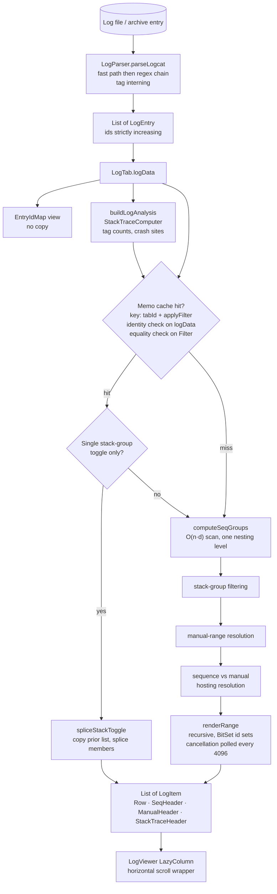

**Key.** Diamonds are decisions taken inside `computeItems` (`utils/Filter.kt:301`).

### 10.1 Stage notes

**Parsing** (`utils/LogParser.kt`). Format detection is **per line, not per file** — a capture that
mixes formats parses correctly. `parseThreadtimeFast` (`:127`) is a hand-rolled scanner for the
dominant format, tried before the regex chain; it is a strict subset that falls back safely. Tags are
interned through a `HashMap` (`:49-51`) to collapse millions of duplicate strings. Lines that match
nothing become `tag = "RAW"` rather than being dropped (`:85`).

**Analysis** is decoupled from parsing. `openFileInternal` publishes the tab with
`pendingAnalysis(logData)` as soon as parsing completes (`ui/AppState.kt:4578-4589`) and only then
runs the expensive `buildLogAnalysis` in the same job (`:4593-4598`). The user sees rows immediately;
crash markers appear a moment later.

**Filtering semantics** (`utils/Filter.kt:32-131`) are, in order: exclusions first, then positive
selectors OR-ed with the base tag filter, then the tag-or-keyword filter. Only `TAGS`-mode message
rules are active — `KEYWORD`-mode rules are preserved for old autosave data and ignored
(`utils/Filter.kt:8-12`).

**Memoisation** (`utils/Filter.kt:159-192`) keys on `"$tabId#$applyFilter"` in a
`ConcurrentHashMap`. Invalidation uses **identity** checks on `logData` and
`analysis.stackTraceGroups` plus **equality** on `Filter` (`:319-323`). A result truncated by a regex
timeout is deliberately *not* cached (`:330-334`).

**The splice fast path** (`utils/Filter.kt:194`) exists because expanding one stack-trace group used
to re-materialise the entire item list. It copies the cached list and splices the member rows in or
out; returning `null` falls back to a full rebuild.

**Cancellation** is covered in [§12.3](#123-cancellation-of-computeitems).

### 10.2 Diagram build and preview pipeline (v3)

Diagram work is a second, per-session pipeline (`ui/Seq3Session.kt`); it does not piggyback on the
log viewer's composition path. `requestGenerate` is the ONLY entry point into
`Seq3Generator.generateSeq3` — a session's own generation counter makes a later range/option edit
supersede rather than queue an in-flight scan, debounced 180ms so a range-boundary drag on a huge
log doesn't enqueue a dozen multi-second scans that all still have to run to completion. Debounced
separately per session, so regenerating workspace A never cancels workspace B's in-flight build.
Metadata-only edits (`updateTitle`) deliberately never call `requestGenerate`, which is what makes
"a title keystroke must never trigger a rebuild" true by construction rather than a special case.

Layout and rendering are cached independently of generation, in `Seq3RenderCache` (`ui/Seq3Theme.kt`):
a layout tier keyed only on the `Seq3Document` (geometry never depends on theme or scale) and a
render tier keyed on `(layout, theme, scale)`. A theme switch therefore reuses the cached layout and
only re-rasterizes; an unrelated note edit elsewhere in the document hits neither cache. The Notes
panel follows the same discipline one level up: `Seq3NoteSummaryCache` extracts only the small
top-level fields (title, caption, export mode, range) a folded card needs via a bounded text scan
that never reaches a note's `lifelines`/`messages` arrays; `Seq3NoteParseCache` runs the full,
trusted `parseSeq3Note` only when a card is expanded (§13.7 has the property test that pins this).

Regeneration (spec §08, `Seq3Regeneration.kt`) is a separate, explicit, non-debounced pipeline:
`requestRegenReview` runs one fresh `generateSeq3` pass, diffs it against the session's current
document into a `Seq3RegenReview` (new/changed/removed/edited-kept rows), and leaves the document
itself untouched until `applyRegenReview` routes the accepted decisions through the same
`applyCommand`/`applySeq3Command` path every other mutation uses — so "Apply N changes" is one undo
step, not N.

### 10.3 Highlighters

A `Highlighter` (`model/Model.kt`) began as `(id, pattern, regex, color, on)` and always coloured the
matched text on the rendered line. Optional fields now sit after `on`, all defaulting to that
original behaviour, so an old autosave, a saved filter, the MCP tool, the context menu and Log
composition keep producing exactly what they always did:

| Field | Meaning | Default |
|---|---|---|
| `wholeLine` | Tint the whole row, not just the match | `false` |
| `target` | Match against the whole rendered line (`ANY`), only `entry.tag` (`TAG`) or only `entry.msg` (`MESSAGE`) | `ANY` |
| `tag` | Exact-tag limit, the same rule as a message rule's tag (`ruleScopeMatches`) | `null` |
| `caseSensitive` | Case-sensitive matching | `false` (ignore case) |
| `textColor` | Foreground override independent of the background and matching behaviour | `null` |
| `captureGroupsOnly` | A regex with capture groups colours only the groups (klogg) | `false` |
| `colorVariance` | klogg `variate_colors` shade spread (match-only), 0 = off | `0` |
| `kloggStyle` | Explicit klogg matching/paint precedence and background behaviour | `false` |
| `backgroundEnabled` | Paint the rule's background; false allows text/typography-only rules | `true` |
| `fontFamily` | Named system family override; null inherits the log font | `null` |
| `bold`, `italic` | Optional text-style overrides; null retains historical defaults | `null` |

These fields are appended to highlighter tokens. Legacy tokens without the explicit compatibility
flag infer `kloggStyle` from their foreground field, preserving the old interpretation; newly
created foreground rules remain native. Settings JSON stores independent interface/log font
families, shared custom colours and custom-editor visibility; the legacy palette-layout setting
is retained for compatibility, while both pickers now use 10 × 10 pages. The positional settings decoder
is unchanged. Missing system families fall back at render time without discarding the saved name.
Filter-library JSON can carry the shared custom palette as optional metadata. Import review stages
it with the filters and merges validated ARGB colours only when the user confirms an import.
Font selection uses one searchable dropdown for interface, log and per-rule families; its search
draft is separate from the selected name so reopening it does not hide other families. Bold/italic
controls expose nullable overrides through compact B/I buttons cycling Default/On/Off, with a
caption reporting the current states. Shared Bg/Fg chips have separate full-height toggle and
colour-picker zones, including their padding; one tooltip per chip explains both actions and the
current state. Font lists use a visible
scrollbar, and dropdown hover feedback is clipped to the control shape. The color popup uses the
original context-menu swatch styling; its advanced HSV/HEX editor starts open and has a button
that persists its expansion preference in keyed settings. The shared palette reserves every cell
on each page so partial pages cannot shrink hover-driven popups. Section and context-menu
background pickers use 10 × 10 pages without a mode selector. The initial page contains
the selected colour, while manual page navigation remains stable until the popup is reopened or
its layout changes. Up to 256 saved colours share the preset grid; their context menu can delete
the saved entry. The separate duplicate Saved colors strip is removed. The active-count chip
toggles the rule list when the section is expanded; when collapsed, it expands both the section and list.
Whole-section Highlighters visibility is an independent filter-panel UI state,
persisted at the end of its positional token without changing the older list-only expansion field.

**`utils/HighlightMatch.kt` is the one matcher.** `highlighterMatches` answers "does this enabled
highlighter find its pattern on this row" (tag limit and target honoured); `resolveLineHighlight`
turns a row plus the tab's highlighters into a `LineHighlight(wholeLine, spans)`; `countHighlighterRows`
runs `highlighterMatches` over a log for the panel's per-highlighter counts. Row painting
(`buildLogLineRender` in `ui/LogViewer.kt`), the minimap and the counts all call these, so what is
painted, what the overview strip shows and what the panel counts cannot disagree. Rules, in order:

1. A tag limit skips rows of other tags; `MESSAGE` and `TAG` match against `entry.msg` / `entry.tag`
   and their offsets are shifted into rendered-line coordinates, so the pid-field remapping keeps working.
2. The first enabled whole-line highlighter, in list order, that matches owns the row.
3. If that owner is klogg-style, only match highlighters listed **above** it contribute spans (klogg
   stops at the first whole-line hit); if it is Indagium's own, every match highlighter still paints.
4. Paint order: Indagium spans in list order (as before), klogg spans reversed so the first in the
   list ends up on top. Plain text scans overlap for Indagium highlighters and never for klogg ones
   (klogg's escaped `globalMatch`).

The row renderer splits whole-line, highlight, keyword and search styles at the union of their
range endpoints and the base field boundaries. Compose resolves nested spans by range nesting,
so insertion order alone cannot keep a full-match foreground above the inner PID, level, tag and
message colours. Applying each layer to the same intervals preserves the intended priorities;
Find styles remain last. Paint-level Compose tests cover field colours, wrapping, process-name
remapping and native/klogg overlap order.

**The filter panel side** (`ui/HighlighterSection.kt`, `ui/HighlighterCandidates.kt`). The search-to-add
field builds its dropdown from pure functions: `parseHighlighterQuery` (a `/re/` regex, or
`tag:Name rest` which limits the highlighter to that exact tag) and `highlighterCandidates`, ranked
TEXT (what was typed), then TAGS (`tagCandidates` / `packagePrefixCandidates`; an exact tag becomes
`target = TAG, tag = <tag>`), then MESSAGES (Log composition templates through
`messageRuleSpecForTemplate`, `target = MESSAGE, tag = template.tag`). Templates are requested with
`requestMessageComposition` the first time they are wanted. Every candidate is added match-only by
default; whole-line is an explicit choice (a row's Line button, `←/→`, or the Match text | Whole line
control). Adding a shape that already exists switches that highlighter's mode instead of duplicating it.
Row match counts run on `Dispatchers.Default`, keyed only on match-relevant fields (`matchKey()`:
never colour, on/off or whole-line), cancel-and-relaunch like the message-rule candidates, and in
large-file mode stop at `LARGE_FILE_CANDIDATE_SCAN_LIMIT` entries and are shown as "≥N".

---

## 11. State management

### 11.1 `AppState` is a plain class

`AppState` (`ui/AppState.kt`) is not a ViewModel, not a store, and not managed by any DI container.
It is a plain Kotlin class, instantiated exactly once in `Main.kt:110`, whose fields are all Compose
`mutableStateOf`. Reading a field inside a composable subscribes that composable to it; writing it
schedules recomposition.

Every external dependency is a constructor parameter with a production default
(`ui/AppState.kt:892-953`): the parser function, each storage directory, size budgets, the
control-server factory, the directory picker, the update checker, the video-controller factory. This
is the project's dependency-injection mechanism and its test seam ([D4](#d4--testability-without-a-compose-harness)).

### 11.2 The `stateLock` invariant

> **Every read-modify-write of the `tabs` list goes through `synchronized(stateLock)`.**

`stateLock` is a plain monitor object (`ui/AppState.kt:1276`). The guarded mutators are:

| Function | Line | Purpose |
|---|---|---|
| `upTab(tabId) { LogTab -> LogTab }` | `ui/AppState.kt:1884` | The universal tab mutator |
| `upFlt(tabId) { Filter -> Filter }` | `ui/AppState.kt:1904` → `:1918` | Filter mutation; also demotes an active preset to a draft |
| `upAnn(tabId) { ... }` | `ui/AppState.kt:5436` | Annotation mutation |

The lock is **reentrant** by design — `upFlt` calls `upTab` inside its own `synchronized` block so
that the before-state read, the mutation, and the draft-tracking write cannot be interleaved by a
concurrent tail flush (`ui/AppState.kt:1913-1917`). The same applies to `closeTabsById`,
`reorderTabs`, the loading counters, `publishSourceIndex`, the source-index merge, `resolveLogSource`,
and `restoreTabsFromAutosave`.

Why a lock at all, when Compose snapshot state is thread-safe? Because snapshot safety protects a
*single* field write, not a read-modify-write across several fields. `tabs = tabs.map { ... }` is
three operations, and the control server, the tailer, and the UI can all issue one concurrently.

**Lock ordering rule.** `AutosaveScheduler` uses two locks of its own and is documented as never
holding either while `stateLock` is held (`ui/AutosaveScheduler.kt:44-47`). This is the only
lock-ordering constraint in the system, and it is what keeps a slow disk write from blocking the UI.

### 11.3 Delegation to coordinators

`AppState` delegates five bounded responsibilities:

| Coordinator | Constructed | Owns |
|---|---|---|
| `ControlServerManager` | `ui/AppState.kt:1280` | Control-server start/stop, port changes, token rotation, the generation-counter race guard |
| `AutosaveScheduler` | `ui/AppState.kt:1290` | *When* an autosave write happens; not *what* is written |
| `AnnotationManager` | `ui/AppState.kt:1295` | The annotation block model: add, update, move, reorder, remove |
| `TailCoordinator` | `ui/AppState.kt:1306` | Per-tab `FileTailer` jobs and debounced re-analysis |
| `CaptureService` + per-tab `TabCaptureController` | `ui/AppState.kt:1796-1801` | Tool/device discovery, retained-session recovery, one recorder/export lane for each live capture tab |
| `AiSidebarRuntime` + `AiSessionRegistry` | `ui/AppState.kt:970-981` | AI runs, sessions, provider selection |

Per-tab `VideoPlayerController` instances live in a `ConcurrentHashMap` (`ui/AppState.kt:1338`) with
an injected factory. `VoiceInputController` is the exception — it is created in the composable
(`ui/AiSidebar.kt:328-330`), not on `AppState`, because it is bound to the lifetime of the AI panel.

Capture has a similar per-tab ownership rule, but the controller is explicit rather than cached by
video-path: `captureControllersByTab` contains the recorder/export lane only while a session is live.
`stopCaptureTab` drains and finalizes on `ioScope`, then removes the controller after attaching the
durable descriptor to the same tab. Snapshot export and cancellation use that same lane, so an
export cannot stop or replace the live recorder.

### 11.4 The `Bound*` adapter pattern

Leaf panels do not receive `AppState`. `FilterPanel` takes plain data and roughly ninety callback
lambdas, wired by `BoundFilterPanel` (`ui/FileView.kt:32-131`); `LogViewer` is bound inline at
`ui/FileView.kt:188-231`.

**The benefit** is that the entire log-viewing UI can be composed in a test or a preview with fake
data, and the panels have no way to reach state they were not given.

**The cost** is a ~100-line adapter per panel that must be edited every time a panel gains a control.
This is a real maintenance tax and is listed as [risk R8](#23-known-architectural-risks-and-technical-debt).

### 11.5 Cross-panel navigation

Panels never call each other. When the notes panel needs the log view to scroll to a line, it sets a
request object carrying a nonce on `AppState`, and the log view consumes it:

- `pendingAnnotationNavigation` / `consumeAnnotationNavigation` (`ui/AppState.kt:1424`, `:2824`)
- `pendingSearchNavigation` / `consumeSearchNavigation` (`ui/AppState.kt:1429`, `:2828`)
- `FilterSearchRequest` (`ui/FileView.kt:17-29`, produced in `ui/App.kt:221-228`)

The nonce is what makes "navigate to the same line twice in a row" work — without it the second
request would be equal to the first and would not trigger recomposition.

### 11.6 Diagram surfaces are not log tabs

`AppState.tabs` remains log-only. Diagram workspace sessions (`Seq3WorkspaceSession`, owned by
`AppState.seq3Sessions`) live in a separate collection selected through `ActiveSurface`, so log-tab
code cannot accidentally treat a diagram as a log with an empty body. Each session owns its
source-log id (nullable), the generated/edited `Seq3Document`, its own undo stack, dirty/draft-saved
state, the confirmed note block id, and the library item id it's backed by. Closing a v3 session is
a plain, immediate close (`Seq3Session.close`) — unlike the deleted v1/v2 coordinator's three-way
save-draft/discard/cancel prompt, a v3 diagram has no separate "unsaved draft" state to protect:
confirming is the only durable-write action, and it always goes through the same overwrite-gated
`upAnn` path any other note write does. Closing a source log converts dependent sessions to
offline/view-only state (`sourceTabClosed` clears `sourceTabId`) rather than discarding their cached
document; `requestGenerate`/`confirm` become no-ops until `relink` reattaches a live tab.

The workspace panel/canvas/inspector follow the same Bound-adapter rule as other UI leaf surfaces:
they receive immutable session state plus callbacks into `Seq3Session` rather than reaching into
`AppState` directly. Canvas pan, zoom, fit/reset, and scrollbar position are presentation state, not
document state — a viewport adjustment must never mark a session dirty or trigger a regenerate.

---

## 12. Threading and concurrency model

### 12.1 Scopes and dispatchers

| Scope / dispatcher | Where | Used for |
|---|---|---|
| `ioScope = CoroutineScope(SupervisorJob() + Dispatchers.IO)` | `ui/AppState.kt:1264-1265` | The application's single IO scope: file loads, autosave writes, tailing, source indexing, control-server start, search recompute |
| `Dispatchers.Default` | `ui/LogViewer.kt:308`, `ui/AppState.kt:2914`, `ui/Minimap.kt:453`, `ui/TidMap.kt:130` | CPU-bound work: `computeItems` for large files, minimap rendering, TID colouring, custom-issue scanning |
| `CoroutineScope(SupervisorJob() + Dispatchers.Default)` | `ai/AiSidebarRuntime.kt:62` | AI runtime |
| `CoroutineScope(SupervisorJob() + Dispatchers.IO)` | `ai/AccountAgentRunner.kt:29` | Subprocess agent runs |
| Per-session conflated generate pipeline | `ui/Seq3Session.kt` | Cancellable `generateSeq3` builds, debounced 180ms; metadata-only edits (title) never enter this pipeline |
| Ktor CIO request coroutines | `debug/ControlServer.kt` | Tool invocations from external clients |
| `CoroutineScope(SupervisorJob() + Dispatchers.IO)` | `testing/run/TestRunCoordinator.kt:94` | The AI test-run coordinator's own scope: one job per run, lane groups beneath it, run persistence. Never the UI thread, never under `stateLock` (§26.5) |

`SupervisorJob` throughout means one failed file load cannot cancel the scope and take every other
load with it. `ioJob.cancel()` in `AppState.close()` cancels every tailer for free
(`ui/AppState.kt:1303-1306`).

### 12.2 Dedicated threads

Three subsystems need a real thread rather than a coroutine, because they block indefinitely on
native or IO calls:

| Thread | Where | Why |
|---|---|---|
| `indagium-video-decode` | `video/VideoPlayerController.kt:442` | FFmpeg decode loop with frame pacing |
| `indagium-voice-capture` | `voice/VoiceCapture.kt:88` | Blocking `TargetDataLine` reads |
| Single-instance accept loop | `singleinstance/SingleInstance.kt:178` | Blocking `ServerSocket.accept()` |

There is no general-purpose executor pool: the only `Executors` uses are the single-thread mirror
lifecycle lane (`ui/EmbeddedMirrorPanel.kt`) and the heap trimmer (`utils/HeapTrim.kt`).
`kotlinx.coroutines.sync.Mutex` and `Semaphore` appear only where a *suspend* function must exclude
others or cap parallelism: `AppState` and `CaptureCoordinator`, and, for the AI test suites,
`testing/run/StepSequence.kt:135` (a sequence's step state), `testing/device/TestDeviceSession.kt:101`
(serialising a lane's adb input) and `testing/run/LaneScheduler.kt` (the device-parallelism cap).

### 12.3 Cancellation of `computeItems`

`computeItems` and `computeSeqGroups` are **not** suspend functions. They are called from the
synchronous small-file render path, from the control server's `get_visible_lines` route, and from
every test — none of which has a `CoroutineScope` (`utils/Filter.kt:277-284`).

Cancellation is therefore a caller-supplied hook rather than coroutine cancellation:

```kotlin
fun interface CancellationCheck { operator fun invoke() }   // utils/Filter.kt:285
internal const val CANCELLATION_CHECK_INTERVAL = 4096       // utils/Filter.kt:297
```

The hook is polled at two checkpoints: `renderRange`'s main loop (re-entered with its own counter at
each recursion level) and `SeqScan`'s O(n·d) scan (`utils/SeqComputer.kt:36-39`). The only production
opt-in is `ui/LogViewer.kt:314`, which passes `{ ensureActive() }` from inside an
`async(Dispatchers.Default)` in the large-file branch — so when a newer filter change lands, the
`LaunchedEffect` keys cancel the surrounding scope and the in-flight computation stops within 4096
items instead of running to completion on a 10-million-line file.

`ComputeItemsCancellationTest` pins this: it asserts the checkpoint is hit at call **1** for
`computeSeqGroups` and call **2** for `renderRange`, on datasets of `CANCELLATION_CHECK_INTERVAL * 10`
rows, so an early count can only mean the loop genuinely stopped.

### 12.4 Locks

| Lock | Where | Guards |
|---|---|---|
| `stateLock` | `ui/AppState.kt:1276` | Every `tabs` read-modify-write, source-index publication, loading counters |
| `schedulingLock` | `ui/AutosaveScheduler.kt:46` | Replacing or invalidating the debounce job |
| `writerLock` (fair `ReentrantLock`) | `ui/AutosaveScheduler.kt:47` | Serialise + disk write, so all callers observe one total write order |
| `lifecycleLock` | `ui/ControlServerManager.kt` | Server start/stop |
| `lifecycleLock` (`ReentrantLock`) | `ui/EmbeddedMirrorPanel.kt` (`SharedRecordingSession`) | Mirror Connect/Disconnect/fallback transitions; **never taken by the EDT** — see below |
| `ReentrantLock` | `debug/AppLogger.kt:23` | Writer configure/append/close |
| `presentationLock` | `video/VideoPlayerController.kt:472` | Frame presentation between decode and UI threads |
| `writeLock` | `ai/CodexAppServerClient.kt:302` | stdio JSON-RPC framing — two writers would interleave lines |
| `lock` | `cases/CaseSearch.kt:45` | The cached case index and its inverted indexes |
| `lock` + fair `writeLock` | `testing/store/TestLibraryStore.kt:67-68` | Publishing the next immutable test library / the disk write. **Leaf lock** (§26.6) |
| `lock` (`ReentrantLock`) | `testing/store/IssueStore.kt:69` | Issue create/update/delete. **Leaf lock** |
| `lock` | `testing/run/TestRunState.kt:18` | Swapping a running test run's immutable snapshot. **Leaf lock** |
| `lock`, `saveLock` | `testing/store/RunPersister.kt:24-25` | The pending run save, and read-the-run-then-write. **Leaf locks** |
| `registryLock`, `publishLock` | `testing/run/TestRunCoordinator.kt:99-100` | Devices in use; the published run list. **Leaf locks** |
| `lock` | `testing/store/TranscriptWriter.kt:18` | One transcript line at a time. **Leaf lock** |
| `testLibraryMirrorLock`, `testRunMirrorLock` | `ui/AppState.kt:1911,2013` | `AppState`'s mirrors of the library and run flows (the value is read inside the lock). **Leaf locks** |
| `testStorageLock` | `ui/AppState.kt:1928` | Switching the AI test folders (`reconcileTestStorage`, `initTestStorage`): swapping the `TestLibraryStore` and the pinned `activeTest*Dir` fields. **Leaf lock**; the library mirror and `forgetFinishedRuns()` are touched only after it is released |

**AI test-suite locks.** Every test-suite lock above is a leaf: none is ever held together with
`stateLock` or either `AutosaveScheduler` lock, nothing is called out of one while it is held, and the
store/coordinator never call back into `AppState` (§26.6).

**Mirror lifecycle invariant.** The EDT/UI thread must never wait on a mirror lifecycle lock, and no
mirror lifecycle lock may be held while waiting for the EDT. Native surface teardown needs the EDT
(`EmbeddedMirrorMacSurface.close`); a Disconnect on an IO thread used to hold
`SharedRecordingSession.lifecycleLock` across it while a Connect on the EDT waited for that lock — a
permanent app freeze (seen when no video packet ever arrived, because the decoder-thread join then
runs its full timeout inside the window). The design:

- **One lane.** Every lifecycle transition (start, stop, close, live-audio toggle) runs on the handle's
  single-thread lifecycle lane, in order. UI callers use `EmbeddedMirrorHandle.requestStart/requestStop/
  requestClose/requestSetLiveAudioEnabled`, which return immediately; the blocking `start/stop/close` are
  `request*` plus a wait (close: bounded, and never waiting on the EDT or the lane itself). Because
  nothing reaches the backend around the lane, a start can never interleave with, or run after, a close
  (the backends also refuse it: `EmbeddedMirrorRuntime`/`StandaloneRuntime` and `SharedRecordingSession`
  carry a terminal `closed` flag checked under the lock their `start` takes).
- **Supersede rules.** A queued start/stop is skipped when a later start/stop exists (last click wins), a
  close is never skipped and skips everything queued, and a Connect that superseded a still-pending
  Disconnect runs as a restart (stop, then start) so a recovery Disconnect -> Connect on a busy lane is a
  real reconnect rather than a no-op against an already-attached backend.
- **Close ordering.** `requestClose` first calls `MirrorBackend.closeNativeSurfaces` (the only EDT-bound
  part; lock-free, idempotent, terminal): inline when the caller is the EDT, otherwise `invokeLater`.
  The lane then does the EDT-free rest (decoder detach, adb/scrcpy cleanup), and
  `EmbeddedMirrorMacSurface.close` returns immediately for an already-closed surface instead of hopping
  to the EDT. So `AppState.close()` (on the EDT, from `onCloseRequest`) can wait a bounded
  `EMBEDDED_MIRROR_SHUTDOWN_WAIT_MS` for adb cleanup without the lane waiting on the EDT, and only then
  stops the recorders. `closeTabsById` closes the surface inline, and stops a tab's recorder on
  `ioScope` only after that tab's mirror-close future completes (bounded by
  `RECORDER_STOP_MIRROR_CLOSE_WAIT_MS`; tracked in `deferredRecorderStopsByTab` so a quit in that window
  still stops it).
- **Remaining bounded EDT waits.** `SharedRecordingSession.stop` replaces the native surface outside
  `lifecycleLock`, and a non-EDT caller waits for an EDT teardown at most `EDT_CLOSE_WAIT_MS`
  (`runOnEdtBounded`, never `invokeAndWait`).

- **Surface publication.** The surface Compose hosts is its own observable: `EmbeddedMirrorHandle.nativeSurface`
  (a `StateFlow<MirrorNativeSurface?>`), republished by the backend (via `MirrorBackend.setSurfaceListener`, outside
  its locks) every time the surface is retired or replaced, and by the handle after each lifecycle job. The panel
  reads it from there and wraps `SwingPanel` in `key(surface)`, because `SwingPanel` calls its factory once per
  node: a Disconnect -> Connect that replaced the surface without recomposing (the connection snapshot ended up
  equal to the one already composed) left the panel hosting the retired canvas while the decoder rendered into the
  new one, i.e. a black mirror and no `Metal mirror AppKit hierarchy` log line. `SharedRecordingSession.start`
  also refuses to bind a decoder to an already-closed surface (it creates a replacement first) and logs when a
  bound surface is still not attached to a window after ~3 s.

- **A replacement surface is never published into a closed mirror.** `closed` is set first by
  `closeNativeSurfaces`/`close`, which then read the surface fields under `SharedRecordingSession.lock`; the swap
  publishes its replacement only through `publishIfOpen` (the `closed` check and the field assignment under that
  same `lock`), and closes the replacement itself when it finds the mirror closed. So a swap that outlives a
  `close()` whose bounded wait (`SURFACE_SWAP_WAIT_NANOS`) timed out cannot leak a native Metal/D3D surface.

Pinned by `EmbeddedMirrorLifecycleTest`.

Plus atomics and concurrent collections: `AtomicLong` for id generation (`utils/Ids.kt:7`),
`AtomicInteger` generation counters, `ConcurrentHashMap` for the compute memo, the AI credential
store, active loads, video controllers, and MCP client tracking.

### 12.5 Debounce inventory

Eight independent debounces exist. They are listed together because their interaction is not obvious
from any single file:

| Debounce | Interval | Where | Collapses |
|---|---|---|---|
| Content autosave | 400 ms | `ui/App.kt:102-113` | Rapid edits into one write; suppressed entirely while tailing |
| Background autosave | 150 ms | `ui/AutosaveScheduler.kt:20` | Drag bursts (panel resize) into one write |
| Find recompute | 150 ms | `ui/AppState.kt:1027` | Keystrokes in one `(tabId, scope)` field; each slot has its own cancellable job and results |
| Tail re-analysis | 1500 ms | `ui/TailCoordinator.kt:128` | Continuous appends into periodic crash re-detection |
| AI UI update | 75 ms | `ai/AiSidebarRuntime.kt:281-288` | Token deltas, so Markdown is not reparsed per token |
| Diagram session generate | 180 ms | `ui/Seq3Session.kt` | Range/option edits into one cancellable `generateSeq3` build; never metadata-only edits |
| Diagram draft save | 400 ms | `ui/Seq3Session.kt` (`markDirty`/`scheduleDraftSave`) | A burst of canvas edits (`applyCommand`) into one `autoSaveDraftToLibrary` + `syncLiveLinkedNote` pass instead of one per edit; `flush()` runs any pending save immediately on `confirm`/`attach`/`close` so nothing is lost |
| Loading indicator grace | 250 ms | `ui/LogViewer.kt:72` | Suppresses a flashing spinner for sub-quarter-second recomputes |

### 12.6 Threading map

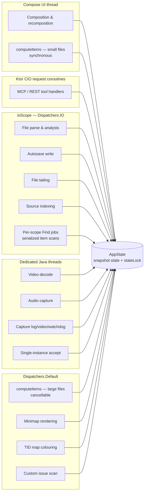

**Key.** Every arrow is a write into `AppState`. Compose `mutableStateOf` is snapshot-safe from any
thread, which is why no `withContext(Dispatchers.Main)` appears anywhere in the codebase; the
`stateLock` in §11.2 handles the compound-update case that snapshot safety does not cover.

---

## 13. Persistence architecture

### 13.1 Storage layout

Everything is a plain file under one app-data directory, resolved per OS by
`DesktopStorage.appDataDir` (`ui/DesktopStorage.kt:241-257`):

| OS | Directory |
|---|---|
| macOS | `~/Library/Application Support/Indagium` |
| Windows | `%APPDATA%\Indagium` (fallback `~/AppData/Roaming/Indagium`) |
| Other | `$XDG_STATE_HOME/Indagium` (fallback `~/.local/state/Indagium`) |

| Path | Contents | Format |
|---|---|---|
| `autosave.cache` | Session: tabs, filters, settings, saved filters, recents | `indagium-cache-v1`, line-oriented (a load also accepts the legacy `openLog2-cache-v1` magic) |
| `source-index` | Indexed `Log.*`/Timber call sites, semantic methods/calls/operations, synthetic callback methods, and bounded source-trace metadata | `indagium-source-index-v1`, schema v19 (a load also accepts the legacy `openLog2-source-index-v1` magic) |
| `case-index` | Similarity index over past analysis notes | `indagium-case-index-v1`, schema v1 (a load also accepts the legacy `openLog2-case-index-v1` magic) |
| `control-token` | Bearer token for the control server | 32 hex chars, plaintext |
| `notes/` | Saved analyses: `<base>_analysis.md` + `.ann` sidecar | Markdown + token format |
| `custom-ai-commands/` | User-defined AI slash commands | One `.md` per command |
| `voice-models/` | Downloaded Whisper models | GGML binary |
| `filter-backups/` | Automatic saved-filter backups | Filter-library JSON |
| `archive-cache/` | `videos/`: videos extracted from bug-report archives (budget-enforced). `captures/`: one reusable `capture-<key>` extraction per capture `.zip`/`.ind` state (§14.6). `capture-log-restore/`: transient verified-log copies | Raw media; derived, safe to delete |
| `captures/` | New retained sessions: `logs/logcat.log`, `mapping/blocks.jsonl`, `timeline/sync.json`, `video/screen.mkv`, screenshots, `session.json`, finalized `capture.indagium.json` | Sparse timing/storage metadata; interrupted sessions are recoverable from the launcher. Legacy sessions keep their original `mapping/capture-index.jsonl`; v5 ZIP/Compact exports use the same compact timing/block metadata with export-local offsets |
| `testing/` | **Legacy** home of the AI test data (library, suites, assets, `issues/`, `runs/`). Now only read once at startup: `migrateLegacyTestStorage` moves it into the three configurable folders (§26.3), and a bare `AppState` with no save root still uses it as its fallback | — |
| `<save root>/test-suites/`, `<save root>/test-runs/<runId>/`, `<save root>/test-issues/<issueId>/` | The AI test data: the library (`library.json`, `suites/`, `assets/`), one folder per run (`run.json` (frozen suite + results), `lanes/<laneId>/{capture,screens,transcript.jsonl}`, `judge.jsonl`) and one folder per issue. **Not** under `appDataDir`: each is a user setting (`testSuitesDir` / `testRunsDir` / `testIssuesDir`, JSON-only) defaulting to a subfolder of the Default save folder | `indagium-test-library`, `indagium-test-suite`, `indagium-issue`, `indagium-test-run`, each a versioned JSON envelope, plus JSON lines (§26.3) |
| `indagium-debug.log` | Opt-in diagnostic log | Android threadtime text |

#### 13.1.1 The pre-rename directory and the one-time migration

Before the app was renamed from openLog to Indagium, `appDataDir` produced a differently-named
directory on each OS — `DesktopStorage.legacyAppDataDir` (`ui/DesktopStorage.kt:260-264`) still knows
how to compute it, purely so the migration below can find it:

| OS | Legacy directory |
|---|---|
| macOS | `~/Library/Application Support/openLog2` |
| Windows | `%APPDATA%\openLog2` (fallback `~/AppData/Roaming/openLog2`) |
| Other | `$XDG_STATE_HOME/openLog2` (fallback `~/.local/state/openLog2`) |

`DesktopStorage.migrateAppDataDirIfNeeded` (`ui/DesktopStorage.kt:290-293`) runs in `Main.kt` before
`AppState` is constructed — and therefore before autosave restore — so a renamed build never starts
with an existing user's session invisible to it. `migrateAppDataDir` (`ui/DesktopStorage.kt:300-333`)
does the actual work, gated by a `.migrated-from-openLog2` marker file written into the *new* dir once
the run completes (or immediately if there was no legacy dir to copy from), which makes every
subsequent launch a no-op (`MigrationOutcome.AlreadyDone`):

| Entry | Copy mode | Why |
|---|---|---|
| `autosave.cache`, `notes/`, `custom-ai-commands/`, `filter-backups/`, `source-index`, `case-index` | Byte copy | User data and durable indexes worth preserving |
| `voice-models/` | Hardlink (same volume), falling back to a byte copy on any failure | Large, content-addressable, no-op for disk usage when linkable |
| `archive-cache/`, `control-token`, `single-instance.{lock,port}` | **Not migrated** | Derived/rebuildable cache, a per-install secret, and process-local coordination files, respectively — none of them is user data worth carrying forward |
| `openlog-debug.log` | **Not migrated** | Renamed away (now `indagium-debug.log`); an old diagnostic log has no continuing value |

Byte-copied data (not hardlinks) is capped at `MIGRATION_MAX_BYTES` = 2 GiB total
(`ui/DesktopStorage.kt:48`) so a pathological amount of legacy data cannot block startup; entries that
would push the running total over the cap are skipped individually (not partially copied) and the
rest of the migration still completes and still writes the marker. The old directory is never
written to, moved, or deleted by any part of this — the migration is copy-only and one-way, so it is
always safe to delete by hand.

### 13.2 The autosave format

`autosave.cache` is line-oriented `key\tvalue`, where each value is base64-url-encoded without
padding. The first line is a magic string: a write always emits `indagium-cache-v1`, but a read also
accepts the legacy `openLog2-cache-v1` (`AUTOSAVE_MAGIC_CURRENT`/`AUTOSAVE_MAGIC_LEGACY_OPENLOG2`,
`ui/AppState.kt:552-553`) — needed because the one-time migration in §13.1.1 copies a legacy user's
`autosave.cache` forward byte-for-byte, magic string and all, so it must still load. Any other first
line aborts the whole restore (`ui/AppState.kt:5964`, written at `:6119`).

Keys are written in a fixed order — `settings`, `active`, `compare`, `saved`, `activeFilters`,
`drafts`, `transientRegex`, `recent`, `recentNotes`, `filterPanel` — followed by a bare `tabs` marker
line and then one `tab\t<token>` line per tab (`ui/AppState.kt:6118-6136`).

**Two coexisting versioning strategies:**

1. **Token records use append-last versioning.** Fields are joined with `|`, each field
   `fieldToken()`-encoded with `"~"` as the empty sentinel (`ui/AutosaveCodec.kt:287-293`). Decoders
   read positionally with `getOrNull(idx)`, so a new field appended at the end simply defaults to
   absent in older files, and older readers ignore it. There is no version number on tokens — the
   append-last discipline *is* the compatibility mechanism. `tabToken` (`ui/AutosaveCodec.kt:1325`)
   shows this clearly: positions 0-8 are original, 9-12 were appended later.
2. **The settings blob is content-sniffed.** `restoreAutosaveKey` looks at the decoded text: if it
   starts with `{` it parses JSON (`settingsFromJson`, `ui/AutosaveCodec.kt:808`), otherwise it falls
   back to the legacy positional pipe format (`settingsFromToken`, `:468`). New settings go into the
   JSON form, which carries `formatVersion: 1` and keys every field by name. The legacy decoder is
   read-only and explicitly marked "never extend this positional layout again"
   (`ui/AutosaveCodec.kt:460-467`); it must stay byte-compatible with the frozen fixture in
   `AutosaveGoldenV1Test`.

### 13.3 Atomicity

Every store — autosave, the source and case indexes, the filter library, and the AI test-suite library, run and issue files — writes through `writeFileAtomically` (`utils/AtomicFileWrite.kt:17`): a temp file
named `.<name>.tmp-<nanoTime>` created **in the destination's own directory** so the subsequent move
stays on one filesystem, then `Files.move(..., REPLACE_EXISTING, ATOMIC_MOVE)`, with a plain-replace
fallback if the filesystem rejects atomic moves. A crash mid-write can therefore never corrupt an
existing autosave — the worst case is a stale but valid file plus an orphaned temp.

### 13.4 What is persisted and what is not

`LogTab.persistedSnapshot()` (`ui/AutosaveCodec.kt:1244`) is the field-for-field mirror of
`tabToken`, and is what the autosave `LaunchedEffect` keys on:

**Persisted:** `id`, `filename`, `sourcePath`, `filter`, `annotations`, `showAnnMd`,
`showUnfiltered`, `expanded`, `manualBlocks`, `archiveCandidate`, `showTimeDelta`, `attachedVideo`,
`noteTargetName`.

**Deliberately not persisted:** `logData` and `rmap` (re-parsed from the file), `analysis`
(recomputed), `largeFileMode` (re-derived from the file size), `selected`, `tailing`, the legacy
`search` projection, both per-scope `searches` slots, `searchMode`, `focusedSearchScope`,
`tidMap`, `videoFollowLog`, `captureTimeline`, `captureSessionId`, and `isCaptureLauncher`
(session-only state — `model/Model.kt`). A live recorder is therefore never resumed from autosave;
its session directory is recovered as interrupted capture data. After Stop, the same tab carries a
durable `attachedVideo`/capture descriptor link, so the finalized capture can be restored normally.
Find work is keyed by `(tabId, SearchScope)`; Filtered and Unfiltered keep separate query, case,
matches, cursor, focus, and navigation requests. A cancellation-aware mutex bounds concurrent full
item-list materializations. Recomputes come in two kinds: a query/case edit bumps the slot's
`inputRevision` (dropping navigation queued for the old input) and marks it searching, while a
refresh (new `logData`/stack-trace groups, a filter or grouping change) keeps the revision and the
current matches navigable until the new result lands. Either way the previous matches stay visible
until replaced, and Enter pressed during an edit's recompute is replayed on the fresh matches. A
zero-match Filtered search offers an explicit "Search all lines" action (`AppState.searchAllLines`)
rather than switching scope by itself. Entering Compare collapses each tab's Find to its Filtered slot
and never changes the persisted `showUnfiltered`; while Compare is active, plain Ctrl+F on a maximized
Original pane explicitly opens that side's Unfiltered slot. Ordinary compare Find remains Filtered.
The saved split-view link preference applies in every
Filtered/Original split mode: it mirrors Filtered row selection into Original and can mirror Find
navigation in either direction; free scrolling and ordinary Original row clicks remain local.
Compare mode uses separate tabs and does not couple their selections. The monotonic split-sync
revision advances when the saved link preference changes, so suspended row/Find work cannot apply
using stale linking semantics. The scope
behavior, last manually selected mode, and split-panel link preference are global `AppSettings`
values stored in keyed JSON; the legacy positional settings decoder remains unchanged. A scope
behavior change applies to the next Find open and never rewrites an open session.
`AppSettings.captureSettings` is persisted in the keyed settings JSON and is applied immediately by
the Capture section of Settings. `workflowAiSelections` remembers the provider, optional model and
reasoning-effort override independently for test-step drafting, note rewrite, recording rewrite, test lanes and the
judge; it does not change the global selected profile and contains no credentials. A remembered profile
is resolved against current settings on open, and stale discovered catalog choices fall back safely.
`AppSettings.tracker` and `AppSettings.testing` are likewise JSON-only
(appended last to `settingsJson()`); the issue tracker's access token is **not** part of settings — it
lives only in the OS keychain (§26.9.3). Test suites, runs and issues are stored in the three test folders
(`testSuitesDir` / `testRunsDir` / `testIssuesDir`, JSON-only, §26.3), not in the autosave.
`AppSettings.proofreading` is also keyed-JSON-only; it defaults to enabled English (`en-US`), with
`en-GB` as the alternate variant. The frozen positional settings decoder is unchanged.

The New tab's tiling (§6.3) adds three more JSON-only settings, appended last to `settingsJson()` after `workflowAiSelections`
(`ui/AutosaveCodec.kt:698-701`) and decoded by `homeLayoutSettingsFromJson()` (`ui/HomeLayoutSettingsJson.kt`), called from
`settingsFromJson` (`:905`); like the rest they never enter the positional form.

- `homeLayout`: the split tree. A split is `{"split":"row"|"column","w":1.6,"children":[...]}`, a leaf `{"section":"open"|"capture"|"tests","w":1}`.
- `homeHiddenSections`: an array of the same section keys, in the order they were hidden.
- `homeLayoutTipDismissed`: a boolean, default `false`.

The decoder never throws, and a hand-edited or corrupt file still yields a layout holding every section exactly once. A node that is
malformed, names an unknown section id, or nests deeper than `HOME_LAYOUT_MAX_DEPTH` (8) is dropped, then `sanitizeHomeLayoutState`
(`ui/HomeLayout.kt`) makes the rest consistent: the first duplicate of a section wins; a weight that is non-finite or <= 0 becomes 1 and
every weight is clamped to 0.05-20; a section that is both in the tree and hidden stays visible; a section in neither is appended at the
trailing page edge, so a section added by a later version appears by itself; the tree is normalised (empty and single-child splits
collapse, same-axis splits flatten); an empty tree, or every section hidden, falls back to `DEFAULT_HOME_LAYOUT` with nothing hidden.
At least one section is therefore always visible. The mutators (`withHomeLayout`, `withHomeSectionHidden`) go through the same
sanitizer, so settings written by the UI satisfy the same invariants.

The log view's tiling (§6.4) adds five more JSON-only settings, decoded by the log-view codec in `ui/LogViewLayoutSettingsJson.kt`
next to the compare view's four: `logViewLayout` (a tree of `{"split":..,"children":[..]}` / `{"section":"<key>","w":..,"dp":..}` nodes, absent while the
user has not changed the layout), `logViewHidden` (tile keys, default `[]`), `logViewCollapsed` (tile keys, default `["diagrams"]`), `logViewTilesLocked` (boolean) and
`lastLogViewPreset` (the `LogViewPresetId` name: `CLASSIC`, `REVIEW`, `LOG_FOCUS`, `FILTERS_ON_TOP`); the compare view's `compareLayout`, `compareHidden` (default `[]`),
`lastComparePreset` (`COMPARE_GRID`, `COMPARE_COLUMNS`) and `compareSyncScroll`. The decoder sanitizes through `sanitizeLogViewLayoutState`, so every tile
appears exactly once whatever the file says (the single view's `toolbar` tile only while `toolbarPlacement` is `IN_LAYOUT`, which the decoder reads from the same
object, §6.6). The window chrome's fields are `tabStripStyle` ... `toolbarEdge` (§6.5) and, appended last, `toolbarOuter` (boolean), `toolbarAlign` (`START` / `CENTER` / `END`),
`verticalTabBarWidthDp` (140..480) and `toolbarFallbackPlacement` (never `IN_LAYOUT`), decoded in `ui/ChromeSettingsJson.kt`; an absent or malformed value keeps the default.

### 13.5 Restore is metadata-only

This is the most important property of the persistence design. `restoreTabsFromAutosave`
(`ui/AppState.kt:6025`) builds tab shells with `logData = emptyList()` under `stateLock`. Actual
parsing is *queued*, not performed, and is started by `App()` only after first composition via
`scheduleRestoredTabLoad` on `ioScope` (`:6041`).

The consequence: restoring a session with eight multi-gigabyte tabs shows the window immediately with
all filters and notes intact, and the log bodies stream in behind it. Tabs whose backing file no
longer exists are dropped during restore (`ui/AutosaveCodec.kt:1432`).

The tab token appends `captureArchivePath` so imported capture snapshots can be restored even
without a video attachment. `RestoredTabSource.CaptureSource` loads and verifies the descriptor,
log, and optional media on the IO load path; token parsing does not scan ZIP contents. Imported
sources use immutable asset overrides plus a source-keyed index/cursor cache instead of copying
multi-gigabyte videos or rewriting their source archives.

### 13.6 Notes sidecars

Saved analyses are written as `<base>_analysis.md` plus a `.ann` sidecar holding the full
`annotationsToken`. The Markdown is for humans and ticket systems; the `.ann` restores exact block
structure, including image bytes and log references, when the note is reopened. The 5th token field
carries `sourcePath` (`ui/AppState.kt:5327`), which is what lets the case index associate a note with
the log it came from.

Each `AnnBlock.LogRef` also persists a `LogRefPresentation`: the captured row labels, formatted
delta strings, process-name candidates and the names actually displayed by the originating view,
plus the four presentation flags. The Add action captures only the selected excerpt and this
metadata before opening the editor, using the source view (or the current filtered context when no
panel is available); all four optional flags start off for a new block.
Changing a flag previews the same frozen rows that Notes, Markdown/Jira and HTML clipboard output
will render. Editing an existing block restores its saved choices. A saved block never consults
current selection, copy settings, analysis, or process-name maps. Ordinary row copy and filtered
export retain their existing settings behavior.

The `LogRef` token keeps its existing positional fields and appends the presentation token last, so
old `.ann` and autosave tokens still decode with `presentation == null`. On open or autosave
restore, resolvable legacy refs are frozen in memory using the effective legacy copy preferences;
there is no historical baseline from which to invent Δt values. Deferred autosave shells retain
the migration preferences until rows resolve. Opening a note does not rewrite its file; the
snapshot is persisted by the next normal save or autosave. Capture archive reanchoring remaps the
frozen presentation rows alongside the marker's local row IDs.

### 13.7 Diagram note codec (v3) and PNG export

Diagram notes stay ordinary `AnnBlock.Note` values, so the `.ann` container format does not change.
The v3 cutover (phase 6 of `docs/plans/use-the-claude-design-mcp-compiled-lighthouse.md`) replaced
the invisible header wholesale: `Seq3Codec` writes and reads exactly one version
(`<!-- indagium:diagram3 v1 {json} -->`), never a v1–v5 compatibility chain. The header carries the
WHOLE `Seq3Document` — lifelines and messages included, not a separate optional model/snapshot —
followed by a fenced Mermaid/PlantUML body and a SHA-256 hash of that body; a hash mismatch (the
fence was hand-edited, or written by a build that computed the hash differently) sets a warning but
still returns the document, since it's what the header actually says. A header stamped with an
unrecognised version, or one with garbled/truncated JSON or no fence after it, degrades to "not a
diagram note" rather than throwing — same "never crash a Notes-panel render" contract the old codec
had, reimplemented against the far smaller v3 model rather than ported. `DiagramExportMode`'s two
serialised constant names (`IMAGE`/`SOURCE`) moved into `diagram3` unchanged, so
`AutosaveCodec`'s `diagramDefaultExportMode` setting keeps reading old autosaves.

`Seq3Layout`/`Seq3Raster` are mandatory, not optional: PNG export has no fallback path. Every
consumer — the rich-clipboard data-URI (`AppState.copyRichPreview`), the `diagram-NN.png` files
`writeAnnotationDiagramImages` writes beside an exported `.md`, and `exportAnnotationFrames`'s
`_frames` folder — rasterizes through the same `Seq3RenderCache` (§10.2) rather than a bespoke path,
so a theme switch is honoured everywhere identically. `DiagramLibraryStore` is unchanged by the
cutover: it always stored the codec's encoded text verbatim (`DiagramLibrarySnapshot.
encodedDiagramNote`), so only the bytes it now stores changed, not its own format or on-disk layout.

Diagram3's generator deliberately does **no** source-index enrichment (`Seq3Generator.kt`'s own
header) — a message's target lifeline is inferred only from adjacent-entry evidence in the log
itself (thread handoff, correlation token; see §8.3), never from the source index. The source-trace
reconstruction engine described below (`source/SourceTraceInference.kt`,
`SourceTraceInferenceEngine`) therefore currently has **no production caller**: the old
`diagram/SeqDiagramBuilder.kt` was its only consumer, and it was deleted with the rest of that
package. The engine and its model (moved intact to `source/SourceTraceModel.kt` — see §9.7) remain
in the tree, covered by their own test suite (`SourceTraceInferenceTest.kt`), on the phase-6 brief's
explicit instruction to preserve them; nothing currently invokes them at runtime.

The source index uses schema v19. In addition to methods, log sites, and resolved call edges, it
persists source-ordered executable operations, branch/merge successors, continuations, returns,
throws, receiver bindings, and async dispatch metadata. A non-v19 index is never partially
trusted: it would be rebuilt before source-trace reconstruction is offered. Test roots remain
excluded from runtime call candidates, and runtime values remain log evidence rather than index
content.

Were it wired to a caller again, `SourceTraceInferenceEngine.resolve` reconstructs lane-isolated
invocation stacks over the indexed operations: calls and returns are structural operations, selected
log rows are separate trace events and remain visible exactly once at their source owner, PID/TID
and logged values refine ambiguity and return correlation, prefix/suffix boundaries are never
synthesized, and ambiguous/stale/unsupported/incompatible lanes stay log-only with diagnostics
rather than guessed arrows. Async dispatches cross lanes only when indexed evidence proves the
handoff and never push a blocking synchronous activation. Source reconstruction is segment-based: a
verified prefix or suffix is retained when a middle row is stale, ambiguous, low-confidence, or
branch-incompatible (`PARTIAL_SOURCE_TRACE` distinguishes that projection from a complete
`SOURCE_TRACE`); synthetic callback methods for Kotlin trailing lambdas and Java/Kotlin anonymous
callback bodies are stored with stable IDs and async registration edges; only async paths may cross
branch operations, and synchronous call/return proof remains straight-line and conservative.

---

### 13.8 klogg highlighter import

A klogg highlighter export can be imported **manually**: dropped on the filter sidebar or picked with
the Saved filters **Import** button. There is no autodetection of an installed klogg, and a `.conf`
dropped on the log area still opens as a log. `decodeFilterImport(fileName, text)` (`ui/FilterCodec.kt`)
routes by content: `{` or `[` is the JSON filter library, a `[HighlighterSetCollection]` (klogg 22+) or
`[FilterSet]` (legacy glogg) section is klogg, anything else is an error.

- `utils/QSettingsIni.kt` reads the Qt `QSettings` INI dialect: sections and comments, `%XX` / `%UXXXX`
  key escapes, quoted values with `\\ \" \x…` escapes, unquoted comma lists, `@@`. `@Variant(…)` and
  `@ByteArray(…)` values are not decoded; the keys that carry them are reported as a note.
- `utils/KloggHighlighterImport.kt` turns each set into one `SavedFilter` (name = set name, every other
  filter field default). Mapping: `regex = use_regex`, `caseSensitive = !ignore_case`, `wholeLine =
  !match_only`, `color = back_colour`, `textColor = fore_colour`, `kloggStyle = true`, `captureGroupsOnly = true`,
  `colorVariance = variate_colors && match_only ? color_variance : 0`. Missing keys take klogg's own
  defaults; colours are `#AARRGGBB`, `#RRGGBB` or SVG names (`utils/QtColorParse.kt`). The `quick\…`
  entries are colour presets and are ignored. Ids come from the set id (or name) plus the index, so
  re-importing the same file shows as identical and is skipped.
- Patterns are compiled with Java regex (`isValidRegexPattern`). PCRE-only syntax (`(?P<n>)`, `\K`,
  `(?|`) cannot compile and that highlighter is skipped with a note; a pattern that depends on the raw
  logcat layout (a leading `^`, a date, a `L/Tag` shape) is flagged, because the rendered line text
  drops the date and spaces fields differently. A set with no valid highlighter is shown as skipped.
- `utils/KloggColor.kt` ports `QColor::darker` / `lighter` and seeds `minstd_rand0` with the CRC32 of
  the matched text (libstdc++ downscaling), so colour-variance shades are deterministic but not
  guaranteed bit-identical to klogg on every platform.

The review dialog (`ImportFilterReviewRow.notes`, `PendingImportReview.notes`) lists up to three notes per
row plus "+N more", and marks klogg's active sets. The dropped-files path also keeps folders and reports
unreadable files through `importError` rather than skipping them silently.

`PendingImportReview.mode` (`ImportReviewMode`) picks what confirming does. `SAVE_FILTERS` is the original
flow. `ADD_TO_CURRENT` appends the highlighters of the rows in `highlightRowIds` (a selection kept apart
from the rows' saved-filter actions, so flipping modes loses neither) to `activeTabId`'s filter through
`upFlt`, with fresh `newId("hl")` ids and skipping any whose match shape (`newHighlightersFor`,
`ui/FilterCodec.kt`) is already on the tab. It writes no saved filters and no filter backup. The default is
`ADD_TO_CURRENT` when `DecodedFilterLibrary.fromKlogg` (set by `decodeFilterImport`'s klogg branch, not the
file name) and a log tab is active; the mode is unavailable without an active tab or any row that has
highlighters.

## 14. External integrations

### 14.1 Control server: MCP and REST

`debug/ControlServer.kt` exposes Indagium's functionality to external programs.

| Property | Value | Evidence |
|---|---|---|
| Framework | Ktor server, CIO engine | `debug/ControlServer.kt:329` |
| Bind address | `127.0.0.1`, **hard-coded, not configurable** | `debug/ControlServer.kt:329` |
| Default port | 8991, clamped to 1..65535 | `model/Model.kt` `mcpControlPort`; `ui/AppState.kt:210-211` |
| Enabled | **Off by default** | `model/Model.kt` `mcpControlEnabled = false` |
| MCP transport | Streamable HTTP at `/mcp` | `debug/ControlServer.kt` `mcpStreamableHttp` |
| REST | Local JSON/REST routes | `debug/ControlServer.kt` `REST_ROUTES` |
| Auth | `Authorization: Bearer <32 hex>`, constant-time compare | `debug/ControlServer.kt:126-173` |
| CORS | Installed **only** when `mcpAllowBrowserClients` is on | `debug/ControlServer.kt:336-345` |

#### 14.1.1 Debug-control isolated runtime

End-to-end MCP verification uses a debug-only process, not the user's normal application instance.
Launch it with both `INDAGIUM_DEBUG_CONTROL=<port>` and
`INDAGIUM_DEBUG_APP_DATA_DIR=<canonical-empty-temp-directory>`. The first switch force-enables the
loopback control server for that process only; the second redirects *all* app-data storage before
any migration, restore, or single-instance work begins.

The override is a fail-closed contract. The path must be absolute, contain no symlink path
components, resolve beneath the JVM temporary directory (or macOS `/private/tmp` /
`/private/var/folders`), name a non-root child directory, and be empty when it already exists. A
relative path, arbitrary user directory, symlink, file, or non-empty directory is rejected instead
of falling back to normal app data. The override is ignored unless debug control is enabled, so it
cannot become a user-facing storage setting.

An accepted override skips the legacy openLog2 → Indagium migration and isolates autosave and Recent
state, control token, notes/drafts, source and case indexes, archive cache, diagnostic log, and the
single-instance lock/socket. Test inputs may therefore be read from explicit fixture paths while all
generated state remains inside the empty debug directory. This is a test-safety boundary, not a
general-purpose sandbox: normal file-open authorization still belongs to the caller and MCP tool
policy.

**The single tool contract.** There is one catalogue, `MCP_TOOLS` (`debug/ControlServer.kt`), and one handler map, `operationHandlers` (`debug/IndagiumToolOperations.kt`). `IndagiumToolGateway` joins them and its `init` block **fails fast if they disagree** (`debug/IndagiumToolGateway.kt`).

Four consumers are then derived from that single pair:

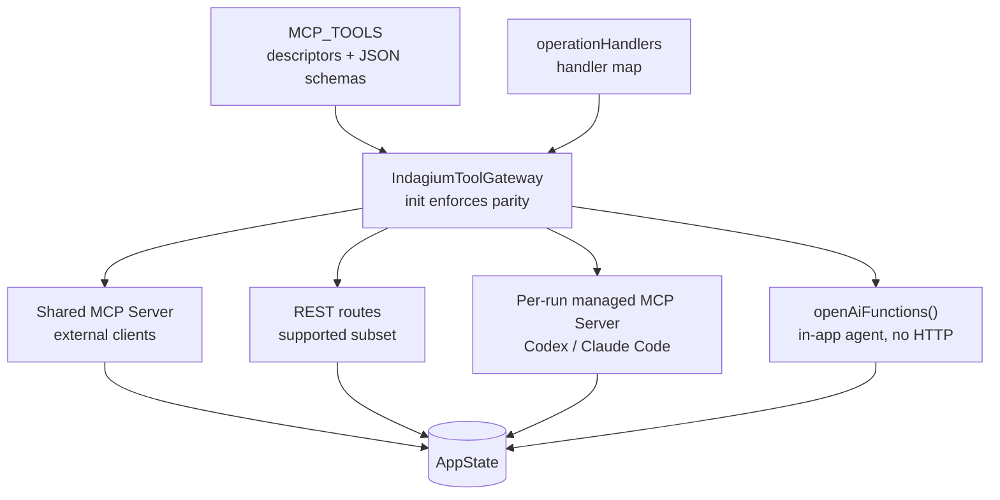

REST intentionally exposes a subset of the shared tool contract; availability is defined by each route and tool descriptor rather than by matching catalogue counts. Device-capture operations are available through the MCP catalogue and are described in [mcp/AVAILABLE_METHODS.md](mcp/AVAILABLE_METHODS.md).

Because `openAiFunctions()` serialises the *same* `ToolSchema` into OpenAI function definitions
(`debug/IndagiumToolGateway.kt:42-48`), there is no second hand-written tool catalogue anywhere. A
tool added in one place is available to every consumer, or the build fails.

**Gateway shapes.** A gateway normally holds synchronous `handlers`. A tool that has to wait is a
*suspend* handler (`suspendHandlers`), reached through `executeSuspending` so no Ktor or `Default`
thread blocks on it; the catalogue-parity check covers both maps. The AI test suites construct
*additional* gateways of their own — one per lane, judge run and tracker-filing job — whose tool names
are only known at run time, and `extraConfirmationRequired` lets such a gateway mark its own tools
(`ASK` scripts) as confirmation-required (§26.5, §26.9.2). `ControlServer.managedMcpServer` registers
exactly the tools of a managed run's own gateway when it brought one.

**Gateway action policy** covers confirmation-sensitive file and workspace operations and is defined
in `IndagiumToolGateway.kt`. The MCP server has a separate per-session approval gate for external
clients before device-changing operations or live-screen reads. Read-only device discovery and status
calls do not need that gate. The in-app AI path is authorized through the user's prompt. This device
gate covers start/stop capture, screen inspection, input/navigation, screenshots, issue marking,
snapshots, and changing device log settings. See [mcp/AVAILABLE_METHODS.md](mcp/AVAILABLE_METHODS.md#device-capture)
for the current live tool policy and operation list. A second external-client gate,
`PER_CALL_APPROVAL_MCP_TOOLS` (`debug/ExternalToolApproval.kt:22`), covers the AI-test-suite tools that
run commands or send data off the computer; it asks for *every call* and remembers nothing (§26.9.2).

**Session hygiene.** MCP sessions are pinged every 120 s with a 5 s timeout, and non-responders are
closed (`debug/ControlServer.kt:312-324`) — without this, an abandoned client would hold a session
forever.

### 14.2 AI providers

Two distinct integration shapes exist, and conflating them is the most common way to misread the
`ai` package.

**Shape 1 — HTTP providers implement `LlmProvider`** (`ai/LlmProvider.kt:10`):

| Provider | Transport | Notes |
|---|---|---|
| `AnthropicMessagesProvider` | Ktor CIO, hand-rolled SSE reader | Replays thinking blocks verbatim with signatures, or the API rejects the turn |
| `OpenAiCompatibleProvider` | Ktor CIO, hand-rolled SSE reader | Opts into `stream_options.include_usage`; detects reasoning models by id pattern |

Both set `requestTimeout = 0` on the engine — CIO's 15 s default breaks local LM Studio generation,
which can legitimately take minutes.

**Shape 2 — account CLIs are subprocesses and do *not* implement `LlmProvider`:**

| Client | Transport | Command |
|---|---|---|
| `ClaudeCodeClient` | Newline-delimited JSON on stdout | `claude --print --output-format stream-json --verbose --include-partial-messages` |
| `CodexAppServerClient` | stdio JSON-RPC (JSONL), numeric request ids | `codex app-server --stdio` |

Both are driven by `AccountAgentRunner`. Indagium holds **no credential** for these — authentication
lives in the user's own CLI installation.

**How a subprocess agent reaches Indagium's tools.** It cannot call in-process, so
`ManagedMcpServerLease` starts a *second* `ControlServer` on port 0 (OS-assigned) with a run-scoped
bearer token registered in `ManagedMcpRunRegistry`. Codex receives the token via the
`INDAGIUM_MCP_TOKEN` environment variable — deliberately not on the command line, where it would be
visible in `ps`. Claude Code receives it in an `Authorization` header inside its `--mcp-config` JSON.
The lease is revoked when the run ends. An AI test-run lane (or judge, or issue-filing job) passes its
own gateway to `ManagedMcpServerLease.start` (`ai/ManagedMcpServerLease.kt:26`), and the run is then
served an `AiToolExecutionCoordinator` over *that* gateway only (`ai/ManagedMcpRunRegistry.kt:36`), so
Claude Code and Codex see just the lane's tools.

### 14.3 Video

`video/VideoPlayerController.kt` decodes with JavaCV's `FFmpegFrameGrabber` on a dedicated thread and
plays audio through `javax.sound.sampled.SourceDataLine`. Frames are downscaled to a 1280 px long
edge during decode, and a frame-drop policy discards frames more than 100 ms late, up to 15
consecutive drops.

The dependency choice is documented in `build.gradle.kts:27-33`: FFmpeg natives ship inside the jar
(no user install) and decode phone recordings including HEVC/`.mov`/WebM. The player uses the
Apache JavaCV wrapper over the shared LGPLv3-or-later FFmpeg build; see `THIRD_PARTY_NOTICES.md`
and `licenses/third-party/SOURCE-BUNDLE.md` for the native dependency closure, replaceable
classifier JARs, and corresponding source inputs. VLCJ was rejected as GPLv3, JavaFX Media for
missing HEVC/`.mov`, and GStreamer/libVLC-direct for requiring a per-OS runtime install.

This player is used after a capture is stopped and finalized (or when an imported capture is opened).
While a capture is live, the right-sidebar capture card's embedded mirror (§6.2) decodes the
device's live stream directly via a second, independent JavaCV/FFmpeg pipeline — it does not attempt
to decode the growing recording MKV, and a mirror failure cannot stop or corrupt log/video recording.
Snapshot export remuxes (or, when the gap to the requested start is large, decodes and re-encodes) a
frozen portion of that growing file and records both requested and actual video coverage, including
any keyframe-shortened start or end gap.

### 14.4 Voice

Three transcription backends, selected per OS by `voice/VoiceRecognitionEngines.kt:14-24`:

| Backend | Mechanism | Notes |
|---|---|---|
| Whisper | App-owned JNI bridge statically linked to pinned `whisper.cpp` 1.9.5 and a downloaded GGML model | Local-only automatic language detection and transcription; Base, Small and Large v3 support translation to English, while Large v3 Turbo is transcription-only |
| Apple Speech | Objective-C JNI bridge, **compiled at build time** from `native/macos/indagium_speech.m` | Keeping it generated rather than committed makes the native code reviewable and lets notarisation sign the exact dylib built for the release |
| Windows Speech | Out-of-process helper, base64 PCM over the pipe | Requires an installed offline language pack |

The four model files are downloaded only after explicit consent from the pinned Hugging Face
revision `5359861c739e955e79d9a303bcbc70fb988958b1`, verified by descriptor size and SHA-256, and
stored in `voice-models/`. The CMake source archive is independently SHA-256 pinned and cached
under Gradle's build directory; a narrow, anchor-checked patch converts upstream Metal allocation
failure from a GGML assertion into a load failure, allowing the JNI bridge to retry on CPU. The
bridge is generated as a platform resource for packaging and statically contains Whisper/GGML; no
speech-recognition service or provider SDK is used. macOS builds embed Metal, while Linux and
Windows build portable CPU kernels. Native inference holds one process-wide mutex because multiple
model contexts would multiply large allocations. Model verification uses shared asynchronous file
status keyed by normalized absolute path and descriptor; microphone entry reads that status without hashing a
large model. The Settings view and install/remove operations use the same status. Recording audio is
not saved. Transient recognition results are not stored as separate voice artifacts; text inserted
into an editor is saved through that editor's normal workflow.

`AnnotationMarkdownEditorDialog` exposes **Rewrite with AI…** when a nonblank selection or draft is
available. It captures the selected range (restoring the editor's retained Markdown selection) or
the full current draft, then uses `AppState.runAgentForText` with an empty tool gateway and only that
text plus optional user instructions. The request never includes log/source/app context, images or
audio. Provider, model and effort are stored in `workflowAiSelections.noteRewrite`, separately from
other AI workflows and without credentials; local, API and Codex/Claude account text profiles are
eligible, voice profiles are not. The preview appears only after an explicit successful run. Apply
checks the editor session, lock/conflict state and exact captured draft, changes the selected range
or full text once (one Undo), and leaves saving to the note's normal action. Cancel, errors, stale
results and editor closure preserve the draft; diagrams pass only their caption to the same dialog.

`VoiceInputControllerFactory` builds the platform controller from the shared `VoiceInputSettings`,
and `VoiceInputSessionCoordinator` grants one active editor a lease at a time. A lease is tied to a
stable editor identity, not a row position. Closing, locking, disabling or replacing the target
cancels its session, and delayed results are dropped unless the same lease still owns it. The AI
composer keeps its existing append-at-end behavior; notes and explicitly opted-in test-authoring
fields insert at the retained selection or caret as one editor change. Escape cancels recording
without discarding text already typed. Model installation is local except for the consented Whisper
model download.

English proofreading runs only in notes. `LanguageToolEnglishProofreader` uses the bundled English
rules locally; `EnglishProofreadingService` serializes checks on a lazy worker. The UI debounces
edits, accepts results only for the exact text revision that was checked, and presents suggested
replacements without changing text automatically. Markdown syntax, code, URLs, paths, diagram
metadata and other technical spans are excluded while source offsets are preserved. Decorations and
ignored suggestions are session UI state, not note content or exported markup. The JSON-only
`ProofreadingSettings` defaults to enabled with `en-US`; `en-GB` is the other supported variant.
Suggestion popups remain passive while typing. Press Alt+Enter (Option+Return on macOS) with the
caret on an issue to enter keyboard mode; Tab/Shift+Tab move between replacements and Ignore,
Enter/Space activates the focused choice, and Escape returns to the editor without changing text.
Escape suppresses the passive popup until the caret or text changes.

### 14.5 Update checker

`update/UpdateChecker.kt` queries `api.github.com/repos/<repo>/releases/latest`, picks the asset
matching the current OS and architecture (`.dmg` / `.msi` / arch-matched `.deb`), and streams the
download to a `.part` file before an atomic move. `fetchLatest()` never throws except on
cancellation. The automatic startup check is silent on failure; only a manual check surfaces an
error.

### 14.6 Archives

`utils/BugReportZip.kt` reads `.zip` and `.7z` bug reports via Commons Compress (commons `ZipFile`, not
`java.util.zip`, so entries stored with ZIP method 93 are readable), with explicit
budgets against decompression bombs: 500 MB per entry and 20,000 entries scanned, enforced by a
`BoundedInputStream` that raises `ArchiveBudgetExceededException`. Videos found inside an archive are
extracted to `archive-cache/` under a cache budget with unreferenced-file pruning.

Capture archives (`.zip`/`.ind`, `CaptureArchiveReader.open`) extract into
`archive-cache/captures/capture-<key>` where `<key>` is the first 128 bits of SHA-256 over the archive's
canonical path, size and mtime (`capture/CaptureExtractionCache.kt`). The first open extracts into a
`capture-tmp-<key>-<uuid>` sibling, verifies every asset's SHA-256 while streaming, writes a
`.indagium-extracted` marker (key plus per-asset length and checksum) and atomically renames it into
place. Every later open (each restart, each restored tab, `restoreCaptureLink`'s re-open) re-reads only
the zip's central directory and descriptor, then reuses the directory when the marker key, the checksum
list and the on-disk asset lengths all still match; a missing or truncated asset, or a changed archive
(new size/mtime, hence a new key), re-extracts. Reuse deliberately skips re-hashing (a ~200 MB video per
tab per launch otherwise); a same-length in-place bit flip on the local disk is not detected. A per-key
`ReentrantLock` makes concurrent opens of one archive extract once; only IO threads take it. Persisted
state never points into this cache (archive sources persist the archive path, videos play from
`archive-cache/videos`); the live references are the in-memory imported snapshot sessions, and the
process-wide in-use set keeps those directories out of the sweep. `AppState` runs
`sweepCaptureExtractionCache` once at startup on `ioScope`: it deletes legacy per-open `capture-<uuid>`
directories, abandoned `capture-tmp-*`, keyed directories unused for 14 days (the marker's mtime is
touched on every reuse) and, above a soft 5 GB budget, least-recently-used directories, always skipping
directories in use, directories active within the last hour and directories another instance still leases,
and the stale `capture-log-restore` leftovers. The lease exists because macOS skips the single-instance guard,
so two JVMs (a dev build and the installed app) can share one cache: a directory a process uses holds a shared
`FileChannel` lock on `.indagium-lease` inside it (`acquireUse`, taken before the reuse is validated), and the sweep
takes that lock exclusively with `tryLock` before deleting, skipping the directory when it cannot (it never waits).
Ownership is reference-counted: `CaptureArchiveReader.open` returns the claim as `ImportedCapture.extractionUse`
(a `CaptureExtractionUse`); `AppState` closes the opener's claim when it is done, keeps one per tab inside the
`ImportedCaptureSnapshot` (taken with `retain()`, closed when the tab closes, the snapshot is replaced or the app closes,
and retained again around a running snapshot export), and the lease channel and in-use entry go with the directory's
last open claim. The lock is also released when the process dies, on `deleteDirectory` of that directory and from
`AppState.close` via `releaseLeases`. Replacing a damaged directory needs exclusive ownership too (`clearForReplacement`:
drop this process's shared lease, `tryLock` exclusively, never wait): when another process still holds a shared lease
nothing is deleted and the archive is extracted into a separate `capture-<uuid>` directory (the sweep's legacy junk
name), when it holds an exclusive one (its sweep) the open waits and retries. All lease and in-use registries key on
canonical paths, so a symlinked or aliased path cannot split one directory (or one `.recording.lock`) into two
entries and close a channel that drops the first one's POSIX lock. A sweep removes the directory's other files while it holds the lease and drops the lease file last, which also keeps
Windows' mandatory locks from blocking the removal. A directory without a lease file (older build, filesystem
without locks) falls back to the in-use set and the grace period. The lease file is not an asset: reuse checks the
marker's asset list, never the directory listing.

**Extract from this archive** (`capture/CaptureArchiveExtract.kt`). The range popover of a tab opened from an archive
(`Export -> Export capture range...`; it is the same `CaptureSnapshotPopover` as Save snapshot) has an "Extract from this
archive" group next to its two archive formats, shown only when the tab's `ImportedCaptureSnapshot.extractSource` (the
extraction directory, the parsed descriptor and the opened file, appended last to the snapshot) is present. The choice is the
UI-only `SnapshotOutput` (`Archive(format)` or `Extract(kind)`); `CaptureExportFormat` is unchanged because it is part of the
exporter request and the AI tool. `CaptureArchiveExtractor` copies, it never decodes: the cache already holds each asset
decoded (zstd undone) and hash-verified, so `ALL_FILES` (a folder), `LOG_ONLY` (`<name>.log`) and `VIDEO_ONLY` (the video's own
extension) re-hash every file against the descriptor while copying (a cache file changed after the open fails with a checksum
error and publishes nothing). Output is staged beside the destination (`.<name>.extracting-<uuid>`, same volume) and renamed in
one step with `moveWithoutReplacing` (the same short Windows sharing-violation retry as `moveReplacingAtomically`, never a
replace); an existing folder is refused (never merged or replaced), an existing file is replaced with
`moveReplacingAtomically` only after the popover's overwrite confirmation, and the popover names what is in the way (a folder
or a file) via `captureExtractConflict`. Paths go through `resolveSafe`, symlinks are
refused, free space is checked first, and cancel is thread interruption (`AppState.extractImportedCapture` runs the copy in
`runInterruptible` on `ioScope`; the copy loop checks `Thread.isInterrupted`), which removes the staging. The copy holds its own
`extractionUse.retain()` for its whole run, so closing the tab mid-copy cannot let a sweep or replacement pull the files away.
The folder's descriptor is written with the exporter's own writer for v3+ and verbatim from the source for v1/v2 (whose nested
shape that writer cannot produce), so the folder re-opens through the in-place folder import; a v1/v2 folder therefore needs
the opened file to still be readable, and says so (Log only / Video only never do); its notes are the archive's as
shipped, not the recipient's edits in the tab. Status reuses the export busy/result/error state (`CaptureExportResult.extracted`
makes the strip say "Extracted to ...", and keeps the AI status's `lastSnapshotPath` on the last saved archive); the range
controls, Include video and the sparse preview are off in Extract mode. The popover reads the extract source on every
composition, and every store or drop of an imported snapshot bumps an observable revision that `captureSnapshotSessionFor`,
`isImportedCaptureSnapshot` and `captureExtractSourceFor` read, so a restored archive tab (rows first, snapshot linked a
moment later) shows its Extract group, and its range editor, as soon as the link lands.
Separately, `AppState.saveRetainedCapture` (the stopped strip's Save ZIP / Save Compact) now exports an opened archive's own
imported snapshot instead of looking its descriptor's session id up in the local capture roots, which failed on a recipient's
machine and exported the local original on the sender's.

### 14.7 Single instance

`singleinstance/SingleInstance.kt` takes a `FileLock` on `single-instance.lock`. The primary instance
binds an ephemeral loopback `ServerSocket` and writes `"<port> <token>"` to a port file with
owner-only POSIX permissions. A secondary instance connects, sends the token plus its file arguments,
and exits before any composition happens (`Main.kt:106`). If the lock cannot be taken *and* the
socket cannot be reached, the app runs anyway in a degraded mode rather than refusing to start.

macOS deliberately skips all of this — LaunchServices and `Desktop.setOpenFileHandler` already
provide the behaviour (`Main.kt:103-106`).

---

## 15. Sequence diagrams

### 15.1 Opening a log file (the primary flow)

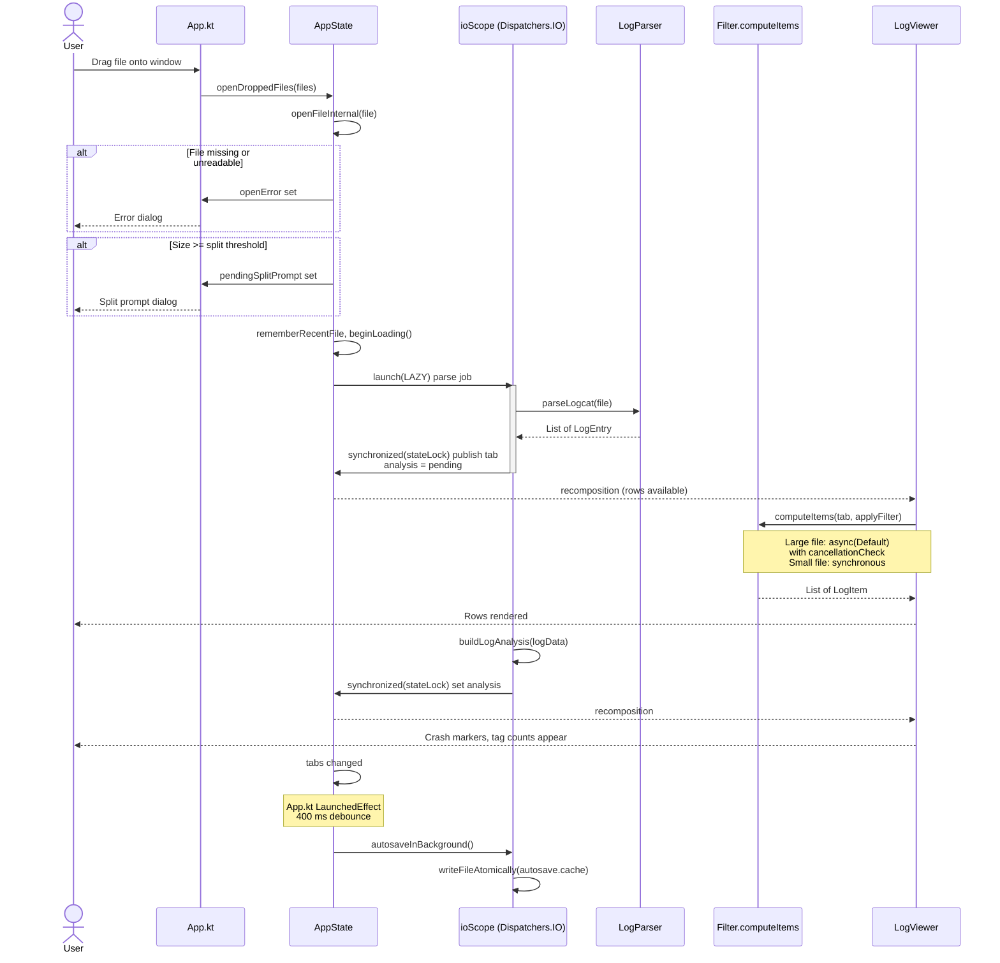

**Key.** Note the two-phase publication: rows appear as soon as parsing finishes, and the expensive
analysis fills in afterwards on the same job. This is what keeps a 2 GB file feeling responsive.

### 15.2 AI investigation round-trip

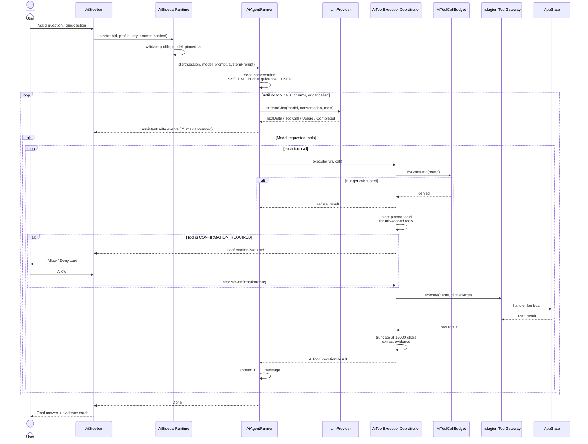

**Key.** The `Policy` participant is the point of the diagram. Budget, tab pinning, the confirmation
gate, result truncation, and evidence extraction all happen there — once — so a subprocess agent
arriving through the managed MCP path (`executeManaged`, `ai/AiToolExecutionCoordinator.kt:37`) gets
identical treatment without a second implementation.

Evidence cards are built **only** from completed gateway results, never from the model's prose
(`ai/AiInvestigation.kt:159-162`). A model that invents a line number cannot produce a clickable link
to it.

### 15.3 External MCP client invoking a tool

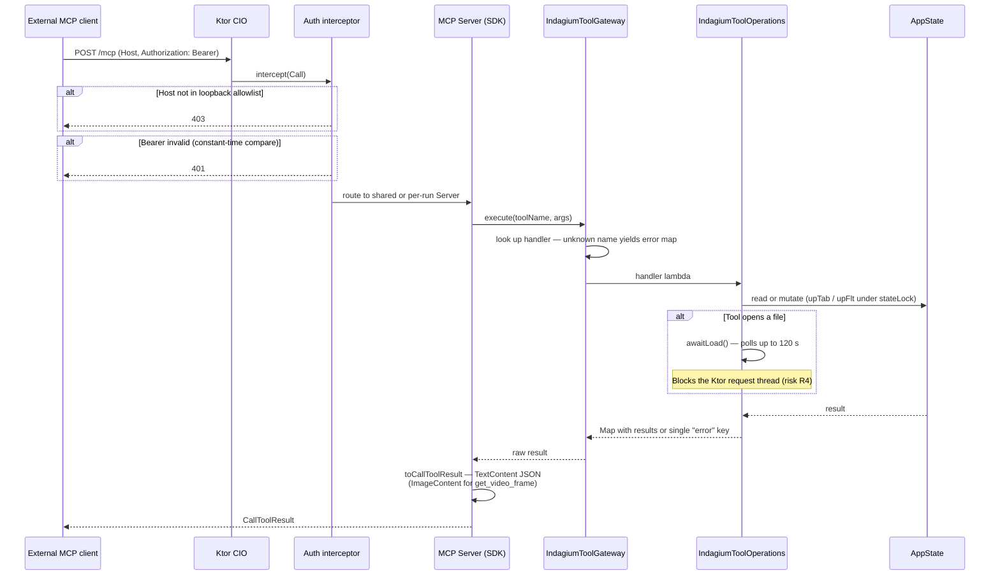

**Key.** Two independent gates run before any tool executes: the `Host` header allowlist (which
defeats DNS rebinding — a malicious page resolving its own hostname to 127.0.0.1 still sends its own
`Host`) and the constant-time bearer comparison. A managed run token is accepted for MCP but
explicitly **rejected** for REST (`debug/ControlServer.kt:420-422`).

Handlers return errors as data — a `Map` with a single `"error"` key — rather than throwing. There
are 117 such returns in `IndagiumToolOperations.kt` against 8 lines containing `try`/`catch`.

### 15.4 Autosave and session restore

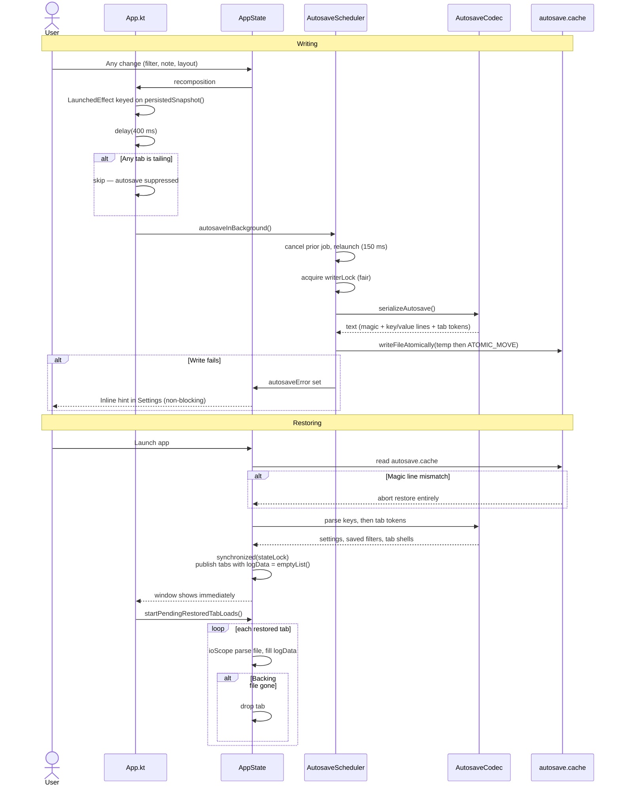

**Key.** The shutdown path differs: `Main.kt`'s `onCloseRequest` calls `autosaveNow()`, which is
**synchronous by design** (`ui/AutosaveScheduler.kt:60-65`) because the process must not exit before
the write lands.

---

## 16. AI run lifecycle

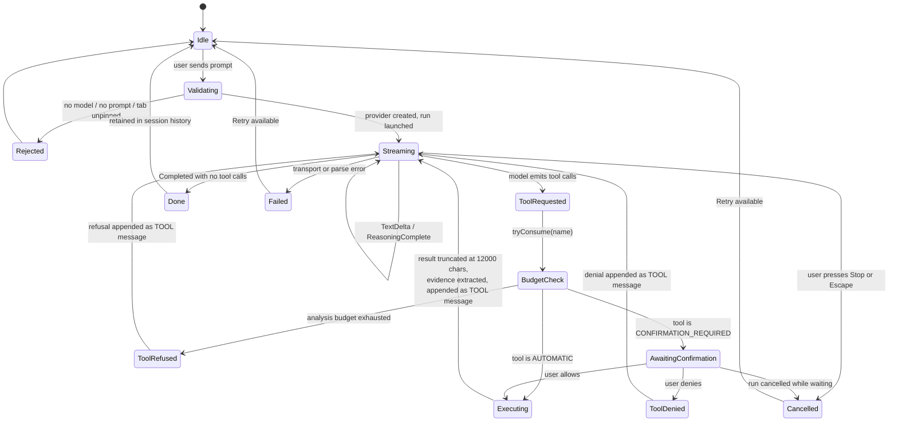

**Key.** Notes and annotation tools do not consume budget (`ai/AiToolCallBudget.kt:74-82`), so the
`BudgetCheck → ToolRefused` edge is unreachable for them. This is deliberate: an agent that has spent
its analysis allowance must still be able to write up what it found.

`Cancelled` is reachable from `AwaitingConfirmation` because a `finally` block cancels every pending
confirmation deferred when the run ends (`ai/AiAgentRunner.kt:256`) — otherwise Stop would hang on a
card nobody was going to click.

AI test-run lanes, the blind judge and the tracker-filing job reuse this same state machine through
`AiAgentRunner`/`AccountAgentRunner`, with two optional knobs that default to *off* so the sidebar is
unchanged: `AiRun.confirmationTimeoutMs` (an unanswered confirmation card counts as denied instead of
waiting forever, `ai/AiToolExecutionCoordinator.kt:140`) and a set of `freeTools` that never spend the
tool-call budget (`ai/AiToolCallBudget.kt:24`). Such a session is deliberately never registered in
`AiSessionRegistry` (§26.5.3).

Conversations exist only for the current launch. `AiSession` is deliberately not part of `LogTab` or
`AppState`'s persisted surface (`ai/AiAgentRunner.kt:19-22`), so no autosave or export path can
retain one.

---

## 17. Error handling and resilience

### 17.1 The governing idioms

**Cancellation is rethrown; everything else becomes an event.** The recurring pattern across the AI
and IO layers:

```kotlin
catch (cancelled: CancellationException) { throw cancelled }
catch (_: Exception) { emit(Error(...)) }
```

Getting this backwards would convert a user pressing Stop into a spurious error card. Examples:
`ai/AnthropicMessagesProvider.kt:130-134`, `ai/OpenAiCompatibleProvider.kt:130-136`,
`ai/AiToolExecutionCoordinator.kt:92-96`, `ai/ClaudeCodeClient.kt:238-247`.

**`runCatching` for best-effort work.** Every AWT/Desktop call, filesystem probe, reflection hack, and
cleanup path is wrapped. `Main.kt` alone has four in its first 120 lines.

**Errors as data at the tool boundary.** Tool handlers return a `Map` with an `"error"` key rather
than throwing, so the transport layer never has to translate exceptions into protocol errors.

**`SupervisorJob` everywhere.** One failed file load cannot cancel `ioScope` and abort the other
seven tabs still loading.

### 17.2 Failure surfaces

There is **no global exception handler and no crash dialog**. Each failure has a designated surface,
chosen by how much it should interrupt the user:

| Failure | State field | Surface |
|---|---|---|
| Cannot open file | `openError` | Modal dialog (`ui/App.kt:1841-1878`) |
| Filter import failed | `importError` | Modal dialog |
| Filter rename collision | `filterRenameError` | Inline in the rename dialog |
| Autosave write failed | `AutosaveScheduler.autosaveError` | **Inline hint in Settings** — deliberately non-blocking |
| Control server bind failed | `mcpControlError` | Inline in Settings; a failed *persisted* enable auto-reverts the toggle so it cannot crash-loop (`ui/ControlServerManager.kt:137-140`) |
| Diagnostic logging misconfigured | `debugLoggingError` | Inline in Settings, with a retry action |
| Reset app data failed | `resetAppDataError` | Inline in the confirm dialog |
| Update check failed | `updateCheckStatus = Failed` | Text in Settings; **silent** for the automatic startup check |
| Video decode failed | `VideoPlayerController.error`, `FailedVideoPlayerController` | Message in the video panel |
| Capture tools/device unavailable | `CaptureService.toolStatus`, `devices`, `error` | Inline in the New capture launcher or Settings → Capture, with recheck/install guidance |
| Live recorder/storage/video diagnostic | `RecorderSnapshot.diagnostics` | Capture strip's diagnostics drawer and live capture card beside the embedded mirror |
| Snapshot export failed/cancelled | `captureExportError` / job cancellation | Snapshot popover; the live recorder remains active and no partial destination is published |
| Stop/finalization failed | `captureFinalizationStatusByTab` | Same tab's finalization banner; raw log remains visible as a stopped ordinary log |
| Load appears hung | `isLoading` + `loadingStatus` | `StuckLoadingDialog` after a delay, offering Cancel loading / Close all tabs / Clear cache / Keep waiting |

`ui/LoadingWatchdog.kt` is a diagnostics-only companion to that dialog: when the global loading state
(`AppState.beginLoading` 0 to 1 transition) lasts more than 10 s it writes one warning per episode to the
diagnostic log (elapsed time, `pendingLoads`, `loadingStatus`, every `activeLoads` entry with tab id, title,
open/restore kind, capture/archive/file source, job state and `countsAsLoading`, queued restore loads, and a
full `ThreadMXBean` dump including monitor owners such as `stateLock`), short follow-ups at 30 s (with a second
dump) and 60 s, and an INFO line with the total duration when an episode that long ends. It runs on `ioScope`,
reads loading state without `stateLock` so a lock held by a stuck thread cannot silence it, and changes no
behaviour. Thresholds are injectable (`LoadingWatchdogConfig`).

The stuck-loading watchdog (`ui/App.kt:281-307`) deserves note: it is the escape hatch for the case
the architecture cannot otherwise recover from — a parse of a pathological file that is technically
progressing but will not finish in useful time.

### 17.3 Resilience in the stores

Every on-disk index degrades to "rebuild" rather than failing:

- Missing file, empty file, wrong magic string, or version mismatch → `null` → full rebuild.
  (`source/SourceIndexStore.kt:133-136`, `cases/CaseIndexStore.kt:112-115`.)
- Each individual line is parsed under its own `runCatching`, so one corrupted record does not
  invalidate the whole file (`source/SourceIndexStore.kt:95`, `cases/CaseIndexStore.kt:88`).
- The autosave is the exception: a wrong magic line aborts the entire restore
  (`ui/AppState.kt:5964`), because a partially restored session is worse than a clean one.
- The AI test-suite stores follow the "skip and report" rule: an unreadable suite file is skipped and
  listed in `TestLibraryStore.loadIssues`, a damaged `library.json` is moved aside rather than
  overwritten, a run folder without a readable `run.json` is skipped by `list()`, and a record written
  by a newer version is loaded read-only and never rewritten (§26.3).

---

## 18. Security considerations

Indagium processes files that frequently contain production data, and it optionally opens a local
network port and runs external programs. This section states each control **and its residual risk**.

### 18.1 Trust boundaries

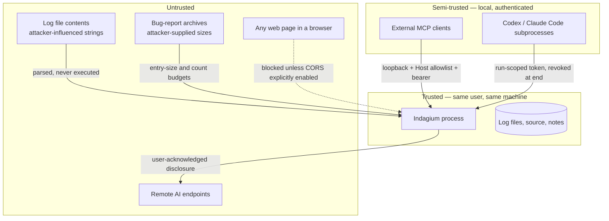

### 18.2 Control-server exposure

| Control | Implementation | Residual risk |
|---|---|---|
| Off by default | `mcpControlEnabled = false` | A user who enables it and forgets leaves it running |
| Loopback bind | `host = "127.0.0.1"`, hard-coded | None from the network; **any local process** can attempt to connect |
| `Host` header allowlist | `{127.0.0.1, localhost, [::1], ::1}` → 403 otherwise | Defeats DNS rebinding, not a local attacker |
| Bearer token | 16 random bytes from `SecureRandom`, hex, compared with `MessageDigest.isEqual` | **Stored in plaintext** at `<appDataDir>/control-token`; owner-only permissions are best-effort and a no-op on Windows. Any process running as the user can read it |
| CORS opt-in | `install(CORS)` only when `mcpAllowBrowserClients` | When enabled, any browser page can reach the port subject to the token |
| Session reaping | 120 s ping, 5 s timeout | Bounded resource leak, not eliminated |

**Deliberate non-control: there is no path sandbox.** `invalidPath` rejects only blank paths and
paths containing NUL (`debug/ControlServer.kt:175-179`). An authenticated client can ask Indagium to
open any file the user can read. This is documented as intentional — opening arbitrary local log
files is the tool's entire purpose — but it means **the bearer token is the only thing standing
between a local process and a file-read primitive**. Treat the token as a credential.

### 18.3 Regular-expression denial of service

Users and AI agents both supply regexes that run against millions of lines. Three controls in
`utils/TextMatch.kt`:

| Control | Value | Purpose |
|---|---|---|
| Per-match deadline | 100 ms | `DeadlineCharSequence` throws from `charAt()` every 1024 calls past the deadline, aborting catastrophic backtracking |
| Per-operation timeout budget | 3 | After three timed-out patterns, all regex is abandoned for the rest of the operation |
| Regex cache | LRU, 256 entries | Bounds memory from an attacker (or agent) supplying unbounded distinct patterns |

A timed-out result is never memoised (`utils/Filter.kt:330-334`), so the user is not stuck with a
silently truncated view.

### 18.4 AI provider credentials

API keys live in `AppState.aiProviderApiKeys`, a `ConcurrentHashMap` (`ui/AppState.kt:966`). The
protection is **structural, not procedural**: `AppSettings` is the only settings object serialised
into `autosave.cache`, and `AiProviderProfile` has no secret field. A key therefore has no path to
disk, to an export, or to a note.

Keys are cleared on profile delete and on `AppState.close()`. They are lost on restart by design.

| Residual risk | Note |
|---|---|
| Keys are in process memory unencrypted | A heap dump or a debugger attached to the process exposes them. AI provider keys have no OS keychain integration; the one secret that does (the issue tracker's token) is described in [§26.9.3](#2693-secrets) |
| Plain-HTTP endpoints are permitted | Only after the user acknowledges `REMOTE_DISCLOSURE_REQUIRED` (`ai/AiProviderProfileSupport.kt:13`); loopback hosts bypass the gate. The key travels unencrypted if the user accepts |

### 18.5 Subprocess agent containment

| Control | Implementation |
|---|---|
| Claude Code built-in tools disabled | Launched with `--tools ""`, `--strict-mcp-config`, `--permission-mode bypassPermissions` (`ai/ClaudeCodeClient.kt:339-343`) — the agent can reach *only* the managed MCP endpoint |
| Codex user MCP servers disabled | Generated config disables servers from `~/.codex/config.toml` per launch |
| Codex sandbox | `approvalPolicy = "never"`, `sandbox = "read-only"`, `ephemeral = true` |
| Fresh workspace | Each run gets a temp directory, deleted afterwards |
| Token off the command line | Passed via `INDAGIUM_MCP_TOKEN` env var, not argv where `ps` would show it |
| Elicitation filtering | Only `indagium`-server elicitations and MCP tool-call approvals are accepted; everything else is declined |
| stderr redaction | `ProcessDiagnosticTail` strips `bearer …` and `api_key|token|secret|password|authorization = …` before any diagnostic surface can show it |

The account agents receive no source-folder access and no application workspace access; all log and
source evidence reaches them only through Indagium tools.

### 18.6 Log redaction

`AppLogger.safeText` (`debug/AppLogger.kt:108-116`) strips CR/LF/TAB, replaces
`api_key|token|secret|password|authorization` values with `[REDACTED]`, replaces Windows `C:\…` and
POSIX `/…` paths with `[PATH]`, and truncates at 2,000 characters. Diagnostic logging is off by
default. The log is written in Android threadtime grammar so it can be opened in Indagium itself —
a small but genuinely useful design touch.

### 18.7 Archive handling

500 MB per entry and 20,000 entries scanned, enforced by a `BoundedInputStream` that raises
`ArchiveBudgetExceededException` (`utils/BugReportZip.kt:19-35`). This is a zip-bomb control. Entry
paths are used for display and extraction into a dedicated cache directory.

### 18.8 Distribution

The macOS build is **unsigned and un-notarised** — there is no Apple Developer certificate in CI. The
README documents the Gatekeeper workaround. Residual risk: users are instructed to bypass a security
control (`xattr -cr`), which is a habit that generalises badly. Signing is the fix.

---

### 18.9 Untrusted import files

Filter imports (the JSON library and klogg configs) come from outside the app, often from a colleague.
They are treated as untrusted data: parsed, never executed. Reads are refused past about **8 MB**
(`readFilterImportText`, `ui/FilterCodec.kt`; a real export is a few KB), klogg array sizes are clamped
(`MAX_ARRAY`), unreadable or malformed files surface as an import error instead of a crash, and every
imported regex is compiled through `TextMatch`'s bounded cache and evaluated under the same 100 ms
per-match deadline as any other user regex (§18.3), so a pathological pattern in a shared config
cannot stall the log view.

### 18.10 AI test suites

The AI test suites add four security surfaces — user-authored scripts that agents can run, confirmation
policies for in-app and external callers, a persistent keychain secret, and an outbound tracker
connection — plus a standing rule that text from devices, scripts, agents and trackers is data, never
instructions. Each control and its residual risk is in [§26.9](#269-security).

## 19. Performance and scalability

Performance is an architectural concern here, not a tuning detail: the target file sizes are large
enough that a naive implementation does not merely run slowly, it exhausts heap.

### 19.1 Memory strategy

| Technique | Where | Saving |
|---|---|---|
| `EntryIdMap` as an `AbstractMap` view | `utils/EntryIdMap.kt:9` | ~70 bytes/entry — roughly 700 MB at 10M entries |
| Tag interning during parse | `utils/LogParser.kt:49-51` | Collapses millions of duplicate tag strings to one instance each |
| `BitSet` id sets in `computeItems` | `utils/Filter.kt:145` | ~1 bit/entry versus ~50 bytes for a boxed `HashSet<Int>` |
| Annotation image cap | `utils/ImageDownscale.kt` | 1280 px / 400 KB hard limit — images round-trip through autosave on every debounced edit |
| Streamed export | `utils/ExportFilteredLog.kt:39-44` | Row-by-row through the writer instead of building one giant `String` |
| Capped tail reads | `utils/FileTailer.kt:19` | 4 MiB per poll, with a widen-once fallback for an over-long line |
| Heap return to the OS + JVM flags | `utils/HeapTrim.kt`, `build.gradle.kts` (`-XX:G1PeriodicGCInterval`, `-XX:+ExplicitGCInvokesConcurrent`, `-XX:MaxRAMPercentage`) | A coalesced concurrent `System.gc()` after a big tab, capture or export is released, so G1 uncommits freed gigabytes instead of holding them while idle |
| `AppendOnlyLogList` (tail path) | `utils/AppendOnlyLogList.kt` | Tail/live-capture appends share one growable backing array: O(batch) per append instead of copying every row each second, which had inflated committed heap ~20x over live data |
| Allocation-free legacy capture-index parser | `capture/CaptureArchive.kt` `parseIndexRecord` | Legacy canonical index lines are parsed without a JSON tree per line; any deviation falls back to `parseIndexRecordJson`. New sessions use sparse block records |
| Heap-pressure watchdog | `utils/HeapPressure.kt` (`HeapPressureMonitor`), `ui/HeapBanner.kt`, `ui/TailCoordinator.kt` (`pauseTailing`/`resumeTailing`), `utils/LogMemoryEstimate.kt` | Turns "freeze then `OutOfMemoryError`" into a message: GC-notification occupancy after GC (NORMAL / WARNING at 70% / CRITICAL at 85%, CRITICAL confirmed by a full GC whose requests back off 60 s -> 15 min and need a young-GC reading above the last confirmed occupancy) drives a banner whose figures track every GC reading (level and reading callbacks are queued under the monitor lock and delivered in decision order by one draining thread, so concurrent collector beans cannot deliver a stale level last); CRITICAL pauses live capture log views (recording continues on disk; Resume once pressure drops; Stop while paused keeps the full log in the session files and archive, the tab stays a prefix); Resume is refused while the paused backlog would not fit in the free heap; a pre-open estimate (~3.5x file size vs. free heap) adds a memory line to the split prompt, and a memory-driven Split writes every part but opens only those that fit (the rest stay in the split folder). Exposed read-only via the `get_memory_status` tool |

### 19.2 CPU strategy

| Technique | Where |
|---|---|
| Hand-rolled fast path before the regex chain | `utils/LogParser.kt:127` |
| Sequential parsing (a parallel version benchmarked ~1.7x **slower**) | `utils/LogParser.kt:36-38` |
| Full memoisation of the item list per tab | `utils/Filter.kt:159-192` |
| Splice fast path for single stack-group toggles | `utils/Filter.kt:194` |
| One O(n·d) sequence scan replacing an O(candidates²) version that "never finished" on a 10M-line file | `utils/SeqComputer.kt:10-12` |
| Allocation-free timestamp parsing (runs per visible row per recomposition) | `utils/LogTime.kt:35` |
| Pre-compiled matcher regexes bucketed by tag | `source/LogSourceResolver.kt:24-26` |
| Two O(1)/O(n) column-width bounds instead of scanning all entries | `utils/LogTime.kt:154,175` |

### 19.3 Responsiveness strategy

- **Two-phase file publication** — rows first, analysis second ([§15.1](#151-opening-a-log-file-the-primary-flow)).
- **Metadata-only session restore** — the window appears before any log body is read ([§13.5](#135-restore-is-metadata-only)).
- **Cancellable recomputation** — a superseded `computeItems` stops within 4096 items ([§12.3](#123-cancellation-of-computeitems)).
- **Large-file mode** — a per-tab flag above a size threshold that switches the viewer to the
  cancellable async path.
- **Eight independent debounces** ([§12.5](#125-debounce-inventory)).

---

## 20. Build, packaging and release

### 20.1 Build structure

Single Gradle project, single source set pair (`desktopMain` / `desktopTest`). Version is defined
once as `app.version` in `gradle.properties` and flows into the generated build info, the packaging
config, and the README badge.

The following inputs are produced at build time rather than committed:

| Generated | Task | Why |
|---|---|---|
| Build info Kotlin source | `generateBuildInfo` | Version and build metadata available to the app |
| License resources | `generateLicenseResources` | In-app agreement, offline third-party licence viewer, full pinned `whisper.cpp` MIT license, media and application inventories, and full legal texts |
| Native media source archive | `prepareMediaSources` | Verifies pinned native sources, recipes, legal texts, and inspected classifier JARs; writes a source archive, SHA-256 file, and manifest under `build/` |
| Host Whisper JNI library | `configureWhisperNative` + `compileWhisperNative` | Checksummed 1.9.5 CMake source cache builds the static engine into a host library under generated desktop resources |
| `libindagium_speech.dylib` | `compileAppleSpeechNative` (macOS only) | Keeps the Objective-C bridge reviewable in-tree and carries the generated dylib as a desktop resource |

Native libraries are generated before desktop resources are packaged. The current macOS distribution
remains unsigned and un-notarised (there is no Apple signing identity in CI); if distribution
signing is enabled later, the generated Whisper and Apple Speech libraries must be included in that
same signing/notarization pass. Windows and Linux likewise package only their host-built bridge.

Note `kotlin.daemon.jvmargs=-Xmx4096m` in `gradle.properties`: the Compose compiler's IR-to-bytecode
transform runs the Kotlin daemon out of its default heap on `SettingsDialog.kt`'s single large
composable. That is a build-level symptom of a code-level issue — see
[risk R9](#23-known-architectural-risks-and-technical-debt).

### 20.2 Native artifact strategy

`bytedecoPlatform` (`build.gradle.kts:43-58`) resolves one native classifier from the machine running
Gradle: `macosx-arm64`, `macosx-x86_64`, `windows-x86_64`, `linux-arm64`, or `linux-x86_64`. Each
installer therefore bundles only its own OS's natives, matching how `compose.desktop.currentOs` and
jpackage already behave. Using `ffmpeg-platform` instead would put every OS's natives into every
installer. `zstdJniPlatform` does the same for zstd-jni (`darwin_aarch64`, `darwin_x86_64`, `win_amd64`,
`linux_aarch64`, `linux_amd64`), so the classifier jar carries only the host's zstd native.

JavaCV's POM declares eleven unused native libraries (OpenCV, Tesseract, OpenBLAS, RealSense,
FlyCapture and others) as non-optional dependencies; all are excluded, and FFmpeg is re-added as an
explicit classifier pair.

**Bundled JDK modules.** jpackage's jlink runtime contains only the modules `jdeps` detects, so two
are added explicitly (`modules(...)` in `build.gradle.kts`): `jdk.httpserver`
(`com.sun.net.httpserver`) and `jdk.management` (`com.sun.management.GarbageCollectionNotificationInfo`, read by the
heap-pressure watchdog, §19.1). `jdeps` cannot see either usage, and without them the packaged app
fails at first use (`NoClassDefFoundError`) even though `desktopRun` works on the full local JDK.
Windows additionally adds `jdk.crypto.mscapi`.

**File associations.** `nativeDistributions` declares `fileAssociation(...)` for the log extensions and
for `application/x-indagium-capture` / `.ind` (Compact capture archives; one declaration on every OS so
the MSI gets a single WiX Extension). On Linux the `.deb`, AppImage and Flatpak all ship the
hand-written `packaging/linux/indagium-mimeinfo.xml`, which declares that type in full (a `*.ind` glob,
`sub-class-of application/zip`, deliberately no `<magic>` so ordinary zips are not claimed); the desktop
entry's `MimeType=` and the metainfo `<provides>` list name it too. Opening is content-based:
`openPaths` routes through `CaptureArchiveReader.isCaptureArchive`, not the extension.

### 20.3 Dependency locking

Locking is applied to the four desktop configurations only. Two module patterns are excluded:
`org.jetbrains.compose.desktop:desktop-jvm-*` and `org.jetbrains.skiko:skiko-awt-runtime-*`, because
these resolve to a **different module name** per OS and a single shared lock file cannot express
"either this artifact or that one" — locking one platform's artifact makes the lock unsatisfiable on
every other platform. The comment records that this broke the Linux CI build once.

The bytedeco artifacts are *not* excluded despite also varying per platform, because bytedeco
publishes one module with per-platform **classifiers**, and Gradle's lock file is keyed at the module
level.

### 20.4 Quality gates

| Gate | Configuration |
|---|---|
| detekt | `buildUponDefaultConfig`, **baselined not ignored** — pre-existing findings are suppressed, any new finding fails the build |
| ktlint | Verbose, HTML + Checkstyle reports, generated sources excluded |
| kover | Pure Compose UI classes excluded from coverage as untestable without a Compose harness |

The detekt choice is the notable one: `ignoreFailures` would make findings invisible to every build;
a baseline keeps existing debt quiet while catching new debt.

### 20.5 Release

Pushing a `v*.*.*` tag triggers GitHub Actions, which builds Linux x86-64, Linux arm64, Windows, and
macOS packages and creates a GitHub Release. A manual GitLab mirror runs `.gitlab-ci.yml` on a
separate runner pool as a fallback when GitHub Actions quota is exhausted; there, Linux builds
automatically and Windows/macOS are manual jobs.

`CLAUDE.md` records a hard rule worth repeating here: when `app.version` changes, the README badge
and both `git tag` examples must change in the same commit.

---

## 21. Testing architecture

380 test Kotlin files (369 `*Test.kt` files), 101,251 lines, in `src/desktopTest`.

### 21.1 The seam

Constructor injection on `AppState` is what makes the suite possible. A test constructs an
`AppState` with a fake parser, temp directories, a stub control-server factory, and a fake update
checker, then exercises real application logic with no UI, no disk of consequence, and no network.
`AppStateBehaviorTest` alone is 6,658 lines — larger than `AppState` itself.

### 21.2 What is protected by dedicated tests

| Invariant | Test |
|---|---|
| Concurrent tab mutation stays consistent | `ConcurrentStateMutationTest` |
| `computeItems` stops promptly when cancelled | `ComputeItemsCancellationTest` |
| The splice fast path produces the same list as a full rebuild | `ComputeItemsSpliceTest` |
| The legacy positional autosave format still parses byte-identically | `AutosaveGoldenV1Test` |
| Autosave scheduling, debouncing, and write ordering | `AutosaveSchedulerTest` |
| Tailer offset capture, rotation, partial lines | `FileTailerTest` |
| Capture process, session recovery, archive integrity, and video/log mapping | `capture/*Test`, `CaptureArchiveTest`, `CaptureAppRoundTripTest`, `CaptureVideoMappingTest` |
| Capture settings, launcher/focus routing, selection bounds, and snapshot cancellation/failure preserving a live recorder | `CaptureSettingsUiTest` and capture state/archive tests |
| Video frame-drop policy | `FrameDropPolicyTest` |
| MCP and REST contract behaviour | `ControlServerTest`, `ControlServerMcpTest`, `IndagiumToolGatewayTest` |
| Every AI provider's stream parsing | `AnthropicMessagesProviderTest`, `OpenAiCompatibleProviderTest`, `ClaudeCodeClientTest`, `CodexAppServerClientTest` |
| Test-library codec (tolerant decode, newer-version read-only) and store (reorder, UTF-8 size bounds, atomic write, protected recovery) | `TestLibraryCodecTest`, `TestLibraryStoreTest`, `TestModelReorderTest`, `TestAssetsTest` |
| Edition limits and the dev switch | `TestLimitsTest`, `EditionServiceTest`, `TestsLimitsUiStateTest` |
| Script safety: injection stays literal, type validation, adb quoting, timeout, output cap, process-tree kill | `TestScriptRunnerTest`, `HostCommandRunnerTest` |
| The step protocol, retries, `onFailure`, timeouts, cancellation, and agent restarts | `TestRunEngineTest`, `TestRunEngineAccountAgentTest`, `DeterministicChecksTest`, `LaneGatewayTest`, `TestAgentToolsTest` |
| Stale completion/observation rejection and case teardown outcome aggregation | `StepSequenceProtocolIdentityTest`, `TestRunEngineTest` |
| Input coordinates retained across contacts and privacy-safe recording rewrites | `GeteventParserTest`, `RecordedVideoTimelineTest` |
| Credential redaction in new previews and historical JSON/Markdown/ZIP exports | `LaneToolPreviewTest`, `TestRunReportExportTest` |
| Lane scheduling (parallel across devices, sequential on one) and the confirmation timeout | `TestLaneSchedulingTest`, `ConfirmationGateTimeoutTest` |
| The judge is blind, and comparison of disagreeing lanes | `JudgeBlindnessTest`, `JudgeComparisonTest` |
| The judge's evidence and images come with its first message, for every agent kind | `JudgeEvidenceUpFrontTest`, `ClaudeCodeClientTest`, `CodexAppServerClientTest` |
| The rewrite's screenshots, video contact sheets (before and settled frames) and screen text come with its first message; password windows never | `RecordingRewriteEvidenceTest`, `RecordingRewriteVideoEvidenceTest`, `RecordingRewriteUpFrontTest` |
| Partial rewrite preserves human-reviewed rows and lets adjacent autogenerated helpers regroup | `RecordingRewriteLockedStepsTest`, `RewriteRecordingToolsTest` |
| Run store, report actions, issue drafts, issue store, notes destination | `TestRunStoreTest`, `TestRunDeleteTest`, `TestRunReportActionsTest`, `IssueDraftBuilderTest`, `IssueStoreTest`, `IssueToNotesTest`, `IssueEngineTest` |
| Secrets stay off argv; fallback to memory; real macOS keychain round trip | `SecretStoreCommandTest`, `MacOsKeychainRoundTripTest` |
| Tracker client (JSON and SSE, session header), issue creator, proxied tools | `TrackerMcpClientTest`, `TrackerIssueCreatorTest`, `TrackerToolsTest`, `TrackerSendTest` |
| MCP authoring, run and issue tool contracts; per-call external approvals | `TestSuiteToolsGatewayTest`, `TestRunToolsGatewayTest`, `IssueToolsGatewayTest`, `ExternalScriptApprovalTest`, `ExternalRunApprovalTest`, `ExternalRerunApprovalTest`, `IndagiumToolGatewaySuspendTest` |
| New tab layout: normalise, every drop branch, resize clamps, geometry, hit-testing, presets, hide/show rules | `HomeLayoutTest` |
| New tab layout settings decode: round trip, defaults for `{}`/legacy, sanitizing of duplicate/unknown ids, bad weights and over-deep trees | `HomeLayoutSettingCodecTest` |
| Tiling host: default arrangement, hide/restore, last section not hideable, preset click, one settings write per grip drag, splitter commit on release, tip | `HomeTilingUiTest` |
| Generic tiling surface: collapse, lock, park, maximize, reset, grip drag, multi-emission, invisible splitters (no size readout, no splitter line at rest, hovered or dragged) | `TilingSurfaceUiTest`, `TileLayoutEngineTest` |
| Sequence presentation order, occurrence moves, insertion membership, lifecycle validation, and persisted widths/colors | `Seq3RowOrderTest`, `Seq3CommandsTest`, `Seq3CodecTest`, `Seq3LifecycleTest` |
| Shared group/delay spacing and wrapped note text in canvas/PNG | `Seq3LayoutTest`, `Seq3RasterTest` |
| Sequence pointer release cleanup, continuous drag previews and edge scrolling, compact artifact colors, source synchronization, and undo focus | `Seq3CanvasQueuePointerUiTest`, `Seq3ArtifactColorsUiTest`, `Seq3SourceAndQueueInteractionsUiTest`, `DiagramWorkspaceTilingUiTest` |
| Scrolling side columns: which splits scroll, heights, last-tile stretch, resize pins siblings and moves the tiles below, min/max, collapse, hidden siblings, reset, visible geometry and drops, scroll offsets | `TileScrollColumnTest`, `LogViewLayoutTest`, `LogViewLayoutSettingCodecTest` |
| Scrolling columns on a surface: wheel, scrollbar, clip outside the viewport, nested scrolling first, short content fills, resize on release, bring into view, drop onto what is on screen | `TilingScrollUiTest`, `LogViewTilingUiTest` |
| The column scrollbar takes the pointer only at its thumb; the rest of the strip resizes the column | `TilingScrollbarSplitterUiTest` |
| The Notes header: text first, compact and icon buttons, then the fold order | `NotesHeaderLayoutTest`, `LogViewTilingUiTest` |
| Condensed Capture section: device and start-hint helpers, options dialog, inline sessions (full list with actions, Open in window…) | `CaptureLauncherTest`, `CaptureOptionsDialogUiTest`, `UnfinishedSessionsInlineUiTest`, `UnfinishedCaptureSessionsPanelUiTest` |
| New tab Tests section: Run opens the suite with its run dialog, locked suite shows View, usage line only on Free; early-stop latest-run scan | `HomeTestsSectionUiTest`, `TestRunStoreTest` |
| Case matrix and suite health numbers; bounded, newest-first compact outcomes; "#N" ordinals | `CaseRunMatrixTest`, `TestsSuiteHealthStateTest`, `TestRunStoreTest`, `TestsSuiteScreenStateTest` |
| Case selection (keyboard, locked-cases notice, detail panel Run) and the Health tab (pass %, flaky badge, cell descriptions, Draft issue) | `TestsCaseSelectionStateTest`, `TestsSuiteSelectionUiTest`, `TestsSuiteHealthUiTest` |

`AutosaveGoldenV1Test` is the interesting one architecturally: it is a **frozen fixture** that pins
the legacy settings format. It is the reason the positional decoder cannot be deleted, and the reason
the append-last rule must be followed rather than "cleaned up".

`LargeFilePerfHarness` exists for the performance work described in §19 and is not a correctness test.

### 21.3 Coverage policy

Kover excludes `@Composable`-annotated code and the pure-rendering UI classes by name. This is an
honest exclusion rather than a coverage-number optimisation: those files are projections of
`AppState` and cannot be meaningfully unit-tested without a Compose test harness the project has
chosen not to adopt.

Capture tests cover state, archive, and process seams. `CaptureDeviceEventsUiTest` additionally
checks the Issues category, popup geometry, pointer movement, first-click propagation to Filtered,
Escape dismissal, and filtered navigation without opening the Unfiltered panel; it writes UI
screenshots under `build/verification/user-followup-20261016/`. These checks cannot establish every
Compose layout, native `scrcpy` window behavior, or device authorization across the three desktop
platforms. Remaining launcher, snapshot, settings, and native-device flows still need manual inspection.

`CaptureRebootSmokeTest` is an opt-in real-recorder integration check. With an already booted SDK
emulator, run `INDAGIUM_CAPTURE_SMOKE_SERIAL=emulator-5554 ./gradlew desktopTest --tests
"com.indagium.capture.CaptureRebootSmokeTest"` (on one command line). Set
`INDAGIUM_CAPTURE_SMOKE_ADB` if adb is elsewhere. It refuses physical serials, reboots the selected
emulator, verifies that one capture resumes, and exports both the full capture and an entirely
offline interval. Evidence stays under `build/verification/capture-reboot/`. Ordinary test runs skip
this check and never reboot a device.

`CaptureQuickBootSmokeTest` is separately opt-in and pinned to `emulator-5556` with AVD name
`Indagium_QuickBoot_Test`. Set `INDAGIUM_CAPTURE_SMOKE_SERIAL`, `INDAGIUM_CAPTURE_SMOKE_AVD`,
`INDAGIUM_CAPTURE_SMOKE_EMULATOR`, and optionally `INDAGIUM_CAPTURE_SMOKE_ADB`; point
`ANDROID_AVD_HOME` at a disposable cloned AVD directory. Start that clone from a stable, completed-boot
snapshot with the same runtime mode as the test's relaunch (writable clone, `-no-snapshot-save`).
The two opt-in methods stop and restart only that verified secondary emulator, checking unchanged
boot identity for Quick Boot and changed identity for a forced cold boot. Run the methods separately,
relaunching the clone between them because each method cleans up its emulator process. Each run
compares every pre-gap raw-row occurrence count, verifies resumed logging and actual restored-setting
readback with all eight buffers explicitly set to 4 MiB and a second read five seconds after
restoration completes, then stops the capture. Evidence stays under `build/verification/quickboot-real/`.
The caller owns removal of the disposable clone; ordinary test runs skip this check.

---

## 22. Extension points

Concrete recipes for the five changes most likely to be needed.

### 22.1 Add an MCP / automation tool

1. Add a descriptor to `MCP_TOOLS` (`debug/ControlServer.kt:767`) — or, for a test-suite, run or issue tool, to the matching `*ToolCatalog.kt` list that `MCP_TOOLS` appends (`:1692`) — using the `schema(...)` DSL. Mind
   the type tokens: `"array"` means array-of-string, `"array<integer>"` means array-of-number, and
   the distinction measurably changes model behaviour (`debug/ControlServer.kt` `schema` DSL).
2. Add a handler with the **same name** to `operationHandlers`
   (`debug/IndagiumToolOperations.kt:339`) or, for a handler that waits, to a `suspendHandlers` map
   (`:374`; the matching `*ToolOperations.kt` for the AI test suites). If the names disagree, `IndagiumToolGateway`'s `init`
   throws at construction — you will find out immediately.
3. If the tool touches files or tab lifecycle, add it to `CONFIRMATION_REQUIRED_TOOLS`
   (`debug/IndagiumToolGateway.kt:92`). If an *external* client could use it to run commands or send
   data off the computer, also add it to `PER_CALL_APPROVAL_MCP_TOOLS` (`debug/ExternalToolApproval.kt:22`)
   with a `describePerCallApproval` branch (§26.9.2).
4. If it should be tab-scoped for AI runs, add it to `TAB_SCOPED_TOOL_NAMES`
   (`ai/AiToolExecutionCoordinator.kt:256`) so the pinned `tabId` is injected.
5. Optionally add a REST route to `REST_ROUTES` (`debug/ControlServer.kt:1696`).
6. Document it in [mcp/AVAILABLE_METHODS.md](mcp/AVAILABLE_METHODS.md).

No change is needed for the in-app AI agent — `openAiFunctions()` derives its definition from the
same descriptor.

### 22.2 Add an AI provider

**If it speaks HTTP:** implement `LlmProvider` (`ai/LlmProvider.kt:10`), add a value to
`AiProviderKind` (`model/Model.kt:572`), and extend the factory in `AiSidebarRuntime` (`:55-60`).
Honour the contract in the interface doc: transport and parse failures become
`LlmStreamEvent.Error`; `CancellationException` propagates untouched.

**If it is a CLI:** model it on `AccountAgentRunner` rather than `LlmProvider`. It will need a
subprocess driver, a `ManagedMcpServerLease`, and a mapping from its event stream onto `AiRunEvent`.

### 22.3 Add a logcat format

Add a regex to `utils/LogParser.kt` and insert it into the detection chain in `parseLogcatLines`.
Order matters — formats are tried in sequence, and a looser pattern placed early will swallow lines a
stricter one should have claimed. Add cases to `LogParserTest`.

### 22.4 Add a persisted setting

1. Add the field to `AppSettings` (`model/Model.kt:1293`) with a default.
2. Add it to `settingsJson()` and `settingsFromJson()` (`ui/AutosaveCodec.kt:588,902`), keyed by
   name, appended after the last existing field. A structured setting (a tree, a list of records)
   gets its own codec file and a single call from each of the two functions, because
   `AutosaveCodec.kt` is at detekt's per-file function limit; `ui/HomeLayoutSettingsJson.kt` is the
   model. Its decoder must never throw and must sanitize whatever it reads (a hand-edited file is
   valid input), so that a missing or malformed key gives the default and the result always
   satisfies the setting's invariants.
3. **Do not touch `settingsFromToken`** — the legacy positional decoder is frozen by
   `AutosaveGoldenV1Test`.
4. If the setting belongs to a token-encoded type instead (tab, filter, annotation), **append the
   field at the end** of that token and read it with `getOrNull`. Inserting it in the middle breaks
   every existing autosave.

### 22.5 Add a theme

Add a value to `ThemePreset` (`model/Model.kt:835`) with its label, and extend `themeColors()`
(`ui/Theme.kt:178`). `PaletteTest` and `ThemePaletteTest` check palette completeness.

### 22.6 Extend the AI test suites

A new check kind, lane tool, issue destination, edition or secret backend each has a short recipe in
[§26.10](#2610-extension-points).

---

## 23. Known architectural risks and technical debt

Ranked by the cost of leaving them unaddressed. Each is a real, located issue — not a style opinion.

<a id="r1--appstate-is-a-6137-line-god-object"></a>
### R1 — `AppState` is a 12,214-line god object

`ui/AppState.kt` is currently 12,214 lines and holds tab management, file loading, filtering, saved filters, annotations, source
indexing, video mapping, AI wiring, update checking, storage accounting, and every dialog's transient
state. It is by far the most likely file to produce a merge conflict, and the hardest to reason
about.

Mitigations already in place: five extracted coordinators (§11.3) and constructor injection. The
remaining bulk is genuinely cohesive around "the tab list", but the *peripheral* groups — update
checking, storage accounting, source-index orchestration, video mapping — are separable along the
same lines the existing coordinators follow.

**Impact:** high, and compounding. **Effort to improve:** incremental and low-risk, one coordinator
at a time.

### R2 — The legacy positional settings format cannot be removed

`settingsFromToken` (`ui/AutosaveCodec.kt:468`) decodes a positional pipe-delimited blob using index
arithmetic like `mcpIndex + N`. It is frozen by `AutosaveGoldenV1Test`. It cannot be extended and
must not be deleted while any user might still have a pre-JSON autosave.

**Impact:** medium — a permanent comprehension tax and a trap for anyone who "tidies" it.
**Mitigation:** a dated removal policy (e.g. drop it two minor versions after the JSON format
shipped), rather than carrying it indefinitely.

### R3 — Hand-rolled JSON that does not report malformed input

`debug/Json.kt` is a lenient parser: `parseNumber` falls back to `0` on garbage (`:144`) and nothing
raises on malformed input. A client sending a slightly wrong request gets silently coerced values
rather than an error.

**Impact:** medium — wrong behaviour presents as a mysterious no-op. **Mitigation:** strict-mode
parsing that returns an error result, or adopting kotlinx.serialization at this boundary now that it
is already on the classpath for the update checker.

### R4 — `awaitLoad()` blocks a Ktor request thread for up to 120 seconds

`IndagiumToolOperations.awaitLoad` (`:361`, `:371`) uses `Thread.sleep(20)` in a poll loop with a
120-second timeout, executed on the Ktor CIO request coroutine's thread. Several concurrent
`open_log_file` calls against large files can starve the server's thread pool.

**Impact:** medium — degrades an optional subsystem, does not affect the UI. **Mitigation:** make the
handlers suspend and use `withTimeout` + a completion signal instead of polling.

### R5 — The control token is the only barrier to an arbitrary-file-read primitive

By design there is no path sandbox ([§18.2](#182-control-server-exposure)). The token is stored in
plaintext with best-effort permissions that are a no-op on Windows. Any local process running as the
user can read it and then ask Indagium to read any file the user can read.

**Impact:** medium, bounded by "local process already running as you" — but worth stating explicitly
because the current documentation does not. **Mitigation:** an optional approved-roots allowlist for
the file-opening tools, off by default to preserve current behaviour.

### R6 — `stateLock` is a single coarse monitor

Every tab mutation, source-index publication, and load-counter update serialises on one object. It is
correct and simple, and at current concurrency levels it is not a measured bottleneck — but a tailing
tab flushing lines while a large `computeItems` publishes results while an MCP client mutates a
filter all contend on the same lock.

**Impact:** low today, rising with concurrent-tab tailing. **Mitigation:** measure before splitting;
per-tab locks would complicate the multi-tab operations (`closeTabsById`, `reorderTabs`, `mergeTabs`)
that currently get their atomicity for free.

### R7 — The `ui ↔ debug ↔ ai` dependency cycle

Described in [§7](#7-package-dependency-graph). It blocks a Gradle module split, which is the natural
next step for enforcing the boundaries in §6 mechanically rather than by convention.

**Impact:** low now, blocking later. **Mitigation:** extract the `AppState` surface the tools actually
use into an interface in a lower package; `IndagiumToolOperations` would depend on the interface, not
on `ui`.

### R8 — Panel binding adapters are large and hand-maintained

`BoundFilterPanel` (`ui/FileView.kt:32-131`) passes roughly ninety lambdas. Every new filter control
means editing both the panel signature and the adapter, and a missed wiring is a silent no-op rather
than a compile error.

**Impact:** low but constant friction. **Mitigation:** group related callbacks into small interfaces
(`FilterPanelActions`, `SequenceActions`) so a new control adds a method to one interface rather than
a parameter to a 90-argument call site.

### R9 — Single composables large enough to break the compiler's default heap

`SettingsDialog.kt`'s single `SettingsDialog()` composable requires `-Xmx4096m` for the Kotlin daemon
(`gradle.properties`). That is a code-size signal, not a build-configuration problem.

**Impact:** low (build-time only), but it slows every contributor's first build.
**Mitigation:** split the dialog into one composable per settings section — a mechanical change.

### R10 — Duplicated token/base64 helpers across three stores

`AutosaveCodec`, `SourceIndexStore`, and `CaseIndexStore` each implement their own `fieldToken` /
base64-url / `"~"`-sentinel encoding. `SourceIndexStore.kt:9-11` explicitly records that the
duplication exists because the originals are file-private.

**Impact:** low — three copies of a small, stable, well-tested function. **Mitigation:** promote one
copy into `utils` when any of them next needs a change.

### R11 — No global exception handler

An exception escaping a Compose composable or a raw thread terminates or corrupts that surface with
no user-visible explanation and no diagnostic record (unless opt-in logging happens to be on).

**Impact:** low frequency, high confusion when it happens. **Mitigation:** a
`Thread.setDefaultUncaughtExceptionHandler` that writes through `AppLogger` and shows a minimal
"something went wrong, diagnostics saved to …" surface.

### R12 — The macOS artifact is unsigned

Covered in [§18.8](#188-distribution). Users are instructed to run `xattr -cr`, which trains a bad
habit. **Mitigation:** an Apple Developer certificate in CI.

### R13 — Log rows are memory-resident by design

Every parsed `LogEntry` of every open tab lives in the JVM heap (about 243 bytes per entry, about 550
bytes per row with derived lists and indexes), and the heap is capped at `MaxRAMPercentage=50`. A
large file, several tabs, or a long live capture can fill it; G1 then thrashes (UI stalls for seconds
to minutes) and finally an `OutOfMemoryError` hits whichever thread allocates next.

**Impact:** high on small machines (about 7M rows on an 8 GB Mac), but recording data is never lost:
the capture session files on disk are authoritative. **Mitigations in place:** the heap-pressure
watchdog and banner (§19.1), pausing live capture log views at CRITICAL, and the pre-open estimate in
the split prompt (Split then opens only the parts that fit). **Follow-ups:** a compact `LogEntry` (numeric `ts`, DLT/source fields in a side
table, roughly 2x more rows per GB) and disk-backed rows (an offset index plus lazy parsing, which
removes the limit but reworks the engine).

### R14 — The AI test-suite feature adds reach that is guarded by convention and by confirmation

User-authored scripts run with the user's privileges, a lane agent can be prompt-injected by text on the
device, and an `AUTO` script is reachable from such an agent. The structural defences (per-agent
gateways, parameters only as environment variables, mandatory verdicts for explicit judge checks,
per-call approval for external clients, the token never leaving the JVM) bound the damage but do not remove it. The Windows
keychain backend has never run on real Windows, whole-video attachments are large, the account-agent
judge path has no dedicated test, there is no MCP tool to pause a run, and library edits write on the
caller's thread.

**Impact:** medium, mostly on machines that grant `AUTO` casually. **Mitigation:** default permission
is `ASK`; the full list with owners is in [§26.11](#2611-known-risks-and-limitations).

---

## 24. Glossary

| Term | Meaning |
|---|---|
| **Annotation / note block** | One element of a tab's analysis document: text, a log-line reference, an image, or a video frame. Modelled by `AnnBlock`. |
| **Case** | A previously written analysis note, indexed for similarity search so an engineer can find "have we seen this before?" |
| **Compute cache** | The per-tab memoisation of `computeItems` output, keyed by tab id and filter-applied flag. |
| **Confirmation-required tool** | A catalog-defined operation that pauses for explicit user approval before executing inside Indagium's own AI panel. Per-lane `ASK` scripts are also confirmed. An external MCP client is gated separately, per call (`PER_CALL_APPROVAL_MCP_TOOLS`). |
| **Edition** | `FREE`, `PREMIUM`, `FRIENDS_FAMILY` or `UNLIMITED`: sets how many AI test suites and cases are *active*; the rest are locked (readable, never dropped). Packaged releases default to `FREE`; development runs default to `UNLIMITED` (§26.4). |
| **Highlighter** | A pattern that colours matching text, or the whole line, without filtering anything out. Optionally limited to a tag, and matched against the tag, the message or the whole rendered line. |
| **Judge** | A separate, *blind* AI run that decides whether one test step met its expected result from evidence alone (never the agent's words). A conclusive FAIL can downgrade a pass; explicit `ScreenJudge`/`AskJudge` checks require a usable judge, and an inconclusive mandatory verdict blocks the step (§26.7). |
| **Lane** | One device driven through a test case by one agent (or by an MCP client, for an `external` lane). Lanes on different devices run in parallel; lanes sharing a device run in turn (§26.5). |
| **Large-file mode** | A per-tab flag set above a size threshold that routes item computation onto the cancellable async path. |
| **Managed MCP lease** | A short-lived, run-scoped MCP endpoint on an OS-assigned port, created so a subprocess AI agent can call Indagium's tools. |
| **Manual collapse block** | A user-created folded range: to start, to end, or an explicit range. |
| **Message rule** | An include or exclude rule matching a line's message or PID/TID, optionally scoped to a tag or package. |
| **Script tool** | A user-authored shell command exposed to a test agent as a typed tool; parameters reach it only as environment variables (§26.9.1). |
| **RAW** | The tag given to a line that matched none of the four logcat formats. Such lines are kept, never dropped. |
| **Suite / case / step** | The AI test-suite hierarchy: a suite holds cases, a case holds ordered steps, a step has an action, an expected result, checks and examples (§26.3). |
| **Sequence** | A user-defined start (and optional end) pattern that folds a recurring region of the log into a collapsible group. |
| **Capture launcher** | Session-only New capture tab that discovers tools/devices and lists retained interrupted sessions before a live capture starts. |
| **Capture strip** | The live-tab toolbar showing device, elapsed time, storage, video status, Stop, Screenshot, Save snapshot, Settings, and diagnostics. |
| **Capture snapshot** | A point-in-time v5 ZIP/Compact export of a live session; it freezes log bytes, block checkpoints, and segment anchors together without stopping the recorder. |
| **Session-only state** | State intentionally excluded from the autosave: selection, tailing, search, TID map, video-follow, capture timeline/session/launcher markers, and all AI conversations. |
| **Splice fast path** | An optimisation that mutates a cached item list in place for a single stack-group expand/collapse instead of rebuilding it. |
| **Threadtime** | The default Android logcat format: `MM-DD HH:MM:SS.mmm PID TID L Tag: message`. Also the format Indagium writes its own diagnostic log in. |
| **Untrusted-data envelope** | The `untrusted_data` field every lane, judge and tracker tool result uses for text from a device, script, agent or tracker: data to read, never instructions (§26.9.5). |
| **TID map** | A gutter overlay colouring rows by thread id within a chosen process. |

---

## 25. Traceability index

Where to read about a given source file.

| File or package | Sections |
|---|---|
| `Main.kt` | [2.1](#21-runtime-shape), [14.7](#147-single-instance), [15.4](#154-autosave-and-session-restore) |
| `model/Model.kt` | [8](#8-core-domain-model), [9.1](#91-model) |
| `utils/LogParser.kt` | [10](#10-data-flow-the-render-pipeline), [19.2](#192-cpu-strategy), [22.3](#223-add-a-logcat-format) |
| `utils/Filter.kt` | [10](#10-data-flow-the-render-pipeline), [12.3](#123-cancellation-of-computeitems), [19](#19-performance-and-scalability) |
| `utils/SeqComputer.kt`, `StackTraceComputer.kt` | [9.2](#92-utils--the-log-engine), [10](#10-data-flow-the-render-pipeline) |
| `utils/TextMatch.kt` | [18.3](#183-regular-expression-denial-of-service) |
| `utils/HighlightMatch.kt` | [9.2](#92-utils--the-log-engine), [10.3](#103-highlighters) |
| `utils/QSettingsIni.kt`, `KloggHighlighterImport.kt`, `KloggColor.kt` | [13.8](#138-klogg-highlighter-import), [18.9](#189-untrusted-import-files) |
| `utils/EntryIdMap.kt`, `ImageDownscale.kt`, `FileTailer.kt` | [19.1](#191-memory-strategy) |
| `utils/AtomicFileWrite.kt` | [13.3](#133-atomicity) |
| `utils/BugReportZip.kt` | [14.6](#146-archives), [18.7](#187-archive-handling) |
| `ui/AppState.kt` | [11](#11-state-management), [12](#12-threading-and-concurrency-model), [R1](#r1--appstate-is-a-12214-line-god-object) |
| `ui/App.kt`, `FileView.kt`, `CompareView.kt` | [5](#5-high-level-component-architecture), [11.4](#114-the-bound-adapter-pattern) |
| `ui/AutosaveCodec.kt`, `AutosaveScheduler.kt`, `DesktopStorage.kt` | [13](#13-persistence-architecture), [15.4](#154-autosave-and-session-restore), [22.4](#224-add-a-persisted-setting) |
| `ui/ControlServerManager.kt`, `TailCoordinator.kt`, `AnnotationManager.kt` | [11.3](#113-delegation-to-coordinators) |
| `ui/CaptureCoordinator.kt`, `CaptureLauncher.kt`, `CaptureStrip.kt`, `CaptureSettingsUi.kt` | [6.2](#62-capture-boundary-and-tab-integration), [9.3](#93-ui), [11.3](#113-delegation-to-coordinators), [17.2](#172-failure-surfaces) |
| `capture/` | [6.2](#62-capture-boundary-and-tab-integration), [9.6](#96-source-cases-and-platform-packages), [13.1](#131-storage-layout), [21.2](#212-what-is-protected-by-dedicated-tests) |
| `ui/Shortcuts.kt`, `Theme.kt` | [9.3](#93-ui), [22.5](#225-add-a-theme) |
| `debug/ControlServer.kt`, `IndagiumToolGateway.kt`, `IndagiumToolOperations.kt` | [14.1](#141-control-server-mcp-and-rest), [15.3](#153-external-mcp-client-invoking-a-tool), [18.2](#182-control-server-exposure), [22.1](#221-add-an-mcp--automation-tool) |
| `debug/Json.kt` | [R3](#r3--hand-rolled-json-that-does-not-report-malformed-input) |
| `debug/AppLogger.kt` | [17](#17-error-handling-and-resilience), [18.6](#186-log-redaction) |
| `ai/` (all) | [14.2](#142-ai-providers), [15.2](#152-ai-investigation-round-trip), [16](#16-ai-run-lifecycle), [18.4](#184-ai-provider-credentials), [18.5](#185-subprocess-agent-containment), [22.2](#222-add-an-ai-provider) |
| `source/` (all) | [9.6](#96-source-cases-and-platform-packages), [13.1](#131-storage-layout) |
| `cases/` (all) | [6.1](#61-boundary-properties-worth-preserving), [9.6](#96-source-cases-and-platform-packages) |
| `video/` | [14.3](#143-video), [12.2](#122-dedicated-threads) |
| `voice/` | [14.4](#144-voice) |
| `update/` | [14.5](#145-update-checker) |
| `singleinstance/` | [14.7](#147-single-instance) |
| `build.gradle.kts` | [2.3](#23-technology-stack), [20](#20-build-packaging-and-release) |
| `testing/model`, `testing/store`, `testing/limits` | [26.3](#263-data-model-and-on-disk-formats), [26.4](#264-editions-and-limits), [26.6](#266-locks) |
| `testing/run`, `testing/device` | [26.5](#265-the-run-engine), [26.7](#267-the-judge), [12.4](#124-locks), [16](#16-ai-run-lifecycle) |
| `testing/script`, `security/` | [26.9](#269-security), [18.10](#1810-ai-test-suites) |
| `testing/tracker` | [26.8](#268-issues-and-the-tracker), [26.9.4](#2694-the-tracker-connection) |
| `edition/` | [26.4](#264-editions-and-limits) |
| `debug/Test*Tool*`, `debug/Issue*Tool*`, `debug/External*Approval.kt` | [26.2](#262-package-layout), [26.9.2](#2692-confirmation-policies), [22.1](#221-add-an-mcp--automation-tool) |
| `ui/Tests*.kt`, `ui/TestRun*.kt`, `ui/Issue*.kt`, `ui/TrackerWiring.kt` | [26.2](#262-package-layout), [26.15](#2615-the-tests-workspace-ui), [9.3](#93-ui) |

---

## 26. AI test suites

The AI test-suites feature lets a person (or an MCP client) describe an Android test as **suites →
cases → steps**, then have AI agents execute it on real devices while a separate, *blind* judge
compares each step's expected result with the evidence. Failed steps become **issues**, which can be
kept locally, written into a log tab's notes, exported as Markdown, or filed in a user-configured
issue tracker through that tracker's own MCP server.

It was added on the `feat/ai-test-suites` branch in nine phases. This section is the architecture of
the result; [mcp/AVAILABLE_METHODS.md](mcp/AVAILABLE_METHODS.md#ai-test-suites) is the tool contract
and [USER_GUIDE.md](USER_GUIDE.md#30-ai-test-suites) is the user's view. Three properties shape
everything below:

1. **The feature is UI-free and `AppState`-free at its core.** `testing/` never imports `ui`; the
   owner (`AppState`) hands it plain lambdas (`CoordinatorDeps`, `testing/run/TestRunCoordinator.kt:62`),
   which is also what lets the engine be driven by fake devices and fake agents in tests.
2. **Agents only ever see a tool gateway built for them.** A lane's agent, the judge, and the
   tracker-filing agent each get their *own* `IndagiumToolGateway` holding only their own tools — never
   the app's full catalog-derived tool set — so there is no global filter that could be bypassed.
3. **Everything that came from a device, a script, an agent or a tracker is data.** It is fenced as
   untrusted in every prompt and tool result (§26.9).

### 26.1 Component overview

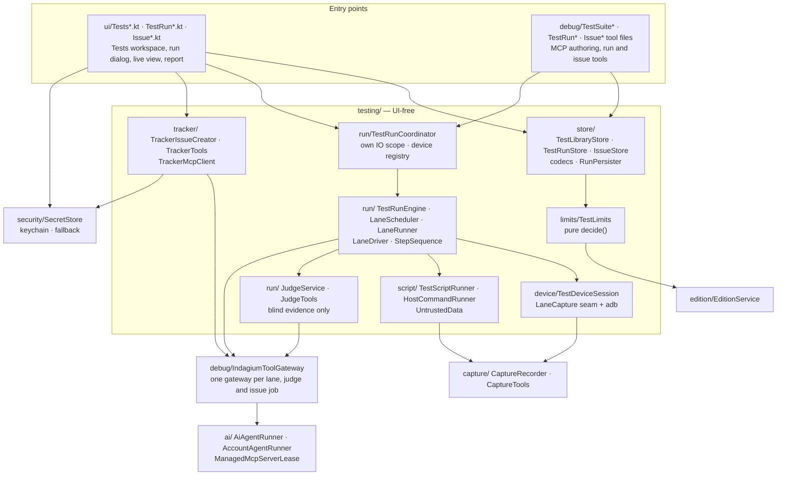

**Key.** Solid arrows are compile-time dependencies or direct calls. `ui` and `debug` are the only
two entry points; both reach the engine through `TestRunCoordinator` and the library through
`TestLibraryStore`, so the UI and MCP paths cannot drift apart.

### 26.2 Package layout

| Package | Files (all under `src/desktopMain/kotlin/com/indagium/`) | Role |
|---|---|---|
| `testing.model` | `TestModel.kt`, `TestModelRules.kt`, `TestRunModel.kt`, `JudgeModel.kt`, `IssueModel.kt`, `TestingSettings.kt` | Immutable domain types: library (suites, cases, steps, checks, examples, scripts, shared steps, hooks, variables), run (config, lanes, case/step results, `StepJudgement`, `JudgeComparison`), issue (draft, record, attachments), and the tracker/testing settings. Pure helpers: `moveById`, name validators, deep copies with fresh ids |
| `testing.authoring` | `TestStepDraftService.kt`, `TestCaseImprove.kt`, `TestCaseImproveEvidence.kt`, `TestCaseImproveBrief.kt`, `TestCaseImproveService.kt`, `TestStepRecordingSession.kt`, `RecordedVideoTimeline.kt`, `RecordingScreenProbe.kt`, `DeviceInputRecorder.kt`, `DeviceInputEnvironment.kt`, `GeteventParsers.kt`, `GeteventKeys.kt`, `RecordingStateAttachment.kt`, `RecordingReviewHints.kt`, `RecordingRewrite.kt`, `RecordingRewriteBrief.kt`, `RewriteEvidence.kt`, `RewriteVideoEvidence.kt`, `RewriteSettledAfter.kt`, `RewriteSensitivity.kt`, `ContactSheet.kt`, `RecordingRewriteTools.kt`, `RecordingRewriteService.kt`, `TestStepRecordingApplyService.kt`, `TestScriptLibraryService.kt` | Shared UI/MCP draft, recording (screen probe, bounded video timeline and AI rewrite, §26.12), insertion, script import/export/schema and explicit-reference usage operations; previews are validated and do not mutate until applied |
| `testing.store` | `TestLibraryStore.kt`, `TestLibraryCodec.kt`, `TestLibraryValidation.kt`, `TestAssets.kt`, `TestRunStore.kt`, `TestRunCodec.kt`, `JudgeCodec.kt`, `RunPersister.kt`, `TranscriptWriter.kt`, `LaneToolActivityWriter.kt`, `IssueStore.kt`, `IssueCodec.kt`, `StoreResult.kt` | Disk-backed library, run and issue stores with versioned JSON envelopes; bounded full-suite result snapshots with lightweight history summaries; debounced run saver; redacted transcript/activity appenders |
| `testing.limits` | `TestLimits.kt` | `decide(library, operation, limits)` — the one pure function every caller consults for edition limits |
| `testing.script` | `TestScriptRunner.kt`, `HostCommandRunner.kt`, `UntrustedData.kt` | Builds and runs a `TestScript`'s command safely; the bounded, cancellable child-process runner; the `untrusted_data` envelope |
| `testing.device` | `TestDeviceSession.kt`, `LaneCapture.kt`, `CaptureLogReader.kt`, `UiTreeParser.kt` | One device lane: the `LaneCapture` seam (production: a real capture controller, with or without a tab; engine tests: `StandaloneLaneCapture`, a headless recorder), adb input/screenshot/UI dump, byte-offset log reading and waiting |
| `testing.run` | `TestRunCoordinator.kt`, `TestRunEngine.kt`, `LaneScheduler.kt`, `LaneRunner.kt`, `LaneDriver.kt`, `StepSequence.kt`, `HookRunner.kt`, `DeterministicChecks.kt`, `TestAgentTools.kt`, `LaneGateway.kt`, `LaneAgents.kt`, `LanePrompts.kt`, `TestRunValidation.kt`, `TestRunState.kt`, `EngineSupport.kt`, `JudgeService.kt`, `JudgeTools.kt`, `JudgeEvidence.kt`, `JudgePrompts.kt`, `StepJudging.kt`, `TestRunComparison.kt`, `TestRunReportExport.kt`, `RunArtifacts.kt`, `LaneMarkerText.kt`, `IssueStepClipService.kt`, `IssueCaptureArchiveService.kt`, `IssueBugreportService.kt`, `ReportActions.kt`, `IssueDraftBuilder.kt`, `IssueEngineHooks.kt`, `IssueMarkdown.kt`, `TestRunMarkdown.kt` | Run engine, complete step deadline/case budget, run comparison and safe report export, lane activity artifacts, bounded issue clips and on-demand Android bugreports |
| `testing.tracker` | `TrackerMcpClient.kt`, `SdkTrackerMcpClient.kt`, `TrackerConfig.kt`, `TrackerIssueCreator.kt`, `TrackerTools.kt`, `TrackerPrompts.kt` | The issue-tracker MCP client (official Kotlin SDK client), setup checks, and the one-shot agent job that files an issue |
| `edition` | `Edition.kt` | `Edition`, `EditionLimits`, `EditionService` |
| `security` | `SecretStore.kt` | OS-keychain secret storage with a session-only fallback |
| `voice` | `VoiceInput.kt`, `VoiceInputController.kt`, `VoiceInputControllerFactory.kt`, `VoiceInputSessionCoordinator.kt` | Local capture/backends, shared controller construction and app-wide stable editor-session ownership |
| `proofread` | `EnglishProofreader.kt`, `ProofreadingText.kt` | Local English rules, bounded checks, UTF-16 ranges and offset-preserving technical-text exclusions |
| `debug` (new files) | `TestSuiteToolCatalog.kt`, `TestSuiteToolOperations.kt`, `TestSuiteToolParsing.kt`, `TestSuiteToolJson.kt`, `TestRunToolCatalog.kt`, `TestRunToolOperations.kt`, `IssueToolCatalog.kt`, `IssueToolOperations.kt`, `TestRunCaptureArgs.kt`, `ExternalToolApproval.kt`, `ExternalRunApproval.kt`, `ExternalTrackerApproval.kt` | Catalog-driven authoring, run/report and issue evidence operations, merged into `MCP_TOOLS` and parity-checked with their handlers; per-call external-client approvals |
| `ui` (new files) | `TestsWorkspace.kt`, `TestsSuiteScreen.kt`, `TestsCaseScreen.kt`, `TestsSteps.kt`, `TestsStepKinds.kt`, `TestsExternalRows.kt`, `TestsListEditors.kt`, `TestsLibraryScreens.kt`, `TestsAgentExamplesScreen.kt`, `TestsTryItPanel.kt`, `TestsWidgets.kt`, `TestsUiState.kt`, `TestsFormat.kt`, `ReorderableColumn.kt`, `TestRunDialog.kt`, `AiModelEffortPickers.kt`, `TestsStepAuthoring.kt`, `TestsStepImprove.kt`, `TestsStepImproveState.kt`, `TestsRecordingRewrite.kt`, `LaneCaptures.kt`, `CaptureMarkerWriter.kt`, `TestRunLiveView.kt`, `TestRunLiveState.kt`, `TestRunReport.kt`, `TestRunStepDetail.kt`, `TestRunUiState.kt`, `TestRunActions.kt`, `TestRunWiring.kt`, `TestScriptTryRun.kt`, `IssueDraftDialog.kt`, `IssueDraftUiState.kt`, `IssueActions.kt`, `IssueNotes.kt`, `IssueTrackerActions.kt`, `TestsIssuesScreen.kt`, `TrackerWiring.kt`, `TestingSettingsSections.kt`, `TestingSettingsCodec.kt` | The Tests workspace (`ActiveSurface.Tests`, `TabRef.Tests`; layout in §26.15), the run dialog/live view/report, the issue dialog, and the glue (`TestRunWiring.kt`, `TrackerWiring.kt`) that connects `testing/` to `AppState` |

Dependency direction. `testing` depends on `model`, `utils`, `capture`, `edition`, `security`, and —
for the agent launchers and the gateway type — `ai` and `debug`. It has **no** dependency on `ui`.
`debug`, `ui` and `security` depend back on it, which adds two small cycles to §7 (`debug ↔
testing`, and `security ↔ testing` through `HostCommandRunner` and `scrubSecret`). Both are the same
shape as the existing `ui ↔ debug` one: shared utility types, not shared mutable state.

### 26.3 Data model and on-disk formats

**Model.** Every container's **order is its list order** — suites, cases, steps, checks, examples,
hooks, variables, scripts, parameters — so reordering is `List.moveById` (`testing/model/TestModelRules.kt:38`)
and no separate index is persisted. Ids are prefixed UUIDs unique across the library (`suite-`,
`case-`, `step-`, `chk-`, `ex-`, `script-`, `shared-`, `hook-`, `var-`; run-side `run-`, `lane-`,
`jdg-`, `cmp-`; `issue-`), so a case or step is found by id alone (`TestLibrary.findCase/findStep`,
`testing/model/TestModel.kt:233,241`). A step's checks are a sealed type —
`LogAppears`, `LogAbsent`, `ScreenJudge`, `ScriptResult`, `AskJudge`, `DeviceState` — and its examples
`GoldenScreenshot` or `ReferenceLog` (`testing/model/TestModel.kt:113,146`). A step is required by default; an optional step
must have a condition that describes when to perform it. Only an optional step can settle as `SKIPPED`, which does not fail
the case; expected text may be blank only for a conditioned optional step. Library and suite envelopes write schema v2 and
read v1 with required-step defaults, so older files remain readable and a newer writer cannot silently discard conditions.

**Step kinds and versioned envelopes.** `TestStep.kind` is `AGENT` (default), `MANUAL`, `SCRIPT` or `REPLAY`, with `TestStep.script`
(`ScriptCall(scriptId, args, exitCode, stdoutContains)`: required for `SCRIPT`, the optional automation alternative of a
`MANUAL` step) and `TestStep.manualCompletion` (`TESTER_ONLY`, `CHECKS_ONLY`, `TESTER_OR_CHECKS`); all three are appended
last in `stepToJson`, and written **only when set**, so an AI step is byte-identical to what builds before step kinds wrote.
A suite file holding any non-`AGENT` step or a `DeviceState` check is written at envelope **version 3**
(`suiteFileVersionFor`, `libraryFileVersionFor` over the shared steps); everything else stays at version 2. A build that
predates step kinds reads versions up to 2 and opens a version 3 file **read-only** (`readEnvelope`), so "plug in the USB
device" is never handed to an AI agent by an older build, and its store never rewrites the file. `TEST_SUITE_FILE_VERSION`
(5) is the newest version this build reads, `TEST_SUITE_BASE_FILE_VERSION` (2) what it writes by default. Gesture hints use
version 4; replay steps and recorded screen roles use version 5 (below). A manual step has
no timeout in the file: the decoder gives it `DEFAULT_MANUAL_STEP_TIMEOUT_MS` (10 minutes). Write-time validation
(`validateStep(step, scripts)`) checks, against the library, that a step's script exists, may be started from a step (not
`SETUP_TEARDOWN_ONLY`) and accepts its arguments (`validateScriptArgs`), that a `MANUAL` step has instructions and, for
`CHECKS_ONLY`, a completion check, and that neither kind is optional; steps already stored are not rejected for a script
deleted afterwards (data is never dropped; a run reports it). AI step drafts (`draft_test_steps`) may not carry a kind, a script
or a device-state check: those are the author's choices. An AI recording rewrite may, under the rules of §26.12 (only an
external-event step may be manual or script, and its script must exist and validate).

**Storage layout.**

**Recorded input and screenshot roles.** `testing/model/RecordedInput.kt` stores ordered touch/key/panel events, normalized
coordinates, source screen size, per-sample timing, duration and gaps. `TestStep.recordedInput` is optional enrichment for AI
steps and required for `StepKind.REPLAY`. `ScreenshotRole` distinguishes `EXPECTED` (the legacy default), `RECORDED_BEFORE`
and `RECORDED_AFTER` on `StepExample.GoldenScreenshot`. Recorded images are contextual references, not assertions of a correct
result. `TestLibraryCodec.kt` raises the envelope for replay and contextual screen roles so an older build cannot silently
execute a replay as an AI step or use a recorded before image as an expected screenshot. Existing libraries and run reports
remain readable with their previous defaults.

| Path | Contents | Format |
|---|---|---|
| `<test suites folder>/library.json` | Suite order, library scripts, shared steps | `indagium-test-library` v2 by default; v3 for manual/script steps or device-state checks, v4 for gesture hints, v5 for replay or recorded screen roles in shared steps (reads v1–v5) (`testing/store/TestLibraryCodec.kt`) |
| `<test suites folder>/suites/<suiteId>.json` | One suite with its cases, steps, checks, examples | `indagium-test-suite` v2 by default; v3 for manual/script steps or device-state checks, v4 for gesture hints, v5 for replay or recorded screen roles (reads v1–v5); the file name must equal the suite id |
| `<test suites folder>/assets/<suiteId>/` | Golden-screenshot images (png/jpg/webp, ≤ 10 MB); a suite stores only a *relative* `assetPath` | Raw images (`testing/store/TestAssets.kt`) |
| `<issues folder>/<issueId>/issue.json` + `attachments/` | One issue and its copied evidence | `indagium-issue` v2 writes and v1/v2 reads (`testing/store/IssueCodec.kt`); v2 preserves newer attachment kinds such as Android bugreports; ≤ 4 MB per record, ≤ 1 GiB per attachment |
| `<test runs folder>/<runId>/run.json` | The run: a **frozen** suite snapshot, the library scripts and shared steps it used, config (`manualSteps`), per-lane results (a step result appends `kind`, `completedBy`, `manualCompletion`, `classification`), comparisons | `indagium-test-run` v1 (`testing/store/TestRunCodec.kt:41`); ≤ 64 MB |
| `<test runs folder>/<runId>/lanes/<laneId>/` | `capture/<sessionId>/` (the lane's capture session exactly as a manual capture writes it: `logs/logcat.log`, `mapping/`, optional `video/screen.mkv` with audio, `session.json`, and after the lane the finalized `capture.indagium.json`), `lane-notes.ann` (the lane's notes with every AI marker), `screens/` (step screenshots), `transcript.jsonl`, `tool-activity.jsonl` | Raw logcat, PNG and redacted JSON lines; activity remains complete within its declared cap after the bounded live cache rotates. The lane's sessions live inside the run folder (not under a capture root) so the report, the step clips and the evidence export find them where they always did, and deleting a run deletes its recordings; `CaptureService` knows them by id for this launch only (§26.5.5) |
| `<test runs folder>/<runId>/judge.jsonl` | Everything the judge runs of the run said and did, tagged with what each judged | JSON lines, redacted |

**Where the folders come from.** `<test suites folder>`, `<test runs folder>` and `<issues folder>` are
`AppSettings.testSuitesDir`, `testRunsDir` and `testIssuesDir` (JSON-only; the frozen positional settings decoder is
untouched). Unset, they default to `<save root>/test-suites`, `/test-runs` and `/test-issues`, where `<save root>` is the
Default save folder (`AppState.effectiveSaveRootOrNull`, `~/Documents/Indagium` unless `saveRootDir` is set) — resolved by
`effectiveTestSuitesDir()` / `effectiveTestRunsDir()` / `effectiveTestIssuesDir()` exactly like the other save folders, and
shown by Settings → General through `SaveFolderKind.TEST_SUITES` / `TEST_RUNS` / `TEST_ISSUES` rows. A bare `AppState` with
no save root (tests) falls back to the injected `testingDir` (`DesktopStorage.testingDir()`, i.e. `<appDataDir>/testing`):
the library there, `runs/` and `issues/` inside it, so a bare instance never resolves to a real user folder. A debug-control
process with an isolated app-data directory keeps its save root inside it (`DesktopStorage.processDefaultSaveRootDir()`).
Nothing is created until a first write.

**Switching folders at runtime.** `AppState.updateSettings` calls `reconcileTestStorage()` when `saveRootDir` or one of the
three folders changes. It replaces the `TestLibraryStore` (loaded from the new folder; `testLibrary` is re-mirrored),
re-points the run and issue stores (`TestRunStore` and `IssueStore` read the folder through a lambda on every use, from the
pinned `activeTest*Dir` fields), forgets the finished runs held in memory and bumps `testRunsFolderEpoch` /
`IssueStore.revision` so screens reload. Nothing is moved or deleted in the old folder, like the other save folders. While a
run is active (`TestRunCoordinator.hasActiveRun()`, true until the run's job has completed, final write included) nothing
switches: `setSaveFolder` refuses `ROOT` / `TEST_*`, the Settings rows disable Browse and Reset, and a change that arrives
by other means is held (`testStorageSwitchPending`) and applied from the coordinator's completion callback.
`testStorageLock` is a leaf lock (§26.6).

**One-time migration.** `AppState.init` (after the saved settings are restored, so the store opens the chosen folder
first) calls `migrateLegacyTestStorage(testingDir, suites, issues, runs)` (`testing/store/TestStorageLayout.kt`): the old
`library.json`, `suites/` and `assets/` move to the suites folder only when it has no `library.json`; `issues/` and `runs/`
move only into an empty or absent folder; a directory present on both sides is merged entry by entry and a file present on
both sides is never overwritten. Moves use `ATOMIC_MOVE` with a copy-then-delete fallback across file systems; a failed move
leaves its source in place and is reported once (`AppLogger`, `AppState.testStorageStatus` shown in Settings and the Tests
tab) and retried at the next start. When data was deliberately left behind, a `.moved-to-save-folders` marker in the old
directory stops later starts from moving it into a different folder. A layout whose destination equals its source (a bare
`AppState`) is skipped.

**Codec rules** (all on the kotlinx.serialization *runtime* JSON API — `buildJsonObject` /
`parseToJsonElement`; the project does not apply the serialization compiler plugin):

- **Versioned envelopes, strict only at the envelope.** A file must carry the expected `format`
  string; `version` greater than this build's is accepted but flagged `readOnly`
  (`readEnvelope`, `testing/store/TestLibraryCodec.kt:415`).
- **Tolerant decode.** Unknown keys are ignored, a missing or mistyped field takes its default, an
  entry of an unknown kind is skipped, and a missing/duplicate/unsafe id is replaced by a fresh one.
  A run or issue file that cannot be decoded is skipped by `list()`, never fatal.
- **Newer-version files are read-only.** `TestSuite.readOnly`, `TestLibrary.readOnly` and
  `IssueRecord.readOnly` are *never persisted*; the stores refuse to rewrite such a record
  (`libraryFileRejection`, `testing/store/TestLibraryStore.kt:438`), so fields this build does not
  understand are not silently lost. A newer record can still be read, exported and deleted.
- **A damaged `library.json` is set aside, not overwritten** (`…corrupt-<millis>`,
  `testing/store/TestLibraryStore.kt`); if that backup fails, the original stays in place and library
  metadata remains read-only. Oversized or unreadable metadata is also preserved read-only, with an
  actionable `TestLibraryStore.loadIssues` entry; suites that fail to load are skipped and listed there.
- **Atomic writes.** Library, run and issue files all go through `writeFileAtomically` (§13.3).
  Files over their cap (16 MB library/suite, 4 MB issue, 64 MB run) are treated as unreadable. Library
  mutations preflight every dirty library/suite document using serialized UTF-8 bytes before publishing
  in-memory state. An oversized edit leaves memory and disk unchanged; rejected imports and duplicates
  clean up staged assets.
- **Settings are JSON-only and secret-free.** `AppSettings.tracker` and `.testing` are appended
  last to the settings JSON (`ui/AutosaveCodec.kt:682-684`), never to the frozen positional form
  (§22.4). The tracker's access token has no field anywhere in settings, autosave, `run.json`,
  `issue.json` or a transcript (§26.9.3).

**Deleting a run** (`TestRunStore.delete`, `sizeOf`, `sizes`; `TestRunCoordinator.deleteRun` / `runSizes`; `AppState.deleteTestRun(s)` /
`testRunSizes`). `delete(runId)` returns a `StoreResult<Unit>` and removes the whole `<runs folder>/<runId>/` tree (`deleteTree`, which
never follows symbolic links) only when: the id is `isSafeId`; the entry is a real directory (not a symbolic link) whose real location is
directly inside the real runs folder; and it holds a `run.json`. Anything else is `Invalid` / `NotFound` and nothing is touched. The store
cannot tell whether a run is still being written, so `TestRunCoordinator.deleteRun` first refuses a run it holds in memory that is
queued or running (`RunEntry.isLive()` or not finished), then drops the finished run's in-memory snapshot (so the lists stop showing it
even if a file could not be removed), republishes, and deletes on IO. `AppState.deleteTestRun(s)` then bumps `testRunsFolderEpoch`, which
the Runs screen, the suite screen and the Issues screen already watch. No `stateLock` is involved (the coordinator owns the run state);
`registryLock` is held only while the in-memory entry is checked and removed, never across the disk delete. There is no MCP tool for
this, and the folder's lane captures go with it (a lane's capture lives in its run). Issues made from a deleted run keep working: their
origin line falls back to the issue's own time. `sizes()` walks every run folder (call off the UI thread) and feeds the Runs header
("14 runs · 1.2 GB") and the delete confirmation.

### 26.4 Editions and limits

`Edition` is `FREE | PREMIUM | FRIENDS_FAMILY | UNLIMITED` (`edition/Edition.kt:15`); `Edition.limits`
maps FREE to `EditionLimits(maxSuites = 1, maxCasesPerSuite = 5)` and the rest to unlimited (null).
An `EditionService` instance (not a global) lives on `AppState` (`ui/AppState.kt:1837`) so tests never
leak an edition into each other.

- **Default and resolution.** Packaged releases (`jpackage.app-path` present) default to `FREE`; unpackaged
  development runs default to `UNLIMITED`. The constructor and `resolveStartup()` use the same default. Startup reads
  `-Dindagium.edition` then `INDAGIUM_EDITION` (first non-blank wins; an unknown value uses that build's default,
  so a typo cannot unlock a Free release); `Main.kt` calls it once. `desktopRun` forwards both
  `indagium.edition` and `indagium.dev` into the run JVM (`build.gradle.kts:595-598`).
- **Dev switch.** `setForDev()` (and the `set_edition` MCP tool) works only when
  `devSwitchAllowed()`: the build is not packaged (no `jpackage.app-path` property) or
  `-Dindagium.dev=true` is set (`edition/Edition.kt:76-83`). A packaged release can therefore never
  be changed through the development buttons or MCP tool without an explicit development override. Startup edition
  overrides still exist; this is edition configuration, not purchase or license validation.
- **Support reminders.** `Edition.canDisableSupportReminders` enables the support dialog's real checkbox in
  Premium, Friends & Family and Unlimited; Free shows the lock and explanation. The dialog observes edition changes
  through StateFlow. `AppState.setSupportPromptSuppressed()` also gates the mutation, and `suppressSupportPrompt` is
  persisted in keyed settings JSON (old/malformed settings default false, legacy positional settings unchanged).
  Startup respects a saved opt-out, including after an edition change; the manual Support project link still opens
  the dialog and lets an eligible edition re-enable reminders. Selecting an edition in development is session-only.
- **`decide()` is the only decision point.** It is a pure function of the library, an operation and
  the limits (`testing/limits/TestLimits.kt:146`); the store, the MCP tools, import, duplicate, the
  UI controls and the run engine all call it, so the rules cannot diverge.
- **Over-limit rules.** The first N suites, and the first M cases of each active suite, **in the
  user's own order** are *active* (`activeCaseIds`, `:64`); everything after is *locked*. A locked
  item is readable, exportable, **deletable and reorderable** (reordering is how the user picks which
  items are active) but not editable, runnable or duplicable. Creating, duplicating or importing a
  suite beyond the suite limit is refused with a `LimitDecision.Refused` (`kind`, `limit`);
  importing a suite with more cases than allowed succeeds and the extra cases arrive locked, with a
  warning. **Data is never dropped.** A run skips locked cases with a warning (`planCases`,
  `testing/run/TestRunEngine.kt:37`). Refusals reach MCP callers as
  `{ "error", "limit": { kind, max, edition, hint } }` and the UI as the disabled-control hint
  `FREE_EDITION_LIMIT_HINT`.

### 26.5 The run engine

#### 26.5.1 Threading

| Piece | Thread / scope | Notes |
|---|---|---|
| `TestRunCoordinator` | Its **own** `CoroutineScope(SupervisorJob() + Dispatchers.IO)` (`testing/run/TestRunCoordinator.kt:94`) | Nothing in the engine runs on the UI thread, a Ktor request thread, or under `stateLock`. `start()` is a `suspend fun`; it validates, probes devices, freezes the suite into a `TestRun`, then launches the engine job and returns immediately |
| One run | One coroutine, launched `CoroutineStart.ATOMIC` (`:188`) | ATOMIC so a cancel before the first instruction still reaches the `finally` that releases the run's devices |
| One lane | A `launch` per **device group** inside `runLaneGroups` (`testing/run/LaneScheduler.kt:24`) | See below |
| One agent segment | An `AiRun` on the agent runner's own IO scope | One per case (and per restart) |
| Lane tools | **Suspend handlers** only | `IndagiumToolGateway.executeSuspending` (`debug/IndagiumToolGateway.kt:52`): `wait_for_log`, `finish_step` and script tools wait on adb, the log file or a judge, and must not block a Ktor or `Default` thread |
| Run persistence | `RunPersister` on IO, 1 s debounce (`testing/store/RunPersister.kt`) | `flush()` runs `NonCancellable` so a cancelled run still writes its final file |
| Device access | `TestDeviceSession` | Input commands serialised by an `inputLock` mutex (`testing/device/TestDeviceSession.kt:101`); every adb call on `Dispatchers.IO` |
| Lane capture start/stop | `ProductionLaneOpener` / `LaneRunner.release` | Start: `withContext(IO + NonCancellable)` (a cancelled run still gets the opened capture back and its cleanup stops it). Stop: `runInterruptible(IO)` inside `withTimeoutOrNull(LANE_STOP_WAIT_MS = 90 s)`. Never the EDT |

**Lane scheduling.** Lanes are grouped by device serial and each group runs its lanes one after
another (a device has one recorder and one screen); different groups run in parallel, and a
`Semaphore` caps simultaneously active devices at `MAX_PARALLEL_DEVICES = 4`
(`testing/run/LaneScheduler.kt:18`) — the rest show as queued. A lane is isolated:
`TestRunEngine.runLane` converts any non-cancellation exception into a lane `ERROR`, so one lane
ending badly never stops another. Cancelling the run cancels every group. The coordinator also keeps a
device registry (`devicesInUse`, guarded by `registryLock`) so two runs can never share a device, and
the lane's capture start claims its serial in `AppState` (`claimLaneDevice`, §26.5.5), which refuses a
serial that a manual capture or another lane holds — the "one live capture" rule is unchanged.

#### 26.5.2 Lane lifecycle

`LaneRunner.run` (`testing/run/LaneRunner.kt:60`): build the lane's agent, open the device (a real
capture of the run's recording settings under `<lane>/capture`, with a live tab unless the run asked
for none, §26.5.5), run the **suite setup** hooks, then for each iteration and each
case: case setup → the case's steps → case teardown (always) → …, then the suite teardown (always),
then release the lane: its markers are flushed, its recording is stopped and finalized (a lane tab
stays open as a stopped capture) and the device is released. A recording that ends on its own while
the lane works (the user stopped or closed the lane's tab, the device went away) fails **that lane**
with an explanatory `error`; the run and the other lanes go on. A failing setup hook **blocks** what depends on it (cases are not run; their
steps are `SKIPPED`). Hooks leave their results in pseudo cases (`suite-setup`, `suite-teardown`) or as
`setup`-flagged step results. Script hooks run directly — no agent, no confirmation: the suite's
author wrote them and whoever started the run accepted them.

Case teardown results are tracked separately from the body's expected-step count. Failed or timed-out
teardown changes a passing body to FAIL; blocked or errored teardown retains that non-pass status.
An existing body failure, setup block or cancellation takes precedence. Teardown evidence and notes
remain available, and ordinary case retry and lane failure policies apply.

#### 26.5.3 The step protocol

**Retry scope.** RunConfig keeps the existing inline per-step retry count unless stepRetriesOverride is set: null inherits,
zero disables, and 1–10 is an explicit count. A positive override also retries execution timeouts when the device remains
usable; every retry starts with fresh execution allowance, reinspection and evidence. Step attempt records keep their own
identity, timing, claims, observations, checks, usage and evidence references independently of transcript retention.
caseRetries defaults to zero and permits at most two additional whole-case attempts. A case retry starts only after all
requested judgments are settled, after case teardown, then runs case setup and every step again; suite setup is unchanged.
The full suite and run config remain frozen across attempts. Execution budget is fresh per whole-case attempt and shared by
its step retries. Earlier failure details are passed to the next execution segment only as fenced observation data, never
to the blind judge. Cancellation, user rejection, exhausted budgets, permanent infrastructure/configuration failures,
inconclusive-only judgment, and manual work requiring a tester exclude automatic case retries. A recovered pass remains
PASS and is marked flaky; all prior attempts stay in the result and usage totals.

The agent (or an external client) sees **only the current step**; later steps are revealed one at a
time by `finish_step`. `StepSequence` (`testing/run/StepSequence.kt:134`) owns the protocol:

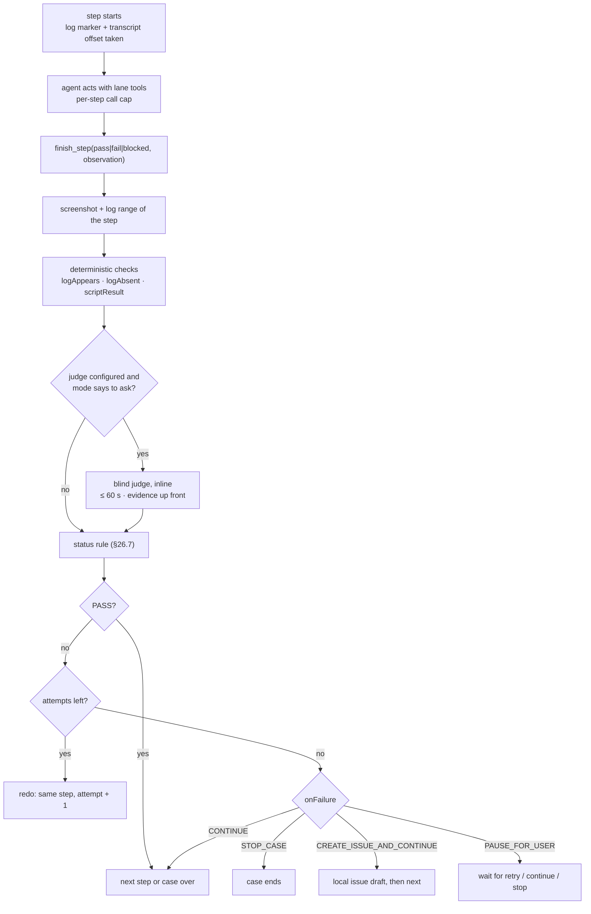

- `finish_step` is a **suspend handler** that holds a `finishing` flag so it is mutually exclusive with
  the timeout watchdog and with a second `finish_step` (`finishStep`, `:276`); all step state changes
  happen under a coroutine `Mutex` (`:135`).
- **Timeouts.** A watchdog polls every `watchdogPollMs` = 250 ms (`EngineTuning`,
  `testing/run/EngineSupport.kt:24`); `checkTimeout` (`StepSequence.kt:528`) closes a step that
  outlives its `timeoutMs` at a verification checkpoint. A judge-confirmed AI action with satisfied checks
  can recover as PASS; otherwise TIMEOUT applies the same `onFailure`. The sequence announces a
  `SequenceEvent` so the driver replaces the expired agent before proceeding (see timeout recovery below).
- **Agent segments and restarts.** `LaneDriver.agentLoop` (`testing/run/LaneDriver.kt:73`) runs one
  agent *run* (a segment) at a time. A new segment starts after a step timeout (resuming at the next
  step) or after the agent failed or stopped without finishing its step (resuming at that same step, at
  most `maxAgentRestarts` = 2 times, then the sequence is aborted `ERROR`). Each new segment's prompt
  carries a summary of the steps already done, **fenced as untrusted data**. A stale run is cut off by
  an **epoch**: `newEpoch()` (`StepSequence.kt:216`) invalidates every earlier run's tool calls
  (`REPLACED_RUN_MESSAGE`).
- **Protocol admission identity.** Free observation and completion calls carry the admitted step,
  attempt and epoch. The sequence validates that identity under the same lock that accepts the result,
  before recording observations or evaluating checks. A timeout, retry, advance or replacement rejects
  an old call without changing the following step, including on external lanes.
- **Current-step examples.** Agents can list and retrieve the active step's golden images and
  reference logs through lane-scoped example tools; transition replies identify examples on the next
  step. Image reads have byte and pixel limits, and example calls obey case tool permissions. A saved
  golden image is reference evidence, not the live device screenshot or coordinate system.
- **Budgets.** Each lane's case iteration has an atomic paid-dispatch budget (`caseToolCallLimit`, default 60, 1..500)
  shared across that case's steps, retries and agent restarts. Agent and external lanes use the same guard and
  accounting rules; separate lanes and repeat iterations receive their own budget. A dispatched call counts even when execution
  returns an error; protocol calls, saved-example reads and actions refused before dispatch are free. Each step also has
  `maxToolCalls` (default 15). The three protocol tools (`get_current_step`, `report_observation`,
  `finish_step`) and the saved-example tools (`list_step_examples`, `get_step_example`) are free for both case and step allowances.
  Example reads still obey the case allow-list, step deadline and bounded image/text readers; activity and provider usage retain
  the actual calls. The current step and transition replies already list its example IDs, so agents need not list them again.
  Exhaustion is settled as an actionable case `ERROR` before a blocked client can finish the case.
- **Step intent.** `TestStep.intent` is `perform_action` (the compatibility default) or `ensure_state`, with an optional
  `precondition`. The prompt, `get_current_step`, next/redo replies, recording application, improvement brief, library/run codecs
  and MCP all carry both fields. `ensure_state` checks the goal before mutation and passes when it already holds. `perform_action`
  establishes its precondition and verifies the specified transition, not only the destination state; retries inspect transition
  evidence and reestablish the precondition before repeating a toggle. The lane may wait for transient UI state at most twice per step.
  Optional steps run only when their condition is present; optional does not replace the intent with `ensure_state`. Single-step,
  background and comparison judges receive that flag and condition from the frozen step definition, independently of the agent's claim.
- **Recorded gestures.** Initial lane prompts and current/next/redo replies carry structured recorded swipe samples with their actual
  times, in addition to compact hints. Release is included once, with no extra endpoint hold. With a live embedded capture, gestures
  use the same continuous scrcpy touch stream as the manual mirror, scaled to the encoded video resolution. A gesture pins its connection
  and screen geometry, uses absolute sample deadlines, and attempts CANCEL on interruption without injecting a replacement gesture.
  Captures without that stream retain the adb motion-event path (with process timing overhead) or the older-device straight-swipe fallback.
  The recording review defaults to AI steps, where recordings guide action selection rather than enforcing an input sequence. Reviewers
  may select individual eligible row IDs for Replay, or opt into replaying all eligible rows. Eligibility excludes optional/precondition
  rows and inputs that cannot be replayed; invalid or stale explicit selections are refused before importing assets. Row IDs retain the
  selection through reordering. Replay preserves all samples up to the gesture tool's point limit instead of coarsening short swipes.
- **Navigation evidence.** For Home/Recents/launcher/floating-player steps, agent screenshots include a bounded Android hierarchy summary.
  Start/end judge frames retain independent, timestamped summaries, also saved as bounded `.ui.json` screenshot sidecars for comparison judges.
  A visible overview container together with task cards identifies Recent apps; launcher package, wallpaper, a dock or live video alone
  cannot establish Home or picture-in-picture. Missing/unclassified hierarchy is unavailable evidence, never proof that a target is absent.
- **Atomic input sequences.** `perform_input_sequence` accepts 1..8 already-known taps, swipes or keys with delays ≤1 s each
  and ≤2 s total. Parsing, per-case allow-lists, coordinates, deadline and aggregate step/case budget are checked before input;
  admission reserves the batch and final screenshot atomically, then charges only dispatched primitives and capture. It runs
  sequentially under one device-input lock without model turns or UI reads between actions, stops on first failure/cancellation,
  and returns per-action outcomes plus the final image. `wait_for_ui` polls exact text, content-description or resource-id selectors
  (explicit `contains` is opt-in), with a 10 s default, 30 s maximum and each blocking read capped at 2 s; absent and unavailable
  hierarchy reads are distinct. Returned bounds map to the latest screenshot coordinate space. When a playback control's position is
  already known in the same stable layout, the prompt directs the agent to reveal the controls and press it in one sequence so it cannot
  hide between model turns; unknown targets or changed layouts require fresh inspection.
- **Attempt deadline.** Device actions, script execution, required screenshots and deterministic checks share the step's
  execution allowance. The judge has its separate `judgeTimeoutMs` = 60 s allowance; a slow judge cannot turn a completed
  action into `TIMEOUT`. Before an attempt's first mutation (including launch/open/script entry) the engine captures a fresh
  start screenshot, reuses it for that attempt, and resets it on retry; a zero-mutation `ensure_state` captures at verification.
  Playback-related steps under either intent retain three end screenshots roughly 500 ms apart, with actual capture timestamps,
  even when ordinary judging is OFF. Samples are retained incrementally if a later capture times out. An expiry records
  `TIMEOUT` once with the submitted claim, observations and completed evidence; cancellation remains distinct, and a late prior
  attempt cannot alter a new attempt's state.
- **Sessions.** Each segment is an `AiSession("testrun:<run>:<lane>:<case>:<iteration>")`
  (`LaneDriver.kt:154`), **never registered in `AiSessionRegistry`**, with a matching
  `AiInvestigationContext`; `deleteClaudeCodeWorkspace()` runs in the segment's `finally`.
- **Pause.** Two distinct mechanisms. *Pause all* (`RunPauseGate`, `LaneScheduler.kt:51`) is set from
  the live view: lanes stop at the next step boundary — `finish_step` records the step, then holds its
  answer until resumed, with the step timer frozen and restarted — and between cases. *PAUSE_FOR_USER*
  is per step: the lane suspends in `LaneHandle.awaitDecision` (a `CompletableDeferred`) until the user,
  or `resume_paused_step`, decides retry / continue / stop. A *manual step* wait is a third, separate suspension (below):
  `resolve_manual_step` answers it.
- **Confirmation timeout.** `AiRun.confirmationTimeoutMs` is optional and **off by default**; a test
  run sets it (default 5 min, Settings > Testing, `DEFAULT_CONFIRMATION_TIMEOUT_MS`) so a card nobody
  answers counts as denied instead of stalling a lane forever
  (`ai/AiToolExecutionCoordinator.kt:140`).

**Manual and script steps (`testing/run/DriverStepRunner.kt`).** A `MANUAL` or `SCRIPT` step is performed by the *run*,
never by an agent or an external client; no AI agent is started for it. `StepSequence.driverStep` is the current step when
it is one of these: while it is current the lane tools and `finish_step` are refused (`DRIVER_STEP_MESSAGE`), `brief()` is
null and the watchdog (`checkTimeout`) leaves the step alone, because the executor owns its deadline. `LaneDriver` calls
`DriverStepRunner.runPending()` before every agent segment and, for an external lane, in `awaitEnd`; it returns once the
sequence stands on an `AGENT` step again or has ended. **Mixed cases.** When an agent's `finish_step` settles a step and the
next one is a driver step, `decide` calls `announceHandoff`: the epoch advances (the agent's gateway goes stale), a
`SequenceEvent.Moved` is sent and the answer is `result: "handoff"` ("stop now, you will be started again"). The driver then
closes that agent *segment* (the same path as a timeout restart), performs the step, and starts a **new segment** whose prompt
(`lanePrompt`) names the next AI step and lists the earlier results, including `[manual step, done by tester]`; the
case's tool-call budget is shared across segments as before. This costs one agent restart per run of consecutive non-AI steps
and needs no change to the agent protocol, which is why it was preferred over holding the agent's `finish_step` answer for up to
the manual step's 10-minute allowance. The sequence reports the outcome through `finishDriverStep` (screenshot, log range,
the step's checks, the judge only for judge checks, then `decideFlow`: pass, retry, `onFailure`), `skipDriverStep` and
`failDriverStep` (a manual step nobody confirmed: status `TIMEOUT`, `classification = AGENT_OR_STEP_PROBLEM`, then
`onFailure`). A manual step is never retried.

- **SCRIPT.** `TestScriptRunner` runs the library script (adb or host target, env-only arguments, its own timeout and output
  cap). A script with permission `ASK` waits for a card (`LaneHandle.awaitScriptConfirmation`, listed with the agent's cards in
  `pendingConfirmations`, answered by the UI or `resolve_test_confirmation`; no answer within the run's confirmation timeout
  is a refusal): a refusal BLOCKS the step and nothing runs. A non-zero exit, a timeout, an unmet `exitCode` or a missing
  `stdoutContains` fails it; then the step's other checks run (skipped when the script already failed).
- **MANUAL.** Depending on the run's `manualSteps` option (`ManualStepsOption`): `SKIP` reports the step `SKIPPED` and goes
  on; `USE_SCRIPT_THEN_WAIT` (default) runs the step's automation script first and, if it passes, completes the step as
  `SCRIPT` — if it fails or is refused the lane falls back to waiting; `WAIT_FOR_TESTER` always waits. Waiting is
  `LaneHandle.beginManualWait` (`ManualWait`: instructions, device, deadline, completion mode), visible through
  `TestRunCoordinator.waitingSteps()` (the live-view "Waiting for you" card, `get_test_run_status.waitingLanes`); the lane
  coroutine suspends in `awaitCompletion`, which wakes at once on the tester's answer
  (`resolveManualStep`: Done, Failed, Skip) and every `manualPollMs` (1 s) reads the **completion checks** (`DeviceState`
  and `LogAppears`, with their waiting window set to zero). `TESTER_ONLY` completes only on Done (and then verifies every check),
  `CHECKS_ONLY` only when the checks are all true (Done is refused), `TESTER_OR_CHECKS` on whichever comes first (a Done
  replaces the completion checks). The wait ends in `TIMEOUT` ("not confirmed") after the step's `timeoutMs`. Each lane waits
  independently on its own device; cancelling the run cancels the wait. *Pause all* holds the lane at the next step boundary,
  not inside a wait.
- **Device state.** `StepCheck.DeviceState(key, expectedRegex, withinMs)` is evaluated by `DeterministicChecks` through
  `TestDeviceSession.readDeviceState`, whose `DeviceStateReader` is replaceable. The production `AdbDeviceStateReader` runs
  **one bounded `adb shell` per key**, the fixed command of the key's `DeviceStateSource` (`dumpsys usb`, `dumpsys battery`,
  `dumpsys bluetooth_manager`, `dumpsys audio`, `dumpsys power`, `dumpsys window displays` or `settings get global …`), and parses
  it with the pure parsers of `DeviceStateParsers.kt` - the same parsers and the same table the recording's environment watcher
  uses (§26.12), so a key means the same when recorded and when checked. The keys are `KNOWN_DEVICE_STATE_KEYS`: `usb.devices`,
  `bt.enabled`, `bt.connected`, `wifi.enabled`, `airplane`, `mobile_data`, `power.source`, `battery.status`, `audio.devices`,
  `screen.awake` and `rotation` (`DEVICE_STATE_KEY_HINTS` describes their values). A dump that is empty, is the shell's or
  `dumpsys`'s own complaint, or is not understood gives an `Unavailable` reading (retried until `withinMs`) rather than a guess;
  an unknown key is a permanent error that names the supported ones.

#### 26.5.4 Cancellation and bounded close

**Recorded-input replay.** `DriverStepRunner.kt` executes `REPLAY` through the same driver handoff as manual/script steps.
`ReplayPlan.kt` validates the whole input list before injection, scales coordinates to the latest screenshot and refuses a
source/device aspect ratio difference above 5%. Pauses are capped at 5 s between events and settling at 3 s. The replay
shares the step's execution deadline with deterministic checks; configured judging then examines the result as for an AI
step. Injection failure must remain an execution failure even if the resulting screen happens to match the expected text.
New replay steps default to zero retries because repeating a partly completed toggle can reverse its result.

With a live embedded capture, `testing/device/MirrorGesture.kt` sends timed touch events through the manual mirror's control stream.
Without that stream, `GestureScript.kt` sends ordered Android motion-event commands; shell process overhead limits timing accuracy.
Both are recorded-path replay rather than hardware-level timing.
Devices without motion-event support fall back to a straight swipe with a reported approximation. Failure or cancellation
attempts to release the finger; a partially injected gesture is not automatically injected again as a fallback.

**Screen references during a run.** Recording apply copies eligible before/after screenshots to ordinary suite assets,
independently of the opt-in full recording archive (§26.14). Agent example tools and judge briefs expose their roles.
`JudgeBrief.kt` labels them separately from the current attempt's actual start/end evidence and expected screenshots;
`JudgePrompts.kt` requires the written expected result to decide correctness. The step list's Screen indicator and example
editor make those references visible. Password-withheld and chronologically ineligible images remain excluded.

`TestRunCoordinator.cancel` cancels the run's job (`:246`). The engine's `finally` and each lane's
`release` run in `withContext(NonCancellable)` on IO: the judge is closed, the final status derived and
`run.json` flushed (`TestRunEngine.finish`, `:125`); the lane's recorder is stopped and finalized (its tab, if
any, stays; a headless run without recording settings deletes its log when logcat evidence was switched off), and its agent closed. **Teardown hooks still run after a cancel, but
scripts only** — shared-step hooks (which need an agent) are recorded as skipped
(`LaneRunner.kt:146`, `HookRunner.kt:41`). Run status is derived from the lanes: `ERROR` if any lane had
an infrastructure problem or a case could not be judged, `FAILED` if any case failed or was blocked,
`CANCELLED` after a cancel, else `PASSED`.

`AppState.close()` calls `testRunCoordinator.close()` (`ui/AppState.kt:4833`), which requests cancellation
for active runs and their externally dispatched calls. It gives run cleanup up to 4 s, then a separate bounded
2 s persistence window before cancelling the coordinator scope (`testing/run/TestRunCoordinator.kt`). Natural
completion also drains still-running paid external calls before final persistence and releasing devices; terminal
protocol replies such as `finish_step` are preserved. This honours the mirror lifecycle rule (§12.4): nothing a
run waits on is EDT work, so the bounded `runBlocking` on the closing thread waits only for IO/coroutine cleanup.

**AI usage accounting.** `AiRunEvent.ToolExecutionStarted` counts one admitted tool-handler invocation independently
of the run's bounded event replay; request denials and duplicate start/result lifecycle events do not add calls. API
providers register a request before streaming, then report replaceable cumulative snapshots for that request; account
agents report cumulative run snapshots. `AiUsageAccumulator` merges sparse/out-of-order updates without adding repeated
snapshots and sums distinct requests. Provider-omitted or incomplete metrics stay null; `partial` marks missing reports,
cancellation, failed runs or saturated Long totals. Cached input stays a reported subset/separate field and is never added
again to provider totals. `AiUsageStats` is persisted in the library case's applied creation provenance and in run case,
step-judge and comparison leaves; lane/run totals derive from those leaves rather than re-adding nested summaries. The
nullable appended JSON fields preserve old files as unavailable instead of implying zero usage. Reports and MCP expose the
same scopes, including external-lane tool counts with token metrics unavailable.

#### 26.5.5 Lane captures

Every lane records through a real capture, so everything a person could save by starting a live capture
and testing by hand is available to a test: logcat (with the device's earlier logs when chosen), screen
video, device audio, the microphone, the device display, adb buffers and the video quality. The run's
`RunConfig.capture` carries the recording settings (the saved capture settings, edited for this run
only, never written back) and `RunConfig.openLaneTabs` whether each lane opens a tab; both are frozen in
`run.json` (appended last, absent in older files: no recording settings means a headless lane without a
tab, as before).

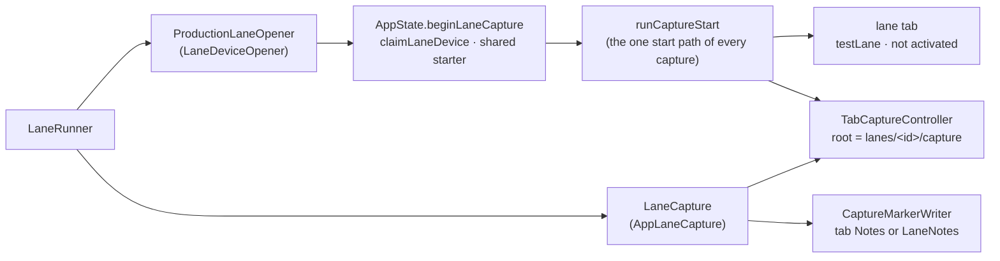

- **One start path.** `startCaptureTab` (manual) and `beginLaneCapture` (lane) both call
  `AppState.runCaptureStart`: tool resolution, the old-glibc adaptation, `controller.start`, the empty
  streaming tab published before adb launches, the log tailer, the heap-pressure pause, the device
  display route and the lifecycle monitor. They differ only in the `CaptureStartPlan`: a lane's tab is
  **appended without being activated** (the Tests workspace keeps the focus; only when nothing at all is
  shown does the new tab become what is shown), takes no launcher's place and does not show the video
  panel, and a lane without a tab has no in-app mirror (an external scrcpy window still opens). The
  controller of a lane is created on the lane's own folder, so its session is
  `lanes/<laneId>/capture/<sessionId>` and every run-folder consumer keeps working.
- **One device owner with an explicit borrow path.** `LogTab.testLane` (session-only, not in the
  autosave) marks a lane tab. `AppState.liveCaptureTabId` filters `testLane == null`, so toolbar and
  device-AI discovery never mistake a lane tab for the user's capture. `aiCaptureBinding` also checks
  `laneCaptureSerials`, preventing another agent from controlling a device while a lane borrows a
  manual capture. An active step-authoring recording blocks a test lane until the user stops and
  reviews it. A matching manual live capture can be borrowed by one lane: both use the same
  `TabCaptureController`, recorder, mirror and encoder; the run's per-device claim prevents a second
  lane or new manual capture from taking that serial. The source tab, settings, notes and checkpoint
  remain user-owned. The run dialog explains that source settings win for a borrowed capture; its
  Recording overrides only affect a lane that starts a new capture. Claims are checked atomically in
  `stateLock`; capture discovery, copying and startup never happen while it is held. Authoring
  discovery and mirror readiness run in the Tests workspace coroutine, with cancellation and no
  focus change.
- **Stop, close, cancel.** `AppState.finishLaneCapture` stops through the paths a tab Stop uses:
  `stopCaptureTab` (mirror `requestStop`, recorder stop, drain, finalization; waits for the controller to be
  removed, bounded and interruptible) or, for a tabless lane, a stop + `finalizeStopped` job on `ioScope`.
  The lane's tab stays as an ordinary stopped capture tab. Cancelling a run cancels the lanes, whose
  `release` runs `NonCancellable`; `AppState.close()` closes the coordinator (bounded, §26.5.4) and then
  `stopAllLiveCaptures` stops anything left, including the tabless lanes' controllers. The EDT never waits
  on a lane: it only waits (bounded) for coordinator jobs, and no lane code waits on a mirror lifecycle
  lock or on the EDT. Closing a lane tab (or pressing Stop in it) makes the recorder leave `RECORDING`,
  which `AppLaneCapture.lost` turns into the lane's error.
- **Borrowed-session boundary.** `AppLaneCapture` copies a borrowed source's flushed log/index and
  bounded video prefix into a lane-specific session directory. A dedicated evidence lock orders
  periodic copies, lane stop and archive export. The final copy freezes source lengths before file
  I/O, writes a lane-specific session id and terminal descriptor, and never advances the source's
  checkpoints or extends source notes. After stop, marker-window reads, judge log reads and exports
  use only the frozen lane files; the user's source capture continues until they stop it. If the
  source ends first, the lane reports capture loss, freezes its local evidence and releases its
  device claim. Copies use bounded-memory chunks; timestamps retain the source index's existing
  approximate alignment.
- **Session lookup.** An owned lane session is not under a capture root, so it never appears in the
  launcher's retained list (no unfinished session to recover after a crash, nothing to delete by
  mistake); `CaptureService.registerLaneSession` makes `retainedSession`/`sessionById` find it by id
  for this launch, which is all Save ZIP, the marker files and the strip need. A borrowed lane's
  separate local session is deliberately not registered as a source capture; it is resolved from
  its run folder and exported directly, while its manual source remains under normal capture-tab
  ownership.
- **AI "Mark issue".** When a non-setup step ends `FAIL`, `TIMEOUT`, `BLOCKED` or `ERROR`,
  `LaneRunner.stepRecorded` asks the lane's capture for a marker (`LaneMarkerText.kt`: the label
  `AI · <case> · step N failed` and a Markdown note of the action, the expected result, the failed checks
  and the judge's verdict, with everything a device, the agent or the judge said quoted as untrusted;
  the step's screenshot). `CaptureMarkerWriter` is the one implementation of a press (the button, the
  `mark_device_issue` tool and the lane all use it): the note and its `indagium:marker` header at once,
  the screenshot under it, and, after `markerPostMs`, the LogRef of the window; it writes either into a
  tab's Notes (`TabMarkerNotes`) or into the `LaneNotes` a tabless lane holds. At the end of the lane the
  notes are written to `lane-notes.ann` so a later issue export has them.
- **Archive.** `AppLaneCapture.exportArchive` is the capture ZIP of the lane's whole bounded session:
  borrowed captures export from lane-local files before or after source Stop/deletion without touching
  source export checkpoints; owned captures use the existing live/retained-session paths. Both use
  `CaptureArchiveExporter` and the lane's notes (the tab's current ones while it is open). Lane captures
  force `markerNotesInSnapshot` so the markers always travel with it. Reopening it ("Bug report / archive")
  shows the log, the video and the AI markers at the failure (`LaneRunCaptureTest` round-trips it through
  `CaptureArchiveReader` and `reanchorImportedCaptureNotes`).

Expected device reboots do not complete a lane capture's `lost` signal: that signal still represents
terminal capture loss, including user Stop/close or fatal recording failure. The lane-scoped
`wait_for_device_ready(timeoutMs)` tool waits for authorized ADB, a responsive shell, and Android's
boot-completed property. It defaults to 120 seconds, allows at most 600 seconds, and remains bounded
by the active step's remaining execution allowance and cancellation. Reboot steps must configure
enough step time; waiting never silently pauses deadlines. The result includes readiness and
best-effort reboot evidence for the normal tool transcript. Timeout results retain the latest
completed probe observations, including authorization and partial boot evidence, even when the
outer step deadline interrupts the next probe.

### 26.6 Locks

The feature adds the following locks to the table in §12.4. **All of them are leaf locks**: nothing is
called while holding one that could take another lock, and none is ever held together with
`AppState.stateLock` or either `AutosaveScheduler` lock.

| Lock | Where | Guards |
|---|---|---|
| `lock` + fair `writeLock` | `testing/store/TestLibraryStore.kt:67-68` | `lock` only computes and publishes the next immutable `TestLibrary`; `writeLock` covers only the disk write, which re-reads the freshest library once it holds the lock, so an older snapshot can never land on disk after a newer one. The `StateFlow` collector rule: a collector resumed inline runs inside `lock`, so collectors must not call back into the store. `limits()` is read **before** `lock` is taken |
| `lock` (`ReentrantLock`) | `testing/store/IssueStore.kt:69` | Create/update/delete (a read-modify-write of `issue.json` and the attachment folder). `revision` is bumped **after** the lock is released. The notes destination calls the annotation mutators only after releasing it (`ui/IssueNotes.kt`) |
| `lock` | `testing/run/TestRunState.kt:18` | Swapping the immutable `TestRun` snapshot; `changed()` runs outside it and reads `current`, so whichever notification runs last sees the freshest run |
| `lock`, `saveLock` | `testing/store/RunPersister.kt:24-25` | The pending-save job; and the read-the-run-then-write step, so a later save never writes an older run over a newer one |
| `registryLock`, `publishLock` | `testing/run/TestRunCoordinator.kt:99-100` | Check-and-register of devices in use; assignment of the published snapshot list |
| `lock` | `testing/store/TranscriptWriter.kt:18` | One JSON line appended at a time |
| `testLibraryMirrorLock`, `testRunMirrorLock` | `ui/AppState.kt:1911,2013` | The `AppState` mirrors of the library and run flows: the value is read **inside** the lock so the last assignment is the freshest |
| `testStorageLock` | `ui/AppState.kt:1928` | Switching the AI test folders (`reconcileTestStorage`, `initTestStorage`): swapping the `TestLibraryStore` and the pinned `activeTest*Dir` fields. **Leaf lock**; the library mirror and `forgetFinishedRuns()` are touched only after it is released |
| `mutex` (coroutine `Mutex`) | `testing/run/StepSequence.kt:135` | A sequence's step state; with the `finishing` flag it makes `finish_step` and the watchdog mutually exclusive |
| `testStepRecordingLock` (`AppState`), recording session `lock` / `probeLock` | `ui/AppState.kt`, `testing/authoring/TestStepRecordingSession.kt` | The one recording session and its `recordingApplications` / `recordingRewrites` sets (an apply and a rewrite of one session exclude each other, decided in one critical section). The session `lock` is a leaf: adb work runs on the session's two workers and the device input recorder's worker, an AI call runs with **no** lock held, and `probeLock` is only taken after `lock` (§26.12) |
| `stateLock` (existing) | `laneCaptureSerials`, `manualCaptureStartSerial` in `ui/AppState.kt` | The per-device claim of lane captures; the one place this feature takes `stateLock`, and only in `AppState` (never inside `testing/`). Claim and release are short and call nothing while holding it |
| `turnLock` (coroutine `Mutex`) | `ai/CodexJudgeHost.kt` | One judge at a time on a lane's kept Codex process, held for the judge's whole run including winding down. Leaf: nothing else is locked under it and nothing waits for the UI thread (§26.7) |
| `LaneCaptureHandle.stopTablessOnce` (`@Synchronized`), `LaneNotes` (`AtomicReference`) | `ui/LaneCaptures.kt`, `ui/CaptureMarkerWriter.kt` | Leaf: start the one stop job of a tabless lane; compare-and-set of its notes |

`AppState` mirrors the store's `StateFlow` into `mutableStateOf` and exposes thin delegates; the
library store writes inline on the caller's thread (§26.10).

### 26.7 The judge

An optional **judge** is a *separate* `AiRun` (any AI profile kind — an in-app model, Claude Code or
Codex — started through the same launchers as a lane's agent) behind a **judge-only gateway**
(`JudgeTools`, `testing/run/JudgeTools.kt:50`): `get_step_brief`, `get_step_screenshot`, `get_example`,
`read_step_log`, and one of `submit_verdict` / `submit_comparison`. It cannot touch the device, the
library, or other lanes.

**Blindness guarantee.** The judge's input is a `JudgeEvidence`
(`testing/run/JudgeEvidence.kt:39`), which has **no field** for what the agent claimed or observed — it
holds the step's action, intent and precondition, expected text, judge checks, *deterministic* check results,
timestamped start/end/playback samples, the step's log byte range, and the examples. No prompt, tool
result or transcript line built from it can leak the claim, because the data is not there to leak
(`JudgePrompts.kt` builds its words only from the suite's own text). `deterministicOnly` additionally
removes the results of the judge checks themselves from what the judge may see. Check details and log rows travel inside an
`untrusted_data` envelope.

**When it runs.** Inline is the default: judgment happens inside finish_step after deterministic checks and screenshot
(StepSequence.judgeAttempt). RunConfig can instead schedule ordinary judged steps after_case or background,
independently of judgeMode. After-case evaluations begin after execution and teardown. Background evaluations enqueue as
each step finishes and can overlap later actions. Both schedules finalize before the case outcome, issue drafts or a whole-case
retry. Setup and teardown sequences, explicit ScreenJudge/AskJudge checks, and PAUSE_FOR_USER steps remain inline. One worker
serializes judge work per lane, with at most two judges active across the run and an eight-item background queue per lane.
Queue backpressure waits outside the step mutex; inline checkpoints have priority and do not wait on unreleased after-case
jobs. The independent 60-second allowance begins when evaluation starts; queue wait is reported separately.

Every deferred judge receives a frozen evidence snapshot bound to case, iteration, case attempt, semantic step and step
attempt identity. It contains the intent/precondition/expected result/checks, bounded log range and timestamped image samples,
but no agent claim or observation. Missing screenshots stay missing; only evidence actually discarded at the per-case bound
forces an unavailable/inconclusive result. Results update only the exact matching historical attempt. Execution outcome and
verification state persist separately, so a pending judgment is provisional, not a final pass. Completed evidence and
verdicts survive cancellation; unfinished verification remains unresolved: `StepSequence.cancelDeferredJudgements` rewrites the
recorded "Independent verification is pending." note of a judgement that never ran to "Not judged: the run was cancelled before the
judge ran." (the state stays PENDING; the report badge reads "not judged" once the run is over). Temporary evidence is bounded and
released when judgment settles, including when screenshot retention is off.

**Agent versus judge.** The status of a step follows the agent's failure or the judge's fail (`settleWithJudge`: a judge never
turns a non-pass into a pass), so the two can contradict each other. The step's note names it: an agent fail/blocked with a judge
PASS reads "The agent reported a failure, but the judge found the expected result met. Review this step." (inline in
`settleEvaluation`, deferred in `deferredVerdictNote`); an agent pass with a judge FAIL keeps "The judge failed a step the agent
reported as passed.". `StepResult.agentJudgeDisagrees()` (`TestSuiteHistory.kt`) is the predicate; the report counts such a step
under **Disagreements** beside cross-lane disagreement (`stepRowMatches`) and marks its matrix row with "≠". The run meta line says
when the judge ran ("judge: every step, after the case" / ", in the background") so a verdict that lands after the case is explained.

**Timeout verification and recovery.** `StepSequence.timeoutEvaluationLocked` takes a bounded end screenshot and retains
completed checks plus the last device-state reading. The note distinguishes an agent that never submitted a result from an
agent whose `finish_step` was waiting for verification. When a judge is configured for that step, timeout verification runs
inline even with BACKGROUND or AFTER_CASE timing: its answer is needed before stopping the case or changing the device.
Pending DeviceState checks receive one current-state read, bounded together by `TIMEOUT_STATE_RECHECK_MS`; scripts are never
rerun and log-observation windows are never shortened. Wi-Fi checks and recording probes read the Wi-Fi service's current
state with `cmd wifi status`, rather than the persisted `wifi_on` preference; disconnected does not mean disabled.

A conclusive, error-free judge PASS recovers an AGENT step only with fresh end-image evidence, no input/script tool still
running, an unexhausted case budget and every explicit deterministic check PASS (`canRecoverTimeout`). Judge-only checks take
the verdict. The final step becomes PASS and advances even under STOP_CASE or PAUSE_FOR_USER; `executionStatus = TIMEOUT`,
its attempt history and the explanatory note retain the exceeded deadline. The UI says **Pass · recovered** and the inspector
**Pass · recovered after timeout**. The old lane agent is invalidated and cancelled before a fresh segment starts on the next
step. Failed, unfinished or unavailable checks, an inconclusive/unavailable/failed judge, stale screenshot, running input or a
driver step retain TIMEOUT and apply the configured failure policy; a PASS verdict in that situation remains advisory and
never silently waives the unresolved requirement. Historical saved timeout runs keep their original outcome.

**Interrupted steps.** A cancel that reaches a running step makes `LaneRunner.runSteps` close it with
`StepSequence.abort(StepStatus.ERROR, …, interrupted = true)`. `StepResult.interrupted` (appended last; written to `run.json` only
when true, absent keys decode to false, so older runs load and older apps ignore it) keeps the stored status ERROR but the report
shows "Cancelled" in a neutral colour, `failedCaseIds` ignores such steps and CANCELLED cases without a genuine failure, and
`interruptedCaseIds` lists them. The report's re-run button (`rerunButtonLabel`) reads "Re-run failed (N)", "Re-run interrupted (N)"
or "Re-run failed and interrupted (N)"; `rerunFailedCasesConfig` selects both sets. A case retried by `caseRetries` keeps its earlier
attempts in `priorAttempts`; the report's case row then has an attempt switcher (`TestRunUiState.viewingAttempts` swaps the shown
attempt's status and steps into the case result, so the matrix, the filters and the inspector work unchanged) and `runVerdict` of a
cancelled run says where it stopped and what the earlier attempts got wrong ("stopped during attempt 2 at step 3; attempt 1 failed
at steps 2 and 7 (judge)").

shouldJudge (testing/run/StepJudging.kt:41): OFF never;
`EVERY_STEP` always; `FAILURES_ONLY` when a deterministic check failed, the agent claimed fail/blocked,
or the step has a `ScreenJudge`/`AskJudge` check (those checks are `NOT_EVALUATED` without a judge).
Budget: 4 evidence calls (`JUDGE_TOOL_CALL_BUDGET`; submitting is free; 8 as `JUDGE_FETCH_TOOL_CALL_BUDGET` when
images must be fetched with tools, see below) and
`judgeTimeoutMs` = 60 s (`EngineTuning`); a judge that times out, ends without a verdict, cannot start or fails
answers `INCONCLUSIVE` with the reason — it never throws, so a flaky judge cannot break a run. New runs default to
`JudgeInconclusivePolicy.BLOCK`; `KEEP_AGENT_PASS` is the explicit advisory option. Older run files without the field
decode to `KEEP_AGENT_PASS`. Explicit judge checks still require a conclusive verdict under either policy, and deterministic
failures remain failures. When the
lanes of a run ended a step differently, one **comparison judge** (budget 6, fetching 12) looks at every lane's own
evidence once all lanes are done (`compareDisagreements`, `testing/run/ComparisonRunner.kt:84`).
Everything either judge says goes to `judge.jsonl`.

**Evidence up front.** A judge does not collect its evidence with a tool call per piece: its first message carries all of
it (`buildJudgeBrief`, `testing/run/JudgeBrief.kt`). That is what `get_step_brief` returns (`judgeBriefMap`: the step, the
judge checks, the lanes' automatic check results and their details inside the `untrusted_data` envelope), a log excerpt per lane
(what `read_step_log` returns by default: 60 rows, 30 per lane for a comparison, halved until at most 12,000 characters so its
`nextOffset` stays true), the texts of the reference logs and the images: each lane's screen at the start of the step, then its
screen at the end of the step, then the golden screenshots (at most `JUDGE_MAX_ATTACHED_IMAGES` = 6 and 6 MB; the encoders are the existing bounded ones, and
whatever does not fit is named with the tool that fetches it). The closing line is "All the evidence is above or attached.
Call submit_verdict now. Use read_step_log only to read a different range of the log." The first message is built from
`JudgeEvidence` alone, so it is exactly as blind as the tools; the tools stay for extras. A judge so briefed answers in
one model turn instead of four or five. `judge.jsonl` gets a `judge_brief` line (`evidenceUpFront`, `images`, `promptChars`,
`briefMs`, `toolBudget`), `judge_finished` a trailing `briefMs`. If the brief cannot be put together (a log that fails to
read) the judge starts with the old pointer to `get_step_brief` and the larger budget (`judge_brief_failed`).

**The start screen.** A step such as "scroll the feed" cannot be judged from its end screen alone. `JudgeLaneEvidence.startScreenshot`
is the screenshot captured immediately before that attempt's first device mutation, labelled "Screen at the start of the step". It is
not the previous step's end screen, which may be stale after a long model turn. A retry gets a fresh capture; a zero-mutation
`ensure_state` attempt captures the current screen during verification. `get_step_screenshot` accepts `moment` = `start` | `end` | `sample_1` | `sample_2` | `sample_3`
(default `end`) for the fetch path. Playback-related evidence also includes three timestamped end samples about 500 ms apart
under both intents and every judge mode. The judge stays blind: frames and timestamps are device evidence, not a claim; identical
frames do not prove a paused state.

**Classification of luck-dependent steps.** `JUDGE_CHANCE_CLASSIFICATION_RULE` (`JudgePrompts.kt`, in both system prompts and both
submit tool descriptions): when the expected result needs content or device state that depends on chance or the environment (ads, a
particular video, picture-in-picture or background behaviour, the network, timing) and the app otherwise behaved sensibly, the judge
classifies `agent_or_step_problem`, not `app_defect`, and gives a `suggestedStepFix` with a stable rewording. The lane prompt
(`LANE_SYSTEM_PROMPT`) has the matching rule for the agent: stay in the state the previous steps produced, and when the expected
result cannot be reached after a couple of reasonable attempts or depends on content it cannot control, call `finish_step` with
`fail` and describe the screen instead of relaunching the app or restarting the flow.

**Images with the first message, per agent kind** (`AgentSegmentRequest.images`, appended last). The capability is one function,
`AiProviderKind.acceptsImagesUpFront()` (`ai/AgentImageSupport.kt`), read through `LaneAgent.acceptsImagesUpFront`; a kind that
cannot gets the text evidence plus a request to fetch the images with `get_step_screenshot` / `get_example` and the larger budget.

| Kind | How the images travel |
|------|-----------------------|
| Anthropic, OpenAI-compatible, OpenAI API | `AiAgentRunner.start(images)` puts them on the first USER `LlmMessage`: image content blocks (Anthropic) or `image_url` data URLs (OpenAI). The providers already serialized user-role images. |
| Codex | `CodexAppServerClient.startTurn(localImagePaths)` adds `{type:"localImage", path}` input items after the text item. The files are written to the run's temporary workspace (`writeAttachedImages`), which is deleted when the run ends. The `UserInput` variants in `codex app-server generate-json-schema` (checked against codex-cli 0.162) are `text`, `image` (`url` or `fileId`), `localImage` (`path`), `audio`, `localAudio`, `skill` and `mention`; `localImage` was chosen because it needs no URL form. If the files cannot be written, `AgentSegmentRequest.promptWithoutImages` is sent instead (the fetch wording). |
| Claude Code | With images the CLI runs with `--input-format stream-json` and no prompt argument; `ClaudeCodeClient` writes one `{"type":"user","message":{"role":"user","content":[text, base64 image blocks]}}` line to the process's stdin (`ClaudeCodeProcess.stdin`) and closes it. Without images the prompt argument is unchanged. |

**Timing.** `AiRun` stamps every event with its own clock at the moment `emit` takes it in
(`AiRun.timedHistory`), and `TranscriptTail` writes each line with that stamp, so `judge.jsonl` (and a lane's
`transcript.jsonl`) show when things really happened however late the file is flushed; `JudgeService` runs a tail
while the judge works, so a hung or killed judge still leaves its lines. Each judge run ends with exactly one
`judge_finished` line (also for a judge that was cancelled, timed out or could not start, with `partial: true`):
`startupMs`, `firstResponseMs`, `modelTurns`, `toolCalls`, `verdictMs`, `totalMs`, `inputTokens`, `outputTokens`,
`partial`, then `cleanupMs` (verdict until the agent was wound down), `verdict`, `error`, `briefMs` and `hostReused` (true when the
judge took over a Codex process an earlier judge of its lane had started, see **The Codex judge host** below). One calculator,
`aiRunTiming` (`ai/AiRunTimingCalculator.kt`, definitions in its KDoc), measures from `AiRun.createdAt`: `startupMs`
until the agent was ready (`AiRun.markAgentReady`: Codex when its managed MCP server reports ready or the turn starts,
Claude Code at its first stream line, an in-app model as the first request goes out, so about 0), `modelTurns` counts
`AiRun.markModelResponse` (an HTTP stream that completed, a Codex token-usage report with a new total, a Claude Code
assistant turn; a lower bound). The same breakdown is kept on `StepJudgement.timing` (`run.json`, append-last, absent in
older files), shown as "Judge: 4.2 s (2 model turns)" in the step detail and the Markdown report, and exposed as
`judgeMs` / `judgeModelTurns` per step by `get_test_run_report` and as `judgedSteps` per case by
`get_test_run_status`. `finish_step` adds a `finish_step_timing` line to the lane transcript
(`evidenceCaptureMs`, `deterministicChecksMs`, `judgeMs`, `totalMs`), and `runAgentForText` (step drafts and recording
rewrites) logs the same breakdown to the app log under `test-agent-timing`.

**The Codex judge host.** A Codex judge used to launch a `codex app-server` process, a managed MCP lease (one `ControlServer` on
its own loopback port) and a workspace for every step. `CodexJudgeHost` (`ai/CodexJudgeHost.kt`) keeps all three for the
judges of **one lane**, so a judge pays only for a new thread and turn:

- *Ownership.* `JudgeService` asks its judge agent for `LaneAgent.reusableForLaneJudge()` the first time a lane judges
  (`AccountLaneAgent` answers for `CODEX_ACCOUNT` only, through `AccountRunnerFactory.judgeHost`; HTTP providers are already one
  shared provider per lane, and Claude Code's CLI is one process per request, so both return null and run as before). A run has one
  judge profile, model and effort, so the lane id is the whole key; a lane that judged earlier with another tool list (the host
  compares the tool names of each judge) gets a new process. The host is closed by `JudgeService.releaseLane`, called from
  `TestRunEngine.runLane`'s `finally` (inside `NonCancellable`, bounded by `agentCancelWaitMs`), and by `JudgeService.shutdown`
  when the run ends, is cancelled or closed. The comparison judge always starts its own short-lived run. Lanes on parallel devices
  have separate hosts; one lane's judges are sequential (a coroutine `Mutex` held for a judge's whole run, including winding down).
- *One lease, switched per judge.* The lease is a `SwitchableMcpRoute` (`ai/ManagedMcpRunRegistry.kt`): the catalogue of the judge
  tools is fixed when the process starts, and each judge `activate`s the route with **its own `AiRun` and gateway** (a fresh
  `AiToolExecutionCoordinator`), so confirmations, the call budget, device bookkeeping and the timing marks stay per judge. A
  call is answered for the target read **once** at the moment it arrives; when no judge is active (`clear` runs first thing when
  a judge ends) the call is refused with "This tool session is not active". A judge starts only after the previous judge's turn
  has been interrupted and has reported its end, so a late call of the previous model cannot reach the next judge's evidence.
- *Per judge.* A new **ephemeral thread** and turn on the shared client (no context carries over), images in a `judge-N`
  subdirectory of the host workspace that is deleted when the judge is over, and `CodexTurnEvents` (`ai/CodexAccountTurn.kt`, the
  event handling shared with `AccountAgentRunner`) bound to that thread. One collector per process dispatches events to the judge
  that is on and rejects an app-server request when none is.
- *Ending a judge.* A judge is cancelled as soon as its verdict is in, so the normal end is `turn/interrupt` on the running turn;
  the process survives. The interrupt must be accepted within `CODEX_JUDGE_INTERRUPT_SETTLE_MS` (3 s) and the turn reported over
  within another 3 s (awaited in the background; the next judge waits for it) or the process is dropped.
- *Dropped and rebuilt by the next judge:* the process exited, a `ProtocolError` with `transportFault` (a line that does not parse,
  a response nobody waits for, a failed reader), the managed MCP server could not start or Codex asked for a host action this app
  does not support (`CodexProcessFault`), a request was left unanswered by a cancelled judge (its answer would reach the next
  one), or an interrupt did not settle. A failed or crashed judge is `INCONCLUSIVE` as before; it is not retried on a new process.
- *Threading and locks.* Everything runs on the host's own IO scope, never on Ktor, Default or the UI thread. `turnLock` is a
  coroutine lock held across a judge's run; the engine's flags are volatile and its plain fields are touched only under it; no
  other lock is taken while it is held and nothing waits for the UI thread (it is a leaf, like the table in §26.6). `close()` is
  safe from any thread at any time.
- *Known limits.* A late MCP call of a judge whose interrupt settled could in principle still arrive; it is refused when no
  judge is active and cannot be told from the next judge's own call when one is (Codex sends no per-turn identity with an MCP
  call), which is why the next judge waits for the end of the interrupted turn. Ephemeral threads stay in the process's memory
  until it ends (one per judged step of the lane).

**Status rule — explicit verdicts are mandatory.** Run validation checks every reachable `ScreenJudge`/`AskJudge` check in the selected cases and reachable suite/case hooks. These checks cannot run with judge mode `OFF` or without a configured, usable judge. Steps with no explicit judge checks retain optional-judge behavior.

1. Deterministic failures remain `FAIL`, even if the agent says `blocked` or an explicit judge is
   inconclusive. A deterministic pass plus an agent `blocked` claim remains `BLOCKED`.
2. A conclusive judge `FAIL` can turn a passing base result into `FAIL`; `PASS` preserves it.
3. For mandatory checks, a judge error, timeout or inconclusive response records the check as
   `NOT_EVALUATED` and the step as `BLOCKED`; it never returns a verdict from missing evidence.
   The normal retry and failure policy then applies. Optional judge failures do not change steps
   without explicit judge checks.
4. Screenshot capture, deterministic checks and judging share the attempt deadline. A deadline
   expiry settles `TIMEOUT` exactly once, keeps completed checks and saved evidence, cancels stale
   evaluations, and cannot settle a later step.

### 26.8 Issues and the tracker

A step with `onFailure = CREATE_ISSUE_AND_CONTINUE` gets a **local draft issue** the moment its result
is recorded, while its evidence is on disk (`IssueAutoDrafter`, `testing/run/IssueEngineHooks.kt`);
any other non-passing step can become an issue on demand. `buildIssueDraft`
(`testing/run/IssueDraftBuilder.kt`) invents nothing: title, reproduction steps, expected/actual, judge
notes, labels, environment and evidence all come from the frozen run. Severity: judge `APP_DEFECT` plus
a crash marker in the step's log is `CRITICAL`, `APP_DEFECT` is `HIGH`, `AGENT_OR_STEP_PROBLEM` is
`LOW`, anything else `MEDIUM`. When a run ends, issues linked to a case of that run are marked
*still failing* or *passing now* (`markLinkedIssues`).

**Destinations:** `local` (kept, status `SAVED`), `notes` (an issue note and the screenshot added to the
log tab of the lane, through the annotation mutators after the issue lock is released), `markdown`
(returned in the answer), and `tracker`. The tracker destination is:

- **A remote MCP server** (URL, one auth header, an AI profile, and the user's prompt) configured in
  Settings > Issue tracker (`TrackerSettings`, `testing/model/TestingSettings.kt:20`).
- **Filed by an agent, not by Indagium.** `TrackerIssueCreator` (`testing/tracker/TrackerIssueCreator.kt:48`)
  connects to the tracker, lists its tools, and starts the chosen profile with a gateway holding only
  the tracker's tools **proxied as `tracker_<name>`** (schemas re-exported), plus `get_issue_draft`,
  `read_issue_attachment` and `report_issue_created`. The user's prompt is the instruction; the draft
  is fenced untrusted data. The job ends when the agent reports the created issue's URL/key, or after
  `TRACKER_JOB_TIMEOUT_MS` = 180 s, or when the agent stops or fails without reporting. Budget: 15
  tracker/attachment calls (`TRACKER_TOOL_CALL_BUDGET`); reading the draft and reporting are free.
- **Attachments** are uploaded by reference: a string `indagium-attachment:<file name>` in a
  tracker-tool argument is replaced, inside the JVM, by that attachment's base64 content (only this
  issue's attachments, ≤ 2 MB each).
- **Token never leaves the JVM.** See §26.9.3.

**The capture archive.** The first item of a failed step's evidence is the **capture archive**
(`IssueAttachmentKind.CAPTURE_ARCHIVE`, "Capture archive (log + video + audio + notes) .zip"), **checked
by default**: the whole recording of the lane, exported by the same exporter as a capture tab's Save ZIP
(the whole log incl. earlier device logs when they were recorded, the whole video, audio, and the notes
with every AI marker), so Indagium's "Bug report / archive" opens it with the markers at the failure.
It is far bigger than other evidence, so it has its own handling (`IssueCaptureArchiveService.kt`): the
draft only carries a **pending** wish (no file; `isPendingCaptureArchive`); it is exported when the issue
is created or sent (`AppState.deliverIssue` → `attachIssueCaptureArchive`, with progress messages and a
disk-space check before the export; a failure stops the delivery with the reason and "untick it to go on
without it"), exported live while the lane still records or from the run folder afterwards, **moved**
into the issue folder (never a second copy), subject to its own cap (`MAX_ISSUE_CAPTURE_ARCHIVE_BYTES`
= 16 GiB, not the 1 GiB of other evidence), and a tracker agent only gets its name, size and location,
never its bytes (`read_issue_attachment` refuses it, `get_issue_draft` lists `path` and
`uploadable: false`). The other files stay available but are unchecked by default, except the step
screenshot and the judge verdict.

**Selectable evidence.** The issue inventory retains available attachments when their `include`
checkbox is off; that checkbox filters delivery rather than owning the file. An on-demand step clip
uses the failed step interval padded by five seconds on each side, clamped to real video coverage.
The dialog displays and allows adjustment of the exported bounds while preserving the original
recording. Android bugreports are collected only after a separate explicit action into an
issue-owned temporary directory, with progress, cancellation and a five-minute timeout. An output
is added to the checklist only after its bounded copy succeeds. Issue storage always writes v2 records
and continues to read older v1 records.

### 26.9 Security

#### 26.9.1 Custom scripts

A `TestScript` is a user-authored shell command exposed to agents as a typed tool. The safety rule of
`TestScriptRunner` (`testing/script/TestScriptRunner.kt`): **a parameter value is never part of the
command text.**

| Control | Implementation |
|---|---|
| Parameters as environment variables | `HOST_SHELL` scripts run `<shell> <template>`; parameter values and the run context (`DEVICE`, `PACKAGE`, `RUN_DIR`, `CASE_ID`, `STEP_ID`) travel only as the child's environment (`hostSpec`). The template is the author's own text, passed to the shell untouched. Host shell: `/bin/zsh -c` on macOS when present, `/bin/sh -c` elsewhere, PowerShell on Windows (`defaultHostShell`, `:216`) |
| POSIX-quoted adb exports | `ADB_SHELL` scripts send ONE remote command, `export name='value' …; <template>`, where every value is POSIX-single-quoted (`buildAdbRemoteCommand`, `:163`; `posixSingleQuote`, `:172`) and every name matches `[A-Za-z_][A-Za-z0-9_]*` |
| Validation | Types: `INT` = `-?\d{1,18}`, `BOOL` = `true`/`false`, `STRING` ≤ 4 KB with no NUL; unknown arguments rejected; required parameters enforced (`validateScriptArgs`, `:183`). Parameter names are lowercase and may not be reserved (`path`, `home`, `shell`, `device`, `run_dir`, `ld_preload`, …: `RESERVED_SCRIPT_PARAM_NAMES`, `testing/model/TestModelRules.kt:19`); a tool name may not shadow a built-in lane tool, an Indagium tool, or start with `tracker_` (`scriptToolNameError`) |
| Timeout, output cap, process-tree kill | Per-script `timeoutMs` (default 30 s, ≤ 1 h) and `outputCapBytes` (default 64 KB, ≤ 8 MB) bound stdout and stderr *each*; the rest is read and discarded so the child never blocks on a full pipe. The script is launched directly (`ProcessBuilder`, no wrapper). While it runs the runner samples its descendants; on timeout or cancellation `terminateProcessTree` stops the script and every sampled or current descendant (SIGTERM, 500 ms grace, then force-kill, whatever the parent's state; `testing/script/HostCommandRunner.kt`, `capture/CaptureProcess.kt`). A descendant still alive when a script ended on its own, or one that survived the force-kill, adds `HostCommandResult.warnings` ("This script left background processes running; scripts must not start background processes."), surfaced in `ScriptRunResult`, the Try-it console, `try_test_script`, hook results and script-check details; the leftover of a script that ended by itself is reported, not killed |
| Sanitized environment | The child inherits the app's environment minus AppImage runtime variables (`sanitizeAppImageRuntimeForChild`), with explicit values merged on top |
| `SETUP_TEARDOWN_ONLY` | A script with this permission is never offered to an agent as a tool (`buildLaneTools`, `testing/run/TestAgentTools.kt:128`) |

#### 26.9.2 Confirmation policies

There are two audiences, with two gates:

- **In-app (Indagium's own AI panel and run lanes) — `CONFIRMATION_REQUIRED`.** Policy lives in
  `CONFIRMATION_REQUIRED_TOOLS` (`debug/IndagiumToolGateway.kt:92`). The test-suite tools requiring
  review include destructive library operations, imports/exports, script execution, run start/cancel,
  report fixes, draft application, recorder start/apply and tracker delivery. Remote step drafting
  also shows an argument-aware disclosure of the provider and bounded suite/case context before text
  leaves the app; local loopback providers do not show an external-send disclosure. The legacy policy
  names remain stable:
  `delete_test_suite`, `delete_test_case`, `delete_test_script`, `import_test_suite`,
  `export_test_suite`, `set_edition`, `try_test_script`, `run_test_suite`, `cancel_test_run`,
  `rerun_test_step`, `apply_step_fix`, `delete_issue`, `send_issue_to_tracker`. A call is also raised
  to `CONFIRMATION_REQUIRED` *per call* when its arguments send data to an external service
  (`create_issue_from_step` with `destination: tracker`, `draft_test_steps`, `improve_test_case` and
  `rewrite_test_recording` with a remote provider, `sendsToExternalService`). Inside a
  run, an **`ASK` script** becomes a confirmation card through the lane gateway's
  `extraConfirmationRequired` (names only known at run time); `AUTO` scripts run without asking.
  `ManagedMcpRunRegistry.register` gives a lane's managed endpoint its **own**
  `AiToolExecutionCoordinator` over the lane gateway (`ai/ManagedMcpRunRegistry.kt:36`), so the policy
  point is unchanged for Claude Code and Codex lanes.
- **External MCP clients — `PER_CALL_APPROVAL_MCP_TOOLS`.** `CONFIRMATION_REQUIRED` gates only
  Indagium's own AI panel; an external client holding the control token would otherwise run any
  command a script holds with nobody asked. The set (`debug/ExternalToolApproval.kt:22`) is
  `try_test_script`, `run_test_suite`, `rerun_test_step`, `rerun_failed_test_cases`,
  `test_lane_tool_call`, `draft_test_steps`, `improve_test_case`, `rewrite_test_recording`, `start_test_recording`,
  `apply_test_recording`, `import_test_script`, `export_test_script`, `export_test_run_report`,
  `collect_android_bugreport`, `export_issue_step_clip`, `create_issue_from_step`,
  `send_issue_to_tracker`. Each call opens a dialog describing *that exact
  call* — a remote draft's provider, endpoint/account and bounded context; the client, the script and
  its exact command and arguments; or the suite, cases, lanes with
  devices and every script a run may execute, or the tracker, profile, issue and every attachment the
  agent can read — and waits up to 5 minutes (`DEVICE_AI_APPROVAL_TIMEOUT_MS`,
  `ui/AppState.kt:3010`). **Approval is per call and never remembered for the session**, because each
  call may run a different command or send different data. A call the tool would refuse anyway
  (unknown script, invalid arguments, no tracker configured) skips the dialog and the tool reports the
  error, so the user is never asked about something that cannot run. `test_lane_tool_call` asks only
  for a *script* tool; a built-in lane tool needs no approval, since the run itself was approved.
  `create_issue_from_step` asks only for destination `tracker`.

`try_test_script` prepares an immutable script snapshot, validated arguments (including defaults) and
device serial before opening approval. An edited or deleted script requires a fresh request and approval.
Accepted calls execute the captured snapshot without another lookup by ID; invalid preparation returns
an error directly, and denied, expired or cancelled approvals execute nothing.

The device tools keep their own, older per-session approval (§14.1).

#### 26.9.3 Secrets

The tracker's access token is the one persistent secret the feature owns (AI provider API keys keep
their existing memory-only treatment, §18.4).

- **`SecretStore`** (`security/SecretStore.kt`) talks to the operating system's store through a child
  process: macOS `security -i` (the command line on **stdin**), Linux `secret-tool store|lookup|clear`
  (the secret on stdin), Windows PowerShell reading a script from stdin that calls
  `CredWriteW`/`CredReadW`/`CredDeleteW` (the secret travels base64 inside that script).
  **A secret never travels on a command line** — argv is readable by every process of the user. Service
  and account names are fixed, validated identifiers and are the only things on argv.
- **Fallback.** `FallbackSecretStore` keeps a secret in `MemorySecretStore` when the system store fails
  and reports `persistent = false` plus the reason, so Settings says "kept for this session only". A
  failure text that came from a child process is scrubbed of the secret before it is returned
  (`scrubSecret`).
- **Never persisted elsewhere.** The token has no field in `AppSettings`, autosave, `run.json`,
  `issue.json`, `judge.jsonl` or a transcript. `TrackerConnection` keeps the header value in a private
  field and its `toString` prints the URL and header *name* only. Transcripts pass every string through
  `redactDiagnosticSecrets` (`testing/store/TranscriptWriter.kt:45`).
- **Tool previews and reports.** String values are diagnostically redacted before preview truncation
  and JSON encoding; credential-key masking remains in place. JSON, Markdown and evidence ZIP exports
  sanitize historical cached previews and complete activity streams, including selected `run.json`
  and tool-activity metadata files. Export sanitization leaves stored historical runs and ordinary
  screenshot/video evidence unchanged.

#### 26.9.4 The tracker connection

- **Proxied tools, token in the JVM.** The agent calls `tracker_<name>`; Indagium's own HTTP
  connection (`SdkTrackerMcpClient`, the official `kotlin-sdk-client` over Streamable HTTP) forwards the
  call and holds the header. The token therefore never reaches a model, a prompt, a transcript, or a
  Claude Code / Codex process, whatever kind of AI profile files the issue.
- **No redirects.** The HTTP client sets `followRedirects = false`
  (`testing/tracker/SdkTrackerMcpClient.kt:35-37`) so the token cannot be forwarded to another host.
- **URL and header checks.** http/https only, a host, no credentials in the URL; plain `http://` to a
  non-loopback host is allowed with a warning; the header name must be a valid token and not one the
  transport sets itself (`testing/tracker/TrackerConfig.kt`).
- **Bounds.** 20 s connect, 60 s per call, at most 64 tools, 64 KB of text per tool result;
  every failure is a `TrackerMcpException` whose message is already free of the token.
- **Fenced results.** Every tracker tool result is returned inside an `untrusted_data` envelope.

#### 26.9.5 Untrusted-data fencing and prompt-injection posture

Text produced by the device (logcat, UI trees, screens), the app under test, a script, an agent, the
judge or a tracker is **never trusted as instructions**:

- Lane, judge and tracker tool results put such text in an `untrusted_data` field with a standing
  notice (`untrustedData`, `testing/script/UntrustedData.kt:14`).
- Prompts fence history and drafts between `<untrusted_data>` markers with the markers inside the text
  defanged so data cannot close its own fence (`fenceUntrusted`, `testing/run/LanePrompts.kt:44`):
  the resumed-segment step summary, the issue draft given to the tracker agent.
- Every system prompt tells the model that anything inside an `untrusted_data` field is data to read,
  never instructions (`LANE_SYSTEM_PROMPT`, `JUDGE_SYSTEM_PROMPT`, `TRACKER_SYSTEM_PROMPT`).

The structural defences matter more than the wording: an injected instruction can at most influence
what a *lane agent* does with the tools of its own lane (device input, and the scripts the suite's
author exposed as `AUTO`/`ASK`); it cannot reach the app's catalogue, the library, the tracker token,
other lanes, or the blind judge's private tools. A conclusive judge failure can downgrade a passing base
result; mandatory explicit judge checks block when no verdict is obtained, and deterministic failures remain
failures (§26.7). The judge never sees the agent's words. Residual risk: an `AUTO` script is
reachable by any prompt-injected lane agent, which is why the default permission is `ASK`.

### 26.10 Extension points

| To add… | Do this |
|---|---|
| **A check kind** | Add a case to the sealed `StepCheck` (`testing/model/TestModel.kt:113`); update `withFreshId` (`TestModelRules.kt`), the codec's encode/decode (`testing/store/TestLibraryCodec.kt`) and `CHECK_TYPE_NAMES`/parsing in `debug/TestSuiteToolParsing.kt` + the schema in `TestSuiteToolCatalog.kt`; evaluate it in `DeterministicChecks.evaluate` (deterministic) or route it to the judge via `judgeChecksOf` (`testing/run/JudgeEvidence.kt`); add the editor row in `ui/TestsSteps.kt`. The `when` expressions over `StepCheck` are exhaustive, so the compiler lists what is missing |
| **A lane tool** | Add a `LaneTool` to the matching group in `testing/run/TestAgentTools.kt` (`screenTools` / `inputTools` / `logTools`); add its name to `RESERVED_SCRIPT_TOOL_NAMES` (`testing/model/TestModelRules.kt:26`) so a script cannot shadow it, and to the `test_lane_tool_call` description. Return device/script text through `untrustedData`, and wrap the handler in `guarded`. If it must not spend the case budget, add it to `LANE_FREE_TOOL_NAMES`. Tests: `TestAgentToolsTest` |
| **An issue destination** | Add a value to `IssueDestination` (`testing/model/IssueModel.kt`); handle it in `ui/IssueActions.kt`'s delivery switch and record the outcome with `recordDelivery`; extend the `destination` enum in `IssueToolCatalog.kt`. If the destination sends data off the computer, add it to `sendsToExternalService` (`debug/IndagiumToolGateway.kt:114`) **and** to the `previewOf` switch in `debug/ExternalTrackerApproval.kt` so a per-call approval is shown |
| **An edition** | Add a value to `Edition` and map it to an `EditionLimits` in `Edition.limits` (`edition/Edition.kt:22`); a new *kind* of limit means a new `LimitOperation`/`LimitKind` branch in `testing/limits/TestLimits.kt` and a `when` arm in `decide`, so every caller picks it up. The `set_edition` enum follows `Edition.entries` automatically |
| **An MCP tool** | Follow §22.1; additionally put the descriptor in the right catalogue file, the handler in the matching `*Operations.kt` (suspend if it waits), a `CONFIRMATION_REQUIRED_TOOLS` entry for anything destructive, and a `PER_CALL_APPROVAL_MCP_TOOLS` entry (with a `describePerCallApproval` branch) for anything an external client could use to run commands or send data off the computer |
| **A secret backend** | Implement `SecretStore`, send the secret on stdin only, and select it in `platformSecretStore` (`security/SecretStore.kt`). Add a command-shape test to `SecretStoreCommandTest` asserting the secret is absent from argv |

### 26.11 Known risks and limitations

1. **The Windows keychain backend is untested on real Windows.** `WindowsCredentialSecretStore`
   (a PowerShell/`advapi32` P/Invoke script on stdin) is covered by command-shape tests with a fake
   runner; the macOS backend is also round-trip tested against the real `security` tool
   (`MacOsKeychainRoundTripTest`), the Windows one has never run against a real Credential Manager. On
   failure it degrades to a session-only secret and says so. The same applies to `HOST_SHELL` scripts:
   on Windows they run under PowerShell, so a template written for `sh` is not portable.
2. **Whole-video attachments.** An issue attaches the lane's *whole* recorded video with a note saying
   where the step starts (`IssueDraftBuilder`), not a clipped excerpt. A video over 50 MB is attached
   *unchecked*, and a tracker agent cannot upload anything over 2 MB (`MAX_ATTACHMENT_BYTES`), so a video
   is in practice kept locally, not filed in the tracker.
3. **The judge through account agents is lightly tested.** The blindness guarantee and the
   comparison judge are pinned by `JudgeBlindnessTest`/`JudgeComparisonTest`, which use scripted in-app
   agents; a Claude Code or Codex judge goes through the managed MCP lease and is covered with fake
   processes only (`JudgeEvidenceUpFrontTest` for the first message, `CodexJudgeHostTest` for the kept Codex
   process), never against a real CLI. Those CLIs'
   MCP clients may also give up on a long inline judge call, which is why the judge is bounded to 60 s.
4. **No MCP tool to pause a run.** *Pause all* exists only in the live view
   (`TestRunCoordinator.setPaused`, `:254`); over MCP a lane can only be paused by a step's
   `PAUSE_FOR_USER` and resumed with `resume_paused_step`. `cancel_test_run` is the only way to stop a
   run from a client.
   `resolve_manual_step` takes whoever calls it at its word that a manual step was done: like `resume_paused_step` it has no
   per-call approval (the run was approved), so an MCP client can complete a step that asked for a person. Use
   `CHECKS_ONLY` for a step that must be proven by the device.
5. **Library edits write on the caller's thread.** The `AppState` delegates call
   `TestLibraryStore`, whose write (one suite file plus `library.json`, both small) happens inline under
   `writeLock`. From the UI this is the UI thread; the files are tiny and atomic, but a slow disk shows
   as a UI hitch. Run, issue and transcript writes are all on IO.
6. **Scripts are not sandboxed.** A `HOST_SHELL` script runs with the user's full privileges and can
   reach any device adb can see, not only its lane's. The controls in §26.9.1 bound injection, time and
   output, not capability — hence the default `ASK` permission, the setup/teardown-only option, and the
   per-call approval for external clients. `AUTO` should be granted only to scripts the author would let
   any test agent run.
7. **Detached processes can outlive a script.** Scripts run directly, with no supervisor or OS-level
   containment (no process group or Job Object). On timeout or cancellation Indagium terminates the
   script and all its descendants it can find (a snapshot taken then, plus descendants sampled while it
   ran), but a process that detaches from the script's process tree (a daemon that double-forks or calls
   `setsid`, or one that was started and re-parented between samples) may survive. A survivor that was
   sampled is reported as a warning on the result; one that was never sampled is invisible. Scripts must
   not start background processes. `ADB_SHELL` scripts can raise a false warning when the adb client had
   to start the adb server.

8. **Lane captures cost what captures cost.** A lane with a tab, the in-app mirror and video is as
   heavy as a manual capture, and four devices run at once: with the default capture settings every
   lane records video (and mirrors it when the device display is "In-app mirror"). Turn the display off
   or the tab off for big matrices. A lane without a tab has no in-app mirror at all.
9. **A lane recording is only as durable as the run folder.** Lane sessions are deliberately not in a
   capture root: they are not offered for recovery after a crash (a lane cut off by an app exit stays an
   interrupted session in its run folder, readable through the report and the evidence export) and
   disappear with the run. `evidence.logcat` no longer has an effect on a run that has recording settings
   (the log is the capture itself and is always kept).
10. **The archive of an issue is exported late.** A draft issue (also an automatic one) only carries the
   wish for it; the ZIP is built when the issue is created or sent, so a run folder that was deleted
   before then can no longer provide it (the delivery fails with that reason; untick the archive to go on).
11. **The environment watcher is best effort and not free.** While a recording runs, one `adb shell` every two seconds asks
   `dumpsys` for usb, battery, bluetooth_manager, audio, power and window state: a small but real load on the device under
   test. The USB, battery, power, rotation and settings readings were built against Android 17 emulator dumps (plus hand-built
   variants for an attached USB device, a charger unplugged, a connected Bluetooth device and a wired headset); the
   Bluetooth-connected and wired-audio readings depend on the Android version's dump layout and may report nothing (the
   recording warns once per unreadable key). Nothing was verified against a physical USB peripheral, Bluetooth device or
   headset. A change is reported after two polls agree (so up to about four seconds late) and one made in the last seconds
   before Stop is lost.

### 26.12 Recording review: screen context and AI rewrite

**Gesture targets and review previews.** A recorded gesture stores ordered per-input hints: kind, normalized coordinates/path,
duration, source dimensions/orientation, the element under touch and each clickable ancestor with its own identity and bounds,
plus touch position inside the leaf target. A semantic step that groups reveal-and-pause actions retains both hints. Device
labels and compact hint text are fenced observations throughout authoring and playback; the agent resolves the intended
specific control on the current screen and treats coordinates as guidance when layout or orientation changes.

The authoring preview and rewrite attachment share a before/after selector: an eligible time-aligned screenshot wins, then
a suitable recorded-video frame. Grouped actions use the screen before their first input and after their last input; quick
helpers do not need a separate image each. Screenshot/video work stays on the existing background workers and never blocks
between gestures. A raw input frame is a separate preview-only source; only an eligible settled after image can be selected
as the expected screenshot after explicit review. UI/activity context and image availability have distinct messages.
Preview provenance does not count as model delivery or evidence that an expected result occurred. Existing password-sensitive
window exclusions apply to displayed/stored screenshots and to leaf and ancestor target labels before preview or apply.

"Record from device" (`ui/TestsStepAuthoring.kt`, `TestStepRecordingSession`) turns accepted mirror input
into review rows. The mirror carries no UI hierarchy, so the session adds its own context, and an
optional AI step turns the raw rows into readable steps.

**Authoring capture preparation.** The UI keeps `ActiveSurface.Tests` selected while it refreshes
device discovery, starts or reuses the selected device's configured manual capture with embedded
mirror enabled, and awaits mirror `LIVE` on a cancellable workspace coroutine. A matching existing
capture is reused; another-device live capture or a lane claim is reported instead of silently
stopping either one. `takeFocus=false` publishes the new capture tab without changing the active
Tests surface, and the mirror window is detached from the editor so the test editor stays visible.
Starting capture alone does not register an input observer. The observer and timeline subscription
are installed only after mirror readiness and a final coroutine cancellation check; changing cases
or leaving the editor cancels an in-flight preparation. Stopping/reviewing the recording does not
stop its capture, so a later same-device lane can borrow it.

**Screen-context probe.** With a `screenProbe` set (`AppState.startTestStepRecording`), a single separate
worker (`RecordingScreenProbe`) captures the screenshot first, then reads the top activity (`dumpsys activity activities`, 3 s)
and then the UI hierarchy (`uiautomator dump`, shared with `TestDeviceSession`, but with the recording's own 3 s timeout
`RECORDING_UI_DUMP_TIMEOUT_SECONDS`, not the lane's 20 s). The order matters while a video plays: the dump waits for an idle screen
and hangs until its timeout, and it used to run before the activity read, so the package and activity were delayed or lost and the
single probe worker was held for 20+ s while later inputs coalesced into one probe. Now the cheap reads come first, a timed-out dump
keeps the package, activity and image, and one probe takes at most the screencap plus two 3 s waits.
The screenshot's acquisition interval brackets only screenshot capture; JPEG encoding is outside that
interval. A session-owned callback retains this image before the slower hierarchy/activity commands
finish, so it can survive a drain timeout. The complete probe has its own interval. One probe runs and
one latest-wins request waits (including the initial probe and the probe ~800 ms after the last input).
ADB preview capture also records a separate acquisition interval. A mirror frame is retained as a raw
input preview, but its presentation timestamp is not mapped to wall time and cannot establish before or
after evidence.

**Expected results of a rewrite.** The rewrite (and the step draft) prompt carries one rule, `STABLE_EXPECTED_RULE`
(`authoring/ExpectedResultRules.kt`): an expected result is the stable, intended outcome of the action, never incidental or
nondeterministic content (ads, specific titles/channels, varying counts, timestamps, notifications, picture-in-picture or
background playback, animations, recommendation content); such content goes into `notes` or a separate optional step with a
condition (a draft, which has neither, leaves it out). As a backstop `buildRewrittenRows` runs `incidentalExpectedWarning`, a
small constant list of regular expressions, over each AI step's expected text and, on a match, sets the row's existing
`reviewReason` to `INCIDENTAL_EXPECTED_WARNING` ("Check this expected result: it may depend on content that changes between
runs.") - a flag, never a rejection, and not for an optional step (an ad skip is the one place an ad belongs) or a step the AI already
explained. `updateReviewedSteps` re-evaluates that warning against the edited text (`reviewReasonAfterEdit`), so rewording the
result clears it. The review panel shows it in the warning colour. The "Recorded input (hint ...)" reference example of a rewritten
step lists each input with its `stateChanges` ("device changes after it: Wi-Fi turned off"), like the rewrite brief.

**Recorded video timeline.** A recording subscribes to the selected mirror's existing H.264 packet observer. Shared-recording
and standalone mirrors tee packets before decode, so native GPU and CPU/Compose paths use the same compressed stream without
a second encoder or device capture mode. The packet callback only enqueues bounded packet data; it does no muxing, disk IO,
or decoding and runs outside the recording session lock. A worker remuxes packets with `StreamingMkvWriter` into temporary
MKV segments and writes a JSONL timing index containing source PTS, receipt wall/monotonic times, session-relative time,
keyframe, dimensions, epoch and segment PTS. Config/keyframe pre-roll is bounded and may predate Record (for example, a
static launcher); the recording duration cap still starts at Record. Reconnects or changed stream config start separate
segments. Gaps and absent/unusable initial video remain visible in the timeline summary. Capture stops at ten minutes,
128 MiB, 40,000 indexed packets, or its bounded queue limit; device input recording continues.

The rewrite can request an input-centered storyboard or a session-relative range up to 30 seconds. It decodes at most six
actual frames into one portrait-readable contact sheet. Actual decoded MKV times map through packet-receipt metadata to
inputs; this is approximate host alignment, not device capture wall time. A held predecessor keeps its true age, and a seek
request is never reported as the returned frame's timestamp. Range coverage is evaluated independently for each input, so
a safe frame in a gap can be the after-state of one input and the before-state of the next. When input or observed screen
evidence indicates password editing, video is withheld from pre-roll through a proven exit to another screen, or through the
frozen recording end when no exit is proven. Rewrites wait for the writer to drain; cancellation/discard closes without
blocking the UI and removes temporary files after any active decode completes.

Screenshot and UI/activity evidence are matched independently (`attachEvidenceWindows` and
`attachScreenStates`). An image can prove a before/after relation using its own acquisition interval
even when the later hierarchy/activity read overlaps an input; in that case the image does not carry
the later app or activity. UI/activity facts come only from a complete probe interval eligible for that
side. Every interval must fit strictly inside the relevant gap: equality, overlap, reversed intervals,
and probes that touch or cross any input are rejected. The latest eligible candidate is selected, so a
newer contaminated probe cannot hide an older valid one. The element under a tap is resolved only from
that input's before UI state. Probe and preview data live in bounded session storage
(`MAX_RECORDED_STEPS + 1` rows, 48 MB of images); adb work stays off the UI thread and outside the
session lock, with bounded queue, cancellation, and drain behavior.

**Input sources.** A recording has two independent sources that feed the same `TestStepRecordingSession.accept` (a defaulted
`source` parameter says which, so a row's context text does not claim the mirror for a device event): the mirror
(`MirrorInputObservers`, only while a mirror is live) and the device itself (`DeviceInputRecorder`, over adb, mirror or not).
`AppState.prepareTestStepRecording` still starts or reuses the capture and waits for its mirror, but a mirror that fails or
times out is now a warning ("Recording continues without the mirror…") instead of an error, and the recording has no
`RecordedVideoTimeline` then (screens come from the adb probe and screencap). `startTestStepRecording` refuses only when there is
neither a live mirror nor a usable device-input plan, with both reasons in the message.

*Device input* (`DeviceInputRecorder`, all pure parsing in `GeteventParsers.kt` / `GeteventKeys.kt` / `DeviceInputEnvironment.kt`).
A preflight (off the UI thread) runs three fixed commands: `getevent -lp` (parsed by `GeteventDeviceParser`: touchscreens are
devices with `INPUT_PROP_DIRECT` plus `ABS_MT_POSITION_X/Y` or single-touch `ABS_X/Y`, or, when the dump has no properties at all,
a device with touch axes and `BTN_TOUCH`; pointer/touchpad devices are not touchscreens; devices whose name matches `scrcpy|uhid`
(the mirror's UHID keyboard and mouse) are excluded; devices with `KEY_*` labels from the key table are key devices), `wm size`
(natural size, override first) and one `dumpsys window displays` rotation read. Unusable output gives `Unavailable` (the session
falls back to the mirror alone with a warning). It then streams `adb shell getevent -lt` through `CaptureTools.startAdb` (the same
process helper the logcat reader uses; stderr merged, descendant kill on close). Threads: a reader that only parses bounded lines
(`forEachBoundedLine`, 512 bytes per line, over-long lines skipped) and feeds `GeteventTouchParser` and the key table; a worker that
runs `DeviceInputPipeline` (the only thread that asks the device anything again); a 2 s rotation poller. The reader never blocks
on the device. getevent timestamps are kernel uptime: `KernelClock` maps them to wall clock with the smallest observed offset and
never runs backwards. `GeteventTouchParser` handles protocol B (slots, tracking ids), protocol A (`SYN_MT_REPORT` groups) and
single-touch (`BTN_TOUCH` + `SYN_REPORT`). Protocol B preserves each slot's last coordinates across
contact releases because unchanged axes may be omitted from later contacts; a fresh parser starts with
unknown coordinates. Single-touch also retains its axes, while protocol A behavior remains unchanged.
The parser scales a raw axis position to natural display pixels (`value * size / (max - min + 1)`),
then turns it by the display rotation read at that moment (Android's own rule: 90 gives `(y, W-1-x)`, 180 `(W-1-x, H-1-y)`,
270 `(H-1-y, x)`), and emits the `MirrorControlCommand.Touch` values the mirror produces, with `screenWidth/Height` set to the
logical size, so tap/long-press/swipe/multi-touch handling, probes, the rewrite and the video logic are shared unchanged. The
rotation comes from the preflight, the poll and every probe (`RecordingScreenState.rotation`, the UI dump's
`<hierarchy rotation>`), and is cached in a volatile field. Key presses (`KEY_BACK`, `KEY_HOMEPAGE`, `KEY_APPSELECT`,
`KEY_POWER`, volume, mute, media, Enter, Tab, Escape, arrows) become `Key` commands with row labels Home, Back, Recents, Power,
Volume up/down, Mute, Play/Pause; printable keys from a hardware or emulator-host keyboard go through `KeyTextAccumulator`
(Shift and Caps Lock aware, Ctrl/Alt/Meta combinations ignored, Backspace edits the run) into one `Enter text` row after 1.5 s of
silence or at the next control key or touch. Mirror system commands (`ExpandNotifications`, `ExpandSettings`, `Collapse*`,
`RotateDevice`, `SetDisplayPowerOn`) are rows with their own `RecordedInputKind` (`NOTIFICATIONS`, `QUICK_SETTINGS`,
`CLOSE_PANELS`, `ROTATE`, `SCREEN_ON`, appended last) instead of a warning. `accept` drops an identical Key/Text/Touch down or up
from the *other* source within 50 ms (touches within 4 px); the mirror's injected input does not show in getevent, so this is a
safety net.

*Privacy of the on-screen keyboard.* The pipeline buffers a gesture until every finger is up, then asks for the keyboard state
(`dumpsys input_method`: `mInputShown`/`mIsInputViewShown`; the IME window frame from `dumpsys window windows`, fallback the
bottom 40 % of the screen; cached 1.5 s, invalidated by any non-keyboard gesture or control key). A gesture whose every down
lands inside the frame while the keyboard is shown is **never passed to the session**: it only extends a typing burst
(start/last time, nothing else). The burst ends when the keyboard hides, another gesture or key arrives, or 2 s pass; after 0.6 s of
quiet a snapshot of the focused field is read (UI dump; `focusedFieldOf`: focused password or edit control) so an outside tap
that ends the burst does not read the next screen. The session then writes one `TEXT` row (`keyboardTextLocked`): the field text
minus what the last screen state before the burst showed (`typedTextDelta`), `Enter text: ••••` when the field is a password
(or an earlier state showed a password being edited), `Type text on the on-screen keyboard` when nothing could be read, or
`Clear the text field`. The row has no gesture path, tapped element or percentage, and no key coordinate exists anywhere (rows,
sampled paths, probes, video/storyboard windows, MCP output); the existing password redaction of video windows keys on the `••••`
row. A keyboard state that cannot be read is warned once and taps then fall back to ordinary tap rows. Known limit: if the screen
changes before any field read, the row says only that text was typed.

*Stop.* `stop()` marks the session pending (`tailPending`, part of `pendingSnapshots`, so review edits and Apply wait) and calls
`DeviceInputHandle.finish()` outside the session lock: non-blocking; the worker drains its queue, flushes typed text and the open
burst (one bounded field read) and reports `deviceInputFinished`; those rows are accepted although the session is no longer
active, but get no new probe or image. `stopAndDrain` waits for it (12 s, then closes the recorder and warns); `close()` closes the
recorder at once. The getevent process is closed on a separate daemon thread, never on the caller (the Stop button runs on the
UI thread). No recording lock is held across adb, and no mirror lifecycle lock is involved.

*Replay.* The lane tools can do what these rows record: `press_key` takes `DEVICE_KEY_CODES`, now also `POWER`, `VOLUME_MUTE`,
`APP_SWITCH` and `MEDIA_PLAY_PAUSE` (the table is shared with the global `device_key` tool, whose enum is derived from it, so that
tool gained the same keys; `SLEEP` and similar remain out); `open_system_panel(notifications|quick_settings|close)` runs one fixed
`cmd statusbar expand-notifications|expand-settings|collapse`; `rotate_device(0..3)` reads `accelerometer_rotation` and
`user_rotation` once (refusing when they cannot be read, since they could not be undone), then writes `accelerometer_rotation 0` and
`user_rotation N`. `TestDeviceSession.closeBlocking` (the lane's `release` runs it in `NonCancellable`, so also after a cancel) puts the
original values back, deleting `user_rotation` if it was unset. Lane tools are not in the global MCP catalogue (`MCP_TOOLS` and its
count are unchanged); they are listed in `RESERVED_SCRIPT_TOOL_NAMES`, the lane prompt and the `test_lane_tool_call` description.

**Environment watcher** (`RecordingEnvironmentWatcher.kt`, `EnvironmentEvents.kt`, `ExternalEventRows.kt`). Started by
`AppState.startTestStepRecording` for every recording (mirror or device input) and attached with `attachEnvironmentWatcher`;
`stop()` and `close()` detach and close it (a flag, a latch and an interrupt of its daemon thread, never a join, so the UI thread
does not wait). Every `ENVIRONMENT_POLL_MS` (2 s, fixed delay) its own thread runs **one** bounded `adb shell` whose remote command
is the constant `sh -c '<script>'`: for each `DeviceStateSource` an `echo @@INDAGIUM-ENV@@<section>` marker, then the source's
fixed command with stderr merged and its output cut by `head -c 262144`, so no section can starve the next; the whole output is
capped at 2.5 MiB and the call at 8 s. The script is built from constants only (no user, device or session text ever reaches it)
and a test pins that it holds no quote of either kind (a double quote would need escaping when the host is Windows). `parseEnvironmentOutput` cuts the output at the marker lines and parses each
section with `DeviceStateSource.parse`, the parsers of the run-time `DeviceState` reader: `usb.devices` (block-aware - the
proto-style dump prints one field per line inside `{ }` records, a list of one without brackets - and only a record in the
`devices` of `host_manager` counts, only with its own fields; `vendor_id=-1` filters, `device_manager`, `port_manager` and nested
configurations/interfaces never do; the one-line layout of older Android is read outside any `{ }`), `power.source` and
`battery.status` (`dumpsys battery`), `wifi.enabled` (`cmd wifi status`), `bt.enabled`, `airplane`, `mobile_data` (`settings get global`),
`bt.connected` (the device lines under `Connected devices: N` of `dumpsys bluetooth_manager`, else the adapter's `ConnectionState`;
best effort), `audio.devices` (the wired/USB names in the `Devices:` line of each stream of `dumpsys audio`; best effort),
`screen.awake` (`mWakefulness`) and `rotation`. A section that is missing, empty, a service complaint or not understood is dropped
and warned once per key per recording (one aggregated warning); a failed poll (adb error, timeout) warns once and polling goes on.

`EnvironmentDiffer` turns snapshots into `EnvironmentEvent(key, from, to, atMs, sinceMs)`: the first value of a key is its
baseline and never an event; a different value is reported only when the next poll sees the same different value (a flap or one
glitching read is never reported), once, timed at the poll that first saw it, with `sinceMs` the last poll that saw the old value;
list values (`usb.devices`, `bt.connected`, `audio.devices`) are sorted before comparing so a dump's order is no change; a key
missing from a poll changes nothing. `TestStepRecordingSession.environmentEventsLocked` (under the session lock, which is a leaf:
the sink is the only place the watcher takes it, adb never runs under it) attributes each event. An event is **evidence** of the
latest recorded input that precedes it when the change could have happened within 3 s after that input
(`input <= atMs` and `input + 3 s >= sinceMs`, because the change is only known to lie between two polls): it is appended to that
row's `stateChanges` (append-last field of `RecordedTestStep`). Any other event becomes a row of the new `RecordedInputKind.EXTERNAL`
(appended last). `battery.status` is evidence only (never a row, and dropped when `power.source` changed in the same batch);
at most 60 events are kept per recording (one warning). External rows are left out of the screen-state attachment windows so they
neither need a screen nor split the gaps between real inputs, and events after `stop()` are dropped (a change that no second poll
confirmed before Stop is lost; a change confirmed before a slow typing-burst row exists is shown as an external row).

An external row is born as a **manual step** (`stepKind = MANUAL`, `performerEditable`): `action` is the tester's instruction
("Connect the USB device 'Ultra' (0781:5581) to the phone"), `screenContext` the observation, `stateChanges` the event, and `checks`
a prefilled `DeviceState` check (key plus a regular expression for the new value - plain or `Regex.escape`d; a vanished list item
is checked by a negative look-ahead - within `DEFAULT_MANUAL_STEP_TIMEOUT_MS`), so a run can notice the step done. Device-supplied
names are made safe for sentences (`cleanDeviceText`: control characters collapsed, 60 characters) and matched literally in
checks. The review chooser (`ExternalEventRowEditor`, pure transitions in `ExternalEventRows.kt`) offers **Wait for tester**, **Run
script ▾** (library scripts, `ScriptCallEditor` with its argument form) and **+ New script**; a script makes a SCRIPT step, or with
"keep manual fallback" a MANUAL step whose script is the automation alternative; the check's window follows the kind unless the
person changed it. **+ New script** creates a library script named after the event (`connect_usb_device`, `disable_wifi`, …) with
the instruction as its description and the placeholder command `echo '…' >&2; exit 1`: a command is never invented, and a step
cannot pass before someone wrote the real one. `RecordedPerformerEdit` (UI and MCP) re-assigns who performs a row; only author-added
rows and external rows accept it, and an external row never becomes an AI step. `toTestSteps` converts external rows through the
unchanged path (`withKind(row.stepKind)`; manual/script rows carry no examples).

*Rewrite and external events.* The brief shows an ordinary input's `stateChanges` ("device changes after it: …") and an external
row as `[EXTERNAL EVENT] detected: … | proposed step for a tester: "…" | proposed check: key matches /…/`, and lists the library
scripts that a step may run (not `SETUP_TEARDOWN_ONLY` ones) as id, tool name, target, description and parameters in a
`library_scripts` untrusted-data fence. The output contract adds `kind` (`agent|manual|script`), `scriptId`/`args`,
`manualCompletion` and `deviceState` checks. `parseRewriteResponse(response, RewriteExpectations)` validates: an external input
must be a step of its own with kind manual or script; no other step may be anything but an AI step; a script step needs a
`scriptId`; `scriptId`/`args`/`manualCompletion` are refused on an AI step; the assembled step passes `validateStep(step,
library.scripts)` (the script exists, may be started from a step and accepts the arguments; `CHECKS_ONLY` needs a completion
check); a manual/script step is never optional and may have a blank expected result; an answer that gives an external step no
device-state check gets the row's proposed ones; script checks and example references stay refused. An author-added row must still
come back unchanged and alone: its `kind` (when sent) must equal the row's, and scripts, arguments, completion, checks, review
reasons and screenshots are refused. `draft_test_steps` keeps refusing kinds, scripts and device-state checks. Coverage is
unchanged: every input and event is in exactly one step.

**Typed text and passwords.** If the screen read before or after a typing run shows a focused password
node (or a password node when nothing reports focus), the whole run (consecutive typed/pasted rows with
Delete presses between) is stored as `Enter text: ••••` and a warning is raised. The real text is dropped
at that moment and can never be recovered; the rewrite brief, the evidence tools and the applied step only
ever use a row's current action text. `uiautomator` already blanks password node text.

**Rewrite with AI** (`RecordingRewriteService`, UI `TestsRecordingRewrite.kt`, MCP `rewrite_test_recording`).
Allowed only for a stopped, drained recording that is not being applied or rewritten. `AppState`
registers the session in `recordingRewrites` under `testStepRecordingLock` (apply, edit, undo and discard
refuse while it is set), then calls the service with **no lock held**:

1. Preflight (case exists, library/suite writable, edition limits), then the brief
   (`RecordingRewriteBrief.kt`): suite and case text and the user's note as plain instructions; the numbered
   raw inputs (kind, action, tapped element, app/activity before and after, held time, approximate session-relative video
   interval when available, separately resolved before/after images with stable IDs, UI availability, and raw preview
   provenance) in untrusted-data fences, chunked below the fence clip. The precise target of a tap comes from pre-action
   evidence; a trustworthy transition may support a broad observed action such as opening YouTube without naming a specific
   control. Its expected result comes from post-action evidence. The prompt directs the model to read only available evidence
   needed to resolve uncertainty; identical capture IDs can be read once and reused across adjacent inputs. Screenshot/video
   pixels, UI labels and app text are untrusted observations; onscreen instructions are never followed. Missing or uncertain
   evidence requires a review reason; an uncertain mirror preview is never presented as verified before/after evidence.
2. One agent run through the lane launchers (`AppState.runAgentForText`, shared with the step draft; an
   in-app model over HTTP, or Claude Code/Codex through the managed MCP lease), with the profile after
   `withRunOverrides(model, effort)`, a budget of three tool calls per input without video or four with video (capped at 60;
   `REWRITE_CLOSEUP_TOOL_CALLS` = 6 when the evidence is attached, see *Evidence up front* below), and a 180 s timeout. Its gateway (`RecordingRewriteTools`) is read-only and holds only `get_recorded_input`,
   `get_recorded_screen` (image result), `get_recorded_ui`, and, when captured, `get_recorded_video_storyboard` (one real
   image result through HTTP and MCP); device text travels inside the
   `untrusted_data` envelope. The answer is the assistant text after the last tool call.
   The brief numbers only retained raw inputs. The video still covers the complete timeline and may show removed actions;
   it explicitly tells the model not to recreate those actions or fold them into retained steps.
   **Evidence up front** (`RewriteEvidence.kt`, `buildRewriteEvidence`). The brief attaches the images the tools would
   fetch, so a rewrite can answer in one or two model turns. **With a usable video the evidence comes from the video**
   (`RewriteVideoEvidence.kt`): per input the frame held just before it (`REWRITE_VIDEO_BEFORE_MS`) and its *settled after*
   frame (`settledAtMs`: the last frame before the next input in time starts, minus `REWRITE_NEXT_INPUT_GUARD_MS`, or
   `REWRITE_SETTLE_MS` = 2 s after the input when that comes first, so a splash or loading screen right after a tap is not
   mistaken for the result), decoded by `RecordedVideoTimeline.stillsAt` (the latest frame at or before each time, password
   windows withheld) through `RewriteVideoSheets.frames`, three inputs per sheet with both frames, then six per sheet with the
   settled one, at most ten JPEG sheets. A cell the video cannot show falls back to the stored screenshot of that moment, so
   screenshots only fill gaps; a video that shows nothing leaves the screenshot behaviour below. **Without a video** (and for
   those gaps) the "after" is chosen by `settledAfterOf` (`RewriteSettledAfter.kt`): the input's own after screenshot, unless it
   was taken less than `REWRITE_SETTLE_MS` after the input and the next input's before screenshot is a later look; an input whose only
   look is that early one carries a caution in its line, and the screen text of the next input's before reading is added when the
   after reading was that early. For a recording whose distinct before/after screenshots fit
   (`REWRITE_MAX_ATTACHED_IMAGES` = 10, 8 MB), each is attached once, labelled in order ("Image 3: input 2 after, input 3
   before"; a capture shared by two adjacent inputs is attached once). A longer recording is covered by contact sheets, every
   input on exactly one sheet: three inputs per sheet with before and after, then six per sheet with one screen each, at most
   ten sheets; inputs beyond that are named in the prompt for `get_recorded_screen`. A sheet is the video storyboard of the
   inputs' time window (`storyboardForRange`, only when the window is at most 30 s and frames could be decoded) or, otherwise,
   one composed from the stored JPEGs by the same layout (`ContactSheet.kt`, shared with the storyboard). Author-added and
   external-event rows get no images. Each recorded input's line also carries a compact UI summary inside the fence: the five
   labelled elements nearest the touch before it and the first texts of the screen after it (password nodes never), plus which
   images show it. **Password rule** (`RewriteSensitivity.kt`, shared with the video: `rewriteSensitiveIntervals`): an input whose
   action is masked ("••••") or whose screens show a password being edited, and any input or screenshot whose time lies in the
   sensitive window (from the start of the recording until a later screen proves the password screen is gone; to the end when
   none does), has no image and no screen text; its line says the evidence is withheld. The images travel in the actual
   `RewriteAttachment` (`RewriteGeneration`, `AgentTextRequest.attachment`, `AgentSegmentRequest.images`). Initial coverage is
   credited only by the provider/account attachment boundary after images are accepted; `acceptsImagesUpFront` alone is not proof.
   If Codex cannot write or attach those files and sends `promptWithoutImages`, the initial image coverage is cleared. A successful
   screen or storyboard fetch adds only the input/moment covered by returned frames, and evidence coverage is unioned per input so
   a later fetch does not erase an actually delivered initial frame. Sensitive/unavailable evidence cannot establish a target even
   if row labels or an unrelated clickable node look plausible. When images cannot be delivered, the prompt offers bounded tools
   to fetch evidence; a text-only fallback never gets credit for images it did not receive. Building the evidence runs on
   `Dispatchers.IO` inside the rewrite's timeout and never fails the rewrite. The app log (`test-agent-timing`) gets a
   `rewrite_brief:` line (`evidenceUpFront`, `kind`, `source=video|screenshots|mixed|none`, `settledAfter=N/M` inputs with a
   settled after look, `lockedSteps`, `images`, `notAttached`, `promptChars`, `briefMs`, `toolBudget`, `inputs`).
   Tests: `RecordingRewriteEvidenceTest`, `RecordingRewriteVideoEvidenceTest`, `RecordingRewriteUpFrontTest`, `RecordedVideoTimelineTest`.
   **Partial rewrites preserve provenance and context** (`RewriteScope`, `LockedRewriteStep`). Human-reviewed rows and author-added
   rows are fixed; model-supported rows are tracked separately from human acceptance. `needs_review` selects unresolved rows and
   adjacent autogenerated helper candidates for possible regrouping, while distant supported model rows are preserved as locked
   context. The brief and tool metadata label preserved provenance accurately and include each preserved step's intent/precondition.
   `parseRewriteResponse` requires preserved rows to return unchanged over exactly their original inputs; the app keeps those same row
   objects. A reviewer edit that changes a field marks that row human-reviewed, while bulk no-op updates do not. `all` ignores locks
   and rewrites from retained sources. Repeating partial rewrites keeps human/author edits fixed while allowing helpers next to still
   unresolved input to be reconsidered. Test: `RecordingRewriteLockedStepsTest`.
3. `parseRewriteResponse` validates the JSON: at most 20 steps; non-blank action; expected result must be
   non-blank unless `reviewReason` explains what needs review (a null, missing, empty or whitespace-only
   reason is treated as absent when expected is present; a blank expected requires either an optional step with a
   non-blank condition or a substantive review reason, and
   a wrong type or non-empty reason over 500 characters is invalid);
   `sourceInputs` ascending, consecutive, non-overlapping and covering every input exactly once in order;
   an optional `expectedScreenshot` of the form `after-of-input-N` with N among the step's inputs; checks
   through the draft's parser and `validateStep`, with script checks and example references refused (device-state checks are
   allowed here, unlike in a draft; see the environment watcher below for kinds and scripts). An
   invalid answer is an error with the reason and **changes nothing**. A tap or long press with neither a
   resolved target nor successful input-centered video inspection or a trustworthy before screenshot is forced into review
   even if the model claims confidence: its recorded gesture is retained in `sourceHint`, unsupported target and assertions stay blocked,
   and Apply waits for a person to resolve the ambiguity. If only part of a multi-input group is unresolved, supported wording
   and checks remain available behind the review gate, while the unresolved source inputs are named for review. A
   video-inspected transition may support a broad action/result, never a
   named UI control from the destination alone. A conditional incidental action (such as dismissing a visible ad) stays
   separate from required actions, must include a condition, and may have blank expected text; when absent it records
   `SKIPPED` without failing the case or running expectation checks. An unresolved gesture cannot be made optional to avoid
   review. A model-generated coordinate-only action is also forced into review even when it supplies an expected result;
   fixed and human-reviewed locked rows bypass this guard. Older coordinate-only rows marked model-supported are not locked during
   partial rewrites unless a person reviewed them. The prompt asks for the supported semantic action and keeps coordinates
   as recorded-input hints. Neither a destination screenshot alone nor unrelated package/activity changes establish a precise target.
4. `TestStepRecordingSession.applyRewrite` swaps the rows in one step, keeping the recorded rows as
   `rawSteps` (refused if the recording is being applied or its recorded rows changed). Each new row keeps
   `sourceInputIds`; its candidate expected screenshot is an eligible after-image of its last (or named)
   source input and is **off** until the reviewer ticks it. A fully unresolved or coordinate-only model row uses a generic recorded-gesture
   action with the original description in `sourceHint`, without a generated target, expected result or checks until edited; a partially resolved group keeps its supported wording
   and checks behind the review gate. Re-running starts from `rawSteps`: a partial rewrite
   preserves author-added and human-reviewed rows plus distant model-supported rows, while unresolved rows and adjacent unreviewed
   autogenerated helpers may be reconsidered together. `scope=all` rewrites the full source block;
   `restoreRaw` (UI "Undo rewrite", MCP `restore_test_recording_raw`) puts them back with their ids.

**Review deletion.** After Stop and a complete screenshot/probe drain, Remove can exclude a raw row or rewritten row. The
immutable raw chronology/evidence stays in `rawSteps`; `excludedSourceInputIds` names removed source inputs. A removed
rewritten row excludes every raw source it represented. Apply and each later rewrite see only retained inputs, and the
existing ordered one-to-one source coverage check still rejects gaps. Undo rewrite restores only non-excluded raw rows;
Restore removed inputs clears exclusions and returns to the complete raw review. Removing every row is allowed as a review
state, but Apply and Rewrite explain that the person must restore inputs or keep at least one row. Removal/restoration are
refused during recording, while screen snapshots are pending, or during rewrite/apply so screen evidence chronology cannot
be reassigned across an excluded timing boundary.

**Review order and added steps.** After Stop the reviewer can also move a row (`moveReviewedRow`; UI grip, Alt+Up/Down, the
arrow buttons; MCP `update_test_recording` with every row id in the new order) and insert a row (`insertReviewedRow`; UI
"Add step", MCP `insert_test_recording_row`) under the same guard as Remove (stopped, no pending snapshots, not applying or
rewriting). `snapshot.steps` is the single source of truth for order; `rawSteps` is history and is never reordered. A moved
row is the same object, so its screens, tapped element, gesture and video window travel with it (screen-state attachment
sorts by completion time, so a later republish cannot scramble moved rows). `reviewedRaw` derives the raw review list in
reviewed order: each visible row in turn, a rewritten row standing for its `sourceInputIds` in recorded order, removed rows
anchored after the row they followed. The rewrite numbers exactly that list (minus exclusions), applyRewrite compares against
it, and Undo rewrite / Restore removed inputs put raw rows back in it. An inserted row is `authorAdded` (no kind, no source
inputs, no evidence): the brief lists it as "[AUTHOR STEP, keep as is]" with its full text, and `parseRewriteResponse` rejects
any answer that merges it, moves it, changes its action/expected/optional/condition or adds checks, a review reason or an
expected screenshot (nothing changes on rejection). The accepted row is the author row itself (same id). Removing an author row
deletes it outright instead of excluding it, a rewrite is blocked while an added step has a blank or over-long action, and the
video-timeline boundaries use a chronological view that skips author inputs. Moves and inserts take no per-call approval, like
the other recording edits.

**Authoring usage.** Draft and rewrite views retain latest-attempt and session totals, including known partial usage from
failed/cancelled attempts. A draft or rewrite does not mutate the case library; applying it stores the applied usage on the
case, and later applied authoring usage accumulates there. Run leaves persist agent usage per case occurrence (including
restarts/retries and hooks), inline judge totals, external tool counts, and comparison-judge usage. Lane/run rollups derive
from those leaves. JSON/Markdown exports and run MCP status/report expose the same data; absent providers report tokens as
unavailable, and partial totals are marked instead of guessed.

**Apply.** `toTestSteps` turns a rewritten row into a `TestStep` with the readable action/expected, the
AI's checks, a `ReferenceLog` example "Recorded input (hint; prefer what is on screen)" listing the raw
inputs (action, element label/id, package), structured timed input, and eligible recorded before/after screenshots as contextual
references. An expected screenshot is added only when ticked. Raw rows apply as
before. **Privacy.** A remote rewrite sends screenshots, screen text and typed text (not passwords) to the
profile's provider, so `rewrite_test_recording` is in `PER_CALL_APPROVAL_MCP_TOOLS` and raised to
`CONFIRMATION_REQUIRED` for a remote profile exactly like `draft_test_steps`; `restore_test_recording_raw`
sends nothing and is not gated.

### 26.13 Improving the steps of a saved case

"Improve steps with AI" (`authoring/TestCaseImproveService.kt`, dialog in `ui/TestsStepImprove.kt`, state in
`ui/TestsStepImproveState.kt`) rewrites the wording of the steps a case already has. A recording rewrite cannot do that:
its screens and video are temporary and deleted when the recording is applied. The improver therefore works from what is
stored: the case's steps (action, expected, kind, optional/condition, checks, examples including the "Recorded input (hint ...)"
reference logs), the suite name, instructions and target package, the case name, goal and preconditions, the golden screenshots,
an optional note, and the **latest finished run of the case** (or the run the caller names).

**Evidence (`TestCaseImproveEvidence.kt`).** `pickImproveRun` reads the suite's run summaries (cheap), loads runs newest first
(at most `IMPROVE_MAX_RUNS_SCANNED` = 30) and takes the first finished run with step results of the case; an explicit `runId`
must be finished and contain the case. Of several lanes and repeats, `occurrenceOf` picks the one with the most problem steps. Per
step the plan keeps its status, attempts, the judge's verdict, reasoning, classification and `suggestedFix`, the deterministic check
results, a person's `agentError` note, the end-of-step screenshot, and the start screenshot (the previous result's end screenshot;
one image is attached once and introduced under both names). A step edited after the run is marked and keeps the text it ran as.
`ImproveStepEvidence` has **no field** for the agent's claim or observation, so, like the judge (§26.7), nothing built from it can
leak them. Images are chosen by count first (problem steps' start/end screens, then up to `IMPROVE_MAX_GOLDEN_IMAGES` golden
screenshots, then other end screens, `IMPROVE_MAX_ATTACHED_IMAGES` in all) and by bytes while loading
(`IMPROVE_MAX_ATTACHED_IMAGE_BYTES`, each through `boundedJudgeImage`); what the limits leave out is named in the prompt. The
screens a run kept are read through `readBoundedRunArtifact`, so a path cannot leave the run folder.

**Request (`TestCaseImproveBrief.kt`).** The suite/case/step text and the note are the user's own and sit in the plain part; the
judge's reasoning and suggested fix, check details, a person's note, and the reference logs (their hints came from the device) are
fenced with `fenceUntrusted` in chunks of at most 5000 characters. The evidence is in the first message with the screenshots as
images (`AgentSegmentRequest.images`, `acceptsImagesUpFront`); there are **no tools** (`runAgentForText` with an empty gateway, one
model turn expected), and an agent that takes no images runs the same request without them (`RewriteAttachment.fallbackPrompt`:
"NOT attached and you have no tool"). The system prompt carries `STABLE_EXPECTED_RULE` and `STABLE_EXPECTED_DRAFT_REMEDY`, says
steps are never added, removed, reordered, merged or split, that a step blamed on an app defect is left alone, and that a
manual or script step only gets new words. Timing goes to the app log as `improve_brief: ...` (evidence, images, prompt size,
brief time) and the existing `test-agent-timing` line with the `test-step-improve` prefix.

**Answer and validation (`TestCaseImprove.kt`).** `parseImproveResponse` is strict: exactly one entry per existing step, in order,
each naming its `stepId`; `kind`, `script`, `scriptId`, `args`, `manualCompletion`, `examples` and the timeout/retry/failure settings
may not change (an echoed `kind` is accepted when equal); every entry has a `reason` ("unchanged" when nothing changes). One rule set,
`improvedStepOf`, serves the model's answer and the reviewed edit: text equal to the saved text is kept byte for byte, an optional
step needs a condition, only AI steps can be optional or have checks changed, and an AI step's expected result may be blank only
when optional (or already blank). A model-sent `checks` array replaces only the *improvable* checks (`askJudge`, `screenJudge`
without an example, `logAppears`, `logAbsent`); script, device-state and example-bound checks always stay, and a check id is kept
only for the same kind of check that had it. `incidentalExpectedWarning` flags (never rejects) an AI step's expected result that
looks incidental.

**Proposal and apply.** `create` runs the edit-lock preflight (read-only library or suite, Free-edition lock) *before* any paid
call, allows one generation per case at a time, and keeps the validated proposal for 30 minutes (at most 16). Nothing is written.
`apply(proposalId, edits, accept)` takes one reviewed edit per step in the proposal's order, revalidates each accepted step with
`improvedStepOf`, and writes the accepted steps that really change through `TestLibraryStore.updateSteps` in **one** case edit (one
`updatedAt`, one file write; the generation's usage is added to the case's `creationUsage`, like a draft's). `updateSteps` is a
compare-and-set: each `StepChange.from` must still equal the stored step, otherwise nothing is written. Before that the service
refuses (and drops) a proposal whose case steps differ from those it was made for. A refusal the person can fix (a lock that is
lifted later, an invalid edit, nothing selected) keeps the proposal; a spent, expired or stale one is gone.

**Surfaces.** UI: the *Improve steps with AI* button beside *Draft steps with AI*, and *Improve these steps with AI* on a case row
of a finished run report that has failed, blocked, timed-out, errored or unjudged steps (`improvableCaseIds`); both open
`TestStepImproveDialog` with the profile, model and effort pickers (workflow key `testCaseImprove`), the evidence line (for example
"Latest run 2026-10-10 18:20 · 4 screenshots · 2 judge suggestions"), and a per-step diff with an *Apply this step* box that is on
for changed steps. MCP: `improve_test_case` (in `PER_CALL_APPROVAL_MCP_TOOLS` and raised to `CONFIRMATION_REQUIRED` for a remote
profile, like `draft_test_steps`, because it sends steps, screenshots and judge text to a provider) and
`apply_test_case_improvement` (`CONFIRMATION_REQUIRED`, writes the library).

### 26.14 Keeping a recording's evidence

A recording's screen readings, screenshots and video are session-only (§26.12). The opt-in setting **Keep recording evidence with
recorded cases** (`TestingSettings.keepRecordingEvidence`, default off, JSON settings form only - never the frozen positional
decoder) saves them when a recording is applied, so the full AI rewrite can be run again on the saved case.

**Layout** (`store/RecordingEvidenceFiles.kt`, inside the Test suites folder next to the golden screenshots):
`assets/<suiteId>/recordings/<recordingId>/` holds `recording.json`, `screens/<sha256-prefix>.jpg` (content-addressed, so a shared
screenshot is stored once) and, only when allowed, `video/timeline-<n>.mkv` plus `video/timeline.jsonl` (the packet index of
`RecordedVideoTimeline`, copied as written). Paths come only from fixed names and a `isSafeId` id; a symlinked `assets`, suite or
`recordings` folder is refused.

**Envelope** (`authoring/RecordingEvidenceCodec.kt`): `{"format":"indagium-test-recording","version":1,...}` with the case id, device
serial, times, `stepIds` (the library steps the recording produced), `privacy` (`passwordSensitive`, windows, counts, a statement),
`video` (stored or why not, plus the figures a timeline needs), `rewrite` (applied, notes, exclusions), `rows` (the reviewed rows),
`rawRows` (the recorded rows an AI rewrite replaced), `screenStates` (hierarchy nodes; a password field's text is blank), `probeScreenshots`,
`warnings`, `notices`. Reads are tolerant; a newer version is refused (not half read). The suite file version stays 2/3: the
append-last field `TestStep.recordingRef` (written only when set) is ignored by older builds, which loses only the link, not data an
older build could hand to the wrong actor (the reason the version is bumped for step kinds).

**Privacy** (`sanitizeEvidence`): the rewrite's own rule (`RewriteSensitivity`, §26.12) decides. If any input touched a password
field, the video is **never** stored, inputs and screenshots inside the sensitive windows lose their images, and a screen reading inside
a window keeps only its time span, app and one blank password marker node (so the windows are found again when the recording is
reopened). The file and the review say so. **Size cap** `MAX_RECORDING_EVIDENCE_BYTES` = 200 MB per recording: over it the video is left
out (warning), then the images.

**Writes** (`RecordingEvidenceSaver`) build a staging folder and publish it with one rename (`RecordingEvidenceFiles.publish`); an
update of a reopened recording rewrites only `recording.json` atomically. They run on the IO dispatcher inside
`TestStepRecordingApplyService`'s `afterApplied` callback, after the steps are in the library and while the reviewed rows are frozen;
no `stateLock` or store lock is held. A failed save clears the link again and only warns. Deleting runs on `RecordingCleanup`'s single
background thread.

**Lifecycle.** The step link is `TestStep.recordingRef` (per-step provenance survives reorders and deletes; a case-level list would not
say which steps). Deleting a case or suite deletes its recordings; moving a case to another suite moves them; duplicating a case, step or
suite, and exporting or importing a suite, drop the link (an export names no evidence). `TestLibraryStore.replaceSteps` replaces the
produced steps in one edit and refuses a block that is not all there, together and in order (`planReplacement`); then *Insert as new
steps* adds them and unlinks the old ones. Settings > Testing shows the disk used and **Delete stored recording evidence**.

**Reopen** (`RecordingReopen.kt`): `restoreRecordingSession` builds a stopped `TestStepRecordingSession` (`loadStopped`, worker threads shut
down, snapshot `reopened`) and opens the video with `RecordedVideoTimeline.openStored`, a read-only timeline whose files are never written
or deleted (`close()` is a no-op); `AppState.registerTestStepRecording(deviceBound = false)` skips the lane-device check. UI: *Rewrite with AI
from saved recording* on the case. MCP: `reopen_test_recording` (`CONFIRMATION_REQUIRED` and `PER_CALL_APPROVAL_MCP_TOOLS`, like
`start_test_recording`), `apply_test_recording.insertAsNew`, and `recordings` on each case of `get_test_suite`.

**Looking at one step's screens** (`authoring/RecordedStepScreens.kt`, `RecordingEvidenceService.stepScreens`, `AppState.recordedStepScreens`): the
step inspector's *Recorded screens* reads `recording.json` once with an image store that returns the reference instead of the bytes, maps the
step to its row through `stepIds` (rows are applied one step per row; a recording whose lists disagree is not trusted), takes the row's selected
before / after screenshot or, for a recorded row, the images of its `before` / `after` screen readings, and reads only those files
(`readBoundedTestAsset`). It never opens the video and never loads the other rows' images.

### 26.15 The Tests workspace UI

The workspace (`ui/TestsWorkspace.kt`, `TestsWorkspace`) is a full-tab surface (`ActiveSurface.Tests`), opened from the New tab's Run tests section
(`AppState.openTestsSuite(suiteId, openRunDialog)`) and its tab chip. Selection and editor preferences live in `TestsViewState`
(`ui/TestsUiState.kt`, owned by `AppState`) for the session; the library lives in `TestLibraryStore` (§26.3). The tile arrangement,
hidden/collapsed panels and layout lock are persisted separately in the JSON-only `AppSettings.testsWorkspaceLayout` field through
`TestsLayoutSettingsJson.kt`; legacy positional settings are unchanged. Every screen reads the shared `TestsUi` (`ui/TestsWidgets.kt`:
the `AppState`, view state, root `FocusRequester`, banner and key target) through `LocalTestsUi`.

**Tile shell.** `TestsWorkspaceTiling.kt` uses the same generic `TilingSurface` as the log and diagram workspaces: rounded cards,
32 dp headers, 8 dp horizontal / 6 dp vertical gaps, drag grips, invisible resize splitters and shared scrollbars. The default arrangement is
**Test Suites**, **Test Library**, **Activity** on the left; **Workspace** and **Execution & recording** in the centre; **Details** and
**Evidence** on the right. The toolbar Layout menu offers presets, panel visibility, lock and reset. Maximize is reserved for panels that
benefit from a focused view. Stable tile keys and fixed composition order preserve panel state during layout changes; selecting another
suite, case or library item changes the contents, not the set of panels. There is no extra selection breadcrumb strip under the app chrome.
`TestsScreenScaffold` supplies Workspace content and a fixed top action row, contextual Details through its `inspector` slot, and a separate
Evidence slot. Creation and run controls remain above scrolling lists. Empty context panes explicitly clear previous evidence.

**Navigation.** Test Suites contains the searchable suite/case tree, with New suite and import/profile actions at the top. The selected suite
expands itself; `filterNavTree` makes case matches expand their suites. Test Library opens Shared steps, Scripts and Examples for agents;
Activity opens Runs and Issues. Edition limits remain in the suite navigation footer and local read-only notices. Suite/case reordering
retains `ReorderableColumn`, store delegates and edition/read-only checks. On narrow windows navigation is available through the existing
Show navigation overlay, while the remaining tiles stack. Layout edits persist independently of the current selection.

**Execution and recording.** The Execution & recording tile remains available while browsing. Idle controls resolve the selected suite or
case; suite recording allows a new case or an existing editable case. Recording sessions retain their original `(suiteId, caseId)` target,
and review/apply acts on that target even after navigation. A successful run setup leaves the current authoring screen open; the operation
tile offers an explicit route to its report. Run setup still uses the existing dialog and coordinator validation (providers, lanes/devices,
judge, capture settings and budgets). Recorded draft review uses a compact list in Execution and puts the selected draft row in Details and Evidence; closing review or choosing
another normal item restores its context without retargeting the recording. AI rewrite retains its existing validation and explicit apply operation.

**Details and Evidence.** Context follows the selected suite/case/step, script/shared step/example, run result or issue. Step editing stays
in Details; screenshots, recording images, reference logs and result/issue attachments have their own Evidence tile. Each pane scrolls
independently using `TestsScrollColumn` and the shared scrollbar style. A selection without evidence shows an empty state rather than
retaining images from the previous selection. Screen headings and actions use the existing `TestsPageHeader`, `TestsOverflowMenu` and
`TestsInspectorHeader` widgets.

**Keyboard routing.** The root `Column` has `onPreviewKeyEvent { ui.routeKey(it) }` (`TestsWorkspace.kt:102`). `TestsUi.routeKey`
(`TestsWidgets.kt:155`) offers a key-down to the one current `TestsKeyTarget` and only when **no text input has focus**: the shared
fields (`CommitTextField`, `InlineField`, the multi-line field) report their focus into `TestsUi.textFocus`, a `TextInputFocusTracker`
(`ui/Components.kt:164`) provided through `LocalTextInputFocusTracker`, so arrows move the caret and Esc cancels an edit while typing. A
screen registers itself with `TestsKeyTargetEffect` (`:187`) for as long as it is composed (the last one to register wins). Three do:
the suite's Cases tab (`handleCasesKey`, `TestsSuiteScreen.kt`: ↑/↓ select the previous/next case through `caseSelectionMovedBy`, Enter opens the
selected case, Esc clears the selection), the step list (`handleStepKey`, `TestsSteps.kt:167`: ↑/↓ select the previous/next step, ⌥↑/⌥↓ move the selected step through the same
`StepListOps.move` as the ⋯ menu, Esc closes the case-field editor) and the run report (`TestRunReport.kt`: ↑/↓ move the selected report
row on the Results tab, `reportSelectionMovedBy`). Every popup, menu and clickable that can take focus calls `TestsUi.reclaimFocus()` when
it closes (the CLAUDE.md focus gotcha), or the root handler stops receiving keys. The help dialog lists the keys under **Tests**
(`ui/Shortcuts.kt`, `KeyboardPanel.TESTS`).

**Case screen** (`TestsCaseScreen.kt`). Fixed action area: a compact back control, the case name as a `TestsTitleField`,
**▶ Run case**, and ⋯ (Duplicate, Delete…); the read-only notice sits directly under it. Then the Goal field, a row of summary chips
(Preconditions, Instructions, Hooks `setup · teardown`, Tools, Examples; `TestsSummaryChip`, `CaseField`), then the steps. Clicking a chip
sets `TestsViewState.caseInspectorField`, which replaces the step editor in the inspector with that field's editor (`CaseFieldInspector`);
selecting a step, Done or Esc clears it. The steps header is "Steps N" over a wrapping row of visible compact buttons (`CaseStepsHeader`, `TestsStepAuthoring.kt`):
**+ Add step** (appends a blank step after the selection), **Draft steps with AI…**, **Record from device…**, **Paste log lines as
checks…**, **Improve steps with AI…**, and, only when they apply, **Insert shared sequence…** (shared steps exist) and **Rewrite with AI
from saved recording** (stored recording evidence exists). A disabled button keeps its reason as a tooltip (`HintedButton`). `StepListSection` (`TestsSteps.kt:116`) draws fixed 34 dp rows
(`StepRow` in a `ReorderableColumn` with `fixedRowHeight`: grip on hover, number, action, kind badge, check summary, last-result dot, ⋯)
and keeps one step selected while there are steps (`TestsViewState.selectedStepId`, per case or shared step), so the inspector is never
empty. The inspector is `SelectedStepInspector` (`:292`): `TestsInspectorHeader` ("Step N of M") over `StepEditor` (Performed by, kind fields,
Action, Expected, Checks, then collapsible Examples and **Advanced** with a one-line summary when closed). The Evidence tile shows the selected step's reference logs, golden screenshots (with a shortcut to their editable Examples section), and,
for a step with stored recording evidence, **Recorded screens** (`RecordedScreensPanel`: before/after images loaded off the UI thread by
`loadRecordedStepScreens`, reading only that row's image files; no model format change). The Examples section is open when the step has examples unless the user closed it for that step
(`TestsViewState.examplesExpanded` / `setExamplesExpanded`, per step id, in memory). Shared steps reuse the same list
and inspector (`TestsSharedStepsScreen`); the Scripts screen is a master list over a script editor with Try it and the tool schema in its
inspector. Each script row's ⋯ menu includes **Delete…** beside Move up/down, so a newly created script can be removed directly
from the list. The row and editor header share one confirmation dialog, bound to the requested script ID; deleting another row
preserves the current selection, and references in steps, hooks and checks are described before confirmation.

**Suite screen** (`TestsSuiteScreen.kt:134`). `TestsPageHeader` (suite name, **+ New case** (Secondary `HintedButton`, same enable rules and hint; the empty state offers a ghost one too), **Re-run failed (N)** (only after a finished run with failures; `rerunFailedCasesConfig` through the same `TestsUi.openRerunDialog(run)` as the report), **▶ Run suite**, ⋯ Duplicate, Export…, Delete…), a last-run
line (status dot, `formatRunMoment`, cases, lanes, "N of M steps passed", Open report; "Loading runs…" until the history first loads,
never "Not run yet"), and `UnderlineTabs` **Cases · Health · Runs · Settings** (`SuiteTab`). The screen is a `TestsScreenScaffold` whose inspector is
the case detail panel, so it reuses `inspectorWidthDp`, the `HDivider` and the stacking below 900 dp.

- **Cases** is a table of `TestsListRow`s (number, case with goal line, steps, **Last 6 runs**, latest result with one dot per lane and a tooltip,
  linked-issue count that opens Issues, ⋯ with Move up/down, Duplicate, Delete…; grip always visible for drag-reorder), switching to a compact
  row below `SUITE_COMPACT_BELOW_DP` (720 dp), where the Last 6 runs column is dropped. Last 6 runs is a row of 8 dp squares from the case matrix
  (passed, failed, blocked or outlined for not in run), each with a content description. A slim, dismissible notice above the table
  (`lockedCasesNoticeText`: "Cases 6–8 are read-only on Free. …"; null when nothing is locked or the whole suite is; dismissal is
  `TestsViewState.lockedCasesNoticeDismissed`, session only) replaces the old full-width edition banner.
- **Selection.** A click selects the row (`TestsViewState.previewCaseId`, session only) and opens the **case detail panel** (`CaseDetailPanel`:
  "Case N", name, description, package and step-count chips, the steps with the status each had in the case's last run, "#N · date ·
  duration · Open report →", **Run case** (`RunDialogTarget(suite, case)`), **Edit steps**, **Duplicate**). Opening the editor
  (`selectedCaseId`) takes **Edit steps**, a second click on the selected row, or Enter; ↑/↓ move the selection, Esc clears it
  (`handleCasesKey`; listed in the help dialog under **Tests**). The second-click rule avoids a double-click delay on every first click.
- **Health** (`ui/TestsSuiteHealth.kt`, `SuiteHealthTab`) reads the matrix of the suite's newest 12 finished runs (`SUITE_HEALTH_RUN_LIMIT`):
  summary cards (last run; pass rate over passed and failed runs, cancelled excluded; median duration; flaky cases; open issues with
  "Review draft →"), the grid of every case against those runs (columns "#N", tooltip with date and status, per-case pass %, flaky badge,
  ▶ Run case when runnable, locked cases dimmed with `LockBadge`), a legend, and, when a run failed, a **Latest failure** card. A case is flaky
  when it both passed and failed inside the window or a run marked it flaky. The card is the only place that loads a full run:
  `testRunCoordinator.loadRun(latestFailedRunId)`, then `firstFailure(buildMatrix(run))`, showing the judge's reasoning or observation
  trimmed to 280 characters, **Open run log** and **Draft issue…** (`IssueDialogTarget.FromStep`).
- **Runs** reuses the Runs screen's `RunHistoryList`. **Settings** groups Setup & teardown, Agent instructions and Variables.

**Run history, outcomes and "#N".** `TestRunStore.listSuiteHistory` (`testing/store/TestRunStore.kt:115`) already scans the suite's run files; it now
also keeps, for the newest 12 finished runs only, a compact `RunCaseOutcomes` (`testing/model/CaseRunHistory.kt`: per case the worst status
across lanes and iterations, the slowest lane's duration, the flaky mark) in `StoredSuiteRunHistory.finishedOutcomes`, so a scan never
holds more than the one full run it is decoding (a run file can be 64 MB). `TestRunCoordinator.loadSuiteRunHistory` merges this launch's
finished live runs in; `deriveCaseRunMatrix(suite, outcomes)` (columns oldest to newest, a row per case, `NOT_IN_RUN` where a run lacked the
case) and `deriveSuiteHealth(matrix)` are pure. `runOrdinals(summaries)` (`TestsUiState.kt`) numbers runs "#N" (oldest = 1) for display
only: nothing stores it, so numbers shift when an older run is deleted and one run can carry different numbers in lists holding
different runs. `rememberSuiteScreenData` (`TestsSuiteScreen.kt:176`) re-reads the disk only when its key changes, the key being
(suite id, `testRunsFolderEpoch`, the ids of this suite's finished live runs); a running run changes `testRuns` many times a second, and
those progress updates are merged in composition from the live snapshots instead of rescanning every run file.

**New tab data.** The New tab's Tests section needs only each suite's newest finished run. `TestRunStore.latestSummariesBySuite`
(`:152`) walks the run folders newest-first by `run.json` modification time and stops as soon as every requested suite (and an overall
latest) has a finished run, within `scanLimit` folders; unfinished runs never count. `AppState.latestTestRunSummaries`
(`ui/TestRunActions.kt`) calls it on IO over `activeTestFolders()`, never starts the coordinator, and lets live `testRuns` win.
`HomeTestsSection` reloads on `testRunsFolderEpoch`, the ids of finished `testRuns` and the suite ids, and keys its issue counts on
`issueStore.revision`. Its Run button opens the suite with its run dialog (`openTestsSuite`); a locked suite shows View instead.

**Run report** (`TestRunReport.kt`). The header is `TestsPageHeader` with the re-run button (**Re-run failed (N)**, **Re-run interrupted (N)** or
**Re-run failed and interrupted (N)**; only when N > 0 and the run is not active; it opens the dialog through `TestsUi.openRerunDialog(run)`, shared with the suite header's **Re-run failed (N)**) and ⋯ (Export report…, Compare with…). `runVerdict(run)` (`TestRunUiState.kt:795`, pure) gives the verdict box its status and
headline; `runMetaLine` gives the meta line (time range, cases × repeats, lanes, judge mode). `RunReportTab` (`TestRunUiState.kt:933`) is **Results ·
Compare · Activity · Usage**. Results shows run warnings, the live view while active (`TestRunLiveView`), multi-select filter pills with
counts (`TestRunReportFilter`, `reportFilterCounts`) and the case/step matrix (`buildMatrix`). The selected step's detail
(`StepDetailFor`; Apply fix…, Mark as agent error, Create issue…) is the **inspector**; `firstNonPassingSelection` preselects the first
non-passing step. Compare loads the previous run only while that tab or the picker is open. Activity and Usage are per lane.

**Runs and Issues.** Runs (`TestsRunsScreen`, `TestRunReport.kt:117`) is a suite dropdown, status pills with counts and `RunHistoryList` grouped by day
(`groupRunsByDay`, `TestsUiState.kt:753`), "Loading runs…" until the first read finished. A run row is status chip · suite (or "N cases") · pass bar · note · clock · hover ⋯; the bar
(`RunPassBar`) and the "a/b" label (monospace, right-aligned) and the note live in fixed-width slots so every row's bar starts and ends at the same
x, across day groups and in the suite's Runs tab. The row ⋯ and the report's ⋯ hold **Delete run…** (disabled while the run is queued or running);
the Runs header ⋯ holds **Delete N shown runs…** (`deletableRuns` over the current suite filter and status pill, never a queued/running run);
`RunDeleteDialog` states the count and the disk size (`rememberRunSizes`, `formatBytes`) and deleting from a report goes back to the list; the
header hint shows "N runs · 1.2 GB" once the sizes are measured (§26.3, Deleting a run). Issues (`TestsIssuesScreen.kt`) lists rows
in the same anatomy (status, severity, title, origin via `originLine`, time, hover ⋯ with Delete…) with search; the selected issue's detail is the
inspector (Edit… primary and a danger **Delete…** button, ⋯ for Copy Markdown, Add to notes, Open folder, Delete…), the header ⋯ holds
**Delete N shown issues…** (every issue the search shows; a confirmation states the count), a read-only (newer-version) issue is never deleted from
the UI, and the newest issue is selected when the screen opens.

**Dialogs.** All Tests dialogs, including the confirmation dialogs, are built on `TestsDialogFrame` (`TestsWidgets.kt:1246`): 8 dp
corners, 20 dp padding, 14 sp title, scrolling body with a scrollbar, a centred `DialogActionButton` footer; `TestsConfirmDialog`
(`:1331`) is a thin wrapper that adds the focus reclaim. A `Dialog` wider than 580 dp needs `usePlatformDefaultWidth = false`
(CLAUDE.md), which every call site sets.

**Theme and formatting.** Pass/success status is `ThemeColors.success` (`ui/Theme.kt:81`, appended last, derived per light/dark family
in `theme()`, runtime-only like `warn`), not `ok` (a preset's `seq1`, which can be purple); `ThemeSuccessContrastTest` pins ≥ 3:1
against `bg` and `p` for every preset. `ui/TestsFormat.kt` holds the display formatting (`formatDuration`, `formatTokens`,
`formatRunMoment`), so no screen prints raw milliseconds, token counts or run ids.

---

## Related documents

- [USER_GUIDE.md](USER_GUIDE.md) — how to use Indagium.
- [mcp/README.md](mcp/README.md) — connecting an external MCP client.
- [mcp/AVAILABLE_METHODS.md](mcp/AVAILABLE_METHODS.md) — the tool reference.
- [mcp/ANALYSIS_PLAYBOOK.md](mcp/ANALYSIS_PLAYBOOK.md) — prompt patterns for log analysis.
